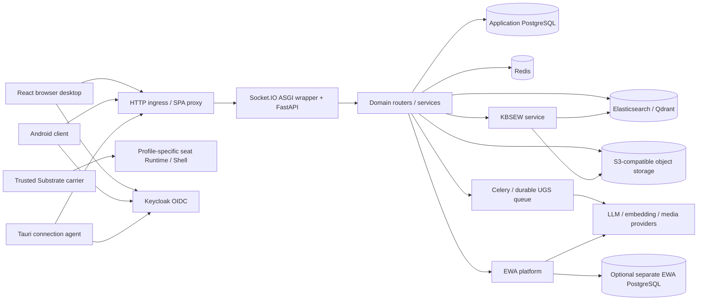

# Architecture traced to source code

Explanation · source inspection dated 2026-10-11. This map describes the checked-out code and its composition roots. It does not certify a running installation, physical hardware, cloud DNS, or the version deployed on any host. Production locations remain owned by [PRODUCTION-TOPOLOGY-STATE.md](PRODUCTION-TOPOLOGY-STATE.md).

## System boundary

EliteEW combines a shared Python application, a browser desktop, edition-specific entrances, and separately deployed infrastructure. Most product domains are routers and services inside the shared API process; a domain name does not imply an independent microservice. KBSEW is a separate FastAPI service. Olenti has a separate Express API and database contract. The public Next.js site has its own server-side lead endpoint.

The carrier payload is profile-specific: [Buildroot assembly](../../pack-organization/trusted-substrate/scripts/buildroot-build.sh) checks a generated Runtime/Shell overlay for `empiieros-shell`. Source recipes and a selected profile do not certify hardware acceptance.

The diagram compresses several protocols. Celery uses Redis; RabbitMQ is separately initialized for named application queues. UGS also has durable database queue execution. These are distinct mechanisms, not interchangeable broker names.

## Composition roots and responsibilities

- [API bootstrap](../../shared/api/main.py) creates FastAPI, installs middleware, calls domain registrars, defines health/error handlers, then exports the Socket.IO ASGI wrapper as `api.main:app`. Its comment requires one Uvicorn worker for this integration.
- [Domain registrars](../../shared/api/domains/) attach auth, creative, social, content, voice, BI/UGS/EWA, desktop, native client, professional-worlds, marketing and miscellaneous APIs. The chat registrar is an empty compatibility slot. The public Site Studio host gateway is inserted before ordinary routes.
- [Frontend entry](../../shared/web/frontend/src/main.tsx) chooses a lightweight follower tab or the full bootstrap. [Full bootstrap](../../shared/web/frontend/src/mainFullApp.ts) starts bounded authentication and loads i18n/React. [App state](../../shared/web/frontend/src/appState/) owns shared shell actions; product features live under `pages/`, `features/` and `components/`.
- [App manifests](../../shared/apps/) and [profile resolution](../../shared/api/services/desktop_app_manifests/runtime.py) describe application components and edition enablement. Profile selection does not install containers and does not replace API permissions.
- [Android](../../pack-cloud/mobile/settings.gradle.kts) is a Gradle multi-module entrance over shared contracts. [Tauri](../../pack-organization/connection-agent/src-tauri/Cargo.toml) owns native device, tunnel, entitlement and update capabilities.
- [KBSEW bootstrap](../../KBSEW/api/main.py) owns a separate database pool and durable ingestion-worker lifespan. Its Python package is also named `api`; run it with the KBSEW working directory, not the shared API import path.
- [Site templates](../../site-templates/olenti/server/src/index.ts), [public site](../../shared/web/site_prod/src/app/) and [host assets](../../host/README.md) have separate entry paths; see the [module map](../reference/SOURCE-MODULE-MAP.md).

## Request and data flows

An API request passes through the configured middleware, then a registered router and its dependencies. [OAuth2 middleware](../../shared/api/middleware/oauth2_protection.py) applies path-level protection; [OAuth2 dependencies](../../shared/api/core/oauth2_auth.py) resolve the authenticated user, session registry and native-access policy. Public middleware exemptions still depend on route-specific access rules. Admin, resource ownership, tenant/project scope and native seat checks are not equivalent permissions.

[DatabaseManager](../../shared/api/core/database_manager.py) owns shared PostgreSQL/asyncpg, SQLAlchemy sessions, Redis, Elasticsearch, S3-compatible storage and RabbitMQ clients. Domain services use those resources. PostgreSQL holds application records; S3 stores object bytes; search and vector clients serve separate indexes. Do not infer atomic transactions across PostgreSQL, S3 and search services.

The EWA composition root is [ewa_platform](../../shared/api/ewa_platform/README.md). [The HTTP facade](../../shared/api/ewa_platform/gateways/companion_http.py) mounts its routers under `/api/v1/ewa`. [The pool lifecycle](../../shared/api/ewa_platform/desktop/pool.py) opens a separate pool when `EWA_DATABASE_URL` is configured. An unset DSN leaves that pool `None`; it does not establish durable parity for every EWA feature. Marketing AMKA remains in [marketing services](../../shared/api/services/amka_core/) and the marketing-cabinet routes.

KBSEW ingestion endpoints enqueue records; [the worker](../../KBSEW/api/services/ingestion_worker.py) claims durable jobs. Drivers extract/chunk content, embedding requests produce vectors, and Qdrant stores the index. [Search](../../KBSEW/api/routers/search.py) returns text chunks and does not run ingestion. The [stack0 gateway](../../shared/api/routers/kbsew_gateway.py) exposes the service through the main API.

## Configuration and identity

[UnifiedConfig](../../shared/api/core/unified_config.py) is Pydantic settings backed by environment aliases; its model config does not declare automatic `.env` loading. Compose and startup scripts supply the process environment. [KBSEW settings](../../KBSEW/api/core/config.py) explicitly set `env_file=None`. A tracked `.example` file documents names and defaults; it is not the runtime secret store.

The browser uses Keycloak/OIDC through [authSession](../../shared/web/frontend/src/services/authSession.ts) and [auth bootstrap](../../shared/web/frontend/src/services/boot/authBootstrap.ts). Backend verification is delegated through [auth providers](../../shared/api/services/auth_provider_service.py); decoding unverified JWT claims alone is not authentication. See [Keycloak operations](docker-re_doc/KEYCLOAK-ELITEEW.md) and [frontend auth](../product/FRONTEND-AUTH.md).

Edition/profile conflicts fail through `InstallProfileConfigError`. Empty `ELITEEW_INSTALL_PROFILE` selects the default for `ELITEEW_PRODUCT_EDITION`. FoFline OAuth clients can select a narrower profile on the same cloud instance. Offline policy helpers describe an allowed subset; they do not promise full cloud availability without network or identity services.

## Errors, observability and lifecycle

The [global handlers](../../shared/api/main.py) distinguish validation errors (422), authentication/authorization (401/403), unavailable infrastructure (503) and unexpected faults (500). Authentication bodies use `reason`/`action`; some business-rule 403 bodies intentionally remain ordinary forbidden responses. KBSEW and the Next.js site have their own error formats. See [HTTP reference](../api/SOURCE-HTTP-REFERENCE.md).

Structured logging comes from [logging_config](../../shared/api/core/logging_config.py), with [token redaction](../../shared/api/utils/log_redaction.py) attached to logging handlers. `/metrics` exports Prometheus data through [monitoring helpers](../../shared/api/utils/monitoring.py). Public `/api/health` returns only `ok`; an authorized admin receives the fuller health view. `/api/v1/ping` is lightweight liveness. The bootstrap explicitly disables OpenTelemetry setup, so the existence of telemetry dependencies is not evidence of active tracing.

Startup initializes shared clients, optional EWA persistence, cache/audio helpers and RabbitMQ queues. `ELITEEW_REQUIRE_DB_AT_STARTUP` and `ELITEEW_REQUIRE_REDIS_AT_STARTUP` can turn missing infrastructure into startup failure. Site Studio can additionally require a worker heartbeat. Shutdown closes pools and HTTP sessions. [Celery configuration](../../shared/api/tasks/celery_app.py) defines worker lifecycle, queues and beat scheduling separately from the web lifespan; [queue_worker](../../shared/api/workers/queue_worker.py) is another entry point.

## Build, test and deployment

Dependency authorities are the frontend workspace/lockfile, API builder requirement inputs/locks, Android Gradle files and the Tauri Cargo/pnpm manifests. The minimal API `pyproject.toml` development extras are not the entire production dependency set. See [developer setup](DEVELOPER-SETUP.md).

[eliteew-pr-gate](../../.github/workflows/eliteew-pr-gate.yml) runs architecture integrity before hygiene and selected frontend regressions. [Mobile CI](../../.github/workflows/mobile-android-ci.yml) runs JVM tests, lint and active debug flavors. Other checked-in workflows cover selected editor/desktop/OpenAPI paths; their presence is not evidence of a successful recent run.

Hosted deployment uses the [deploy CLI](../../docker/scripts/eliteew-deploy.sh) and compose overlays. Build on command-center and run on prod-core, as required by repository policy. Baked and dev-bind stack0 lines are mutually exclusive. This audit did not execute deployment, migrations, service restarts or external health probes. See [infrastructure source guide](INFRASTRUCTURE-SOURCE-GUIDE.md).

## Related documents

- [API registration and domains](../api/API-ENTRY-POINTS-AND-DOMAINS.md)
- [Source contracts and validation limits](../api/SOURCE-HTTP-REFERENCE.md)
- [Source module map](../reference/SOURCE-MODULE-MAP.md)
- [Audit progress](../../docs/DOCUMENTATION_PROGRESS.md)
