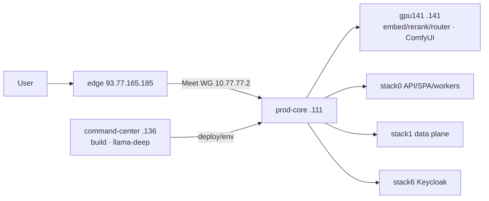

# Технический паспорт текущего состояния (EliteEW monorepo)

Living reverse-engineering passport of `powered_by_emperyworld`: architecture,
functional map, integrations, scale, SPOF, and architectural security surface.
Keep markdown **and** paired canvas current after every work wave/session.

**Status:** living technical passport — refresh after every work wave/session
(`skill eliteew-technical-passport-sync` / `/eliteew-technical-passport-sync`).
**As-of:** 2026-09-10 UTC · **HEAD:** `939079648` (bump on each sync)
**Paired canvas (must stay in lockstep):** Cursor IDE
`~/.cursor/projects/home-owned-powered-by-emperyworld/canvases/eliteew-technical-passport-2026-08-09.canvas.tsx`
**Living topology SoT:** [PRODUCTION-TOPOLOGY-STATE.md](PRODUCTION-TOPOLOGY-STATE.md) §Current
**Historical filename:** dated `…-2026-08-09.md` soft-retired; this stable path is SoT.

**Method:** repository tree, FastAPI domain registrars, compose stacks, oauth2
middleware, `unified_config`, git rev-list/shortlog. Refactor recommendations are
out of scope. Security registry = architectural attack surface, not vulnerability
scorecard.

**Excluded (operator TZ):** Velocity, Cycle Time, bug counts, defect density.

| Signal | Value |
|--------|-------|
| Shape | Monorepo · 1 `.git` |
| Chronology | 2774 commits · ~100 days since 2026-06-02 |
| Cloud | 4 hosts (prod-core, command-center, gpu141, edge) |
| API | 13 domains · 190 routers with `APIRouter` |
| Scale (approx.) | API ~568k LOC · FE ~900k LOC (excl. generated) · Android ~93k · SQL migrations 343 |

---

## 1. Архитектурное устройство

Фактическая топология модулей (не marketing roadmap).

### Living product surface

| Path | Role |
|------|------|
| `shared/api` | FastAPI 3.14 · domains → routers → services |
| `shared/web/frontend` | React SPA 4.1.1 · features + Desktop shell |
| `shared/apps` | 20 `app.manifest.yaml` · U1 mount registry (incl. `kursorina`) |
| `pack-organization/connection-agent` | Tauri TREE **0.5.37** · CHANNEL_MATRIX Linux RPM Connected/FoFline **lag 0.5.36** (pending OTA) / Windows lag **0.4.61** · SoT [DESKTOP-CLIENT-VERSION-SOT.md](../product/desktop/DESKTOP-CLIENT-VERSION-SOT.md) · product [DESKTOP-EBROWSER.md](../product/desktop/DESKTOP-EBROWSER.md) |
| `pack-cloud/mobile` | Gradle multi-module · OTA on `.111` |
| `KBSEW` | Separate service `:28030` · gateway `/api/v1/kbsew/*` |
| `site-templates/olenti` | Site Studio storefront pack |

### Ops / platform plane

| Path | Role |
|------|------|
| `docker/stack` | 30+ compose units · Podman-first |
| `docker/scripts` | 180+ top-level · 308 recursive `.sh` |
| `documentation/` | living canon only · agent SoT: [fixed-errors/](../reference/fixed-errors/README.md); solution-readiness = [retired stub](../reference/solution-readiness/README.md) |
| `keys/` | Host SSH/WG/tunnel keys (private gitignored) |
| `keycloak-import/` | Soft-retired local realm dump (`trash/`); living ops = `docker/scripts/keycloak-harden-empery-realm.sh` |
| `pack-organization/kiosk-fedora-iso/` | Kiosk image tooling (org door; gitignored) |
| `pack-organization/trusted-substrate/` | Trusted Substrate stub (from-source OS carrier); SoT [ELITEEW-TRUSTED-SUBSTRATE.md](../product/desktop/ELITEEW-TRUSTED-SUBSTRATE.md); factory not started |
| `trash/` | Soft-retired DEWA / EWGen / EWPower / EWC / EWCO / … |

### Cloud runtime hosts (canon §Current)

| Host | LAN / public | Role (fact) |
|------|--------------|-------------|
| prod-core | `192.168.1.111` | Public runtime: stack0, stack1, EWA PG, stack2/4/6/11/12, landing, OTA, KBSEW — no builds |
| command-center | `192.168.1.136` | Git, docs, env/SOPS, all builds, Phase 4 `llama-deep` `:8080`. Living ComfyUI is on **gpu141** (not this host). |
| gpu141 | `192.168.1.141` | embed `:8081` · rerank `:8082` · tool-router `:8083` · **living ComfyUI** `:31003` |
| edge VM | `93.77.165.185` | TLS nginx · Meet WG backhaul `10.77.77.2` (SSH reserve) · cloud-spa static `/srv/eliteew/cloud-spa/current` for `app.eliteew.ru` shell |

### API domain registrars (`shared/api/domains`)

| Domain | Responsibility (from registrar) |
|--------|----------------------------------|
| `auth` | Keycloak SSO, refresh, logout, mobile-embedded |
| `creative` | Image/Video/Music studios · Paperless · editors |
| `chat` | Empty slot — legacy `/api/ws*` soft-retired; Socket.IO in `main` |
| `social` | Friends, Social Hub, GAF chat, video calls (+ legacy `/api`) |
| `content` | Unified content CRUD/search/versions/shares (+ legacy `/api`) |
| `voice` | Stack9 TTS/STT, live voice WS, voice commands |
| `bi_ugs` | Business Intelligence + UGS generation |
| `desktop` | Shell, AI chat, Site Studio ops, KIRS, Poemma, admin |
| `desktop_client` | Tauri enroll/license/OTA/ops token paths |
| `professional_worlds` | Professional Worlds product API |
| `marketing` | Marketing Cabinet + AMKA surface (large mount set) |
| `site_studio_public` | Public storefront gateway (host-scoped) |
| `misc` | Diagnostics, floating widgets, version |

**Mount order in `main.py`:**
`site_studio_public` → `auth` → `creative` → `chat` → `social` → `content` →
`voice` → `bi_ugs` → `desktop` → `desktop_client` → `professional_worlds` →
`marketing` → `misc` · then `system_maintenance`.

---

## 2. Функциональная карта (факт из кода)

| Capability cluster | Evidence surface | Clients |
|--------------------|------------------|---------|
| Desktop shell + app store | `domains/desktop` · `apps/*.manifest` · `appMounts.registry` | SPA Desktop · Tauri |
| Assistant + discussion | `desktop_ai_chat*` routers · Celery `desktop_discussion` | SPA · admin |
| Assistant / agentic | `ewa_platform/companion` · gateways/routers · Celery `ewa_*` | SPA ewa · MobileEwaCompanion · ESP TFT (`esp-display/*`, device token) |
| Курсорина (investigation worker) | `services/kursorina` · `/api/v1/kursorina` · Celery `short` · library-first + Yandex web | Desktop `KursorinaApp` · SoT [KURSORINA.md](../product/desktop/KURSORINA.md) |
| Cursor agent gates (dev plane) | `.cursor/hooks` · fixed-errors consult · serial-session inject · Tauri F-01…F-13 (scoped) · language-bridge | IDE agents only — not runtime UX |
| UGS + BI | `domains/bi_ugs` · UGS services | SPA ugs · Mobile |
| Creative media (image/video/music) | `domains/creative` · ComfyUI on `.141` | SPA studios · MusicForge |
| Unified content + search | `unified_content*` · Qdrant/ES/Seaweed · post-upload **`verify_object_readable`** · owner **«Битые файлы»** + `contentManagerInitialTab=brokenFiles` · `document_thumbnail` (text/PDF JPEG on upload + GET lazy-heal; never heal `broken_quarantined`) | ContentManager · shares · Image Studio · Mobile CM lite |
| Marketing Cabinet / AMKA | `domains/marketing` · `features/amka` · `amka_core` | SPA MarketingCabinet |
| Site Studio (public + ops) | `site_studio_public` · `desktop_sites` · olenti templates | Public `*-site` hosts · admin ops |
| Social / Friends / GAF / Meet | `domains/social` · stack11 Jitsi · Socket.IO | SPA · Mobile · Meet |
| Voice (STT/TTS/live) | `domains/voice` · stack9 whisper/silero | Voice Center widgets |
| Auth / SSO registry | Keycloak stack6 · `sso_user_sessions` · clients web/mobile/desktop/fofline/api | All authenticated surfaces |
| Desktop client FoFline/Connected | `desktop_client` domain · W-transport · license redeem | Tauri NSIS/RPM · OTA |
| Mobile app + trusted device WG | MobileAndroid · `mobile_trusted_devices` · OTA `:29180` · list/player `/thumbnail` only via `allowsStoredThumbnailFetch` (`thumbnail_url` set) | Android |
| KBSEW knowledge barrels | `stack-kbsew` · `kbsew_gateway` | Desktop gateway |
| Doc editors (v1/v2/elite) | `doc_editor*` · `elite_editor` · Yjs store | SPA documentEditorV2 |

### Скрытые / legacy / не living

| Signal | Status (evidence) |
|--------|-------------------|
| DEWA, EWGen, EWPower, EWC, EWCO, SSFEW, nexus-root, access-gate, tg_bot | Under `trash/` · not living host roles |
| stack3 VictoriaLogs · stack5 SearXNG/Crawl4AI | Off / retired · compose+env templates remain |
| Chroma as primary vector | Marked legacy · Qdrant primary; chroma `ServiceConfig` still in `unified_config` |
| Legacy FastAPI `/api/ws*` | Soft-retired 2026-07-28 · chat domain empty |
| Dual mounts `/api` + `/api/v1` | content, social friends, marketing — backward-compat tags |
| `shared/web/landing` | Archived-in-tree · living landing = `site_prod` on `.111:29002` |
| `power.eliteew.ru` / `dewa.eliteew.ru` | Expected down after soft-retire (wontfix) |
| CI workflows `dewa-pr-gate` / `ewco-pr-gate` | Still present under `.github/workflows` |

---

## 3. Матрица зависимостей и интеграций

| System | Role | Coupling to stack0 API |
|--------|------|------------------------|
| PostgreSQL (stack1) | Primary app DB | Hard — `DatabaseManager` |
| EWA Postgres | EWA platform data plane | Hard — health slice |
| Redis | Cache · Celery broker · Socket.IO mgr | Hard |
| RabbitMQ | `queue_worker` jobs | Hard for async jobs |
| Qdrant | Vectors / semantic search / EWA | Hard for search/EWA |
| Elasticsearch | Content/index search | High |
| SeaweedFS (S3/MinIO API) | Object storage (`minio` SDK; no boto3 in venv) | Hard for media/content |
| Keycloak (stack6) | OIDC JWT issuer | Hard — auth gate |
| llama-chat (stack2 `.111`) | Chat LLM | High for AI features |
| llama-deep (`.136:8080`) | Deep job class (Phase 4 31B) | Medium — gated `LLAMA_DEEP_URL` / `EWA_DEEP_LLM_ENABLED` |
| gpu141 embed/rerank/router | Embeddings · tools | High for RAG/agentic |
| ComfyUI (`.141:31003`) | Image/music/video gen | High creative path on gpu141 |
| stack4 OCR/Tika/Paperless | Doc pipeline | Medium–high |
| stack9 whisper/silero | Voice | Medium (kill-switch exists) |
| stack11 Jitsi | Video meetings | Medium social |
| edge + Meet WG | Public TLS ingress; SPA static from edge cloud-spa disk in prod | Hard for public UX |
| Yandex Search API | Web search (replaces stack5) | Medium |
| KBSEW `:28030` | Knowledge service | Gateway-coupled |
| Socket.IO | Realtime presence/events | Hard for live UX |

### Data-flow skeletons (entry → store/output)

**A · Authenticated SPA / Desktop API**

Browser/Tauri → edge TLS → (static `/assets/*` from edge cloud-spa **or** WG proxy to `.111:29001` in full-proxy mode) → `/api/*` via WG → `.111:29000` → `OAuth2ProtectionMiddleware`
→ domain router → service → Postgres/Redis/Qdrant/Seaweed → JSON/SSE response.

**B · Long jobs (UGS / music / agentic)**

API accept → RabbitMQ `queue_worker` and/or Celery queues
(`short` | `ewa_agentic` | `ewa_companion` | `desktop_discussion`) →
ComfyUI/`.141` or llama/`.111` or gpu141 inference → status in PG/Redis →
client poll/SSE/Socket.IO. Курсорина missions enqueue on `short`
(`run_kursorina_mission`) → `kursorina_missions` poll.

**C · Public Site Studio**

`{slug}-site.eliteew.ru` → edge → `site_studio_public` gateway (host allow) →
public content APIs only (admin surfaces denied on site hosts by policy).

**D · SSO**

Client PKCE (`empery-web` | `mobile` | `desktop` | `fofline`) → Keycloak realm
`empery` → access token → API introspection/validate → `sso_user_sessions`
(no raw refresh in audit table).

---

## 4. Масштаб и сложность

| Metric | Value |
|--------|------:|
| API `.py` files | 2485 |
| FE `ts`/`tsx` files | 5463 |
| Files >800 LOC (API+FE) | 190 |

### Hotspots (generated OpenAPI noted separately)

| Lines | Path |
|------:|------|
| 4250 | `api/ewa_platform/settings/catalog_entries.py` |
| 4205 | `api/routers/doc_editor.py` |
| 3134 | `api/services/imperorg_service.py` |
| 2869 | `api/services/elite_editor/elite_orchestrator.py` |
| 2748 | `api/core/unified_config.py` |
| 2660 | `api/routers/marketing_cabinet/document_autofill.py` |
| 17k–12k | FE `generated/*-openapi.ts` (contract artifacts) |

ORM: `shared/api/models` (14 modules with `__tablename__`) · schemas: 67 pydantic
modules · migrations: SQL runner (no Alembic) · nested git: monorepo root only ·
contributors: poet + dependabot · last 100 commit subjects dominated by
fofline/desktop/client.

### Single points of failure (architecture)

| Component | Blast if down |
|-----------|---------------|
| prod-core `.111` | All public API/SPA/workers/data plane |
| stack1 Postgres | Auth sync + most product persistence |
| Keycloak stack6 | Login + JWT validation across clients |
| edge + Meet WG | Public HTTPS ingress (SSH reserve); cloud-spa static on edge VM |
| Redis | Celery broker, cache, Socket.IO manager |
| Celery beat (single) | Scheduled tasks stop |
| command-center `.136` | Builds, env push, `llama-deep` |
| gpu141 inference/media | Embed/rerank/tool-router and ComfyUI degrade |

---

## 5. Реестр критических архитектурных рисков безопасности

Поверхность атаки и контроль доступа — факты устройства, не scorecard
уязвимостей и не defect density.

| ID | Risk class | Architectural fact |
|----|------------|--------------------|
| R1 | Auth perimeter | Two-layer: `OAuth2ProtectionMiddleware` allowlist + route `Depends(require_oauth2_user)`. Public paths include health, auth, Socket.IO path, tickets, themes presets, desktop-client license redeem, Site Studio host branch, ESP TFT `esp-display/turn` + `esp-display/image` (device token enforced in router). |
| R2 | Alternate gates | Desktop-client ops routes use `X-Desktop-Client-Ops-Token` (not OIDC). ESP TFT uses `X-EliteEW-Esp-Display-Token` (not OIDC). Ticket/download ACL and Socket.IO connect JWT are separate from HTTP middleware JWT skip on `/socket.io/`. |
| R3 | Admin RBAC | No `require_role` symbol. Admin via `payload_has_admin_access` / `require_admin_user`; roles `{admin, emperyworld_admin, msi}` across resource clients `empery-api` \| `web` \| `mobile` \| `desktop` \| `fofline`. |
| R4 | Public host split | Site Studio public hosts must not expose admin/desktop APIs (policy in rules + `site_studio_public`). Mis-routing on edge would expand blast radius. |
| R5 | Secrets plane | Secrets via `unified_config` env Fields; plaintext staging on `.136`; prod-core runtime tmpfs. `keys/` holds host private keys (agent Read hard-blocked). No production password-assignment literal hits in non-test API scan. |
| R6 | SSO data | `sso_user_sessions` + audit events; migration comment: raw JWT/refresh never stored in audit. `RedactSensitiveLogFilter` + `opaque_token_ref` on token logs. |
| R7 | Legacy attack surface | Dual `/api` and `/api/v1` mounts; retired stack5/stack3 config remnants; soft-retired trees under `trash/` still on disk; historical `dewa-ops-*` script names remain as EliteEW helpers. |
| R8 | Realtime | Socket.IO ASGI mounted with Redis manager option; connect requires `validate_websocket_token` — middleware JWT skip is path-only. |
| R9 | Cross-host trust | API on `.111` calls ComfyUI and inference on `.141` over LAN; edge WG tunnels for public and portal/mobile peers — network allowlists are part of trust boundary. |
| R10 | Config concentration | `unified_config.py` ~2748 LOC owns `ServiceConfig` catalog including retired services — large config surface for mis-enablement. |
| R11 | Tauri product WebView IPC | Product capability is local + clipboard/notifications/native-audio + **EBrowser** `allow-ebrowser-*` (policy SoT fetch, chrome events, find/zoom; no `fs_bridge`); `fs_bridge_*` remains main-window ACL + `require_main_window`. Hub Start requires **main** `allow-license-preflight-cmd` / `allow-license-heartbeat-cmd` (must not be on `product.json`). Retail AppManifest omits `wg_*`. Residual: Authenticode/GPG (#003). public Linux RPM **0.5.36** (CHANNEL_MATRIX; TREE **0.5.37** pending OTA) (WebAuthn auto-POST block in `oidc-auth` still applies). |
| R12 | Content blob probe amplification | Empty `thumbnail_path` + mobile mime-probe historically hammered edge `GET …/thumbnail` (and Seaweed on miss). Mitigations: API `document_thumbnail` lazy-heal for regenerable types (not `broken_quarantined`); mobile `allowsStoredThumbnailFetch` — no `/thumbnail` / download fallback without `thumbnail_url`. |

---

## 6. Git / evidence anchors

### Repository chronology

| Item | Fact |
|------|------|
| Init | 2026-06-02 |
| Commits | 2774 |
| HEAD (snapshot 2026-09-10) | `939079648` — docs lockstep after EBrowser Waves P/U/O (then TREE **0.5.30** RPM OTA) + Connected SPA Wave U on temporary stack0 **dev-bind** (`deploy_id=1789004248070-tf0vu37o89`); base image still `prod-baked-20260910-0923`; return via `release stack0 --all` |
| Last 200 subject prefixes | feat 37 · fix 98 · docs 25 · chore 15 · ops 2 |

### Automation

| Area | Fact |
|------|------|
| CI | `eliteew-pr-gate`, `mobile-android-ci`, desktop e2e/eval, openapi pilots, residual dewa/ewco gates |
| Deploy | `eliteew-deploy.sh` release\|hotfix · baked A / dev-bind B · edge static `deploy-cloud-spa-to-edge.sh` after Line A |
| Env templates | 25 under `docker/env_file/*.example` |

---

## Related

- [PRODUCTION-TOPOLOGY-STATE.md](PRODUCTION-TOPOLOGY-STATE.md) — living cloud hosts/stacks
- [CLOUD-SPA-EDGE-STATIC.md](CLOUD-SPA-EDGE-STATIC.md) — edge static shell + deploy_id parity
- [DOCKER-STACKS-PROD-OVERVIEW.md](DOCKER-STACKS-PROD-OVERVIEW.md) — compose stack map
- [ELITEEW-PRODUCT-EDITIONS-AND-APP-PLATFORM.md](ELITEEW-PRODUCT-EDITIONS-AND-APP-PLATFORM.md) — editions + Kernel/App
- [ENGINEERING-GOVERNANCE-MANIFESTO.md](ENGINEERING-GOVERNANCE-MANIFESTO.md) — shotgun / LOC budgets
- [API-INFRASTRUCTURE.md](API-INFRASTRUCTURE.md) — `DatabaseManager` ownership
- [docker-re_doc/KEYCLOAK-ELITEEW.md](docker-re_doc/KEYCLOAK-ELITEEW.md) — OIDC clients
- [REALTIME-SOCKETIO-AND-WS.md](REALTIME-SOCKETIO-AND-WS.md) — Socket.IO contract
- [../reference/fixed-errors/README.md](../reference/fixed-errors/README.md) — product defect registry (agent)
- [AGENT-SERIAL-SESSION.md](AGENT-SERIAL-SESSION.md) — serial Cursor session hygiene
- [../reference/solution-readiness/README.md](../reference/solution-readiness/README.md) — retired stub (was READY gate)

**Residual:** keep As-of/HEAD/metrics current via passport-sync after each wave.
LOC counts are approximate unless remeasured in the sync skill.
Docs hygiene Volna1–13 + root-dump sweep (2026-08-13): EliteEW root realtor/Ultimate mirrors, EWDesk batch drafts, migration audit dumps, landing IMPROVEMENTS soft-retired → `trash/`; realtor living notes under `documentation/product/professional-worlds/`. Ассистент `026` Workbench atomized (facade ≤780). Living Current OTA: public Linux RPM **0.5.36** (CHANNEL_MATRIX; TREE **0.5.37** pending OTA) (EBrowser P/U+). Historical 2026-09-10 ship was **0.5.30** seq 90/92. Next hygiene: only soft-retire when a living successor exists and program is Done.
