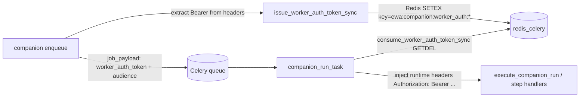

# Assistant Queue Auth Token Flow

Канон для безопасной передачи авторизации в фоне companion jobs (Celery) после remediation S2.

## Зачем это нужно

Ранее `job_payload` мог содержать `Authorization: Bearer ...` и попадать в очередь в сыром виде.  
Теперь брокерный payload хранит только короткоживущий opaque token reference, а реальный Bearer извлекается worker-ом ровно в момент исполнения.

## Границы контракта

- Scope: `api/ewa_platform/companion/jobs/enqueue.py`, `api/ewa_platform/workers/companion_task_runner.py`, `api/ewa_platform/companion/jobs/step_handlers.py`, `api/ewa_platform/companion/jobs/worker_auth_token.py`.
- Не меняет HTTP-контракт клиента companion chat.
- Не заменяет Keycloak/SSO; это только transport-hardening внутри очереди.

## Поток данных

## Формат payload в очереди

После enqueue:

- `worker_auth_token`: opaque reference (`token_urlsafe`)
- `worker_auth_audience`: `ewa.companion.celery.worker`
- `headers`: удаляется из payload (если Bearer был обнаружен)

Если Bearer не обнаружен, legacy-ветка допускается (для обратной совместимости), но должна считаться техническим долгом.

## Инварианты безопасности

1. **TTL-bound token:** значение живёт ограниченное время (`EWA_COMPANION_WORKER_AUTH_TTL_SECONDS`, clamp 30..3600 сек).
2. **One-time consume:** worker пытается `GETDEL`; fallback `GET + DELETE` для совместимости Redis.
3. **Binding checks:** перед возвратом Bearer сверяются `run_id`, `principal_id`, `audience`.
4. **Queue payload hygiene:** сырой Bearer не должен сохраняться в `job_payload`.

## Конфигурация

| Переменная | По умолчанию | Назначение |
| --- | --- | --- |
| `EWA_COMPANION_WORKER_AUTH_TTL_SECONDS` | `900` | TTL opaque worker token |
| `CELERY_REDIS_DB` | `0` | Redis DB для токена (через `get_redis_url`) |

## Ошибки и поведение

- Token не найден/протух/не совпал binding:
  - `worker_auth_error=token_invalid_or_expired` в resolved payload,
  - step может завершиться ошибкой `companion_worker_auth_invalid(_or_expired)`.
- Redis недоступен при issue:
  - enqueue возвращает `None` (задача не ставится), логируется причина.

## Наблюдаемость (логи)

Базовые маркеры:

- `[STEP] companion_worker_auth_issued`
- `[STEP] companion_job_enqueue_worker_auth`
- `[STEP] companion_worker_auth_resolved`
- `[STEP] companion_worker_auth_consume_failed`
- `[STEP] companion_worker_auth_binding_mismatch`
- `[STEP] companion_worker_auth_legacy_payload_detected`

## Smoke-check после деплоя

1. Запустить background companion run (`music_generation_*` или image background).
2. Проверить, что enqueue прошёл через `companion_job_enqueue_worker_auth`.
3. Убедиться, что worker резолвит токен (`companion_worker_auth_resolved`) и run не падает по auth.
4. Проверить отсутствие raw Bearer в диагностике payload очереди.

## Связанные документы

- `product/ewa/EWA-COMPANION-MUSIC-GENERATION.md`
- `documentation/plans/product/ewa/EWA-COMPANION-BACKGROUND-ORCHESTRATION-MASTER-PLAN.md` *[operator-local process plan; gitignored — not living canon]*
- `platform/OBSERVABILITY-SLO-AND-INCIDENTS.md`
