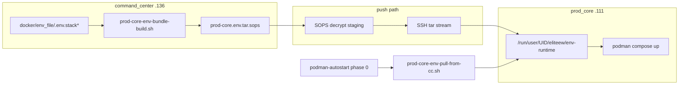

# Prod-core Config Plane

**Тип:** How-to + Reference + Explanation (Diátaxis)
**Статус:** канон Wave 4+ follow-up (2026-06-16)
**Аудитория:** оператор command-center (`.136`), on-call, агенты Cursor

## Summary

После cutover на **baked images** исходники EliteEW на prod-core (`.111`) не нужны, но **секреты и env** по-прежнему требуются для `podman compose`. Wave 4 убирает **постоянный plaintext** с диска `.111`:

| Слой | Хост | Путь / артефакт | Примечание |
|------|------|-----------------|------------|
| **At-rest (encrypted)** | `.136` | `docker/env_file/bundles/prod-core.env.tar.sops` | коммитится в git (шифротекст) |
| **Plaintext staging** | `.136` only | `docker/env_file/.env.stack*` | редактирование, ротация; не rsync на `.111` |
| **Runtime** | `.111` | `$XDG_RUNTIME_DIR/eliteew/env-runtime` | tmpfs; живёт до logout/reboot |
| **Legacy (deprecated)** | `.111` disk | `docker/env_file/` plaintext | убрать в `trash_clear/` (оператор) |

**Источник правды:** command-center (`.136`).
**Управление (living):** CLI-скрипты `docker/scripts/eliteew-prod-core-env-*.sh` и `prod-core-env-*.sh` (env names may still use `DEWA_OPS_*` / `DEWA_*` for compat — EliteEW helpers, **not** a live DEWA app).
**Retired UI:** DEWA вкладка **Конфиг** (`:4180`, `dewa.eliteew.ru`) soft-retired with DEWA tree → `trash/`; do not treat as required operator path.
**Не в scope Wave 4:** Podman secrets (Wave 5), Vault/Doppler.

См. также: [docker-re_doc/PROD-CORE-MIGRATION-BAKED-IMAGES.md](docker-re_doc/PROD-CORE-MIGRATION-BAKED-IMAGES.md), [docker-re_doc/SECRETS-ROTATION.md](docker-re_doc/SECRETS-ROTATION.md), [PRODUCTION-TOPOLOGY-STATE.md](PRODUCTION-TOPOLOGY-STATE.md).

---

## Архитектура



### Инварианты (жёстко)

| Правило | Детали |
|---------|--------|
| **Никогда не отдавать значения секретов в HTTP** | Historical DEWA `/api/prod-config/*` was metadata-only (presence, `key_count`, mtime, `storage_mode`) — **без values**. Living path is CLI on `.136` (no public prod-config UI). |
| **Operator privilege** | Env push / validate / encrypt — operator shell on command-center with SOPS age key; no public DEWA RBAC gate |
| **Reboot-safe** | `eliteew-podman-autostart` на `.111` **не стартует** стеки без успешного env-pull; после pull — `ensure-baked-env-from-containers` (STACK0/2/4 `*_BAKED_IMAGE` из existing/exited контейнеров) |
| **Baked deploy** | `prod-core-deploy-lib.sh` патчит baked tags в **runtime** env, не legacy disk |
| **Env-push preserve** | `eliteew-prod-core-env-push.sh` snapshot/restore deploy-only bake keys (`prod_core_env_*_runtime_deploy_keys`) — SOPS bundle часто **не** содержит `STACK0_*_BAKED_*` / `STACK4_*_BAKED_*` |
| **Staging bake sync** | After successful `eeprodbaked` / `eeprodruntime`, `prod_core_env_sync_*_bake_keys_to_staging` writes bake tags into `.136` `docker/env_file/.env.stack*`. Rebuild SOPS (`prod-core-env-bundle-build.sh` + encrypt) so the next push carries keys without container infer. |
| **Fail-closed** | Нет bundle / нет age key / pull failed → стеки не поднимаем «вслепую» |

---

## Config vs secrets

| Класс | Примеры переменных | Wave 4 |
|-------|-------------------|--------|
| **CONFIG** | `API_HOST_PORT`, `STACK0_*_BAKED_*`, `STACK2_LLAMA_MODELS_PATH`, bind hosts | в bundle; может попадать в deploy-tree как **примеры** (`.example`) |
| **SECRETS** | `POSTGRES_PASSWORD`, `KEYCLOAK_CLIENT_SECRET`, `RABBITMQ_PASSWORD`, JWT keys, `MINIO_*` | только SOPS bundle → runtime tmpfs |

В `.env.stack0.backend.example` секции `# CONFIG` / `# SECRETS` — ориентир для оператора при правках на `.136`.

### stack0 role layers (staging on `.136`)

SSOT for edits and compose interpolation remains **`.env.stack0.backend`** (`podman compose --env-file …`).

Container injection is **role-split** (generated, not edited by hand):

```bash
bash docker/scripts/stack0-env-materialize-roles.sh
```

`stack0-env-materialize-roles.sh` preserves **multiline double-quoted values** (OpenSSH PEMs for mobile/portal edge sync). Do not hand-edit `.env.stack0.{shared,api,jobs}`.

| Generated file | Mounted by |
|----------------|------------|
| `.env.stack0.shared` | all stack0 backend services |
| `.env.stack0.api` | `eliteew-api-prod`, `eliteew-api-preflight` |
| `.env.stack0.jobs` | queue-worker, site-studio-worker, celery* + beat |

API-only class includes Keycloak/OIDC client secrets, `DESKTOP_CLIENT_BINDING_SPI_TOKEN`, FCM, trusted-device SMTP/WG client publish keys (except server **public** key). The binding token is duplicated only into stack6 Keycloak and stack0 API role; workers do not receive it. Jobs-only includes Playwright/browser-render, Site-Edge Carrier, and **mobile edge SSH private key** + **WG server private key**. Mobile tunnel **automation flags** (`MOBILE_PRIVATE_TUNNEL_EDGE_SYNC_ENABLED`, SSH host/user/timeouts, interface, keepalive, reconcile interval) and `MOBILE_TRUSTED_DEVICE_WG_SERVER_PUBLIC_KEY` materialize to **shared** so API can enqueue Celery after bind without holding the edge SSH PEM, and Celery can verify `expected_pub`. Unknown keys default to **shared**.

**Invariant:** any `UnifiedConfig` field that is **required without default** (`Field(...)`) must land in **shared** (or be present in every role mount). Workers/celery mount `shared`+`jobs` only — putting such keys in API-only (e.g. former `MARKETING_CABINET_ROUTER_MODEL`) causes restart loops (`ValidationError: Field required`).

Additionally, secrets that workers need because of **import side-effects** (Celery → desktop/marketing → `KeycloakService`) are forced into shared via `SHARED_FORCE` in `stack0-env-materialize-roles.sh` (`KEYCLOAK_CLIENT_SECRET`, `JWT_SECRET_KEY`, `OIDC_PROVIDER_CLIENT_SECRET`).

**Bundle (this wave):** packs only `.env.stack0.backend` (and other stack env files). On install (`prod-core-env-install-runtime.sh`) role slices are **materialized into runtime tmpfs** and symlinked under `docker/env_file/` for compose. After SSOT edits on `.136`: run `bash docker/scripts/stack0-env-materialize-roles.sh`, then rebuild+encrypt SOPS and `env-push` before stack0 recreate.

---

## Состав bundle (prod-core)

| Файл в bundle | Stack / назначение |
|---------------|-------------------|
| `.env.stack0.backend` | stack0 SSOT (API + workers + Celery); role slices materialize on staging |
| `.env.stack1` | Postgres, Redis, RabbitMQ, Qdrant, SeaweedFS, … |
| `.env.stack2` | llama-chat |
| `.env.stack4` | OCR / Tika / Paperless |
| `.env.stack6` | Keycloak |
| `.env.stack-ewa` | EWA Postgres |
| `.env.stack11` | Jitsi |
| `.env.stack12` | internal DNS (CoreDNS) |
| `.env.yandex-tunnel` | reverse SSH tunnel |

Список в коде: `PROD_CORE_ENV_BUNDLE_FILES` в `docker/scripts/prod-core-env-lib.sh`.

---

## One-time setup (command-center `.136`)

### 1. Инструменты `age` + `sops`

На Fedora (или аналог):

```bash
# вариант A: пакет age + бинарник sops в ~/.local/bin
sudo dnf install -y age
curl -fsSL -o ~/.local/bin/sops \
  "https://github.com/getsops/sops/releases/download/v3.9.4/sops-v3.9.4.linux.amd64"
chmod +x ~/.local/bin/sops
```

Проверка: `age --version`, `sops --version`.

### 2. Age key (только на `.136`)

```bash
mkdir -p ~/.config/sops/age
age-keygen -o ~/.config/sops/age/keys.txt
chmod 600 ~/.config/sops/age/keys.txt
age-keygen -y ~/.config/sops/age/keys.txt   # публичный recipient
```

- **Приватный ключ** — `~/.config/sops/age/keys.txt` (**не в git**). Сделать **офлайн-бэкап** (см. [SECRETS-ROTATION.md](docker-re_doc/SECRETS-ROTATION.md)).
- **Публичный recipient** — в `docker/env_file/bundles/.sops.yaml` (можно коммитить).

Важно: `path_regex` в `.sops.yaml` должен совпадать с **plaintext** tar:

```yaml
creation_rules:
  - path_regex: prod-core\.env\.tar$
    age: >-
      age1....   # ваш публичный recipient
```

### 3. Первый bundle и encrypt

```bash
cd <repo>
bash docker/scripts/prod-core-env-bundle-build.sh
bash docker/scripts/prod-core-env-sops-encrypt.sh
git add docker/env_file/bundles/prod-core.env.tar.sops   # при изменении секретов
```

### 4. SSH prod-core (`.111`) → command-center (`.136`)

Autostart вызывает `prod-core-env-pull-from-cc.sh` на `.111`. Нужны:

1. **firewalld на `.136`:** tcp/22 с `192.168.1.111`
2. **SSH key** на `.111` (`~/.ssh/id_ed25519`), pubkey в `authorized_keys` на `.136`
3. **`~/.ssh/config` на `.111`:** host alias `command-center` → `192.168.1.136` (LAN)

**Обратный путь (deploy с `.136`):** SSH к prod-core по **LAN** — `Host prod-core` → `192.168.1.111` / `DEWA_OPS_PROD_CORE_SSH`. Former 2.5G `10.255.136.0/24` retired — [PRODUCTION-TOPOLOGY-STATE.md](PRODUCTION-TOPOLOGY-STATE.md) §Current.

Автоматизация (запуск на **`.136`**):

```bash
bash docker/scripts/install-prod-core-env-pull-access.sh
```

Smoke с **`.111`**:

```bash
bash docker/scripts/prod-core-env-pull-from-cc.sh --dry-run
bash docker/scripts/prod-core-env-pull-from-cc.sh
```

### 5. Скрипты на `.111`

После обновления репозитория на prod-core:

```bash
bash docker/scripts/sync-prod-core-deploy-tree.sh owned@prod-core
# включает prod-core-env-*.sh, podman-autostart-prod-core.sh, prod-core-deploy-lib.sh
```

---

## Env contract

```bash
ELITEEW_ENV_RUNTIME_DIR="${XDG_RUNTIME_DIR:-/run/user/$(id -u)}/eliteew/env-runtime"
# compose читает, например:
# ${ELITEEW_ENV_RUNTIME_DIR}/.env.stack0.backend
```

| `storage_mode` (DEWA / probe) | Значение |
|------------------------------|----------|
| `sops_at_rest` | `.136`: есть `.tar.sops` (+ age key) |
| `runtime_tmpfs` | `.111`: env в tmpfs (целевое состояние) |
| `legacy_disk` | `.111`: plaintext в `docker/env_file/` (миграция) |
| `missing` | нет `.env.stack0.backend` ни в runtime, ни на диске |

Резолвер: `prod_core_env_resolve_dir()` — runtime приоритетнее legacy (с `WARN`).

---

## Скрипты (справочник)

| Скрипт | Где запускать | Назначение |
|--------|---------------|------------|
| `prod-core-env-bundle-build.sh` | `.136` | tar из `docker/env_file/.env.stack*` → `bundles/prod-core.env.tar` |
| `prod-core-env-sops-encrypt.sh` | `.136` | encrypt → `prod-core.env.tar.sops` |
| `prod-core-env-sops-decrypt.sh` | `.136` | decrypt во временный каталог |
| `eliteew-prod-core-env-push.sh` | `.136` | decrypt → SSH tar → tmpfs на `.111`; `--validate-only`, `--yes`, `--plaintext-bundle` |
| `prod-core-env-pull-from-cc.sh` | `.111` | pull bundle с `.136` → tmpfs (autostart); `--dry-run` |
| `prod-core-env-install-runtime.sh` | `.111` | разложить tar в `ELITEEW_ENV_RUNTIME_DIR` |
| `prod-core-env-lib.sh` | source | пути, `storage_mode`, список файлов bundle |
| `podman-autostart-prod-core.sh` | `.111` | **phase 0:** env-pull (fail-closed), затем стеки |
| `start-prod-core-stacks.sh` | `.111` | `ENV_DIR` через `prod_core_env_resolve_dir` |
| `prod-core-deploy-lib.sh` | `.111` / remote | patch baked tags в runtime env |
| `eliteew-stack0-baked-deploy.sh` | `.136` | после export образов — env push (флаг `--skip-env-push`) |
| `sync-prod-core-deploy-tree.sh` | `.136` | доставка env/autostart скриптов на `.111` |
| `install-prod-core-env-pull-access.sh` | `.136` | firewalld ssh + SSH key `.111`→`.136` |

---

## Operator surface (CLI; DEWA UI retired)

Living Config Plane is **CLI on command-center**. Historical DEWA Config UI (`http://127.0.0.1:4180/#tab=config`, `https://dewa.eliteew.ru/#tab=config`) and DEWA HTTP `/api/prod-config/*` are soft-retired with the DEWA tree — do not treat as required living services or smoke gates.

### CLI operations (canonical)

| Action | Scope | Команда |
|--------|-------|---------|
| Validate bundle | `.136` | `bash docker/scripts/eliteew-prod-core-env-push.sh --validate-only` (includes `ewa-env-dsn-parity.sh` for `.env.stack-ewa` vs `EWA_DATABASE_URL`) |
| Push env → prod-core tmpfs | `.136` → `.111` | `bash docker/scripts/eliteew-prod-core-env-push.sh --yes` |
| Pull smoke (dry) | `.111` | `bash docker/scripts/prod-core-env-pull-from-cc.sh --dry-run` |
| Build / encrypt bundle | `.136` | `prod-core-env-bundle-build.sh` + `prod-core-env-sops-encrypt.sh` |

After env push: recreate only when runtime is in sync; for gpu141 image/env drift use `bash docker/scripts/start-gpu141-embed-rerank.sh` / runtime deploy path from command-center (not DEWA CTA `eedeploy/gpu141-workers-deploy`).

---

## Типовые сценарии оператора

### A. Изменить env / ротировать секрет

1. На `.136` править plaintext `docker/env_file/.env.stack*` (не `scp` plaintext на `.111`).
2. `bash docker/scripts/prod-core-env-bundle-build.sh` затем encrypt (`prod-core-env-sops-encrypt.sh`).
3. `bash docker/scripts/eliteew-prod-core-env-push.sh --validate-only`.
4. `bash docker/scripts/eliteew-prod-core-env-push.sh --yes` — runtime tmpfs на `.111`.
5. Если push failed: **не** recreate; повторить push.
6. При `container` drift после успешного sync — recreate затронутых стеков через `eectl` / `bash docker/scripts/eliteew-deploy.sh release stack0 --all` / `eeprodruntime` по playbook.
7. **Pitfall (2026-07-28):** staging `.env.stack0.backend` can say `SILERO_SERVICE_URL=http://stack9-silero:8000` while the **encrypted** `prod-core.env.tar.sops` still has `stack9-cosyvoice3` — runtime follows the **bundle** after push. Always rebuild+encrypt before push when TTS URL / CosyVoice↔Silero contour changes; then recreate stack0 backend so containers re-read env.
7b. **Pitfall (2026-09-21):** planting `EMPIERO_OS_OTA_ARTIFACT_PK` (64 lowercase hex, verify PK only — never the artifact SK) in staging does not reach `stack0-eliteew-api-prod-baked` until the SOPS bundle is rebuilt+encrypted and `eliteew-prod-core-env-push.sh --yes` updates `.111` tmpfs. Then recreate `eliteew-api-prod` with `stack0_b.prod-baked.override.yml` (`--no-deps` is enough for this env). Unknown stack0 keys materialize into `.env.stack0.shared` (API mounts shared+api). Do not use `--plaintext-bundle`. Env-push is not EmpiierOS MATCH.
7. Для `.141` health/drift: `ssh gpu141 'curl -sf http://127.0.0.1:8081/health && …:8082 && …:8083'` затем recovery/deploy scripts.
8. Закоммитить обновлённый `prod-core.env.tar.sops` (если политика репозитория требует).

### B. Baked deploy stack0

Канон release: `bash docker/scripts/eliteew-deploy.sh release stack0 --all` (optional `--yes`; optional `--refresh-openapi-pilots`). Implementer `eliteew-stack0-baked-deploy.sh` / alias `eeprodbaked` may env-push after image export; dry-run: `--skip-env-push`. Agents must not use `--frontend-only` / `--backend-only`. Bake image names follow this release `BAKED_TAG` (eeprodbaked unsets leftover `STACK0_*_BAKED_IMAGE`; restore host `HOME` if shell leaked `HOME=/tmp` before SOPS).

**Compose на prod-core и runtime env:** сервисы в compose YAML ссылаются на per-container `env_file: ../env_file/.env.*`. На `.111` plaintext env **не** лежит на диске — только tmpfs. После env pull/install `prod_core_env_ensure_legacy_symlinks()` создаёт **symlink для каждого файла bundle** (`PROD_CORE_ENV_BUNDLE_FILES`) в `docker/env_file/` → runtime tmpfs. Старые plaintext файлы в `docker/env_file/` на `.111` мешают symlink — перенести в `trash_clear/` оператором.

**podman-compose 1.x на `.111`:** не поддерживает `${VAR:-default}` в volume mounts и не раскрывает `${SITE_STUDIO_PODMAN_UID}` в путях mount — см. таблицу блокеров в [PROD-CORE-MIGRATION-BAKED-IMAGES.md](docker-re_doc/PROD-CORE-MIGRATION-BAKED-IMAGES.md) § Пошаговый конвейер.

### C. Проверка после reboot `.111`

```bash
# на .136
bash docker/scripts/eliteew-migration-command-center.sh reboot-gate all
```

Evidence: autostart phase `env-pull` OK → phase `ensure-baked-env-from-containers` OK → `podman ps` → `curl -sf http://127.0.0.1:29000/api/health` на `.111` **без** ручного `scp`.

Если после env-push на живом хосте пропали `STACK0_*_BAKED_IMAGE`: `eeprodline ensure-baked-env --yes` (или повторный push с актуальным `prod-core-env-lib.sh` — restore из предыдущего tmpfs). После bake/runtime deploy staging на `.136` уже патчится автоматически — для cold-boot без контейнеров: rebuild+encrypt SOPS bundle и push. Regression: `bash docker/scripts/verify-prod-core-env-preserve-selftest.sh`.

### D. Fallback Level A (до SOPS cutover)

`eliteew-prod-core-env-push.sh --plaintext-bundle` — plaintext tar с предупреждением в логах. Только аварийно; не целевое состояние.

---

## Миграция с legacy `scp` на `.111`

Чеклист (вручную, не автоматом):

1. [ ] SOPS + age на `.136`; recipient в `.sops.yaml`.
2. [ ] `eliteew-prod-core-env-push.sh --yes` — rollup **Норма**, prod-core `runtime_tmpfs`.
3. [ ] Smoke: API `:29000/health`, frontend `:29001`, ключевые стеки.
4. [ ] `sync-prod-core-deploy-tree.sh` — compose + prod-core ops scripts на `.111` (без api/dist/documentation).
5. [ ] SSH `.111` → `.136` для autostart pull.
6. [x] Legacy plaintext env на `.111` — в `trash_clear/` (оператор удаляет после smoke).
7. [ ] `reboot-gate` — autostart без ручного env.
8. [ ] CLI validate/push: prod-core `runtime_tmpfs` (не `legacy_disk`).

### `trash_clear/` на `.111` (оператор удаляет вручную)

На prod-core при **baked images** не нужны исходники API/SPA, legacy plaintext env, кэш stack9 TTS (stack9 не является autostart baseline; voice contour включается только по отдельной политике/runbook, API монтирует только `voice_*.json`).

После smoke всё лишнее складывается в `trash_clear/` (агент **не** `rm -rf`):

```bash
# когда убедитесь что health OK и после reboot-smoke:
du -sh <repo>/trash_clear
rm -rf <repo>/trash_clear
```

Типичное содержимое `trash_clear/` (~8.5G):

| Путь в trash | Зачем убрали |
|--------------|--------------|
| `shared/api/` | код в baked-образах |
| `shared/web/` | `dist-build` + dev-файлы в образе frontend |
| `docker/data/stack9/qwen3-tts/cache` | не нужен для baked baseline; voice/stack9 включать только по отдельной политике |
| `docker/env_file/.legacy-backup-*`, `documentation-host/` | plaintext env; handbook — bake в образ |
| `docker/builders/stack0-frontend/Dockerfile*` | build-time на `.136`; на `.111` — только `docker-entrypoint-csp.sh` |
| `root-stray/` (`appBuildId.ts`, `EwaCompanionChatPanel.tsx`, …) | артефакты ошибочного rsync |
| `home/` | вложенный дубль пути `home/owned/...` |
| legacy duplicates of mobile release helpers outside `docker/scripts/` and `docker/stack/` | mobile OTA **is** a prod-core artifact; keep canonical `docker/scripts/mobile-release-stack.sh` and `docker/stack/stack-mobile-release.yml` on `.111` for `stack-mobile-release` local `:29180` |

**Оставить на `.111`:** `docker/stack`, `docker/scripts` (prod-core ops), `docker/data/stack1|stack11|…`, `docker/builders/stack0-frontend/docker-entrypoint-csp.sh`, `local/binaries/` (mobile OTA + API `/app/mobile-release` bind), `site-templates/`, `host/comfyui`, `host/generated_files`, `keys/yandex_tunnel_key`. Assistant KB — **в baked API-образе**, не на диске `.111`.

**Старые podman-образы** (десятки GB) — отдельно от `trash_clear/`:

```bash
# на .111 — оставить только активный тег prod-baked-20260614-2232 и prod-runtime-20260615-1325
podman images --format '{{.Repository}}:{{.Tag}}' | grep eliteew | grep -v '20260614-2232\|20260615-1325' | head
# после проверки: podman rmi <старые теги>  # вручную, по одному или prune
```

**Не удалять** на `.136` — там источник правды `docker/env_file/` и SOPS bundle.

---

## Устранение неполадок

| Симптом | Вероятная причина | Действие |
|---------|-------------------|----------|
| `REPLACE_WITH_AGE_RECIPIENT` / encrypt fail | не настроен `.sops.yaml` | `age-keygen -y` → правка `.sops.yaml` |
| `no matching creation rules` | неверный `path_regex` | regex на `prod-core\.env\.tar$` |
| `sops not in PATH` | не установлен sops | см. § One-time setup |
| Push: `prod-core-env-lib.sh: No such file` | старый deploy-tree на `.111` | `sync-prod-core-deploy-tree.sh` |
| Push: `tar: not tar archive` | bug heredoc+pipe (исправлено) | обновить `eliteew-prod-core-env-push.sh` |
| Autostart не поднимает стеки | нет сети `.111`→`.136` или нет SSH key | fail-closed by design; починить сеть/ключ; затем ручной push |
| `legacy_disk` / plaintext on `.111` | plaintext ещё на диске `.111` | push + убрать legacy backup → `trash_clear/` |
| `missing` на prod-core | tmpfs пуст после reboot | env-pull или push с `.136` |
| Push failed after env edit | source/bundle обновлены, runtime tmpfs не обновился | повторить runtime push; recreate запрещён до sync |

Логи: `journalctl --user -u eliteew-podman-autostart` на `.111`; push script stdout on `.136`.

---

## Wave 5 — Podman secrets (lifecycle via CLI)

**Что реализовано (2026-06-16):**

- Lifecycle flags on `docker/scripts/eliteew-prod-core-env-push.sh`:
  - `--podman-secrets-plan`
  - `--podman-secrets-apply`
  - `--podman-secrets-verify`
- Historical DEWA inventory that computed `secret_backend`/`migration_status` from `podman secret ls` is soft-retired with DEWA → `trash/`; use CLI verify flags above.

**Текущая naming-конвенция stack-level secrets:**

- `eliteew_stack0_env`
- `eliteew_stack1_env`
- `eliteew_stack2_env`
- `eliteew_stack4_env`
- `eliteew_stack6_env`
- `eliteew_stack_ewa_env`
- `eliteew_stack11_env`

**Важно:** Wave 5 добавляет lifecycle/machine-evidence via CLI; runtime stack0/stack1 по-прежнему использует tmpfs env-файлы. Полная compose `secrets:` миграция остаётся отдельным шагом.

---

## Следующие шаги (рекомендуемый порядок)

### P0 — закрыть cutover на `.111`

| # | Задача | Статус (2026-06-15) |
|---|--------|---------------------|
| 1 | SSH autostart `.111`→`.136` | **Done** — `install-prod-core-env-pull-access.sh`, pull smoke OK |
| 2 | Убрать legacy plaintext / лишнее на `.111` | **В `trash_clear/`** — оператор `rm -rf` после smoke |
| 3 | Reboot-gate + evidence | **Частично** — `smoke` OK; reboot на `.111` = `reboot_manual_required` (sudo/challenge) |
| 4 | `sops` в PATH на `.136` | **Done** — `~/.local/bin` + `~/.config/environment.d/99-eliteew-tools.conf` |

### P1 — эксплуатация

5. **Документировать age backup** в офлайн-хранилище; проверить восстановление decrypt на staging.
6. **Обновить** [PROD-CORE-MIGRATION-BAKED-IMAGES.md](docker-re_doc/PROD-CORE-MIGRATION-BAKED-IMAGES.md) — **Done** (Config Plane, handbook bake, deploy-tree).
7. **Опционально:** encrypted bundle cache на `.111` для reboot без сети (не plaintext) — отдельная задача.

### P2 — Wave 5+

8. **Podman secrets migration** — **Done (Wave 5 lifecycle)**; полная `compose secrets:` интеграция остаётся отдельным follow-up.
9. **gpu141 env plane** — health/smoke on `:8081/:8082/:8083`; полноценный env push на `.141` остаётся отдельной волной.
10. **Автоматическая ротация секретов** — out of scope for UI; остаётся `regenerate-env-secrets.py` + manual encrypt + push.

---

## Связанные файлы в репозитории

| Область | Путь |
|---------|------|
| CLI / push | `docker/scripts/eliteew-prod-core-env-push.sh`, `prod-core-env-*.sh`, `prod-core-env-lib.sh` |
| Bundle | `docker/env_file/bundles/` |
| Historical DEWA Config UI | soft-retired under `trash/` (was `DEWA/backend…prod_config*`, `DEWA/frontend…ConfigPlanePanel`) |
| Правила агента | `project-and-deploy.mdc`, [PRODUCTION-TOPOLOGY-STATE.md](PRODUCTION-TOPOLOGY-STATE.md) |
