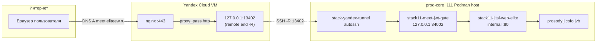

# Jitsi Meet (meet.eliteew.ru) через reverse SSH на Yandex Cloud VM

Операторский канон: как **публичный HTTPS** к UI Jitsi Meet доезжает до **prod-core `.111`**, где крутятся **stack11** и **stack-yandex-tunnel**, при том что **прямой вход с интернета на prod-core не открывается** — только **VM в Yandex** с **nginx** и **обратным SSH** (`autossh`).

> **Terminology:** older sections/scripts may say `punisher`; for current production Meet runtime read this as **prod-core `.111`**. HTTP/signaling backhaul primary = Meet WG ([WG-HTTP-BACKHAUL-PRIMARY.md](WG-HTTP-BACKHAUL-PRIMARY.md)); SSH reverse = manual reserve. stack666 LAN Meet proxy retired → `trash/`. Topology: [PRODUCTION-TOPOLOGY-STATE.md](../PRODUCTION-TOPOLOGY-STATE.md) §Current.

## 1. Для кого этот документ

- Оператор деплоя (prod-core `.111` + Yandex VM).
- Разработчик, отлаживающий «Meet открывается в LAN, с LTE нет» — разделение **сигналинг (HTTPS/WebSocket)** и **медиа (JVB / ICE / TURN)**.

## 2. Краткая схема трафика



- **Пользователь** ходит на **`https://meet.eliteew.ru`** (резолв по публичному DNS, обычно на IP VM).
- **nginx на VM** терминирует TLS и проксирует на **`http://127.0.0.1:13402`**.
- **Порт 13402 на VM** появляется из **обратного SSH** и на prod-core сопоставлен с **`127.0.0.1:34002`** (HTTP **`stack11-meet-jwt-gate`** → **`jitsi/web`**).
- **Prosody / Jicofo / JVB** остаются на prod-core во внутренней сети stack11; браузер для сигналинга ходит на тот же хост `meet.eliteew.ru`, для **RTP** используются ICE-кандидаты JVB (отдельный предмет, раздел 8).

## 3. Таблица обратных портов (`stack-yandex-tunnel`)

Источник правды: **`docker/stack/stack-yandex-tunnel.yml`**.

| Remote на VM (localhost) | prod-core `.111` target | Назначение |
|--------------------------|-------------------------|------------|
| **29001** | `127.0.0.1:29001` | Фронт EliteEW baked stack0, **`stack0-eliteew-frontend-prod-baked`** |
| **36000** | `127.0.0.1:36000` | Keycloak (**`stack6-keycloak`**) для **`auth.eliteew.ru`** (отдельный vhost, см. **`YANDEX-VM-SSH-TUNNEL.md`**) |
| **13402** | `127.0.0.1:34002` | **Meet JWT-gate** → **`stack11-jitsi-web-elite`** |
| **13400** | `127.0.0.1:13400` (TCP) → socat → **UDP `34000`** | **JVB RTP** (legacy: UDP-over-TCP в туннеле; **не** прод) |
| **13401** | `127.0.0.1:34001` | **JVB TCP harvester** (ICE fallback, legacy) |

**Медиа (прод):** на edge **`eliteew-jvb-media-relay-udp-wg`** — публичный **UDP 13400** → kernel NAT → WG → **10.77.77.2:34000** (host `wg0` на prod-core, JVB слушает host UDP `34000`). **Сигналинг / Meet web (прод):** Meet WG HTTP backhaul → `10.77.77.2:13402` → host proxy → `.111:34002` ([WG-HTTP-BACKHAUL-PRIMARY.md](WG-HTTP-BACKHAUL-PRIMARY.md)); SSH `-R 13402` = **manual reserve** only. Канон медиа: **[MEET-MEDIA-UDP-NATIVE-PATH.md](MEET-MEDIA-UDP-NATIVE-PATH.md)**; incident/methodology: **[JITSI-MEDIA-INCIDENT-2026-05-28.md](JITSI-MEDIA-INCIDENT-2026-05-28.md)**; установка: **`bash run-meet-media-install.sh`**, проверка: **`bash run-meet-media-verify.sh`**. Security group edge: **UDP 51821** (WG) + **UDP 13400**.

**Откат (артефакты голоса):** **`eliteew-jvb-media-relay`** (TCP/SSH) — **`deploy-jvb-media-relay-on-vm.sh`**, см. **`rollback-meet-media-udp.sh`**.

По умолчанию **OpenSSH `RemoteForward`** вешает порт на **loopback VM** (`127.0.0.1`), не на `0.0.0.0`. Это норма: наружу торчит только **nginx :443**.

## 4. Обязательные сервисы на prod-core `.111`

### 4.1. Туннель

- Контейнер **`stack-yandex-tunnel`**, образ **`eliteew-yandex-tunnel`**.
- Поднимается из корня репозитория: **`bash docker/scripts/yandex-tunnel/compose-up.sh`**.
- После смены списка **`-R`** в compose всегда: **`compose-up.sh up -d --force-recreate`**.
- Env не коммитить: **`docker/env_file/.env.yandex-tunnel`** (образец: **`.env.yandex-tunnel.example`**).

### 4.2. Jitsi stack11

Конфигурация compose: **`docker/stack/stack11.yml`**.

На prod-core должны быть **Up**:

| Контейнер | Смысл | Публикация на prod-core (типично) |
|-----------|-------|----------------------------------|
| **`stack11-meet-jwt-gate`** | JWT-gate перед UI Meet | **`127.0.0.1:34002` → 80** (в туннель и edge — сюда). |
| **`stack11-jitsi-web-elite`** | Статика и логика веб-клиента Meet | **expose :80** в `ew_net_5402`; HTTPS при необходимости **`127.0.0.1:34003` → 443**. |
| **`stack11-jitsi-prosody-elite`** | XMPP | внутренние порты, наружу не обязаны. |
| **`stack11-jitsi-jicofo-elite`** | Фокус конференции | — |
| **`stack11-jitsi-jvb-elite`** | Видеомост (RTP) | **`0.0.0.0:34000/udp`**, **`0.0.0.0:34001/tcp`** — см. раздел 8. |

Проверка: **`docker ps`** — имена и **healthy** у **web** / **prosody** по политике образа.

Инвариант hardening: прямой HTTPS web-контейнера **не** должен слушать все интерфейсы. В **`.env.stack11`** держать **`JITSI_WEB_HTTPS_BIND=127.0.0.1`**; публичный UI идёт через **`stack11-meet-jwt-gate`** (`127.0.0.1:34002`) и Yandex edge.

## 5. nginx на Yandex VM

### 5.1. Файлы в репозитории

| Профиль TLS | Файл | Куда копирует **`deploy-nginx-app-to-vm.sh`** |
|-------------|------|-----------------------------------------------|
| mkcert (частный CA, как на command-center) | **`docker/host_conf/nginx-app-https-vm-mkcert.conf`** | `/etc/nginx/sites-available/app.eliteew.ru` (имя файла историческое; внутри несколько `server_name`). |
| Let’s Encrypt на VM | **`docker/host_conf/nginx-app-https.conf`** | то же; пути сертификатов под **certbot**. |

В обоих файлах есть:

- Редирект **HTTP → HTTPS** для **`meet.eliteew.ru`**.
- Блок **`server { ... server_name meet.eliteew.ru; ... }`** с **`include /etc/nginx/conf.d/eliteew-meet-server.inc`** (шаблон **`docker/host_conf/nginx-meet-server.inc`**).
- **JWT-gate на UI (канон на prod-core `.111`):** контейнер **`stack11-meet-jwt-gate`** на **`127.0.0.1:34002`**. Edge проксирует весь HTTP Meet на WG/SSH backhaul; gate отдаёт **403** без jwt на `/`. Дублировать inc на VM опционально: **`bash docker/scripts/apply-meet-nginx-jwt-gate.sh`** (нужен sudo на edge).
- Для Meet **не** задан **`add_header X-Frame-Options "SAMEORIGIN"`**: иначе встраивание **`https://meet.eliteew.ru`** в iframe с **`https://app.eliteew.ru`** (окно **VideoCallApp**) ломается на уровне браузера.
- Edge access log для **`meet.eliteew.ru`** использует формат без query string (`$request_method $uri $server_protocol`), потому что Jitsi передаёт `jwt`/`token` в URL. На prod-core `stack11-meet-jwt-gate` и `log-to-file.sh` также не должны сохранять эти параметры в логах.

Остальные заголовки (HSTS, nosniff, referrer) оставлены по аналогии с app.

### 5.2. WebSocket и длинные соединения

Используется общий **`map $http_upgrade $connection_upgrade`** и в location Meet (в **`eliteew-meet-server.inc`**):

- **`proxy_http_version 1.1`**
- **`Upgrade` / `Connection`**
- **`proxy_read_timeout` / `proxy_send_timeout` 86400s**
- **`proxy_buffering off`**

Это нужно для **BOSH / WebSocket** сигналинга Jitsi через прокси.

### 5.3. Выкладка на VM

Из корня репозитория на **command-center `.136`** (админский SSH на VM, ключи см. **`YANDEX-VM-SSH-TUNNEL.md`**):

```bash
# mkcert: синхронизация TLS command-center → VM
bash docker/scripts/yandex-tunnel/sync-mkcert-certs-to-yandex-vm.sh

NGINX_APP_SITE_CONFIG="$PWD/docker/host_conf/nginx-app-https-vm-mkcert.conf" \
  bash docker/scripts/yandex-tunnel/deploy-nginx-app-to-vm.sh

bash docker/scripts/apply-meet-nginx-jwt-gate.sh
```

Для Let’s Encrypt на VM подставьте **`nginx-app-https.conf`** и убедитесь, что сертификат покрывает **`meet.eliteew.ru`** (SAN или wildcard `*.eliteew.ru`). После деплоя vhost — снова **`apply-meet-nginx-jwt-gate.sh`**.

## 6. DNS

- **`meet.eliteew.ru`** в публичном DNS (например **8.8.8.8** / **1.1.1.1**) должен указывать на **публичный IP VM** в Yandex, как и **`app.eliteew.ru`**, если тот же фронтовой периметр.
- На **command-center `.136`** часто есть **`/etc/hosts`** с перенаправлением `*.eliteew.ru` на LAN — операторские проверки из интернета делайте с **`dig @8.8.8.8`** и **`curl --resolve`**, иначе «локально всё ок», с телефона в LTE ошибка сохранится.

## 7. Связка с приложением EliteEW

Продуктовый поток звонков: **`product/INTERNAL-VIDEO-CALLS.md`** (API, GAF Chat, iframe).

Кратко:

- Backend подписывает JWT (**`JITSI_APP_SECRET`** / **`JITSI_JWT_SECRET`**) должен совпадать между **stack0 env** и **stack11 Prosody** (см. **`docker/env_file/.env.stack0.backend`** и **`.env.stack11`** на command-center staging / prod-core runtime — не коммитить секреты).
- **`JITSI_PUBLIC_URL`** / домен Meet в токене должны быть согласованы с **`meet.eliteew.ru`**.
- Во **frontend nginx** (env stack0) для iframe нужен **`CSP_FRAME_EXTRA`** с **`https://meet.eliteew.ru`** (канон см. **`INTERNAL-VIDEO-CALLS.md`**).

## 8. Медиа (JVB)

**HTTP Meet** идёт через туннель **`13402`** (§3).

**Медиа (прод):** UDP-native **93.77.165.185:13400** → kernel NAT/WG → JVB **10.77.77.2:34000** — **[MEET-MEDIA-UDP-NATIVE-PATH.md](MEET-MEDIA-UDP-NATIVE-PATH.md)**. Не смешивать с legacy UDP-over-TCP через SSH **`-R 13400`**.

В **`docker/stack/stack11.yml`** для web-контейнера должен быть включён инвариант **`ENABLE_P2P=0`**. Для внутренних звонков EliteEW это принудительно ведёт клиентов через **JVB**, а не через peer-to-peer.

В **`.env.stack11`** задайте публичный ICE для клиентов из интернета (формат docker-jitsi-meet с портами):

```bash
# Пример: публичный IP VM из .env.yandex-tunnel + LAN для локальных клиентов
JITSI_JVB_ADVERTISE_IPS=158.160.205.181#13400,158.160.205.181#13401,192.168.1.136,192.168.38.5
```

После смены **`JITSI_JVB_ADVERTISE_IPS`**: пересоздать **`stack11-jitsi-jvb-elite`**. После смены медиа-контура: **`bash run-meet-media-install.sh`** / **`run-meet-media-verify.sh`**. После смены **`-R 13402`** в туннеле: **`compose-up.sh up -d --force-recreate`** (медиа **13400** на проде — не через `-R`).

Альтернатива (если UDP-over-TCP через socat недостаточен): **`coturn`** на VM — см. **`product/INTERNAL-VIDEO-CALLS.md`**.

## 9. Проверка после изменений

### 9.1. Скрипт с command-center / prod-core

```bash
bash docker/scripts/yandex-tunnel/check-yandex-tunnel.sh
bash docker/scripts/stack11-security-smoke.sh
```

В скрипт входит smoke **`meet.eliteew.ru`** через **`dig @8.8.8.8`** и **`curl --resolve`**. Ожидается **HTTP 200** на публичной странице либо **HTTP 403** от **JWT-gate** на `/` без `jwt`; **502** / connection refused — ошибка туннеля или upstream.

`stack11-security-smoke.sh` проверяет:

- `/` без JWT → **403**;
- `/config.js` → **200**;
- scanner paths (`/.env`, `/.git/config`, `wp-config.php`) → **403/404**;
- `config.p2p.enabled = false`;
- `stack11-jitsi-web-elite` слушает **`127.0.0.1:34003`**, а не `0.0.0.0`;
- fake `jwt`/`token` не попадает в свежие логи **`stack11-meet-jwt-gate`**.

### 9.2. Ручная проверка (внешний DNS, без LAN `/etc/hosts` на command-center)

```bash
MEET="$(dig @8.8.8.8 +short meet.eliteew.ru A | head -1)"
curl -sSIL --resolve "meet.eliteew.ru:443:${MEET}" "https://meet.eliteew.ru/"
```

Аналогично для **app** и **auth**, см. **`YANDEX-VM-SSH-TUNNEL.md`**.

### 9.3. smoke в UI

- Открыть **`https://app.eliteew.ru`**, авторизоваться, из GAF-чата инициировать звонок, убедиться что iframe **`meet.eliteew.ru`** грузится без ошибки **в консоли** про **X-Frame-Options** или **CSP**.

## 10. Частые сбои

| Симптом | Возможная причина | Действие |
|---------|-------------------|----------|
| **502 / connection refused** к Meet с интернета | Туннель не поднят или нет **`13402`** | **`docker ps` `stack-yandex-tunnel`**; **`compose-up.sh up -d --force-recreate`**; на VM **`ss -tlnp \| grep 13402`**. |
| **502** после рестарта jitsi web | **`34002`** на prod-core `.111` не слушает | **`podman ps` `stack11-jitsi-web-elite`**; порты **127.0.0.1:34002**. |
| Страница Meet грузится, **нет звука/видео с LTE** | ICE / JVB / NAT | Проверить **`JVB_ADVERTISE_IPS`**, порты **34000/udp**, **34001/tcp**, TURN; раздел 8. |
| Signaling OK, **JVB без `Add remote candidate`**, **`PT2M35S expiring`**, colibri-ws пустой (`.38` Wi‑Fi / LAN) | Dead STUN/TURN на Meet runtime (prod-core) при VPN DNS; нулевой ICE trickle; hot-reload JVB | Historical handoff soft-retired → `trash/…/archive/…/GAF-JITSI-MEDIA-DEBUG-2026-05-19.md` (not living canon). Living: **`useStunTurn=false`** + Google STUN; не делать **`s6-svc -r jvb`** во время звонка; монитор **`debug-jitsi-call-monitor.sh`** (**script absent from tree** — use `podman logs` / living JITSI incident canon). |
| Звонок входит в комнату, но быстро «отключён», при этом API не пишет новый **`/end`**, а JVB пустой | Jitsi ушёл в **P2P** вместо JVB | Проверить **`https://meet.eliteew.ru/config.js?room=check`**: ожидается **`config.p2p.enabled = false`**. Если true — **`ENABLE_P2P=0`** в **`docker/stack/stack11.yml`** и пересоздать **`stack11-jitsi-web-elite`**. |
| **Пустой iframe** в Desktop | **CSP** или **X-Frame-Options** | CSP: **`CSP_FRAME_EXTRA`**; nginx Meet: **без** **SAMEORIGIN** на meet vhost. |
| **Нативный SDK (Android):** `config.js` **AbortError**, в браузере на том же телефоне URL открывается | Часто Android system DNS отдаёт LAN-only адрес (`meet.eliteew.ru → 192.168.x`), а браузер использует свой DoH; либо запрос **не доходит** до web / **обрывается на клиенте** (RN fetch / таймаут / сеть) | На телефоне: **`adb shell 'ping -c 1 -W 2 meet.eliteew.ru || true'`** — если виден недостижимый RFC1918 адрес, это split-DNS. В приложении `MobileApp` ставит React Native OkHttp factory с **`EmperyNetworkingDns`**; на prod-core дополнительно **`bash docker/scripts/jitsi-meet-http-smoke.sh`** и **`podman logs -f stack11-jitsi-web-elite`**. |
| Расхождение JWT | Разные секреты stack0 / stack11 | Выровнять **`JITSI_*_SECRET`** и перезапустить API и stack11 компоненты по **`project-and-deploy.mdc`**. |

## 11. Связанные документы и файлы

### 11.1 Где в монорепо лежит Docker / конфиги Meet

| Назначение | Путь |
|------------|------|
| Compose **stack11** (prosody, **web**, jicofo, jvb, jibri) | **`docker/stack/stack11.yml`** |
| Публикация HTTP Meet с prod-core `.111` | **`stack11-meet-jwt-gate`**, хост **`127.0.0.1:34002→80`**; jitsi **web** без host HTTP (только через gate) |
| Туннель / WG **edge → prod-core:34002** (SSH reserve: VM:13402) | WG primary [WG-HTTP-BACKHAUL-PRIMARY.md](WG-HTTP-BACKHAUL-PRIMARY.md); reserve **`docker/stack/stack-yandex-tunnel.yml`**, env **`docker/env_file/.env.yandex-tunnel`** |
| Nginx на **Yandex VM** (шаблоны под выкладку) | **`docker/host_conf/nginx-app-https-vm-mkcert.conf`**, **`docker/host_conf/nginx-app-https.conf`** (блок **`server_name meet.eliteew.ru`**, `proxy_pass` → **127.0.0.1:13402**) |
| Nginx **внутри** образа web (кастом после деплоя) | данные стека: **`docker/data/stack11/web/nginx/meet.conf`** (монтируется в контейнер web при настройке) |
| LAN Meet | edge / Meet WG only (stack666 LAN proxy retired → `trash/`) |
| Смоук с интернета (SSH + Meet root) | **`docker/scripts/yandex-tunnel/check-yandex-tunnel.sh`** |
| Быстрый тайминг **HTTPS config.js** + локальный **34002** | **`docker/scripts/jitsi-meet-http-smoke.sh`** |
| Выкладка nginx на VM | **`docker/scripts/yandex-tunnel/deploy-nginx-app-to-vm.sh`** |

### 11.2 Таблица ссылок (как раньше)

| Документ / путь |
|-----------------|
| **`platform/docker-re_doc/YANDEX-VM-SSH-TUNNEL.md`** — вход app/auth, ключи VM, порядок выкладки nginx. |
| **`product/INTERNAL-VIDEO-CALLS.md`** — продукт MVP, API, ограничения, CSP, JVB. |
| Historical GAF media debug handoff soft-retired → `trash/…/documentation archive tree2026-05-24-doc-reality-audit/…/GAF-JITSI-MEDIA-DEBUG-2026-05-19.md` (not living canon; do not recreate the documentation archive tree (forbidden as living canon)). |
| **`platform/docker-re_doc/MEET-MEDIA-UDP-NATIVE-PATH.md`** — **канон** прод-медиа (WG + relay :13400). |
| **`platform/docker-re_doc/JITSI-MEDIA-INCIDENT-2026-05-28.md`** — evidence-first методика медиа-инцидента. |
| **debug-jitsi-call-monitor.sh *[absent]*** — NDJSON монитор (**absent from tree as of 2026-09-30**); use stack11 logs + [JITSI-MEDIA-INCIDENT-2026-05-28.md](JITSI-MEDIA-INCIDENT-2026-05-28.md). |
| **`docker/stack/stack-yandex-tunnel.yml`** |
| **`docker/scripts/yandex-tunnel/check-yandex-tunnel.sh`** |
| **`docker/scripts/yandex-tunnel/deploy-nginx-app-to-vm.sh`** |

---

При существенном изменении схемы (новые порты, TURN-only) поправьте этот файл как канон (`documentation/worklog/` retired → `trash/`; chronology via chat / `git log`).
