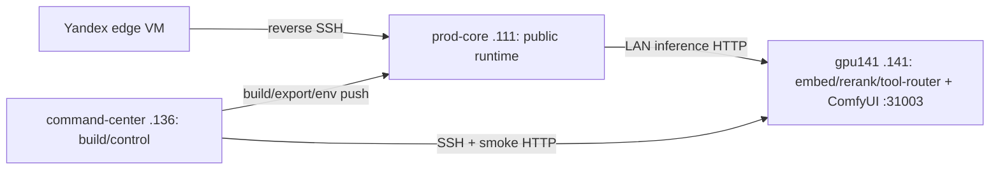

# LAN workers / gpu141 (`192.168.1.141`)

> **Note (2026-09-30):** `gpu141-debian-*` and `punisher-*` helpers under `docker/scripts/lan-workers/` are historical / not in tree; living GPU141 ops use `eliteew-gpu141-comfyui-*` and topology canon.


**Status:** operator runbook for gpu141 remote inference and legacy worker migration.
**Current topology source:** `documentation/platform/PRODUCTION-TOPOLOGY-STATE.md` §Current.
**Live OS baseline:** **2026-07-14** — Debian 13 (trixie), overlayroot RO, rootful Podman **host-net**.

## Current Baseline (2026-07-14)

| Host | Role |
|------|------|
| **prod-core `.111`** | Public runtime: baked stack0, stack1, EWA PG, stack2 `llama-chat`, stack4, stack6, stack11, stack12, yandex tunnel, landing/mobile artifacts. |
| **command-center `.136`** | Git/docs/env staging, SOPS, all builds (`eliteew-deploy.sh` / `eeprodruntime` / MobileAndroid), Phase 4 `llama-deep` `:8080`, deploy/smoke wrappers. **Not living:** DEWA / EWPower / EWC / EWGen / logwatch / EWCO (soft-retired → `trash/`). Not public stack0 runtime. Living ComfyUI is on **gpu141**. |
| **gpu141 `.141`** | Remote inference: `llama-remote-embed` `:8081`, `llama-remote-rerank` `:8082`, `llama-remote-tool-router` `:8083`, **and living ComfyUI** `:31003` (host-local `/var/lib/eliteew/comfyui`, rootful host-net). |



### Host facts (live)

| Item | Value |
|------|-------|
| OS | Debian **13 (trixie)** (migrated from Fedora) |
| GPU | NVIDIA GeForce **RTX 5060 Ti** 16 GB (Blackwell) |
| Driver | **nvidia-open 610.x** via CUDA **`debian13`** network repo (`nvidia-smi` from `nvidia-driver-cuda`) |
| Runtime | **rootful** Podman + CDI (`/etc/cdi/nvidia.yaml`) |
| Compose (live) | `docker/stack/stack2-llama-remote-embed-rerank.host-net.yml` |
| Workdir on host | `/home/owned/llama-remote` + `.env.llama-remote` |
| Models | `/home/owned/models/llama/` (GGUF; current: Qwen3 Embedding 8B, Reranker 8B, Instruct 4B) |
| Autostart | systemd **`gpu141-llama-remote.service`** (`enabled`) |
| Root FS | **overlayroot** tmpfs upper; disk lower = `/media/root-ro` (**ro**) |
| Host firewall | **nftables DROP** allowlist (`setup-gpu141-nftables-harden.sh`) |
| MikroTik isolate | Script ready (`mikrotik-gpu141-isolate.rsc`); **not applied** 2026-07-14 (operator deferred) |

## What This File Is For

Use this file for:

- checking gpu141 remote inference health;
- deploying or recovering `.141` embed/rerank/tool-router services;
- bare-metal Debian rebuild / RO / harden procedures;
- understanding old worker migration scripts that still contain `punisher` in names;
- optional legacy cutover of queue/Celery workers, if explicitly requested.

Do **not** use this file to infer that `.136` is current default prod runtime. It is not.

## Current gpu141 Services

| Service | Port | Expected |
|---------|------|----------|
| `llama-remote-embed` | `127.0.0.1:8081/health` | HTTP 200 `{"status":"ok"}` |
| `llama-remote-rerank` | `127.0.0.1:8082/health` | HTTP 200 `{"status":"ok"}` |
| `llama-remote-tool-router` | `127.0.0.1:8083/health` | HTTP 200 `{"status":"ok"}` |
| **ComfyUI** (living product) | `0.0.0.0:31003` (`/system_stats`) | HTTP 200; tree `/var/lib/eliteew/comfyui`; systemd `eliteew-gpu141-comfyui` |

Smoke:

```bash
ssh gpu141 'curl -sf http://127.0.0.1:8081/health && curl -sf http://127.0.0.1:8082/health && curl -sf http://127.0.0.1:8083/health'
ssh gpu141 'curl -sf http://127.0.0.1:31003/system_stats >/dev/null'
# from command-center
curl -sf http://192.168.1.141:8081/health
curl -sf http://192.168.1.141:31003/system_stats >/dev/null
# product path from API
ssh 192.168.1.111 'podman exec stack0-eliteew-api-prod-baked printenv COMFYUI_URL'
# expect http://192.168.1.141:31003/
```

**ComfyUI ops (2026-09-26 cutover):** persist bind + remount helpers under `docker/scripts/lan-workers/eliteew-gpu141-comfyui-*.sh`; rootful host-net start (`eliteew-gpu141-comfyui-rootful-start-sudo.sh`); nft allow `:31003` from `.111`+`.136`. Stack0 `COMFYUI_URL` + UGS DB `generation_providers.comfyui.base_url` must both point at `.141:31003`. Historical `.136` Comfy runbook: [COMFYUI-COMMAND-CENTER-OPERATIONS.md](COMFYUI-COMMAND-CENTER-OPERATIONS.md).

VRAM budget default on 16 GB cards (llama workers; Comfy shares the same GPU — schedule heavy music/image jobs accordingly):

- `LLAMA_EMBED_NGL=999` (GPU full offload for embedding)
- `LLAMA_RERANK_NGL=999` (GPU full offload for rerank)
- `LLAMA_TOOL_ROUTER_NGL=0` (CPU by default to keep rerank stable and avoid CUDA OOM)

## Network contract (must not break prod)

| Source | Dest on `.141` | Purpose |
|--------|----------------|---------|
| **`.111`** | TCP **8081–8083**, **31003** | prod-core stack0 embed/rerank/tool-router + ComfyUI |
| **`.136`** | TCP **8081–8083**, **31003** | ops smoke from command-center |
| **`.136`** | TCP **22** | SSH / deploy |
| Optional client (e.g. **`192.168.8.10`**) | TCP **22**, **31003** | ops laptop/VPN: SSH/scp + Comfy download — **not** `:8081–8083` |
| Other LAN / WAN | all | **DROP** (host nftables; optional MikroTik later) |

**Do not** allowlist inference only from `.136` — prod-core will break.

Add/remove an optional client without rewriting the whole harden set:

```bash
# on gpu141
sudo bash docker/scripts/lan-workers/eliteew-gpu141-nft-allow-client.sh 192.168.8.10
# or: sudo EXTRA_CLIENT_IPS="192.168.8.10" bash setup-gpu141-nftables-harden.sh
```

## Host OS bootstrap (Debian on `.141`)

Bare-metal rebuild path:

| Step | Script / action |
|------|-----------------|
| Apt mirrors + base packages | `gpu141-debian-bootstrap-apt.sh` |
| NVIDIA for **RTX 50xx (Blackwell)** | `gpu141-debian-install-nvidia-open.sh` + `cuda-keyring` from CUDA **`debian13`** |
| Install real `nvidia-smi` binary | `apt-get install -y nvidia-driver-cuda` (dummy `nvidia-smi` package is empty) |
| Podman + NVIDIA CDI toolkit | `gpu141-debian-install-podman-nvidia.sh` |
| Env template | `docker/scripts/lan-workers/gpu141.env.llama-remote.example` → `/home/owned/llama-remote/.env.llama-remote` |
| **nftables harden (DROP + allowlist)** | `docker/scripts/lan-workers/setup-gpu141-nftables-harden.sh` |
| nftables legacy accept-policy | `setup-gpu141-nftables-embed-rerank.sh` (superseded by harden) |
| MikroTik forward isolate (optional) | `docker/scripts/lan-workers/mikrotik-gpu141-isolate.rsc` — requires `use-ip-firewall=yes` on bridge if hosts share `192.168.1.0/24` L2 |
| overlayroot RO | `gpu141-debian-enable-overlayroot.sh` |
| Autostart unit | `docker/scripts/lan-workers/gpu141-llama-remote.service` |

### NVIDIA notes

- **Do not** install Debian `non-free` `nvidia-driver` **550** on 50-series — too old.
- **Do not** use CUDA **`debian12`** repo on Debian 13: apt/`sqv` rejects SHA1 key after 2026-02-01.
- Use CUDA **`debian13`** → `nvidia-open` (+ `nvidia-driver-cuda` for CLI).
- Ensure `PATH` includes `/sbin`/`/usr/sbin` under `sudo` (or `sudo -i`) before `dpkg`/`apt`.

### Podman networking (Debian)

Bridge port-publish on Debian 13 + rootful Podman can accept TCP on `:8081` but never return HTTP while in-container `/health` works. **Live fix:** host network compose:

```bash
cd /home/owned/llama-remote
podman compose -f stack2-llama-remote-embed-rerank.host-net.yml --env-file .env.llama-remote up -d --force-recreate
```

Canon live file: `docker/stack/stack2-llama-remote-embed-rerank.host-net.yml` (`restart: always`, ports **8081/8082/8083** on host).

Bridge file `stack2-llama-remote-embed-rerank.yml` remains for older Fedora-style deploys / `start-gpu141-embed-rerank.sh`; on current Debian use **host-net**.

### Read-only root (overlayroot) — live

Engaged on gpu141:

| Mount | Role |
|-------|------|
| `/` | overlay (`overlayroot`) — appears **rw**; writes go to **tmpfs** upper |
| `/media/root-ro` | real NVMe — **ro** |
| `/media/root-rw` | tmpfs upper |

```bash
findmnt /media/root-ro   # must be ro
systemctl is-enabled gpu141-llama-remote.service
```

- Enable script: `gpu141-debian-enable-overlayroot.sh` (Debian 13 needs `LIBMOUNT_FORCE_MOUNT2=always`; disk swap disabled).
- Emergency disable: GRUB → `overlayroot=disabled`.
- **Permanent disk edits** (unit, compose, apt): remount lower RW then lock again:

```bash
mount -o remount,rw /media/root-ro
# write under /media/root-ro/...
systemctl --root=/media/root-ro enable gpu141-llama-remote.service
sync
cd /
mount -o remount,ro /media/root-ro
```

(`overlayroot-chroot` also works; files copied only into live `/root` are **not** visible inside chroot — copy via `/media/root-ro/...` or pipe/`tee`.)

- Caveat: `podman pull` / apt on the live overlay live in RAM and vanish on reboot unless written to `/media/root-ro`.

### Autostart after reboot

Unit `gpu141-llama-remote.service` runs:

`podman compose -f stack2-llama-remote-embed-rerank.host-net.yml --env-file .env.llama-remote up -d`

Verified 2026-07-14: after reboot → `enabled`, containers **healthy**, `/health` ok.

### Model / env cutover (rootful)

Live stack is **rootful**. User `owned` can edit `/home/owned/llama-remote/.env.llama-remote` and rsync GGUF under `/home/owned/models/llama/`, but **cannot** recreate containers without sudo.

After changing `LLAMA_EMBED_FILE` / `LLAMA_RERANK_FILE` (Phase 2: `Qwen3-Embedding-0.6B-Q8_0.gguf` + `qwen3-reranker-0.6b-q8_0.gguf`, stack0 `AI_EMBEDDINGS_DIMENSION=1024`):

```bash
ssh -t gpu141 'sudo systemctl restart gpu141-llama-remote.service'
# smoke
ssh gpu141 'curl -sf http://127.0.0.1:8081/v1/models | python3 -m json.tool | head'
```

Do **not** run `podman compose …` as `owned` on live Debian — it pulls into rootless storage and leaves the rootful 8B stack running.

## Current Data Path

| Caller | Target | Notes |
|--------|--------|-------|
| prod-core `.111` stack0 API/workers | gpu141 `.141:8081/:8082/:8083` | Remote embedding/rerank/tool-router HTTP. |
| command-center `.136` ops smoke | gpu141 `.141:8081/:8082/:8083` | curl health from CC; EWCO pilot soft-retired → `trash/`. Allow via nftables (not firewalld on Debian). |
| command-center `.136` | gpu141 | SSH + diagnostics / image+model sync. |
| gpu141 | prod-core `.111` | No stack1 DB/Rabbit LAN binds for current remote inference. |

If a legacy doc says `.141 -> punisher .136` for Postgres/Rabbit/API, that describes the old optional worker cutover, not the current prod baseline.

## ComfyUI

Current canon: living ComfyUI is on gpu141 `.141:31003` after the 2026-09-26 cutover. It uses `/var/lib/eliteew/comfyui`, rootful host-net Podman, and the `eliteew-gpu141-comfyui` host unit. The 2026-06-15 audit predates this cutover. Legacy SSH tunnel scripts remain non-product paths.

## Scripts And Names

Some script names still contain `punisher`; in current terminology this means command-center `.136` unless a script/runbook is explicitly historical.

| Script | Use |
|--------|-----|
| `docker/scripts/lan-workers/gpu141-recovery-gate.sh` | Readiness gate for `.141` inference services. |
| `docker/scripts/start-gpu141-embed-rerank.sh` | Sync GGUF + host-net compose/env (0.6B embed/rerank defaults); rootful recreate needs passwordless sudo or manual `systemctl restart`. |
| `gpu141-debian-*.sh` | OS/NVIDIA/podman/overlayroot bootstrap (this rebuild). |
| `docker/scripts/lan-workers/setup-gpu141-nftables-harden.sh` | Host DROP allowlist (live). |
| `docker/scripts/lan-workers/eliteew-gpu141-nft-allow-client.sh` | Add one client IP → `:22` + `:31003` (persist `/etc/nftables.conf`). |
| `docker/scripts/lan-workers/gpu141-llama-remote.service` | Boot compose up -d (live). |
| `docker/scripts/lan-workers/mikrotik-gpu141-isolate.rsc` | Optional MikroTik forward isolate (deferred). |
| `punisher-deploy-gpu141-workers.sh` | Legacy worker cutover helper for `*-lan141`. |
| `move-workers-back-to-punisher.sh` *[absent]* | Legacy reverse worker cutover back to `.136`. |
| `docker/scripts/lan-workers/start-gpu141-comfy-ssh-tunnel.sh` | Legacy Comfy tunnel (`COMFY_TUNNEL_BIND`, default `0.0.0.0` for pasta). Do not treat tunnel `:31004` as the living direct `.141:31003` API path. |

## Optional Legacy Worker Cutover

Only perform this with an explicit operator request.

Legacy model:

- `.136` exposed stack1/Rabbit/Redis/API host ports to `.141`.
- `.141` ran queue/Celery worker containers.
- `.136` local worker containers were stopped.
- After reverse cutover, LAN binds returned to localhost.

Current model avoids this for prod-core public runtime. If worker placement changes again, update `PRODUCTION-TOPOLOGY-STATE.md` first, then this file.

## Hardening Rules

- Default prod Celery beat must run only once, on prod-core baked stack0 unless topology says otherwise.
- Do not open stack1/Rabbit/Redis LAN binds for `.141` unless running a documented temporary worker cutover.
- After any temporary LAN bind, restore localhost binds and verify `.141` cannot connect to old `30000/30001/30008/30433` ports.
- Do not assume `ComfyUI_URL=http://host.containers.internal:31004/` is healthy; verify the listener first.
- Keep rootful Podman on this dedicated inference node; rootless is optional future work (~2–6 h).
- Same-subnet L2 traffic may bypass MikroTik `forward` unless bridge `use-ip-firewall=yes` — host nftables remains primary.

## Verification Matrix

| Check | Command | Expected |
|-------|---------|----------|
| gpu141 services | `ssh gpu141 'curl -sf http://127.0.0.1:8081/health && curl -sf http://127.0.0.1:8082/health && curl -sf http://127.0.0.1:8083/health'` | success |
| overlay RO | `ssh gpu141 'findmnt /media/root-ro'` | `ro` |
| autostart | `ssh gpu141 'systemctl is-enabled gpu141-llama-remote.service'` | `enabled` |
| LAN from `.136` | `curl -sf http://192.168.1.141:8081/health` | success |
| prod-core API | `ssh 192.168.1.111 'curl -sf http://127.0.0.1:29000/api/health'` | success |
| living Comfy | `ssh gpu141 'curl -sf http://127.0.0.1:31003/system_stats >/dev/null'` | success |
| no accidental legacy workers | `ssh gpu141 'podman ps --format "{{.Names}}"'` | `llama-remote-*` plus living Comfy; no stack0 workers |

## Related

- `documentation/platform/PRODUCTION-TOPOLOGY-STATE.md`
- `documentation/platform/STACK2-LLM-CONTRACT.md`
- `documentation/platform/docker-re_doc/PROD-CORE-MIGRATION-BAKED-IMAGES.md`
- `docker/stack/stack2-llama-remote-embed-rerank.host-net.yml`
