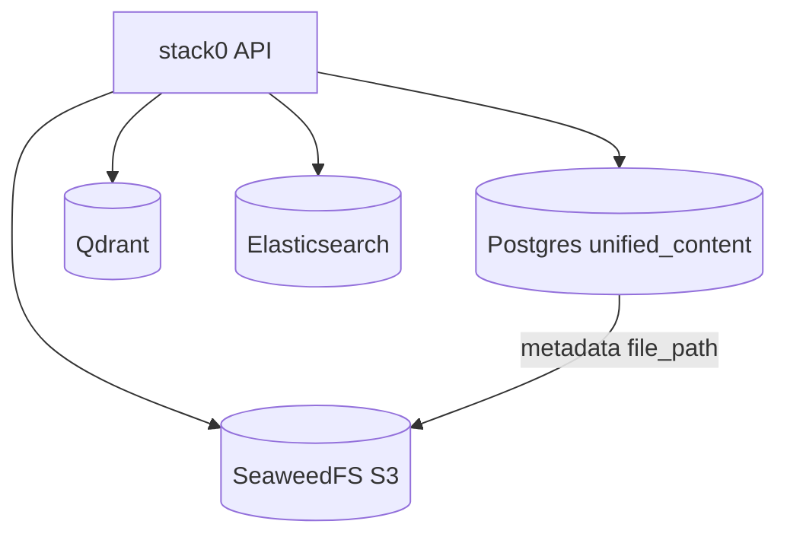

# Storage and vector topology (EliteEW)

**Статус:** канон (reference).  
**Scope:** где хранятся файлы, векторы и поисковые индексы в prod-контуре.

Текущий prod-расклад хостов — [PRODUCTION-TOPOLOGY-STATE.md](../PRODUCTION-TOPOLOGY-STATE.md).

---

## Summary table

| Store | Technology | Role | Primary? |
|-------|------------|------|----------|
| Relational metadata | PostgreSQL (`stack1-postgres`) | `unified_content`, ACL, audit | yes |
| Large blobs | **SeaweedFS** (S3 API) | Files ≥ threshold, thumbnails | yes |
| Small blobs | PostgreSQL BYTEA | Legacy/small files per backend routing | conditional |
| Vector search | **Qdrant** (`stack1-qdrant`) | Semantic search, companion episodic, UGS embeddings, **KBSEW barrels** (docs/api/fe) | **yes** (default) |
| Vector legacy | Chroma (`stack1-chroma`) | Fallback only if `UNIFIED_VECTOR_READ_BACKEND=chroma` | legacy |
| Vector retired | ~~`stack1-chroma-code`~~ | Orphan code-search Chroma — **soft-retired 2026-08-09**; use KBSEW `code_*` barrels | retired |
| Full-text / hybrid | Elasticsearch (`stack1-elasticsearch`) | Unified content list/search facets | yes |
| Assistant DB | Postgres (`stack-ewa-postgres`) | Profiles, task runs, platform settings | yes (EWA scope) |

---

## Blob path (Unified Content)

1. Upload → API chooses backend (`storage_factory`) → often SeaweedFS for large files.
2. DB row stores `file_path` like `unified-content/{uuid}/{original_filename}`.
3. Download/thumbnail reads S3 via `SeaweedFSStorage.retrieve()`.
4. **Thresholds:** non-audio ≥1MB → SeaweedFS; audio &lt;40MB → PostgreSQL BYTEA (SeaweedFS long MP3 reads unreliable).
5. **Remediation:** batch migrate + soft-delete hard-purge (≥30d) — historical one-shot `STACK1-POSTGRES-REMEDIATION-2026-07-11.md` → `trash/`; living ops: CLI `api/scripts/migrate_pg_blobs_to_seaweed.py`, `hard_purge_soft_deleted_content.py`; admin `POST /content/admin/migrate-pg-blobs`, `POST /content/admin/hard-purge-soft-deleted`; see also [SEAWEEDFS-OPERATOR-RUNBOOK.md](SEAWEEDFS-OPERATOR-RUNBOOK.md).

Runbook orphan/chunk issues: [SEAWEEDFS-OPERATOR-RUNBOOK.md](SEAWEEDFS-OPERATOR-RUNBOOK.md).

---

## Vector path

| Env | Meaning |
|-----|---------|
| `UNIFIED_VECTOR_READ_BACKEND=qdrant` | **Default** prod (remediation S3) |
| `UNIFIED_VECTOR_READ_BACKEND=chroma` | Legacy fallback / diagnostics only |
| `AI_EMBEDDINGS_DIMENSION` | Must match embed model (2560 vs 4096) |
| `LLAMA_EMBEDDING_URL` | HTTP embeddings (llama-embed / TEI / remote) |

Migration when dimension/model changes: [QDRANT-INDEXING.md](QDRANT-INDEXING.md) (dated `EMBEDDING-DIMENSION-MIGRATION.md` soft-retired → `trash/`).

**Do not** treat Chroma as primary in new features — Qdrant-first per `project-and-deploy.mdc`.

**`stack1-chroma-code`:** soft-retired 2026-08-09 (removed from `docker/stack/stack1.yml`, container stopped on prod-core). Living code/docs RAG = KBSEW → Qdrant (`eliteew-docs` / `eliteew-api` / `eliteew-frontend`). Data dir `docker/data/stack1/chroma-code` retained; do not recreate without operator restore.

---

## Elasticsearch

Indexes unified content and related search surfaces. Worker/API on prod-core reach ES via docker network or host port **`30007`** when workers run on gpu141 (LAN override env).

See [ELASTICSEARCH-INDICES.md](ELASTICSEARCH-INDICES.md).

---

## Diagram

---

## Связанные документы

- [SEGMENTATION.md](SEGMENTATION.md) — Docker networks
- [STACK1-POSTGRES-TUNING.md](STACK1-POSTGRES-TUNING.md)
- [EWA-POSTGRES-RUNBOOK.md](EWA-POSTGRES-RUNBOOK.md)
