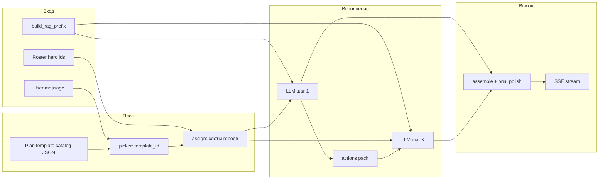

# Эксперты (Llama)

**Status:** living product SoT (large hub). Prefer thin siblings for new work — Discussion [desktop/DESKTOP-AI-CHAT-DISCUSSION-MODE.md](desktop/DESKTOP-AI-CHAT-DISCUSSION-MODE.md), Collaboration [desktop/DESKTOP-AI-CHAT-COLLABORATION.md](desktop/DESKTOP-AI-CHAT-COLLABORATION.md), Memory Cells [desktop/DESKTOP-AI-CHAT-MEMORY-CELLS.md](desktop/DESKTOP-AI-CHAT-MEMORY-CELLS.md), Tool router [DESKTOP-AI-CHAT-TOOL-ROUTER.md](DESKTOP-AI-CHAT-TOOL-ROUTER.md). **Not** Assistant (`ewa/`). Topology: [PRODUCTION-TOPOLOGY-STATE.md](../platform/PRODUCTION-TOPOLOGY-STATE.md) §Current.

Модульный чат на рабочем столе: **Llama** `/api/chat`, опционально **инструменты** (UGS-картинка, веб-поиск, HTTP fetch URL), **голос** (Voice Gateway STT/TTS), **RAG только по чату** в Qdrant (`desktop_chat_rag`) и **read-only** контекст из vault маркетингового проекта для **лида проекта** (`projects.created_by`).

**Editions / install profiles (2026-08-13, `desktop-ai-chat-027`):** first-class manifest `shared/apps/desktop_ai_chat/` → `DesktopAiChatApp` (user title «Эксперты»). **Не путать** с `shared/apps/assistant/` → `AssistantApp` (**Справочная навигация** / FAQ handbook). Cloud-full + onprem-team-core enable Experts; FoFline `fofline-connected` keeps handbook only (no `desktop_ai_chat`).
**Collaboration (друзья в «Команде»):** Waves 0–4 Done — [desktop/DESKTOP-AI-CHAT-COLLABORATION.md](desktop/DESKTOP-AI-CHAT-COLLABORATION.md) (invite/ACL, speaker labels, FE members/leave/lock poll, Socket.IO fan-out).

## User mental model (SoT)

Three entry journeys — **not** a single segmented mode switcher in chrome:

| Mode | User name | How the user enters | Primary CTA |
|------|-----------|---------------------|-------------|
| **Solo** | Соло | New-chat picker → solo | Send (`POST …/stream`) |
| **Team** | Команда | New-chat picker → ensemble; friends optional | Send; Process tab **«Совещание»** (Council sequential speech) |
| **Discussion** | Дискуссия | Overflow ⋯ → «Начать дискуссию» (or **Пройти интервью** from a prep card) | Начать / Продолжить / Завершить |

**Isolation:** Council internal `delivery_mode=separate` → user label «по очереди» / «in turn» — **not** product Дискуссия. Active Discussion blocks `/stream` with `409 discussion_active`. SoT for Discussion: [desktop/DESKTOP-AI-CHAT-DISCUSSION-MODE.md](desktop/DESKTOP-AI-CHAT-DISCUSSION-MODE.md). Process history: desktop/`documentation/plans/product/desktop/DESKTOP-AI-CHAT-GROUP-SURFACES-PLAN.md` *[operator-local process plan; gitignored — not living canon]*.

**Memory Cells (личная portable RAG):** [desktop/DESKTOP-AI-CHAT-MEMORY-CELLS.md](desktop/DESKTOP-AI-CHAT-MEMORY-CELLS.md) — до 3 ячеек на пользователя; extract create/update удаляет чат; attach при создании чата; профиль (More → Memory cells); admin tab `aiChatTab=memoryCells`.

**Discussion mode (явный сценарий, 2026-08-07):** [desktop/DESKTOP-AI-CHAT-DISCUSSION-MODE.md](desktop/DESKTOP-AI-CHAT-DISCUSSION-MODE.md) — не авто из Council/`/stream`; Celery queue `desktop_discussion` + worker `celery-discussion-worker` (≤5 AI turns/batch); raise-hand → `paused_user` после текущей AI-реплики (worker refresh `pause_requested`); реплика пользователя на любой `paused_*` (bubble + main composer → interjection); документ по кнопке, кроме interview-handoff (**Пройти интервью** с карточки темы/цели → auto-document on finish); active session блокирует `/stream` (`409 discussion_active`). Не путать с Council internal `mode=discussion` при `delivery_mode=separate`.

**HTTP contracts (JSON + SSE docs):** named Pydantic Out in `api/schemas/desktop_ai_chat.py` + `response_model=` on user JSON routes; FE `desktopAiChatOpenApi.ts` aliases from `desktop-openapi` (Wave B2). Wave B5 `text/event-stream` `$ref`: Discussion `GET …/discussion/{id}/events` → `DiscussionEventsStreamSsePayloadDoc`; Solo/Team `POST …/chats/{id}/stream` → `DesktopAiChatStreamSsePayloadDoc` (token/done/error/speaker_start/council_turn/ensemble_plan/tools/document_replace + named catch-all). Runtime FE still dispatches by `data.event` name. Canon: `documentation/plans/api/BE-FE-CONTRACT-INTEGRITY-REMEDIATION.md` *[operator-local process plan; gitignored — not living canon]*.

**Озвучка ответа (соло-чат):** в `POST /api/v1/voice-gateway/synthesize` уходит `voice` из поля **`sileroVoice`** героя в `desktopAiHeroes.ts` (`aidar` / `baya` / `eugene` / `xenia`); у чата без выбранного героя — по умолчанию `xenia`. В режиме группировки TTS после стрима отключён (как раньше).

**Hero cohorts (2026-09-01):** пикеры соло/«Команда» и Discussion setup делят каталог на **Эксперты**, **Соборные голоса** и **IT отдел** (`DesktopAiHeroCohortPickLists`; i18n `heroPickerCohort*`). IT: EN-никнеймы (`it_kernel`…`it_relay`); **Соборные голоса:** вымышленные русские персоны (`nikolay_fyodorovich`…`teresa_agnesovna`, cohort `collective_souls`) — SoT `heroes_collective_souls_data.py` / FE `desktopAiCollectiveSoulsHeroes.ts`. Дефолтный roster «Команда» — только ассистенты; смешение когорт до max 6 разрешено. Канон authoring: [DESKTOP-ENSEMBLE-HERO-AUTHORING.md](DESKTOP-ENSEMBLE-HERO-AUTHORING.md).

**IT blueprint packs (2026-08-09):** built-in `it_adr_v1`, `it_api_change_v1`, `it_ui_states_v1`, `it_release_runbook_v1`, `it_threat_model_v1`, `it_incident_brief_v1` — runtime-first артефакты под IT-роли (`artifact_type` `it_*`); канон [DESKTOP-ENSEMBLE-PLAN-AUTHORING.md](DESKTOP-ENSEMBLE-PLAN-AUTHORING.md) §IT department templates.

**Code architecture audit (2026-08-10):** built-in `code_architecture_audit_v1` (`artifact_type` `code_architecture_audit`) — domain/surface lock → inventory EXISTS/PARTIAL/MISSING → Keep/Change/Kill → gap-only MVP; picker override `user_requests_code_architecture_audit` (не greenfield `product_spec_v1`); finalizer codes `inventory_status_missing`, `domain_surface_lock_missing`, `keep_change_kill_missing`, `reinvents_existing`. Канон: [DESKTOP-ENSEMBLE-PLAN-AUTHORING.md](DESKTOP-ENSEMBLE-PLAN-AUTHORING.md).

## UI state inventory (Ассистент SPA)

Фронт: `shared/web/frontend/src/features/desktop-ai-chat/`. **Shell orchestrator:** stable path `DesktopAiChatApp.tsx` — thin facade (named + default + `DesktopAiChatAppProps`); compose under `app/` (`useDesktopAiChatAppCompose.ts` wires domain hooks; `useDesktopAiChatAppPanelPrefs.ts` / `useDesktopAiChatAppChromeState.ts` / `useDesktopAiChatAppVoice.ts` — prefs/modals/STT·TTS; `useDesktopAiChatAppShellActions.ts` — delete/export/STT/stream-lock handlers; `DesktopAiChatAppView.tsx` — sidebar/messages/composer journey JSX; `DesktopAiChatAppOverlays.tsx` — picker/dossier/guide/members/confirms; `DesktopAiChatAppDiscussionDock.tsx` — Discussion Process bubble + panel-close key; `desktopAiChatAppPrefs.ts` — per-chat panel prefs defaults). Domain hooks/components/layout/utils остаются в sibling-каталогах (`hooks/`, `components/`, …). SSE send/stream orchestration (`runStream`, send, regenerate, ensemble document confirm, retry, epoch abort) facaded at `hooks/useDesktopAiChatStream.ts`; implementation under `hooks/desktopAiChatStream/` (`helpers`, `types`, `streamEventHandlers`, `useDesktopAiChatStreamRun`, `useDesktopAiChatStreamActions`, orchestrator). Поверхности и состояния:

| Surface | States | UX contract |
|---------|--------|-------------|
| Feature gate | `feature_disabled` | `featureDisabled` — чат выключен в настройках приложения. |
| Sidebar list | `loading`, `ready`, `empty`, `error` | `DesktopAiChatStatePanel` при `listLoadState=error`; skeleton при загрузке; empty copy при нуле чатов. **Row title hygiene (2026-08-05):** `utils/desktopAiChatListDisplayTitle.ts` — strip `Чат:`/`Chat:`; generic ensemble title → roster short-labels (`Ликий · Соренто`); **no** uppercase `КОМАНДА` badge (team = card chrome + avatars); solo secondary assistant line only when it does not repeat the primary; shared chats keep short `Общий` chip. Wire-up: `DesktopAiChatSidebar.tsx`. Lock: `__tests__/desktopAiChatListDisplayTitle.test.ts`. **Premium list chrome (2026-08-05):** idle team/shared rows use quiet hairline (`DESKTOP_AI_CHAT_SIDEBAR_TEAM_CARD_IDLE_CLASS`), not accent wash on every card; pending-invites + shared chip sentence-case (`DESKTOP_AI_CHAT_SIDEBAR_*` in `layout/desktopAiChatLayoutTokens.ts`). Lock: `__tests__/DesktopAiChatSidebar.premium.contract.test.ts`. |
| Thread | `idle`, `loading`, `ready`, `empty`, `error` | `resolveThreadSurfaceState` в `desktopAiChatSurfaceState.ts`; inline error panel + retry для сообщений. |
| Thread history window | `tail=6` + «Показать ещё» | Первичная загрузка `GET …/messages?tail=6` (`DESKTOP_AI_MESSAGES_TAIL`). Сообщения выше окна скрыты; у верхнего края ленты sticky-баннер `desktop-ai-chat-load-older` с кнопкой «Показать ещё» (`messagesLoadOlder`). Каждый клик подгружает до `DESKTOP_AI_MESSAGES_OLDER_PAGE` (6) сообщений **сразу перед** уже загруженным суффиксом (`offset/limit`, не dump с `offset=0`). Scroll anchor сохраняется при prepend. После стрима `mergeServerTailWithOlderPrefix` держит уже подгруженный префикс. |
| Assistant answer | `conversation`, `expert_document`, `blueprint` | Короткие реплики остаются пузырями; содержательный Markdown получает `DesktopAiExpertAnswerDocument`; blueprint сохраняет отдельный artifact UI. |
| Settings rail | basic (voice, smart tools, web search) + advanced (`details`, persist `desktop_ai_chat_settings_advanced_open`) | **Quiet chrome (2026-07-31):** rail **collapsed by default** (`readHeaderCollapsed`: missing key → collapsed; persist `'1'`/`'0'`). Header: **Settings** (cog) + overflow **⋯** (export, delete, guide tour, ensemble plan, release) — not equal-weight icon row. Context bar only when project bound and/or attachments (no empty «нет проекта»). Composer: Stop **replaces** Send while streaming. project picker без raw id; vault ineligible hint. |
| Composer | offline banner, empty-thread focus; Stop XOR Send | **Dock (2026-08-05):** `#desktop-ai-chat-composer` — unified toolbar-cluster surface (textarea + actions); textarea id `#desktop-ai-chat-composer-textarea` for focus (empty-thread / «Перейти к…»). Stop **replaces** Send while streaming. **Attach (2026-08-10):** paperclip is a native `<label htmlFor="#desktop-ai-chat-composer-attach-input">` over an `sr-only` file input (not Tailwind `hidden`, not JS `.click()` — WebKitGTK / TooltipV2 wrappers swallow programmatic activation); then `POST /api/v1/content` + `POST …/attachments`. Lock: `desktopAiChatComposerDock.contract.test.ts`. |
| Discussion mode | idle / setup / running / paused_* / document | Overflow **⋯ → Начать дискуссию** → chat-scoped setup (`DiscussionSetupHost`: ✕/Cancel; chat switch blocked until close-and-switch confirm). Process\|Document bubble + control bar (raise-hand / continue / finish / generate doc). Module `features/desktop-ai-chat/discussion/`. Canon: [desktop/DESKTOP-AI-CHAT-DISCUSSION-MODE.md](desktop/DESKTOP-AI-CHAT-DISCUSSION-MODE.md). |
| Compact window | `isCompactSurface` | баннер `compactSurfaceHint`; sidebar `max-h-[min(42%,280px)]`. |
| Low GPU | `isDesktopLowGpuModeEnabled()` | scroll-down без `backdrop-blur`. |

i18n: `src/i18n/locales/{en,ru}/desktopAiChat.json` — primary copy без RAG/vault/TTS/MVP; footnote/context показывают «материалы чата / документы проекта / веб-источники», а не raw diagnostics.

## Контракт экспертного ответа

Ассистент применяет адаптивный контракт **`expert-document-v1`** к соло-ответам и содержательным репликам legacy freeform ensemble:

- приветствие, backchannel и простое уточнение остаются естественным ответом на 1–4 предложения без искусственного «документа»;
- анализ, план, сравнение, спецификация или профессиональная рекомендация оформляются в Markdown как применимый рабочий материал: прямой вывод, `##`/`###`, аргументы и следующие шаги только по смыслу;
- таблица используется для реального сравнения, матрицы или параметров, а не как декоративная сетка;
- fenced `mermaid` используется только когда процесс, архитектура, состояния или связи понятнее визуально; произвольный исполняемый canvas/HTML модель не генерирует;
- код и команды идут в fenced-блоках с языком; важные ограничения и допущения могут быть коротким blockquote;
- факты, гипотезы и рекомендации разделяются; при нехватке материалов ответ обязан обозначить ограничение, а не изображать доказанный вывод;
- скрытое рассуждение, системный промпт и служебные блоки (`Цель ответа`, `Рассуждение`, `Контракт ответа`, `Формат вывода`) пользователю не показываются.

Включение: `desktop_ai_chat_config.defaults.desktop_chat_structured_reply_enabled`; если ключ отсутствует, контракт **включён по умолчанию**. Backwards-compatible env override `DESKTOP_AI_CHAT_STRUCTURED_REPLY=0|false|off` отключает его. Persisted prompt metadata содержит `desktop_expert_reply_contract: "expert-document-v1"`; legacy JSON-envelope `visible_reply` продолжает разбираться только для старых/совместимых ответов.

### Контракт доказательной опоры

`api/services/desktop_chat/context_evidence.py` преобразует найденные chunks в единый provenance-aware реестр до генерации ответа:

- `C1…` — вложение текущего чата (`chat_attachment`, authority `user_material`);
- `P1…` — исходный документ проекта (`project_document`, authority `project_material`);
- `D1…` — ранее созданный AI-артефакт (`derived_ai_artifact`, authority `derived`): допустим для продолжения рабочей гипотезы, но не считается независимым подтверждением;
- `W1…` — безопасный абсолютный HTTP(S) web-source (`web`, authority `external`).

В пользовательском Markdown модель ссылается только как `【C1】` / `【P1】` / `【D1】` / `【W1】` (C — вложение чата, P — документ проекта, D — ранее сгенерированный AI-материал, W — веб). Внутренние `RAG`, `vault`, `fragment`, `chunk_index`, `content_id`, UUID и score запрещены. В теле вкладки **Документ** FE подставляет читаемые `«kind: title»` через `humanizeDesktopAiCitationMarkers` когда `context_sources` известны; ledger **Основания** сохраняет 【ID】 для сопоставления. Публичная запись `context_sources` содержит только `citation_id`, `kind`, `authority`, безопасный `title` и опциональный web `url`; chunk body и storage lineage остаются на backend. Lineage загружается из существующих `unified_content.source_service/tags/metadata` после действующей проверки доступа — миграция БД не требуется.

`context_sources` аддитивно входит в `done.context` и persisted `message_metadata.context_summary` solo/legacy/blueprint ответов. Исторические сообщения без этого поля остаются валидными. `done_context_contract.py` проверяет форму источников, дубликаты citation IDs, запрещённые storage-поля и unsafe URL.

### UI профессионального документа

`utils/desktopAiExpertDocument.ts` анализирует Markdown локально, без дополнительного вызова модели: считает `##`/`###` вне fenced-блоков, таблицы, Mermaid, code-блоки и checklist items, а по структурным маркерам и двуязычным заголовкам выбирает пользовательский тип артефакта: `analysis`, `decision`, `comparison`, `action_plan`, `technical` или `research`. Это presentation-классификация, а не новая фактическая интерпретация ответа. Короткая реплика не становится документом только из-за metadata. Документный режим включается для ответа с несколькими крупными разделами, содержательной визуальной структурой или достаточно длинного ответа под `expert-document-v1`.

`DesktopAiExpertAnswerDocument` даёт такому ответу отдельную presentation-грамматику:

- широкий рабочий лист на почти всю ширину `#desktop-ai-chat-messages` (`DESKTOP_AI_CHAT_THREAD_COLUMN_CLASS`: ~1–2 cm gutter с каждой стороны, без потолка `42rem`/`60rem`); **плотный header (2026-08-05):** «Экспертно · {тип}» в одной строке (subtitle только в `title` tooltip), chips форматов в том же блоке, export — без отдельной полосы подзаголовка;
- честные chips наличия разделов, таблиц, схем, практических code-блоков, checklist items и приложенных источников;
- оглавление по `##`: chip-strip; при **>4** разделов — свёрнутый `<details>` (`expertAnswerTocSummary`) до раскрытия пользователем, чтобы тело документа владело fold; при `prefers-reduced-motion: reduce` — instant scroll;
- collapse после `640px` (`DESKTOP_AI_EXPERT_DOC_COLLAPSE_PX`); expand/collapse control **остаётся** после раскрытия (в т.ч. после TOC jump) — раньше `needsClamp` сбрасывался на expand и длинный документ «залипал» полностью открытым;
- экспорт именно этого ответа в `.md`; filename сохраняет смысловой stem (`decision`, `comparison`, `action-plan`, `technical`, `research`, `analysis` или `blueprint`), а не обезличенное `expert-answer`;
- document presentation: умеренный reading rhythm; таблицы — `table-fixed` + wrap (`break-words` / `max-w-0`), sticky thead с непрозрачным фоном, первая колонка ~22%, горизонтальный scroll только для широких сеток; line numbers в многострочных code-блоках;
- таблицы, Mermaid, код, изображения и ссылки остаются в единственном безопасном `DesktopAiChatMarkdown`: таблицы имеют горизонтальный scroll, Mermaid — lazy render и крупный modal, code block — language label + copy action;
- **GFM table construction (prompt):** expert contract требует 2–4 колонки, короткие заголовки, одну мысль на ячейку без `\n` внутри ячейки, экранирование `|`; длинные цитаты — в прозе под таблицей;
- **Mermaid remount lock (2026-07-31):** `ReactMarkdown` `components` are memoized; sanitized SVG is cached (`desktopAiChatMermaidCache.ts`). Effect cleanup must **not** wipe `innerHTML` — otherwise a parent remount (framer layout / shell) restarts `mermaid.render` (~600 ms long tasks). Vitest: `DesktopAiChatMarkdown.mermaidRemount.test.tsx`. **2026-09-15:** `mermaid` `^12.0.0`; shared `mermaidProductLayout.ts` pins `layout: 'dagre'` and `look: 'classic'` (root + flowchart). Chat `htmlLabels: true`; Doc Editor `htmlLabels: false` at **root** (Mermaid 12 ignores nested `flowchart.htmlLabels`). Chat and Doc Editor run `initialize`+`render` inside `withMermaidExclusive` so htmlLabels cannot interleave. Cache key `MERMAID_CONFIG_VERSION` = 8.
- evidence ledger (`DesktopAiEvidenceLedger`) **компактный по умолчанию**: заголовок + счётчик + chip статусов проверки/опоры; полный список материалов — в свёрнутом `<details>` (max-height scroll). Объединяет `context_sources` и безопасные web URL с dedupe; citation `【P1】`, название, тип; derived AI-документы явно помечены; empty state остаётся честным;
- **не** показывать пользователю footnote «Опора: …» под пузырём (`DesktopAiContextFootnote` снят с `DesktopAiChatMessagesPane`; helpers/golden остаются для SSE-контракта);
- blueprint держит вкладку **«Основания»** (`evidence`) вместо сырых `RAG/vault/chunks`; expert document включает тот же compact ledger под телом ответа;
- export/save-to-project добавляет appendix «Основания» к `.md`, чтобы артефакт оставался самодостаточным вне SPA;
- `assistant_document_replace` SSE заменяет streamed draft финализированным текстом байт-в-байт с persisted message; SPA не создаёт второе сообщение.

Во время активного live-stream последний ответ сохраняет обычный пузырь, чтобы частичные заголовки не переключали layout на каждом токене; после terminal event и синхронизации сообщений содержательный ответ получает document chrome по сохранённой metadata/Markdown-структуре. Исторические сообщения без metadata также распознаются по фактической структуре. Blueprint не смешивается с generic expert document и продолжает использовать `DesktopAiBlueprintArtifactBubble`.

### Failure / edge-case matrix

| Ось | Контракт |
|-----|----------|
| Offline / generation error | Новый document chrome не изображает сетевой успех: действуют существующие inline error + retry/stop toast; во время активного неполного stream последний ответ остаётся обычным пузырём. Persisted документ и приложенные к нему sources читаются без нового сетевого вызова. |
| Long thread / history window | SPA не рендерит всю историю: первично `tail=6`. «Показать ещё» страницами по 6 **назад от окна** (`nextOlderMessagesQuery`); один клик не делает `offset=0` dump. Offline-mode сети на load-older — toast `messagesLoadError`, окно не сбрасывается. Dual: стрим + уже подгруженный префикс → `mergeServerTailWithOlderPrefix`. |
| Dual mode / conflict | Blueprint metadata имеет приоритет и всегда ведёт в `DesktopAiBlueprintArtifactBubble`; generic expert renderer применяется только к non-blueprint ответу. Короткий ответ не становится документом только из-за contract metadata. При нескольких смысловых сигналах classification использует устойчивый приоритет `technical → comparison → action plan → explicit research heading → decision → source-backed research fallback → analysis`; это меняет только header, не содержимое. |
| Permission / access | Auth/RBAC не меняются. Model Markdown проходит только через `DesktopAiChatMarkdown`; raw HTML и произвольный исполняемый canvas не добавлены. Source normalization пропускает только абсолютные `http:`/`https:` URL без embedded credentials. |
| Regression proof | API: `test_desktop_expert_reply_contract.py`, `test_desktop_chat_artifact_finalizer.py`, `test_desktop_chat_joint_section_dedupe.py`, `test_desktop_chat_joint_latency_budget.py`, `test_desktop_chat_council_brief.py`, `test_desktop_chat_council_transcript.py`, `test_desktop_chat_council_finalize.py`, `test_desktop_chat_council_protocol_f4.py`, `test_desktop_chat_blueprint_council.py`, `test_desktop_chat_route_eval_harness.py`, `test_desktop_chat_quality_replay.py`, `test_desktop_chat_ensemble_route.py`, `test_desktop_chat_ensemble_sanitization.py`, `test_desktop_chat_context_evidence.py`, `test_desktop_chat_done_context_contract.py`; FE: `desktopChatMessagesMerge.test.ts` (tail/page window), `DesktopAiExpertAnswerDocument.test.tsx`, `DesktopAiEvidenceLedger.test.tsx`, `desktopAiEvidence.test.ts`, `desktopChatDocumentReplacement.test.ts`, `DesktopAiBlueprintArtifactBubble.ui.test.tsx`, `DesktopAiCouncilProcessTab.test.tsx`, `desktopChatContextSummary.test.ts`, `desktopAiChat.jargon.test.ts`; production build: `pnpm run build:react-compiler`. |

## Operator smoke (UI)

После деплоя stack0 SPA (command-center → prod-core baked или dev-bind):

1. Открыть **Ассистент** на `app.eliteew.ru` (или command-center dev bind).
2. **Sidebar:** список чатов загружается; при симуляции offline — error panel + «Повторить».
3. **Empty thread:** новый/пустой чат — фокус в поле ввода; empty-state copy без internal ids.
3a. **Long history:** в чате с >6 сообщениями открыть тред — видны только последние 6; прокрутка вверх → sticky «Показать ещё»; клик добавляет ещё ≤6 без подвисания SPA.
4. **Settings:** basic toggles видны; advanced раскрывается; project picker — имя проекта или «проект привязан», не uuid-slice.
5. **Delete chat:** корзина в шапке → confirm modal (`deleteChatConfirm*`) → чат исчезает из списка.
6. **Compact:** уменьшить окно (<1040×720) — баннер `compactSurfaceHint`, sidebar scroll cap.
7. **Artifact semantics:** по очереди запросить решение, сравнение, план действий и техническую реализацию — после завершения стрима header показывает соответствующий тип результата; короткое «спасибо» остаётся обычным пузырём.
8. **Table / diagram / code:** запросить сравнение вариантов, схему процесса и многострочный пример кода — таблица scroll-safe и читаемого размера, Mermaid открывается в крупном modal, code block имеет language label, line numbers и copy; произвольный HTML/canvas не исполняется.
9. **Evidence:** включить web search — chip показывает число источников, ссылки находятся внутри expert document; у blueprint они только во вкладке `Источники`, без дубля в `Контекст` и под пузырём.
10. **Export:** в header экспертного документа скачать `.md`; файл содержит исходный Markdown без UI chrome.
11. **Vitest (узко):** `cd shared/web/frontend && pnpm exec vitest run src/features/desktop-ai-chat/__tests__/DesktopAiExpertAnswerDocument.test.tsx src/features/desktop-ai-chat/__tests__/DesktopAiChatMessagesPane.load-error.test.tsx src/features/desktop-ai-chat/__tests__/DesktopAiBlueprintArtifactBubble.ui.test.tsx src/features/desktop-ai-chat/__tests__/DesktopAiChatMarkdown.security.test.tsx src/features/desktop-ai-chat/__tests__/desktopWebSearchSources.test.ts`

### Admin UI smoke (Unified Admin → Ассистент)

Путь: **Единая админка → Ассистент** (`?section=desktopAiChat&aiChatTab=`). Legacy: `?section=system&aiChatTab=` автоматически перенаправляется на новый раздел. Код: `src/pages/Admin/desktopAiChat/`. Отдельная панель **Ensemble plan** в System **снята** — blueprint-шаблоны на вкладке **Blueprint plans** (`aiChatTab=blueprint`).

1. **Overview:** ссылки на Defaults, Blueprint plans, Diagnostics и KBSEW agent access (`?section=kbsew&kbsewTab=agent-access`).
2. **Defaults:** structured cards — gates, model/router, ensemble, **Generation limits** (`desktop_chat_num_predict`, `desktop_chat_timeout_sec`, `ensemble_separate_reply_max_tokens`, `ensemble_joint_section_max_tokens`, `ensemble_blueprint_step_max_tokens`), fetch allowlist; Save пишет ключи в `desktop_ai_chat_config.defaults` (PATCH normalize/clamp на бэке). При slow GET — skeleton, поля disabled до `ready`.
3. **Advanced JSON:** merge одного ключа; malformed JSON блокируется до сети (`adminAiChat.invalidJson`); бюджеты можно задать и здесь — structured save clamp'ит.
4. **Templates:** создать шаблон, деактивировать, удалить с confirm.
5. **Blueprint plans:** открыть встроенный шаблон в редакторе; Validate API → schema OK; сохранить черновик; таблица drafts scroll на узком окне; modal редактора full-screen на mobile width; DnD шагов — aria-label на drag handle.
6. **Diagnostics:** probe — rollup `all_ok` / partial fail; primary row — human labels (`probeCheck.*`), raw id в `<details>`.
7. **403:** пользователь без app role `admin` — permission panel, не editable `{}`.
8. **Vitest (узко):** `cd shared/web/frontend && pnpm exec vitest run src/pages/Admin/desktopAiChat/__tests__/`

## Чеклист оператора (prod / stage)

Перед выкладкой и при расследовании инцидентов:

1. **`desktop_ai_chat_config.defaults` в БД** (или `GET/PATCH /api/v1/desktop/admin/ai-chat/config`):
   - **Generation budgets** (форма Defaults → «Generation limits», модуль `generation_budgets_settings.py`): **`desktop_chat_num_predict`** (дефолт **98304**, clamp 256…131072), **`desktop_chat_timeout_sec`** (дефолт **300**, clamp 30…600), **`ensemble_separate_reply_max_tokens`** (дефолт **32768**, clamp 128…98304), **`ensemble_joint_section_max_tokens`** (дефолт **40960**), **`ensemble_blueprint_step_max_tokens`** (дефолт **40960**, clamp 512…98304). Seed: миграция `20260805_desktop_ai_chat_generation_budgets.sql` (только missing keys). Env `DESKTOP_AI_CHAT_NUM_PREDICT` / `DESKTOP_AI_CHAT_TIMEOUT_SEC` — fallback, если ключа нет в defaults.
   - **`fetch_url_allow_hosts`** — для **production** (`ELITEEW_RUNTIME_PROFILE=prod` или `DESKTOP_FETCH_URL_REQUIRE_ALLOWLIST=1`) пустой allowlist **блокирует** `desktop_fetch_url` до PATCH с непустым списком (`fetch_url_policy.py`, admin validation на PATCH).
   - **`fetch_url_deny_hosts`** — при необходимости заблокировать конкретные суффиксы.
   - **`tools_fetch_url_enabled`** — выключить инструмент полностью, если исходящий HTTP не нужен.
   - **`kbsew_search_settings`** — `{ "enabled": bool, "allowed_barrels": [uuid] }` для инструмента **`knowledge_base_search`**. UI: Unified Admin → **База знаний (KBSEW)** → **Доступ агента** (`?section=kbsew&kbsewTab=agent-access`). Per-chat overlay: `desktop_ai_chats.settings.kbsew_search_settings`. См. `documentation/product/KBSEW.md`.
2. **Global Search Config в БД** (`GET/PATCH /api/v1/desktop/admin/search-config/config`):
   - `provider_mode` и surface toggles (`desktop|ewa|marketing|imperorg|ugs`) задают общий runtime-gate веб-поиска.
   - Yandex secrets (`yandex_api_key`, `yandex_folder_id`) — только write-only, шифруются at-rest; в read API возвращается только статус mask/configured.
   - Если singleton-строка в БД пустая (`{}`), runtime трактует её как `env`-fallback (`[STEP] search_config_fallback_env reason=empty_db_row`), а не как валидный DB override.
   - Для одноразового переноса env→DB (settings + encrypted secrets) доступен `POST /api/v1/desktop/admin/search-config/config/bootstrap-env`.
3. **Redis / PG stream coordination** (stack1 Redis + optional PG advisory fallback): для **`POST .../stream`** — `stream_coordination.py` + `stream_lock.py`. Режим: **`DESKTOP_AI_CHAT_STREAM_LOCK_MODE`** = `strict` (503 при недоступности), `degrade` (fail-open + метрика), **`pg_fallback`** (default: PG lock при падении Redis). Клиент: **503** `stream_coordination_unavailable`, **409** `turn_in_progress` / `duplicate_client_request`. Prometheus: `desktop_stream_coordination_degraded_total`; лог: **`[STEP] desktop_ai_chat stream_lock_fail_open`** / `stream_coordination_degraded`. PromQL: `rate(desktop_stream_coordination_degraded_total[5m]) > 0`. Admin probe: `POST /api/v1/desktop/admin/ai-chat/probe` (UI: Unified Admin → Ассистент).
4. **Инфраструктура inference:** Llama base URL, Qdrant, UGS/Comfy, Voice Gateway — по env и `podman ps`, не только по репозиторию.
5. **Групповой чат (ensemble):** в `desktop_ai_chat_config.defaults` — `desktop_ensemble_engine` (`blueprint` \| `legacy_freeform`), **`desktop_ensemble_routing_mode`** (рекомендуется **`auto`**), `ensemble_blueprint_conversational_fallback`, `ensemble_max_speakers_per_turn`, при авто-маршрутизации — `ensemble_route_llm_enabled`, `ensemble_route_llm_min_confidence`, `ensemble_route_llm_timeout_sec`, **версионированные эвристики** (`route_heuristics_data.py` + additive `ensemble_route_*_extra` в defaults); режим **`semi`**: в metadata user при `asked` сохраняется **`ensemble_doc_confirm_reason`** (текст для UI после перезагрузки).

## Инварианты

- **Session lifecycle (Wave A, SSE):** `POST /api/v1/desktop/ai-chat/chats/{id}/stream` **не** держит `Depends(get_postgres_session)` на всю длину SSE. Роутер и `stream_chat_turn` открывают **короткую prep-сессию** (load chat / regenerate / gates), закрывают её, затем стримят LLM/tools. Запись user/assistant и metadata — через **isolated short-lived sessions** (`desktop_ai_chat_session`, `persist_*_isolated`). Инструменты (`execute_desktop_tool` / `run_tool_loop`) открывают свою сессию на вызов, не разделяя request-session со стримом. Cancel клиента → `CancelledError` + isolated partial persist; `get_postgres_session` на cancel/commit делает rollback и **не** эскалирует `PendingRollbackError` как ASGI ERROR. Регресс: `tests/test_desktop_chat_stream_session_lifecycle.py`.
- **Инструмент `desktop_fetch_url`:** блокируются loopback/private/link-local и метаданные облака; каждый редирект перепроверяется; allow/deny из `defaults` (`fetch_url_allow_hosts` / `fetch_url_deny_hosts`). См. `shared/api/services/desktop_chat/tools/fetch_url.py`.
- **Инструмент `desktop_web_search`:** не включается автоматически вместе с «Умными действиями». Для каждого `POST /stream` нужен явный `use_web_search: true` и admin/default gate `tools_web_search_enabled`. На **фронте** тумблер «Веб-поиск» — **one-shot**: после отправки (или regenerate) флаг сбрасывается; у composer показывается статичный чип «на следующий ответ» с выключением в 1 клик. В **соло**-чате дополнительно требуется `use_tools=true`; в **ensemble** prefetch веб-поиска выполняется только по `use_web_search=true` (без smart tools). При `user_id + db` запрос идёт через quota-aware `search_service.web_search()` с **DB-first runtime config** (`search_runtime_config`, encrypted secrets, surface toggles, `quota_enforced`) и env fallback. Источники сохраняются в `message.metadata.desktop_web_search_sources` и в `done.context.web_search_sources`.
- **Guard против «я искал в интернете», когда tools off:** если ход идёт с `use_tools=false`, system prompt явно запрещает утверждать, что веб-поиск/URL уже выполнены. Для live-данных (погода, новости, цены, афиша) ассистент обязан честно сказать, что нужен запуск web-search в этом ходе.
- **Guard против выдумок при пустом поиске:** когда `desktop_web_search` вернул пустой/ошибочный результат (`ничего не найдено`, `не настроен`, quota-denied), post-tool nudge заставляет дать честный ответ «проверяемых фактов нет» и не выдумывать цифры/события/ссылки.
- **Temporal short-circuit (глубокий guard):** для прямых вопросов о текущей дате/времени и конфликтов «ты уверена? / сейчас 2024» backend может ответить детерминированно от server wall-clock без LLM-поколения, чтобы убрать «мой таймлайн/мой мир» галлюцинации.
- **Web-search repair retry:** если в этом ходе `desktop_web_search` дал hits, но модель всё равно отвечает «данных нет/поиск не выполнен», `run_tool_loop` делает дополнительный non-tool retry с жёсткой инструкцией опираться на найденные URL/факты.
- **Текущая дата/время для LLM:** в system prompt каждого хода и в преамбулу блока веб-поиска сервер подставляет authoritative wall-clock (`api/utils/llm_wall_clock_context.py`, TZ: `ELITEEW_OPERATOR_TZ` или `TZ`, default `Asia/Vladivostok`). Относительные формулировки («сегодня», «на следующий месяц», «в этом месяце») модель должна считать от этой метки; архивные даты из сниппетов не выдавать как предстоящие.
- **Якорь в поисковом запросе:** `web_search()` дописывает месяц/год из wall-clock, если в запросе нет года, но есть **временной** контекст (погода, курс, афиша, «сегодня», …). Голая shopping-«цена» **без** time-cue не якорится. После SERP hits проходят multi-token rank (`web_search_relevance`) + optional `/v1/rerank`. Follow-up «поищи ещё» берёт предыдущий вопрос из истории чата (`get_web_search_query`).
- **Превью картинок в markdown:** в браузере не отмечаются как «доверенные» произвольные LAN/localhost-хосты (только same-origin, `*.eliteew.ru`, типичные object storage). См. `DesktopAiChatMarkdown.tsx` — `isTrustedChatImageUrl`.
- **При удалении чата** или **срезе истории** пересобирается индекс `desktop_chat_rag` (чистка Qdrant по чату и при срезе — переиндексация оставшихся вложений). Дубликаты строк `POST /attachments` с тем же `content_id` не создаются.
- Сообщения и вложения **не** пишутся в `marketing_project_rag`.
- Индекс чата: коллекция **`desktop_chat_rag`**, фильтр по `desktop_chat_id`; точки привязаны к `unified_content` вложений. Опционально в payload Qdrant может быть **`source_message_id`** (UUID сообщения), если индексация вызвана с привязкой к turn — для будущей согласованности с regenerate/откатом; текущие вызовы `index_unified_content_desktop_chat_rag` передают его только при явном аргументе.
- В промпт чата попадает **`format_context_chunks_for_prompt`** с citeable `source=C…`, а не raw координатами Qdrant; перед сборкой действует **`dedupe_desktop_chat_rag_chunks`** (лимит чанков на один `content_id`), чтобы один материал не вытеснял остальные.
- Перед склейкой enriched-запроса сервис добавляет блок **«Политика использования контекста»**: найденные выдержки считаются недоверенным контентом, не трактуются как инструкции и не могут вывести в ответ внутренние storage-маркеры. Episodic chat memory отделена как continuity-only и не является доказательной опорой.
- **Episodic embed budget (2026-08-10):** upsert/search for `chat_history` goes through `chat_memory_service._get_embedding`, which clips text to fit remote **`LLAMA_EMBED_CTX`** (prod gpu141 default **4096**) and does not retry `exceed_context_size` HTTP 400. Turn text from `prepare_memory_record` is capped under the same budget (bez/arly). Log: `[STEP] chat_memory_embed_clip …`. Canon: [`STACK2-LLM-CONTRACT.md`](../platform/STACK2-LLM-CONTRACT.md) §Embed input budget.
- Vault проекта: только семантический поиск по **`marketing_project_rag`** при `use_project_rag` и проверке лида (`assert_project_marketing_lead`). Сколько чанков попадает в промпт: **`min(rag_top_k, rag_project_vault_max_chunks)`**; в коде по умолчанию потолок vault **16** (ключ **`rag_project_vault_max_chunks`** в `defaults`, допустимо 1…32). **Phase 3 budgets:** code defaults **`rag_top_k=8`**, **`rag_max_chunks_chars=8000`** when keys absent (`rag_limits.py`); stored admin defaults still win; hard clamp chars ≤48k. Migration `20260904_01_desktop_ai_chat_rag_budget_phase3.sql` retargets **each** legacy seed key independently (12 / 24000 / 12 → 8 / 8000 / 8) without resetting mixed admin overrides. Diversity: не более **`rag_project_vault_max_per_content_id`** чанков на один `content_id` (default **2**, clamp 1…8) — dedupe перед реранком. Пул кандидатов перед реранком: до **`vault_take * 4`**, не более 128 точек Qdrant.

## Реранк RAG (llama-server)

После векторного поиска (Qdrant) кандидаты для **вложений чата** и **vault проекта** могут переранжироваться через отдельный контейнер **stack2-llama-rerank** (`POST /v1/rerank`). Код: `shared/api/services/rerank_client.py`, вызов из `build_rag_prefix` в `desktop_chat/service_rag.py` (публичный re-export: `desktop_chat/service.py`).

- **Env API (stack0):** `RAG_RERANK_BASE_URL` — база вида `http://stack2-llama-rerank:8080` (без `/v1`; клиент добавляет `/v1/rerank`). Пустое значение — реранк выключен, порядок чанков как у Qdrant.
- **Поведение при сбое:** HTTP-ошибка, таймаут или невалидный ответ — в логе `[STEP] rag.rerank`, промпт собирается в прежнем порядке.
- **`desktop_ai_chat_config.defaults` (опционально):** `rag_rerank_enabled` (если ключа нет и URL задан — реранк включён), `rag_rerank_timeout_ms` (по умолчанию 45000), `rag_rerank_max_docs` (8–64, по умолчанию 40).

## Ensemble blueprint: целевая архитектура (логика)

Режим **blueprint** (шаблоны плана в групповом чате): один раз собирается **enriched** пользовательский запрос с RAG, затем для каждого шага шаблона — вызов LLM в роли назначенного героя, в конце **склейка** markdown по `document_outline` и SSE клиенту. Точка входа: `desktop_chat/service_stream.py` (`stream_chat_turn`, facade `service.py`) → `desktop_chat_ensemble/stream_turn.py` → `blueprint/stream_turn.py` (**Wave 4 facade**, 2026-08-06: `stream_metadata` / `stream_planning` / `stream_step_loop` / `stream_finalize`; public import `stream_blueprint_turn` unchanged).

**Mid-turn actions (Wave 1+2):** для `research_plan_v1` (после `rp1`), `code_architecture_audit_v1` (после `caa2`), **включённого веб-поиска** (`use_web_search` → `capabilities.web`, без обязательных триггер-фраз), analysis/hypothesis-intent и явного «проверь в сети|доках|файлах» (pre-step) пакет `desktop_chat_ensemble/actions/` выполняет ограниченные read-only probes (web / chat RAG / project vault / KBSEW). Wave 2: agent-decided JSON sidecar после gaps героя; при armed web всегда ≥1 web probe. Shared Research Tool Surface + MCP `research`. Picker: web-armed / research bias (в т.ч. RU «исследуй») предпочитает `research_plan_v1` над длинными `it_ui_states_v1` keywords. Канон: [DESKTOP-ENSEMBLE-ACTIONS.md](DESKTOP-ENSEMBLE-ACTIONS.md). Kill-switch: `ensemble_actions_enabled` (default on).

**Upstream soft-degrade:** DNS / `httpx.ConnectError` / name-resolution failures toward `LLAMA_URL` (`stack2-llama-chat`) log `[STEP] ensemble_blueprint_upstream_unreachable` at **WARNING** (no traceback) and SSE `error` with message `Upstream temporarily unreachable`. First check that `stack2-llama-chat` is running — see [STACK2-LLM-CONTRACT.md](../platform/STACK2-LLM-CONTRACT.md) §nvidia-uvm.



| Узел на схеме | Где в репозитории |
|---------------|-------------------|
| RAG | `shared/api/services/desktop_chat/service_rag.py` — `build_rag_prefix` (facade `service.py`) |
| Catalog | `plan_templates/*.json` + `manifest.json` (встроенные) и опционально **черновики в БД** (`desktop_ensemble_plan_templates`), см. ниже; сборка каталога — `blueprint/catalog.py` (`get_plan_catalog_for_session`) |
| OrchPick | `shared/api/services/desktop_chat_ensemble/blueprint/picker.py` |
| Assign | `shared/api/services/desktop_chat_ensemble/blueprint/assign.py`, профили — `heroes.py` (`HERO_SLOT_PROFILE`) |
| LLM шаги | `blueprint/stream_turn.py` (facade) → `stream_step_loop.py` + `llama_service` |
| Actions | `desktop_chat_ensemble/actions/` — gate / planner / runners / merge; hook в `blueprint/stream_step_loop.py` |
| Stitch | `blueprint/assemble.py`, опц. шлифовка — `archive/legacy_freeform/joint_polish.py` |
| Диспетчер blueprint / legacy | `desktop_chat_ensemble/stream_turn.py` |

**Режим `legacy_freeform`** использует отдельную цепочку (`archive/legacy_freeform/`, JSON-оркестратор `plan_ensemble_speakers`) — на диаграмме выше показан только blueprint.

## API (пользователь)

Префикс: `/api/v1/desktop/ai-chat` (auth: OAuth2).

**Router layout (Wave 3+):** parent facade `shared/api/routers/desktop_ai_chat.py` mounts child routers **without** extra child prefixes — public paths unchanged (`/api/v1/desktop/ai-chat/...`). Children: `desktop_ai_chat_{config,memory,messages,collaboration,discussion,chats,stream,attachments,solo_slot}_routes.py` + helpers `desktop_ai_chat_shared.py`. Mount order: static before parameterized (config → memory → solo tariffs → me → invites → discussion → chats → messages → stream → attachments → solo/collab per-chat). Canon: [ATOMIC-ROUTER-DECOMPOSITION-CANON.md](../platform/ATOMIC-ROUTER-DECOMPOSITION-CANON.md). SSE stream session invariant remains: prep via `desktop_ai_chat_session()`, close before `StreamingResponse`.

**Blueprint stream layout (Wave 4, 2026-08-06):** `blueprint/stream_turn.py` is a thin facade for `stream_blueprint_turn`; phases live in `stream_metadata.py`, `stream_planning.py`, `stream_step_loop.py`, `stream_finalize.py`. Lock: `tests/test_desktop_chat_blueprint_stream_turn_atomization.py`.

**Artifact finalizer layout (`desktop-ai-chat-024`, 2026-08-13):** `blueprint/artifact_finalizer.py` is the public orchestrator (repair + fallback); deterministic validate/sanitize/Evidence live in `blueprint/artifact_validation.py`. Public imports stay on `artifact_finalizer`. Lock: `tests/test_desktop_chat_artifact_finalizer_atomization.py`.

**Guide modal layout (`desktop-ai-chat-026`, 2026-08-13):** `DesktopAiChatGuideModal.tsx` facade; placement / spotlight / step registry under `features/desktop-ai-chat/guide/`. Lock: `DesktopAiChatGuideModal.atomization.contract.test.ts` + `desktopAiChat.guide-dom.test.ts`.

| Метод | Путь | Назначение |
|--------|------|------------|
| GET | `/effective-settings` | `{ defaults }` из `desktop_ai_chat_config` |
| GET/POST | `/chats` | список / создать чат |
| GET/PATCH/DELETE | `/chats/{id}` | карточка / обновить (в т.ч. `settings`) / удалить |
| GET | `/chats/{id}/messages` | история (`metadata` на сообщениях ассистента — атрибуция героя в ensemble). Опционально: `limit` / `offset` (кап `10000`) — срез с начала в порядке времени; либо **`tail`** (кап `10000`) — только **последние N** сообщений в хронологическом порядке. Ответ может включать **`total`**, **`truncated`** (если использован `tail`). Без параметров — вся история. |
| DELETE | `/chats/{id}/messages/{message_id}` | срез истории: только если сообщение с ролью **user**; удаляются оно и **все сообщения после него** в порядке `created_at`, `id` (ответы ИИ, следующие user, tool и т.д.). Ответ `{ deleted_count }`. |
| POST | `/chats/{id}/verify-context` | опционально перед стримом: проверка привязки к проекту / vault (`{ ok, detail? }`). Фронт вызывает при `use_project_rag` + `project_id`. |
| POST | `/chats/{id}/stream` | SSE: тело `{ content, use_tools?, use_web_search?, regenerate?, ensemble_document_confirm?, ref_user_message_id?, client_request_id? }`. `use_web_search` default `false` + admin gate `tools_web_search_enabled=true`; в **соло** также нужен `use_tools=true`, в **ensemble** — только `use_web_search=true` (prefetch перед council/blueprint). Без gate модель не видит `desktop_web_search`. **`client_request_id`** (UUID) — идемпотентность повторов; параллельный стрим по тому же чату — **409** `turn_in_progress`, повтор того же `client_request_id` — **409** `duplicate_client_request` (Redis; при недоступности Redis — fail-open). Обычный ход: `content` непустой, `regenerate` false. **Перегенерация:** `regenerate: true` — последнее сообщение в истории должно быть от ассистента (иначе **409** `nothing_to_regenerate`); последний ответ ассистента удаляется из БД, повторно вызывается модель с тем же последним пользовательским сообщением **без** добавления дубликата `user` в БД. **Подтверждение режима документа (только ensemble):** `ensemble_document_confirm`: `accept` \| `decline`, обязателен **`ref_user_message_id`** (UUID последнего user-сообщения в чате в состоянии `ensemble_doc_confirm: asked`). Тело без нового текста: **`content`** должен быть пустым, с **`regenerate`** не сочетается (**400**). После записи решения в `message_metadata` стрим идёт с тем же текстом пользователя **без** второго `persist` user. Повторный accept/decline при уже финальном состоянии — **409** `confirm_already_resolved`; ref не последний user — **409** `confirm_stale`; не `asked` — **400** `confirm_not_pending`. |
| GET/POST | `/chats/{id}/attachments` | список вложений (`source_label`, `rag_indexed_at`) / привязать `content_id` + индексация RAG (`rag_index_ok` в ответе) |
| DELETE | `/chats/{id}/attachments/{attachment_id}` | снять вложение и удалить соответствующие точки в Qdrant (`desktop_chat_rag`) для пары чат + `content_id` |

Стрим: события `token` (delta), **`tools_progress`** (прогресс UGS: объект `ugs`), `tools` (итоговый `trace` инструментов), `done`, `error`; комментарии `: keep-alive`. В режиме **«Группировка»** (ensemble): `planning` (`detail`: `orchestrator` — legacy, `blueprint_template` — шаблонный план), **`ensemble_plan`** (эфемерный draft-state; в БД не сохраняется), **`council_turn`** (Wave F1: append мини-чата совещания; полный `council_transcript` в metadata / `done` / `assistant_document_replace`), **`ensemble_document_confirm`** (`user_message_id`, `reason`, `route_note`) для `semi`, mid-turn **`ensemble_action_start` / `ensemble_action_progress` / `ensemble_action_done`** (research probes; см. [DESKTOP-ENSEMBLE-ACTIONS.md](DESKTOP-ENSEMBLE-ACTIONS.md); SPA — composer hint), и **`assistant_document_replace`** после финализации. Replacement содержит полный `content`, `quality_status`, `artifact_type`, опциональные `plan_template_id`/`message_id`/`council_transcript`; этот текст байт-в-байт соответствует сохранённому assistant message и заменяет streamed draft без второго сообщения. На SPA token paints **батчатся по rAF** (один paint полного накопленного текста на кадр). `assistant_document_replace` сначала **staging** (контент + `desktop_stream_finalizing`, без blueprint chrome), а полный commit metadata/`message_id` rewrite выполняется один раз в конце хода до tail merge — чтобы не remount'ить Markdown и не переключать вкладки артефакта mid-stream.

**Черновики планов в админке:** раздел «Система» → блок «Черновики планов ensemble» (или API `/api/v1/desktop/admin/ai-chat/ensemble-plan-templates`). **Доступ:** экран единой админки открывается по ролям/allowlist во фронте (`ugsAdminAccess`: в т.ч. `eliteew-admin`, `realm-admin`, …); **сами запросы** к `/api/v1/desktop/admin/*` проходят только если у пользователя **`admin` или `emperyworld_admin`** в приложении (`require_admin_user`). Если UI пускает, а API отвечает **403**, проверьте маппинг ролей Keycloak → `user.role`. **Кэш:** глобальный Redis response-cache для GET не применяется к `/api/v1/desktop/admin/` (см. `ResponseCacheMiddleware`); каталог файловых планов для **админских** endpoints читается с диска без LRU (`get_plan_catalog_fresh`); после CRUD черновика в БД сбрасывается `get_plan_catalog` LRU. Редактор: **конструктор** + **JSON** (Monaco); `POST .../validate`, `GET .../builtins/{id}` (при **404** здесь при живом списке `GET .../builtins` чаще всего не задеплоен маршрут detail или несовпадение id с файловым каталогом — смотрите `detail` ответа). Копия: `POST .../duplicate-builtin`. Миграция: `api/migrations/applied/20260329_03_desktop_ensemble_plan_templates.sql`.

**Встроенные file-шаблоны** (`plan_templates/`, **25** в `manifest.json`): `tech_plan_v1`, `code_architecture_audit_v1`, `marketing_brief_v1`, `project_audit_v1`, `strategy_options_v1`, `product_spec_v1`, `business_plan_v1`, `meeting_notes_v1`, `content_brief_v1`, `incident_postmortem_v1`, `release_checklist_v1`, `sales_onepager_v1`, `onboarding_guide_v1`, `knowledge_faq_v1`, `job_posting_v1`, `workshop_program_v1`, `research_plan_v1`, `campaign_plan_v1`, `integration_spec_v1`, плюс IT: `it_adr_v1`, `it_api_change_v1`, `it_ui_states_v1`, `it_release_runbook_v1`, `it_threat_model_v1`, `it_incident_brief_v1` (`artifact_type` `it_*`; см. [DESKTOP-ENSEMBLE-PLAN-AUTHORING.md](DESKTOP-ENSEMBLE-PLAN-AUTHORING.md) §IT department templates). `code_architecture_audit_v1` — inventory-before-invent (не PRD). `project_audit_v1` разделяет вывод/основание, диагностику и решения; `strategy_options_v1` требует 3–5 различающихся вариантов и явный расчёт `ICE = Impact × Confidence × Ease`. `marketing_brief_v1` v3 собирается в три непересекающиеся секции: «Цель и основание», «Аудитория и JTBD», «Ценность, риски и проверка». Подсказки picker — в `manifest.json`.

**Режим `blueprint` (по умолчанию для ensemble):** каталог JSON-шаблонов `shared/api/services/desktop_chat_ensemble/plan_templates/` (`manifest.json` + файлы шаблонов), выбор шаблона эвристикой по ключевым словам и опционально коротким LLM-вызовом. Запрос «протокол встречи» / meeting notes → `meeting_notes_v1` (keywords + route hints v6; без широкого `решени`/`встреча`). **Compound-запрос** (несколько артефактов в одном сообщении): primary = шаблон с максимальным keyword score; остальные matching templates уходят в SSE/metadata **`deferred_plan_templates`** (без склейки outline) + huddle-подсказка «запустите отдельно». Перед назначением героев runtime отбирает шаги по `PlanStep.min_roster` под размер ростера (**3–6**): ядро (`min_roster` ≤ 3) всегда; расширение 4/5/6 открывает дополнительные секции под новых персонажей. Шаги назначаются героям по `HERO_SLOT_PROFILE` / `required_slots`. Для каждого шага `blueprint/council.py` сначала создаёт отдельную profile-driven `{speech}`-реплику и отправляет `council_turn`; только затем `stream_step_loop.py` стримит полную Document-секцию. Следующая речь видит plain-text стенограмму, но не markdown предыдущих секций; Document-вызов видит только очищенную историю, текущий task block и ограниченные итоги завершённых шагов. Итог собирается по отфильтрованному `document_outline` (finalizer сверяет только активные секции; fuzzy-match заголовков игнорирует emoji/markdown). Telemetry: `ensemble_blueprint_roster_coverage` (`roster_len` / `steps_active` / `unique_speakers`). После опционального legacy polish вступает **`artifact_finalizer.py`**: проверяет обязательные секции, незакрытые fences, смысловые дубли (overlap ≥ 0.65), internal markers, неизвестные citation IDs, границу фактов/гипотез, **арифметику ICE** (`I×C×E == score`) и **неполный ICE** (`ICE: 30` без формулы → `ice_incomplete`), служебные плейсхолдеры (`[Текущая дата]` / `[Расчет в процессе]` → `placeholder_marker:` + scrub в `[уточнить]`), запрет выдуманных брендов с цифрами (`invented_brand:…`, scrub `[Brand TBD]`) для brand-sensitive типов включая `team_response` / `meeting_notes` / `project_audit` / `research_plan`. **Allowlist брендов** строится из user request + non-derived evidence (titles с `kind=derived_ai_artifact` / `authority=derived` не разрешают бренд — иначе «Улов16» из прошлых AI-доков отравлял корпус). Artifact-specific: для `strategy_options` — 3–5 вариантов и рассчитанный ICE. Финализатор получает исходный запрос пользователя, template contract и metadata-only `context_sources`, но не enriched RAG/chunk body.

При нарушениях разрешён ровно один repair (`ensemble_artifact_repair_enabled`, default on; лимит `ensemble_artifact_repair_max_tokens`). Repair не может добавлять факты/источники. Полностью валидный результат получает `quality_status.status=verified`; успешный repair — `repaired`; недоступность LLM или неполный repair возвращают очищенный исходный draft со статусом `needs_review`, без второй persistence. `grounding_status` ведётся независимо: `grounded`, `derived_context`, `hypothesis_only` или `light_context`; один только `D…` AI-артефакт больше не даёт `grounded`.

В **`metadata`** итогового сообщения: `desktop_ensemble_blueprint`, `plan_template_id`, `artifact_type`, финальный `quality_status` (в т.ч. `violations[]`), `document_outline`, `steps_preview`, `council_transcript`, опционально `deferred_plan_templates`, `context_summary`, contributors, при mid-turn probes — **`ensemble_actions`** (`ran`, `mode`, `skipped_reason?`, `results_summary[]`, `citation_ids[]`). Один и тот же полный `council_transcript` передаётся в persisted metadata, `assistant_document_replace` и `done`, поэтому live-вкладка и reload совпадают. Legacy joint проходит тот же finalizer с task-block headings и получает тот же replacement contract.

**UI артефакта blueprint:** сохранённые ответы с `plan_template_id` / `desktop_ensemble_blueprint` рендерятся компонентом `DesktopAiBlueprintArtifactBubble` (вкладки «Документ», **«Совещание»** при наличии `council_transcript`, «План», «Основания», «Проверки»; chip `quality_status` с подсказкой при `hypothesis_only` и списком `violations` при `needs_review` — также в панели «Советуются» на SSE `ensemble_plan`; при `needs_review`+violations или `hypothesis_only` с `required_context` стартовая вкладка «Проверки»; вкладка «Проверки» показывает **человекочитаемые** `required_context` / violation codes через `formatDesktopAiRequiredContextLabel` / `formatDesktopAiQualityViolation` (не сырые `business_goal` / `source_citation_missing`); callout deferred templates; кликабельное оглавление с прокруткой к заголовкам markdown; кнопки **«Скачать»** (.md) и **«В проект»** в шапке артефакта при привязанном `project_id` для сохранения в файловый менеджер).

**Панель «Советуются» (composer):** появляется на SSE `ensemble_plan` в фазе **`deliberating`** (huddle / steps / speakers / reason) в **scroll-капе** (`max-h ~11rem`). На `speaker_start` → фаза **`speaking`**: компактный HUD — заголовок `ensembleSpeaking`, `hintWriting` для `active_speaker_id`, chips спикеров и подсказка «протокол в ответе выше»; **huddle / steps / task_blocks скрыты**, чтобы не перекрывать поле ввода. Live-протокол — **в пузыре ответа**, вкладка **«Совещание»** (default при live turns). Очистка state на `done`/`error`. Ширина council = `DESKTOP_AI_CHAT_THREAD_COLUMN_CLASS`. Lock: `DesktopAiChatComposer.ensembleCouncil.test.tsx`.

**Council Process tab (Wave F2, 2026-08-06):** при `metadata.council_transcript` пользователь открывает **«Совещание»** рядом с **«Документ»** на team answer: timeline **реплик участников** / closing (оркестратор brief **не** в протоколе — план в `ensemble_plan` + ephemeral «{{name}} думает…» при live). В шапке каждой реплики — **аватар героя** (`heroAvatarPublicPath`) + имя. Реплики рендерятся через **`DesktopAiChatMarkdown`** (GFM, не `whitespace-pre-wrap`); `turn.text` приходит из отдельного speech-only LLM-вызова героя и не является превью/обрезкой его Document-секции. Blueprint встраивает ту же вкладку в свой nav; joint/expert/plain — shell `DesktopAiCouncilTabsShell`. Document tab: **`presentation=document`** + expert-document chrome при council transcript ≥320 chars. Live stream: default на «Совещание» пока растут turns; во время live **не дублировать** markdown-токены в Document tab (placeholder «документ собирается»). После reload — полный archive из metadata. Locks: `DesktopAiCouncilProcessTab.test.tsx`, `DesktopAiChatComposer.ensembleCouncil.test.tsx`, `test_desktop_chat_council_speech.py`.

**Council closing + final from transcript (Wave F3, expanded 2026-08-06):** после всех speaker replies — детерминированный closing `ok` \| `supplement` (+ notes; микро-реплики не запускаются в этой волне) → SSE `council_turn` kind=`closing` + `closing:{decision,notes?}` в metadata. Каждый turn хранит две разные дорожки: `text` = живая реплика, `document_text` = секция итогового документа. Legacy Document-tab draft собирается только из `document_text` (`assemble_markdown_from_council_transcript`), stitch `_markdown_blocks` — fallback. Blueprint собирает тот же `document_text` через template `bodies` / `document_outline`; transcript и документ используют одно исходное тело шага, но разные presentation-дорожки. Далее действуют polish → `finalize_artifact`. Locks: `tests/test_desktop_chat_council_finalize.py`, `tests/test_desktop_chat_council_transcript.py`, `tests/test_desktop_chat_blueprint_council.py`.

**Per-member registry list (2026-08-06):** запросы вида «каждый из вас / каждый участник / с каждого по N приложений, ровно N разных приложений, не повторяться / не дублировать» маршрутизируются в специализированный legacy council **до** generic artifact/blueprint heuristic. Там fixed orchestrator plan (**joint**, все speakers до cap), sequential sections (parallel off), polish off. `parse_registry_list_count` одинаково понимает `по N`, `ровно N` и русские числа от одного до десяти; значение ограничивается диапазоном 1–30 и становится exact `minItems=maxItems` для каждого участника. Speech-call и registry-call разделены: `council_speech.py` возвращает только `{speech}` для «Совещания», а `registry_list_json.py` возвращает только `{items[]}` для `document_text` / Document. Следующий спикер видит **plain speech transcript** реплик, но не markdown-списки; Document-call получает только свой task block и peer item names для dedupe. Длина речи = задача + характер (без искусственного cap «2–3 предложения»); speech `temperature=0.85`. Locks: `tests/test_desktop_chat_council_speech.py`, `tests/test_desktop_chat_registry_list.py`, `tests/test_desktop_chat_route_eval_harness.py`.

**Council speech/document split (2026-08-06):** обе рабочие ветки — legacy joint и auto/forced blueprint — больше не показывают полную Document-секцию как «реплику». Для каждого героя сначала выполняется schema-вызов `{speech}` с его полным системным профилем и растущей plain-text стенограммой; пока вызов выполняется, SSE продолжает keep-alive. После evidence последним user-message снова фиксируются имя текущего героя и его task block. Затем отдельный вызов создаёт только Document-секцию. Из prompt обоих вызовов удаляется semantic-memory блок «Контекст продолжения диалога», а старые `desktop_ensemble_joint` assistant documents не включаются. Полные peer sections не inject’ятся в speech lane. Речь защищает один тезис, риск, возражение или критерий решения; она может назвать один короткий пример, но не проговаривает полный набор запрошенных приложений / пунктов / решений — полные названия и описания остаются только в Document. Секретарский opener, markdown heading, три и более list-lines, полная prose-тройка deliverables или перечисление через «во-первых / во-вторых / в-третьих» считаются Document leak: выполняется один repair; повторный leak fail-closed и отражается в closing `supplement`, но Document-секция продолжает строиться. Это устраняет recency-contamination, при которой вся команда продолжала формулу первого документа («я подготовил итоговый перечень…»), несмотря на разные hero profiles.

**Council Protocol program (Waves F0–F4 Done, 2026-08-06):** Cause-слой multi-speaker — sequential council (не parallel race), персистентный `council_transcript`, вкладка **«Совещание»**, closing + Document из протокола. Hygiene Waves A–E остаются. Verify:

```bash
cd shared/api && PYTHONPATH=.. ../../.venv/bin/python -m pytest \
  tests/test_desktop_chat_council_brief.py \
  tests/test_desktop_chat_council_transcript.py \
  tests/test_desktop_chat_council_finalize.py \
  tests/test_desktop_chat_council_protocol_f4.py \
  tests/test_desktop_chat_blueprint_council.py \
  tests/test_desktop_chat_route_eval_harness.py -q
cd shared/web/frontend && pnpm exec vitest run \
  src/features/desktop-ai-chat/__tests__/DesktopAiCouncilProcessTab.test.tsx \
  src/features/desktop-ai-chat/__tests__/desktopChatDocumentReplacement.test.ts \
  src/features/desktop-ai-chat/__tests__/desktopAiChat.jargon.test.ts
```

| Axis | Contract (Council) |
|------|-------------------|
| Offline / cancel | Partial `council_transcript` в metadata; Document может быть `needs_review`; Process показывает завершённые turns |
| Dual-flag | `ensemble_joint_parallel_sections=true` логируется как ignored: речевой council всегда sequential. `chat_only` → legacy freeform + тот же council для multi-speaker |
| Permission | Без смены ACL; transcript только участникам чата |
| Deferred | micro-replies на `supplement` не запускаются; legacy и blueprint сохраняют доступные turns, пропуск speech виден в closing notes |

Lock entry: `tests/test_desktop_chat_council_protocol_f4.py` + backlog `023`.

**Thread column width (2026-08-05):** сырой пузырь и blueprint/expert sheet делят одну колонку `DESKTOP_AI_CHAT_THREAD_COLUMN_CLASS` — почти вся ширина `#desktop-ai-chat-messages`, gutter ~1–2 cm на сторону (`calc(100%-…)`), без потолков `42rem`/`60rem`.
**Attribution в пузыре (2026-08-05):** joint/multi-hero assistant label — **chip-strip** (normal case, не UPPERCASE); больше 3 участников → `+N` с полным списком в `title`. Helpers: `assistantSpeakerChips` / `assistantSpeakerLabel` в `utils/desktopAiChatExport.ts`.
**Header roster title (2026-08-05):** stacked avatars remain primary; title line uses **compact** AI names (max 2 + `+N`, normal case) via `compactDesktopAiHeaderRosterLabel` — no UPPERCASE dump of the full panel.
**Режим `legacy_freeform`:** `planning` с `detail: orchestrator`, **`ensemble_plan`** с `speakers`, **`delivery_mode`**: `separate` \| `joint`, **`task_blocks`**: `[{ id, hero_id, title, objective, phase }]` — по одному блоку на спикера; `reason`, `focus[]`, `huddle_lines`, `roster_size`, `max_speakers_this_turn`; опционально **`ensemble_chair_done`**, **`speaker_start`** (`desktop_hero_id`, `index`, при склейке — `delivery_mode: "joint"`), **`joint_section_start`**. Содержательная задача / web-search intent с несколькими спикерами по умолчанию даёт **один joint-артефакт** (не тройной копипаст separate); backend переопределяет ошибочный `force_social_short` при рабочем/web сигнале. `separate` сохраняется для social/direct ping, **human-support** («нужна помощь», «мне тяжело» без техконтекста), явного «каждый отдельно/по очереди» и дискуссии/спора. Human-support: fixed orchestrator plan (Тереза/Альберт/Ян Генрихович при наличии в ростере), `support` reply contract, маршрут **legacy** даже при armed web search. Заголовки joint-документа берутся из `task_blocks.title`, а не из имён героев; attribution остаётся в metadata. Код: `archive/legacy_freeform/`.

**Joint quality (Wave A, 2026-08-06):** после склейки и при отказе polish/finalizer — **детерминированный dedupe** top-level `##` (`dedupe_joint_markdown`) + strip echo «Совместный ответ участников […]»; polish **не** возвращает сырой дублированный stitch при compression revert. Artifact finalizer: при incomplete repair персистит **sanitized source draft** (+ section dedupe при `duplicate_sections`), а не тело неудачного repair; если repair+dedupe снимает все violations — статус `repaired`. Peer-document inject удалён из речевой и документной дорожек; между героями передаётся только speech transcript. Lock: `tests/test_desktop_chat_joint_section_dedupe.py`.

**Joint latency (Wave B, 2026-08-06):** document-heavy joint (реестр/MVP/roadmap/…) — cap speakers через `ensemble_joint_document_max_speakers` (default **4**, dual-flag `min` с `ensemble_max_speakers_per_turn`). Pre-polish dedupe с `dropped_duplicate_section:*` → **skip compression retries** polish. Телеметрия: `[METRIC] ensemble_joint_budget speakers= duration_ms= polish_reverted= duplicates_stripped= parallel= compression_skipped=`. Lock: `tests/test_desktop_chat_joint_latency_budget.py`.

**Council sequential (Wave F0, amended 2026-08-06):** quality-path не гоняет joint sections параллельно; `ensemble_joint_parallel_sections=true` больше не включает race и даёт `[STEP] ensemble_joint_parallel_ignored`. Между спикерами inject’ится только plain-text стенограмма живых реплик, не полные Document-секции. В system — профиль героя, его task block и позиция в круге; после evidence — recency anchor «сейчас говорит {{hero}}». `delivery_mode=separate` → council mode `discussion` (можно не согласиться) — **это не** product [Discussion mode](desktop/DESKTOP-AI-CHAT-DISCUSSION-MODE.md). **W2 user copy:** Process subtitle for that internal mode is «по очереди» / «in turn» (`councilModeDiscussion`); huddle EN is «Conferring» (`ensembleDeliberating`). Do not show «Дискуссия» / «discussion» on Council. **W4/W10 metric (living blueprint):** `[METRIC] ensemble_council_budget speakers= interludes= duration_ms= last_reply_at_ms= planning_ms= speech_ms= document_ms= parallel=0 mode= engine=blueprint status=` from `blueprint/stream_finalize.py` `finally` and from the facade when the step loop aborts before finalize (`ok` / `empty` / `error` / `cancelled` / `aborted`). `duration_ms` is planning→end wall clock (includes polish/persist). `last_reply_at_ms` is last `speaker_reply.at_ms` from transcript `_t0` and **includes interleaved document LLM time** — not a speech-only clock. Filter soak on `engine=blueprint`. Do **not** treat either field as proof that sequential speech should be parallelized. Legacy `stream_turn.py` still emits the older field set (and separate-speech only when `speakers>=2`). Helpers: `archive/legacy_freeform/council_speech.py`, `council_brief.py`. Locks: `tests/test_desktop_chat_council_speech.py`, `tests/test_desktop_chat_council_brief.py`, `desktopAiChat.jargon.test.ts` (W2 surface names), `test_desktop_chat_blueprint_council.py` (W4 metric).

**Council transcript (Wave F1, 2026-08-06):** accumulator `council_transcript` (version=1, mode, roster, turns[], closing) пишется в **metadata** assistant (joint + separate) и в SSE: live `council_turn`, полный снимок в `assistant_document_replace` / `done`. Виды turn: `orchestrator_brief` | `speaker_reply` | `closing` (F3). FE: типы + merge в `desktopChatDocumentReplacement` / stream handlers; вкладка «Совещание» — F2. Lock: `tests/test_desktop_chat_council_transcript.py` + `desktopChatDocumentReplacement.test.ts` + `DesktopAiCouncilProcessTab.test.tsx`.

**Document routing (Wave C, 2026-08-06):** короткие document intents (реестр / список из / backlog / по пунктам / техническое задание) больше не падают в `auto_legacy` из‑за `len≤220` — канон hints **v6** (`route_heuristics_data.py`) ловит их **до** short-message fallback → **blueprint** (или `semi` confirm). Dual-flag: `chat_only` и `desktop_ensemble_engine=legacy_freeform` по-прежнему побеждают. Wave B cap остаётся safety net, если маршрут всё же legacy. Lock: `test_desktop_chat_ensemble_route` + golden `blueprint-registry-*`.

**Context honesty (Wave D, 2026-08-06):** `done.context` / `context_summary` явно несёт `history_messages_used`, `chat_attachment_chunks`, `chat_memory_hits` (+ прежние vault/rag поля). Footnote «Опора: …» подписывает вложения отдельно и при attachment=0 показывает историю/память диалога вместо ложного «нет контекста». Lock: `test_desktop_chat_done_context_contract` + `desktopChatContextSummary.test.ts`.

**Preamble sanitize (Wave E, 2026-08-06):** `sanitize_ensemble_model_output` → `strip_joint_history_preamble` снимает echo «Совместный ответ участников […]» (в т.ч. bold `**…**`) и lead «Команда сформировала расширенный перечень…» на per-speaker выходе, до polish/finalizer. Watch `003` / `008` без нового воспроизведения в этой волне — остаются `watch`. Lock: `test_desktop_chat_ensemble_sanitization` (joint preamble) + bold case в `test_desktop_chat_joint_section_dedupe`.

**Joint polish (до quality gate):** существующий редактор может сгладить переходы, но больше не считается проверкой качества. При сжатии/ошибке он возвращает **dedupe-fallback** склейки (не сырые дубли); после него обязательный artifact finalizer детерминированно решает, можно ли сохранять документ как `verified`, нужен ли один repair или следует оставить `needs_review` (уже после dedupe). В polish и finalizer передаётся исходный пользовательский запрос, а не enriched текст с RAG-выдержками.

### Группа: «диалог» vs «шаблонный план» (важно для UX)

По умолчанию для ensemble, если нигде не задан `desktop_ensemble_engine`, сервер выбирает **`blueprint`**. Перед picker действует смысловая эвристика (`conversational_route.py`): форма результата проверяется **до** generic short-message fallback. Поэтому короткие «проведите полноценный аудит», разговорные «давайте с аудита начнём» / «аудит начнём», «дайте 3–5 стратегических гипотез», «исследовательский отчёт», а также **реестр / список из N / backlog / по пунктам** (hints **v6**) идут в blueprint, а приветствие, backchannel и обычный короткий вопрос — в `legacy_freeform`. Если маршрут всё же попал в blueprint, а **picker не нашёл шаблон** (0 keyword hits / пустой `template_id`) — при **`ensemble_blueprint_conversational_fallback` ≠ false** ход **не** рвётся ошибкой `ensemble_blueprint_template_not_selected`, а уходит в **legacy freeform** (`blueprint/stream_turn.py`). Полностью отключить conversational fallback: **`ensemble_blueprint_conversational_fallback`: `false`** (тогда unmatched template снова даёт SSE error).

`example_command` и `keywords` в `manifest.json` выбирают конкретный template уже после входа в blueprint. Канонические формы audit/strategy/research продублированы в версионированных route hints, чтобы короткая формулировка не потерялась до picker. Неизвестная новая форма остаётся `uncertain` и может пройти LLM-classifier; `blueprint_only` по-прежнему имеет явный приоритет.

Ключ **`desktop_ensemble_routing_mode`** в `settings` чата (или в admin `defaults`): **`auto`** (по умолчанию при отсутствии ключа), **`semi`** (перед blueprint — SSE `ensemble_document_confirm`, в `metadata` последнего user пишется `ensemble_doc_confirm: asked` \| `accepted` \| `declined`), **`chat_only`** (всегда legacy freeform), **`blueprint_only`** (всегда blueprint, независимо от `desktop_ensemble_engine`). Санитизация — `sanitize_desktop_chat_settings_payload`.

#### Матрица поведения группы (product contract)

| Режим | Ожидаемый тип ответа | Примечание |
|-------|----------------------|------------|
| **`auto`** | Гибрид: social/backchannel/обычные вопросы → **legacy freeform**; короткая длина сама по себе не отменяет document intent (audit/strategy/research/**реестр/список/backlog**/MVP и др. → **blueprint**). Содержательный legacy multi-speaker → один joint-артефакт, если пользователь явно не запросил отдельные голоса. | Рекомендуемый default для новых групповых чатов. |
| **`semi`** | Перед выбором blueprint при «документном» классификаторе — SSE **`ensemble_document_confirm`**; пользователь **accept/decline** через `POST .../stream` с пустым `content` | После accept — blueprint; после decline — legacy freeform. TTL pending confirm: **`desktop_ensemble_doc_confirm_ttl_seconds`** (admin defaults, default **3600**, clamp 60–86400); по истечении — safe decline (`ensemble_doc_confirm_expired: true`) и legacy freeform; API confirm на просроченном `asked` → **409** `confirm_expired`. |
| **`chat_only`** | Всегда **legacy freeform** (`archive/legacy_freeform/`), без шаблонного blueprint | Отдельные пузыри или joint — решает оркестратор в рамках legacy. |
| **`blueprint_only`** | Всегда **blueprint** (`blueprint/stream_turn.py`), один склеенный документ по шаблону | Независимо от эвристики «диалог vs документ». |

Сценарии для ручной приёмки: small talk (приветствие); рабочий вопрос без явного ТЗ; запрос плана/брифа/общего ответа; уточнение к уже сохранённому совместному сообщению (`desktop_ensemble_joint` в metadata). Короткие backchannel-реплики вроде `ясно`, `ок`, `спасибо` не должны запускать новый длинный multi-speaker цикл: ensemble теперь старается отвечать на них одним коротким голосом. Короткий адресный пинг конкретного героя (`Аким Борисович, ты где?`, `что Ликий молчит`) тоже должен давать один короткий ответ именно этого участника, а не новый общий круг панели. Явный и типичный group-smalltalk ко всей панели (`всем привет`, `как ваше настроение`, `привет как дела`, `здравствуйте` без обращения на «ты») должен раскрывать весь roster, а не только первых двух участников.

Чтобы **никогда** не выбирать шаблон и всегда использовать только оркестратор чата, задайте **`desktop_ensemble_engine`: `legacy_freeform`** в `defaults` и/или в `settings` чата, либо используйте **`desktop_ensemble_routing_mode: chat_only`**. Подробнее и **как авторить новые шаблоны** — **`product/DESKTOP-ENSEMBLE-PLAN-AUTHORING.md`**; как добавлять новых героев и писать для них prompts — **`product/DESKTOP-ENSEMBLE-HERO-AUTHORING.md`**; mid-turn research probes (Wave 1) — **`product/DESKTOP-ENSEMBLE-ACTIONS.md`**.

#### Runbook: migration routing-mode (admin defaults)

1. Снимите текущее значение `desktop_ensemble_routing_mode` через `GET /api/v1/desktop/admin/ai-chat/config`.
2. Переключите default-режим через `PATCH /api/v1/desktop/admin/ai-chat/config`.
3. Прогоните smoke matrix на временных чатах.
4. Если smoke не зелёный — верните прошлое значение (`rollback`).

Пример переключения default на `semi`:

```bash
curl -sS -X PATCH "http://127.0.0.1:29000/api/v1/desktop/admin/ai-chat/config" \
  -H "Authorization: Bearer ${ADMIN_TOKEN}" \
  -H "Content-Type: application/json" \
  --data '{"defaults":{"desktop_ensemble_routing_mode":"semi"}}'
```

Operator smoke matrix:

> **Absent helpers (2026-09-30):** historical `docker/scripts/desktop-ai-chat-*.sh` / `dewa-ops-desktop-ai-chat-assert-done-context.sh` are **not in the monorepo tree**. Commands below keep basenames only for operator archaeology; living gates use `bash docker/scripts/run-stack0-api-tests.sh` / Vitest as cited elsewhere.

```bash
AI_CHAT_BASE_URL="http://127.0.0.1:29000/api/v1" \
AI_CHAT_BEARER_TOKEN="${OPERATOR_TOKEN}" \
bash desktop-ai-chat-ensemble-routing-smoke.sh   # absent
```

`desktop-ai-chat-ensemble-routing-smoke.sh` (absent from tree as of 2026-09-30) historically проверял SSE-контракт матрицы:
- `chat_only` + document prompt -> legacy (`ensemble_blueprint=false`);
- `blueprint_only` + chat prompt -> blueprint (`ensemble_blueprint=true`);
- `semi` + document prompt -> `ensemble_document_confirm` + `pending_document_confirm=true`;
- `auto` -> document prompt в blueprint, chat prompt в legacy;
- idle `DELETE/POST .../stream-lock` -> `204` (recovery после зависшего `turn_in_progress`);
- повтор `POST /stream` с тем же `client_request_id` после успешного хода -> `409 duplicate_client_request`;
- `done.context` contract на каждом `event: done`;
- финальный `sse_assert_replay` — assert CLI по capture `auto_chat_prompt` (skip: `AI_CHAT_SMOKE_SKIP_SSE_ASSERT=1`; артефакт: `AI_CHAT_SMOKE_KEEP_SSE=1` → latest-auto-chat.sse *[smoke artifact under docker/logs/desktop-ai-chat-smoke/]*).
- опциональный **`project_vault`**: при `AI_CHAT_SMOKE_PROJECT_ID` (marketing lead) — ensemble-чат с `use_project_rag`, assert `project_vault_requested=true` в `done.context` (skip: `AI_CHAT_SMOKE_SKIP_PROJECT_VAULT=1`); replay assert CLI на capture (`project_vault_sse_assert_replay`, `AI_CHAT_ASSERT_EXPECT_VAULT_REQUESTED=1`); артефакт `AI_CHAT_SMOKE_KEEP_SSE=1` → `latest-project-vault.sse`.

**Operator gates milestone (Phases 10–62):**

| Band | Phases | Gate |
|------|--------|------|
| Eval harnesses | 10–12 | route/prompt/LLM classifier golden pytest |
| Frontend contracts | 13–15, 22–24 | Vitest stream/lock/footnote |
| SSE / context | 17–21, 25–26, 34 | done.context parse + golden SSE fixture |
| Router HTTP | 23, 27–33 | 22 stream router contract tests |
| Live smoke | 16, 24, 27, 30, 36–37 | routing matrix + vault + SSE replay assert |
| Offline / shell ops | 35, 38–59 | ops manifest 12 gates, offline eval JSON (shell scripts on command-center) |

**Retired (not living gates):** DEWA / `eeops/*` ops plane soft-retired → `trash/`. Do **not** require DEWA UI, `eeops/` dispatch, or `dewa.eliteew.ru` for desktop AI chat smoke. Living checklist below is shell-only on command-center.

**Live checklist (command-center) — absent helpers (basenames only):**

```bash
# 1. Offline eval (no token): pytest + Vitest + assert CLI on SSE golden
bash desktop-ai-chat-offline-eval.sh   # absent
# aggregated JSON summary: AI_CHAT_EVAL_JSON_SUMMARY=1 bash desktop-ai-chat-offline-eval.sh
# gate chain: ops-manifest → gate-contract → offline-eval → offline-eval-json → routing-json-check
# all gates dry-run manifest (no token):
bash desktop-ai-chat-ops-manifest.sh   # absent
# JSON manifest: AI_CHAT_OPS_MANIFEST_JSON=1 bash desktop-ai-chat-ops-manifest.sh
# ops manifest gate contract (no token): bash desktop-ai-chat-ops-manifest-gate-contract.sh
# Routing smoke JSON dry-run: AI_CHAT_SMOKE_DRY_RUN=1 AI_CHAT_SMOKE_DRY_RUN_JSON=1 bash desktop-ai-chat-ensemble-routing-smoke.sh
# skip assert CLI only: AI_CHAT_EVAL_SKIP_ASSERT_CLI=1 bash desktop-ai-chat-offline-eval.sh
# skip ops manifest JSON gate: AI_CHAT_EVAL_SKIP_OPS_MANIFEST=1 bash desktop-ai-chat-offline-eval.sh
# skip routing JSON contract check (omits manifest shell gate): AI_CHAT_EVAL_SKIP_ROUTING_JSON_CHECK=1 bash desktop-ai-chat-offline-eval.sh
# standalone routing JSON check: bash desktop-ai-chat-routing-smoke-json-check.sh

# 2. Routing matrix + done.context + SSE replay (token required)
AI_CHAT_BEARER_TOKEN="${OPERATOR_TOKEN}" \
  bash desktop-ai-chat-ensemble-routing-smoke.sh   # absent

# 2b. Optional project vault done.context (marketing-lead project UUID)
AI_CHAT_BEARER_TOKEN="${OPERATOR_TOKEN}" \
  AI_CHAT_SMOKE_PROJECT_ID="${PROJECT_UUID}" \
  bash desktop-ai-chat-ensemble-routing-smoke.sh

# 2c. Vault-only smoke (skip routing matrix; needs project id + token)
AI_CHAT_BEARER_TOKEN="${OPERATOR_TOKEN}" \
  AI_CHAT_SMOKE_PROJECT_ID="${PROJECT_UUID}" \
  AI_CHAT_SMOKE_ONLY=project_vault \
  bash desktop-ai-chat-ensemble-routing-smoke.sh

# 2d. Replay assert on saved vault capture (no token)
bash desktop-ai-chat-vault-replay.sh   # absent

# 3. Optional: keep SSE artifacts for manual re-assert
AI_CHAT_BEARER_TOKEN="${OPERATOR_TOKEN}" AI_CHAT_SMOKE_KEEP_SSE=1 \
  bash desktop-ai-chat-ensemble-routing-smoke.sh
# artifacts: latest-auto-chat.sse *[smoke artifact under docker/logs/desktop-ai-chat-smoke/]*
#            latest-project-vault.sse *[smoke artifact under docker/logs/desktop-ai-chat-smoke/]* (when project id set)

# 4. Re-assert saved capture
# (script prefix dewa-ops-* = historical EliteEW helper name; not a live DEWA/eeops gate)
AI_CHAT_ASSERT_SSE_FILE=latest-auto-chat.sse *[smoke artifact under docker/logs/desktop-ai-chat-smoke/]* \
  bash dewa-ops-desktop-ai-chat-assert-done-context.sh   # absent
AI_CHAT_ASSERT_SSE_FILE=latest-project-vault.sse *[smoke artifact under docker/logs/desktop-ai-chat-smoke/]* \
  AI_CHAT_ASSERT_EXPECT_VAULT_REQUESTED=1 \
  bash dewa-ops-desktop-ai-chat-assert-done-context.sh
```

**Solo slot stream (соло-чат):** без активного слота `POST .../stream` → `403 solo_slot_required`; после истечения → `403 solo_slot_expired`. Групповой ensemble-чат слот не требует.

Stack0 pytest matrix (без live HTTP):

```bash
bash docker/scripts/run-stack0-api-tests.sh tests/test_desktop_chat_ensemble_sse_integration.py -q
```

Покрывает SSE-цепочки: semi `ensemble_document_confirm` + `pending_document_confirm`, forced accept/decline, auto legacy без confirm, abort с release idempotency lock.

### Настройки чата (`desktop_ai_chats.settings`)

- Соло: `desktop_chat_mode` не задан или `solo`, плюс разрешённый **`desktop_hero_id`** (каталог и allowlist: `desktopAiHeroes.ts` / `api.services.desktop_chat_ensemble.settings.ALLOWED_DESKTOP_HERO_IDS`). Пример: id **`arlekino_pravoz`** в UI — **«Юрий Студичев»** (юридико-переговорный тон; в промпте зафиксированы границы: чистый маркетинг без юридического угла — с оговоркой и без имитации «маркетинговой всезнайки», синхрон с `heroes.py` **HERO_SYSTEM_PROMPTS**). Эксперт по недвижимости: id **`nikita_dvizhev`** — **«Никита Движев»** (листинг/спрос/брокераж + owner/investor lens; вымышленная персона, без impersonation реальных медиа-тренеров; authoring — `product/DESKTOP-ENSEMBLE-HERO-AUTHORING.md`). Первый контакт / смыслы: id **`nadin_context`** — **«Найдин»** (синхронизация сути, образ результата, ТЗ для команды; не подменяет adoption/НЛП-методичку Акима). Когорта **Имя Отчество** (2026-08-02): **`mark_arkadevich`** («Марк Аркадьевич»), **`elena_valeryevna`**, **`kristian_romanovich`**, **`artur_sergeevich`**, **`diana_igorevna`**, **`viktor_lvovich`**, **`nikolas_alekseevich`** — вымышленные CEO/CFO/бренд/продажи/HR/экспансия/capital-allocation персоны; полный каталог — `product/DESKTOP-ENSEMBLE-HERO-AUTHORING.md`.
- Для соло-настроек сервер автоматически добавляет **`desktop_hero_prompt_version`** из канона `heroes_prompt_data.py` (prompt provenance для диагностики).
- **Группировка:** `desktop_chat_mode: "ensemble"`. Ростер — **`desktop_ensemble_ids`**: до **`ENSEMBLE_MAX_ROSTER_HEROES` (= 6)** id из allowlist (порядок сохраняется). Продуктовый UI «Новый → Команда»: минимум **`ENSEMBLE_MIN_ROSTER_HEROES` / `DESKTOP_ENSEMBLE_MIN_ROSTER` (= 3)**, опционально 4–6; лишние id в запросе отбрасываются, **`get_ensemble_roster`** всегда возвращает не больше шести. AMKA/agentic/legacy могут слать короче max без UI-min. Наследие **`desktop_ensemble_all: true`**: бэкенд берёт `DEFAULT_ENSEMBLE_HERO_ORDER` и **обрезает до 6** (новый UI при создании группы шлёт явный список, не `all`). `desktop_hero_id` у ensemble не хранится. **`desktop_ensemble_engine`**: `blueprint` (шаблоны плана; значение по умолчанию, если ключ не задан ни в чате, ни в admin defaults) или `legacy_freeform` (JSON-оркестратор из архива). **`desktop_ensemble_routing_mode`**: см. таблицу выше (`auto` / `semi` / `chat_only` / `blueprint_only`). Санитизация: POST `/chats` и PATCH `/chats/{id}` с `settings`. При создании/переходе в ensemble пустой `system_prompt_override` заменяется нейтральной панелью по умолчанию.

Код ensemble: пакет **`shared/api/services/desktop_chat_ensemble/`** (диспетчер **`stream_turn.py`**, подпакет **`blueprint/`**, архив **`archive/legacy_freeform/`**, история с подписями); фронт — подпапка **`shared/web/frontend/src/features/desktop-ai-chat/ensemble/`** и ветки в `DesktopAiChatApp.tsx`. Перед сохранением ответа **`sanitize_ensemble_model_output`** срезает копирование служебной строки «Реплика участника …» (в т.ч. в markdown-**bold**), echo **«Совместный ответ участников […]»**, утечки координатора вида **`[Твой блок b1: …]`**, внутренние ссылки вида **`[label=pl1.txt]`** и скобочные хвосты вида **`(label: …, fragment: …)`**, редакторские хвосты (`Примечание`, `Внимание`, `С уважением`, `Формат вывода`, `Запрещено`, `Удалено`, `Личный вклад`, `Запрос пользователя`) и сиротские строки `#`, а также служебные заголовки вида `## Ликий Соренто`, `Ответ Акимбо`, `Цель секции: ...`, если backend уже оформляет секцию сам. В legacy оркестратор для **коротких приветствий/вопросов о настроении** при обращении ко всей панели форсирует **short social mode** на весь текущий roster (см. эвристику `user_group_smalltalk_wants_full_panel` в `orchestrator.py`); иначе для лёгкого social без признаков «всем/всех/как дела/…» может оставаться cap в два спикера вместо длинных монологов; для коротких backchannel (`ясно`, `ок`, `спасибо`) — один короткий ответ без новой «простыни»; для короткого пинга конкретного героя — один адресный ответ именно этого героя; для запросов вида **`оцените проект / что скажете?`** — обычно 1–2 разнесённых мнения вместо трёх длинных полотен. Для `ack/social/assessment` legacy использует компактный short-reply prompt героя вместо полного roleplay-листа, чтобы не тянуть ритуальные приветствия и character-card в короткие ходы; в short social герои не должны превращать ответ в мини-презентацию своей специализации. В per-turn контракте legacy дополнительно запрещены обязательные ритуальные приветствия персонажей, отказ «не могу оценить без доступа» при предварительной оценке и ссылки на внутренние labels/фрагменты. Для запросов типа **`полный бизнес-план`** в blueprint добавлен builtin **`business_plan_v1`**; follow-up к уже joint-артефакту (`добавь бюджет`, `сократи`, `раскрой риски`, запрос **`30/60/90`**) маршрут старается держать в document-flow (`conversational_route.user_requests_30_60_90_day_plan`), а не откатывать в legacy только из-за короткой длины сообщения; эвристика picker’а для **`30 60 90`**/`30/60/90` выбирает **`business_plan_v1`** (шаг **bp3** — три блока по фазам). В blueprint каждый шаг теперь идёт через компактный expert-document prompt героя вместо полного roleplay system prompt; это уменьшает утечки `NLP`, фирменных catchphrase и служебных сигнатур в документ. Slot-оси blueprint расширены до **`product` / `operations` / `finance` / `behavioral`**, чтобы шаблоны могли естественно назначать продуктового, операционного, финансового и behavioral-героя, а не только `brand/rigor/legal/engineering/creative`. При этом для совместимости с уже сохранёнными чатами сохранены старые `hero_id`, но UI-роли у части слотов переупакованы: `max_safin` → **Макс Бериевич**, `suno_songwriter` → **Ольга Ратовна**, `dr_vereskov` → **Роман Финакович**, `viktor_engineer` → **Виктор Архиекторович**. Дефолтный потолок токенов на шаг ниже, injection завершённых шагов короче, а сборщик срезает дубли outline-заголовков и стартовые document-title heading'и (`Резюме`, `Бизнес-план ...`, `Резюме проекта ...` и т.п.) прямо при assemble; после `joint_polish` дополнительно чистятся технические хвосты. Шаблоны `business_plan_v1` и `marketing_brief_v1` дополнительно режут request-restatement, лишние action-plan блоки и invented geography/channels, если пользователь этого не просил. На фронте joint-сообщения и markdown-export берут подпись из **`desktop_ensemble_contributors`**, а не маскируются под одного героя по `desktop_hero_id`.

Финальный кадр **`data:` для `done`** — JSON с `event: "done"` и (для актуальных клиентов) опциональными полями:

- **`context`** — краткая сводка того, что попало в контекст (**Wave D honesty**): `chat_rag_chunks` / **`chat_attachment_chunks`** (одинаковый счётчик вложений; dual-flag), `history_messages_used` (история до cap), `chat_memory_hits` (эпизодическая память диалога), бюджет чата (`chat_rag_requested`, `chat_rag_cap`, `chat_rag_quality.*`), vault (`project_vault_requested`, `project_vault_cap`, `project_vault_quality.*`, `project_vault_chunks`), `context_policy_applied`. Тела чанков в SSE **не** передаются. UI footnote: «материалы чата (вложения)» + не трактует attachment=0 как «нет контекста», если есть история/память/проект.
- **`duration_ms`** — длительность генерации на сервере.
- **`prompt`** (опционально) — provenance активного системного промпта: `desktop_prompt_mode`, `desktop_prompt_source`, `desktop_prompt_hash` (SHA-256 composed prompt), `desktop_hero_id`, `desktop_hero_prompt_version`, флаги tool/structured/post-tool. Те же поля (кроме hash при отсутствии compose) могут попадать в `message_metadata` ассистента.

Поля опциональны ради обратной совместимости со старым фронтом, который ожидает только маркер завершения.

## API (админ)

Префиксы:
- `/api/v1/desktop/admin/ai-chat` (роль admin) — defaults/prompts/ensemble templates.
- `/api/v1/desktop/admin/search-config` (роль admin) — global web-search runtime settings + masked secrets status.

- `GET/PATCH /config` — `defaults` JSONB (мерж PATCH в существующее). Ключ **`desktop_ensemble_engine`**: при необходимости зафиксировать для всех новых чатов `legacy_freeform` (иначе по серверной логике по умолчанию — `blueprint`). При **`desktop_ensemble_engine: blueprint`** действует гибрид (`conversational_route.py` + `stream_turn.py`): сначала **эвристика** (явные маркеры документа / очень короткое сообщение → сразу blueprint или legacy), в **серой зоне** — короткий **LLM-классификатор** Llama (`intent: document|chat`, JSON). Канон эвристик — **`route_heuristics_data.py`** (`ENSEMBLE_ROUTE_HEURISTICS_VERSION`); оператор может **добавлять** подстроки через defaults (без удаления канона): **`ensemble_route_blueprint_hints_extra`**, **`ensemble_route_manifest_hints_extra`**, **`ensemble_route_brief_ack_extra`**, **`ensemble_route_joint_followup_edit_extra`**, **`ensemble_route_joint_followup_topic_extra`** (списки строк). При extras в логах — `[METRIC] desktop_ai_chat ensemble_route_heuristics`. Отключить классификатор (неочевидные фразы пойдут в legacy как раньше): **`ensemble_route_llm_enabled`: `false`**. Порог уверенности и таймаут: **`ensemble_route_llm_min_confidence`** (по умолчанию `0.42`), **`ensemble_route_llm_timeout_sec`** (по умолчанию `45`), **`ensemble_route_llm_max_tokens`** (по умолчанию `128`). Отключить весь fallback «диалог vs документ» и всегда blueprint: **`ensemble_blueprint_conversational_fallback`: `false`**. Ключ **`ensemble_max_speakers_per_turn`** (целое): сколько ассистентов может ответить за один ход в группе (от 1 до размера ростера, не больше `ENSEMBLE_MAX_ROSTER_HEROES`) — **только legacy**; если ключа нет в `defaults`, сервис использует `min(|ростер|, ENSEMBLE_MAX_ROSTER_HEROES)`; миграция может задать явный default в `desktop_ai_chat_config` (см. `20260330_desktop_ai_chat_ensemble_max_speakers.sql`). Для **legacy joint** (опционально): **`ensemble_joint_chair_enabled`**, **`ensemble_joint_chair_max_tokens`**, **`ensemble_joint_polish_enabled`**, **`ensemble_joint_polish_num_predict`**, **`ensemble_joint_section_max_tokens`** (дефолт секции без override: **40960**, admin clamp **98304**); для **legacy separate** — **`ensemble_separate_reply_max_tokens`** (дефолт рабочей реплики **32768**, assessment **24576**, admin clamp **98304**; ack/social остаются короткими). Промпт-контракт `standard` просит **объёмный профессиональный** ответ (не «2–5 коротких абзацев»). Глобальный потолок генерации Ассистент: **`desktop_chat_num_predict`** / env **`DESKTOP_AI_CHAT_NUM_PREDICT`** (дефолт **98304**, clamp 256…131072) и таймаут **`desktop_chat_timeout_sec`** / **`DESKTOP_AI_CHAT_TIMEOUT_SEC`** (дефолт **300** с, clamp 30…600) — иначе per-speaker budgets обрезаются потолком `num_predict`. Для **blueprint**: **`ensemble_blueprint_step_max_tokens`** (дефолт шага **40960**, clamp **98304**) или наследие `ensemble_joint_section_max_tokens`; см. также LLM-picker и **`ensemble_blueprint_polish_enabled`** в блоке про стрим выше.
- `GET/PATCH /search-config/config` — global web-search settings (`provider_mode`, `quota_enforced`, `monthly_free_default`, `default_limit`, `surfaces.*`) и write-only secret actions (`set|rotate|clear`) для `yandex_api_key` / `yandex_folder_id`.
- `POST /search-config/config/bootstrap-env` — idempotent bootstrap env→DB: сохраняет текущие env defaults/секреты в singleton (`search_runtime_config`) и пишет аудит `bootstrap_env` (`force=true` перезаписывает существующий DB runtime).
- `GET /search-config/effective?surface=desktop|ewa|marketing|imperorg|ugs` — безопасный runtime-срез без plaintext-secret (полезно для smoke и диагностики fallback).
- Rollback switches (без миграций БД):
  - `desktop_ensemble_routing_mode: auto` — безопасный дефолт маршрутизации.
  - `desktop_ensemble_engine: legacy_freeform` — форсировать legacy по умолчанию.
  - `ensemble_route_llm_enabled: false` — отключить LLM-классификатор в серой зоне.
  - `ensemble_blueprint_conversational_fallback: false` — выключить диалоговый fallback и оставить только blueprint в `blueprint` engine.
- CRUD `/prompt-templates` — шаблоны промптов (таблица `desktop_ai_chat_prompt_templates`).

## База данных

Миграции: `shared/api/migrations/applied/20260329_desktop_ai_chat.sql`; опционально лимит спикеров ensemble в `shared/api/migrations/applied/20260330_desktop_ai_chat_ensemble_max_speakers.sql`; global search runtime config — `shared/api/migrations/applied/20260701_01_search_runtime_config.sql`.
Модели: `shared/api/models/desktop_ai_chat.py`, `shared/api/models/search_runtime_config.py`.

## Сервисы

- `shared/api/routers/desktop_ai_chat.py` — **HTTP parent facade** (mount + re-exports); children: `desktop_ai_chat_{config,chats,memory,messages,stream,attachments,solo_slot,collaboration,discussion}_routes.py`, helpers `desktop_ai_chat_shared.py`. Lock: `tests/test_desktop_ai_chat_import_chain.py` + OpenAPI/stream contract suite.
- `shared/api/services/desktop_chat/service.py` — **facade** (стабильный import path): re-export helpers / RAG / persist / tool-loop / stream. Atomization lock: `tests/test_desktop_chat_service_atomization.py`.
- `shared/api/services/desktop_chat/service_helpers.py` — temporal/web/image heuristics, model resolve, speaker context, memory write.
- `shared/api/services/desktop_chat/service_rag.py` — `build_rag_prefix` (attachments, vault, memory cells, web context policy).
- `shared/api/services/desktop_chat/service_persist.py` — history shaping + message persistence (incl. isolated Wave A writers).
- `shared/api/services/desktop_chat/service_tool_loop.py` — non-stream multi-round tool loop.
- `shared/api/services/desktop_chat/service_stream.py` — SSE `stream_chat_turn`; по завершении — structured-log `[STEP] desktop_ai_chat stream_done` (`chat_id`, `user_id`, `duration_ms`, флаги инструментов и RAG); для semi-confirm — метрика `[METRIC] desktop_ai_chat ensemble_doc_confirm`.
- `shared/api/services/desktop_chat/rag_service.py` — Qdrant `desktop_chat_rag`.
- `shared/api/services/desktop_chat/tools/` — whitelist и исполнение инструментов.
- `shared/api/services/desktop_chat_ensemble/stream_turn.py` — маршрутизация ensemble (`forced`/`auto`/`semi`) и route-метрики `[METRIC] desktop_ai_chat ensemble_route`.
- `shared/api/services/desktop_chat_ensemble/route_eval.py` — offline golden-set eval для эвристик маршрутизации (без LLM); фикстуры `api/tests/fixtures/desktop_chat_route_eval_golden.jsonl`, gate: `tests/test_desktop_chat_route_eval_harness.py`.
- `shared/api/services/desktop_chat/prompt_eval.py` — offline golden-set eval для compose промптов (hero/mode/tools); фикстуры `api/tests/fixtures/desktop_chat_prompt_eval_golden.jsonl`, gate: `tests/test_desktop_chat_prompt_eval_harness.py`. Оператор: `offline-eval.sh` (route + prompt + LLM classifier mocks).
- `shared/api/services/desktop_chat_ensemble/route_llm_eval.py` — offline eval ответов LLM-классификатора маршрута (mock sidecar); фикстуры `desktop_chat_route_llm_eval_golden.jsonl`, gate: `tests/test_desktop_chat_route_llm_classifier_harness.py`.
- `shared/api/services/desktop_chat_ensemble/heroes_prompt_data.py` — канонический `promptVersion`; при сохранении assistant message сервер проставляет `desktop_hero_prompt_version` и `desktop_ensemble_prompt_versions` в metadata.
- Для budget/diagnostics retrieval используются `rag_chat_max_chunks` (cap chat-контекста, 1..32), `rag_project_vault_max_chunks` (cap vault-контекста, 1..32) и `rag_project_vault_max_per_content_id` (diversity vault, 1..8); метрика бюджета в логах: `[METRIC] desktop_ai_chat rag_context_budget`. Контракт SSE `done.context`: `done_context_contract.py` + golden fixtures (`desktop_chat_done_context_golden.json`, `desktop_chat_context_footnote_golden.json`, `desktop_chat_done_context_sse_golden.sse`); offline gate `desktop-ai-chat-offline-eval.sh`; post-capture assert `desktop-ai-chat-assert-done-context.py` / shell helper `dewa-ops-desktop-ai-chat-assert-done-context.sh` (**may be absent**) (historical `dewa-ops-*` name; DEWA/eeops retired — not a living ops gate) (`AI_CHAT_ASSERT_SSE_FILE`).
- `shared/api/services/search_runtime_config_service.py` — DB-first runtime resolver, `updated_at` sync on patch/bootstrap, bootstrap env→DB helper (`bootstrap_search_runtime_config_from_env`).

## Фронтенд

- Приложение: `shared/web/frontend/src/features/desktop-ai-chat/DesktopAiChatApp.tsx`; ответы ассистента — **markdown** через facade `DesktopAiChatMarkdown.tsx` (+ `DesktopAiChatMarkdown.{prose,media,mermaid,components}.*`: GFM, таблицы, Mermaid, код, изображения; `react-markdown` + `remark-gfm` + **rehype-slug** / **rehype-autolink-headings** для якорей заголовков внутри пузыря; **безопасные** внешние ссылки — только http(s) и в новой вкладке, **фрагменты `#...`** — без `target=_blank`), длинные ответы дополнительно **сворачиваются** обёрткой `DesktopAiCollapsibleAssistantMarkdown.tsx`. Изображения в markdown: превью только для **доверенных** URL (в т.ч. same-origin `/api/…`). **О собеседнике:** модалка `DesktopAiHeroDossierModal.tsx` открывается по **клику на аватар ассистента** в шапке (рядом с подписью), в режиме **Команда** — по **каждому лицу** в стеке ростера (не всегда первый), и по **аватару ассистента в ленте сообщений** (отдельной кнопки нет); профиль и особенности в `desktopAiHeroes.ts` (`dossierTools`, `dossierTraits`, `promptVersion`). Блок возможностей дополняется подсказкой из `effective-settings`. В панели настроек: **Умные действия** (соло), **Веб-поиск** (соло — только вместе с умными действиями; **Команда** — отдельно, без smart tools). Переключатели «С микрофона» / «Озвучивать ответ» убраны из шапки; STT/TTS остаются через кнопку микрофона в composer при `voice_enabled`.
- **Стрим-клиент:** стабильный facade `api/desktopChatClient.ts` (re-export only) → `api/desktopChatClient/{types,rest,streamErrors,stream}.ts` — `classifyDesktopStreamError`, retry fetch, `releaseDesktopAiChatStreamLock`; parse done `context` — `desktopChatSsePayload.ts`, формат строки «Опора» — `desktopChatContextSummary.ts`, раскрываемая детализация — `components/DesktopAiContextFootnote.tsx`, ссылки источников веб-поиска — `desktopWebSearchSources.ts` + `components/DesktopAiWebSearchSources.tsx` (под каждым ответом, в «Опоре», во вкладке **Источники** blueprint-артефакта, в блоке «Умные действия»). Vitest: `api/__tests__/desktopChatClient.atomization.contract.test.ts` + `__tests__/`. Offline gate: `offline-eval.sh`.
- **MessagesPane (UI inventory):** стабильный facade `components/DesktopAiChatMessagesPane.tsx` (re-export only) → `components/messagesPane/` — `desktopAiChatMessagesPaneTypes.ts`, `useDesktopAiChatLoadOlderBanner.ts`, `DesktopAiChatLoadOlderBanner.tsx`, `DesktopAiChatThreadStates.tsx`, `buildDesktopAiChatMessageRowModel.ts`, `DesktopAiChatMessageRow.tsx`, `DesktopAiChatMessagesPaneView.tsx` (section shell, day dividers, peer-generating, scroll-down FAB). Vitest: `components/messagesPane/__tests__/DesktopAiChatMessagesPane.atomization.contract.test.ts` + load-error / centered-bubbles / states / a11y / guide-dom.
- После ответа под пузырём ассистента может отображаться строка **«Опора: …»** из `done.context` (фрагменты RAG/vault, **база знаний** (`kbsew_prefetch_*`: ok / обновляется / недоступна), **источники веб-поиска**, cap, **~релевантность** из `score_avg`, флаг политики) и отдельный раскрывающийся список URL. При наличии structured metadata строка **раскрывается** (`<details>`) — caps, sources, score range и policy без тел чанков. Если retrieval запрашивался, но материалов нет — **footnote не рисуется** (без «материалы не найдены»). Раскрытые строки **не дублируют** текст summary. Детали **умных действий / prefetch веб-поиска** — складной список последних трасс (`tools`) с URL-источниками.
- **UX:** копирование ответа, поиск по списку чатов с **`useDeferredValue`**, **баннер ошибки стрима** и кнопка «Повторить» при `retryable`, **название чата только в списке слева** (переименование — двойной щелчок → PATCH `title`), индикатор **черновика** (точка у чата при непустом `desktop_ai_chat_draft:{id}`), в шапке области сообщений — **компактная** однострочная подпись собеседника / ростера после аватара (без дубля названия чата), панель настроек — один ряд тумблеров + складной блок «Дополнительно», drag-and-drop файлов на область чата (как «скрепка»), подсказки по инструментам из `effective-settings`, остановка стрима (AbortSignal) + кнопка «Стоп» (внутренний флаг может **пропустить следующий TTS** после остановки), выбор проекта из **`GET /api/v1/projects`** (комбобокс + чип сброса). **STT:** `useMicRecorder` + `transcribe`, переключение «старт / стоп» на кнопке микрофона; **Esc** в поле ввода во время записи — остановить **без** распознавания; индикатор уровня и строки статуса «Запись / Распознавание / Озвучивание». **Черновик:** `localStorage` `desktop_ai_chat_draft:{chatId}` — очищается после отправки и при удалении чата.
- **Экскурсия:** `GuideTourLaunchButton` в **правом верхнем углу** шапки чата открывает `DesktopAiChatGuideModal` (facade; `guide/` placement/spotlight/steps); тексты `desktopAiChat.json` → `tour`; якоря `data-ai-chat-guide` — см. [GUIDED-TOUR-EXCURSION.md](GUIDED-TOUR-EXCURSION.md).
- **Фаза E:** сведения о **модели** — в модалке «О собеседнике»; toast по **`rag_index_ok`** и список вложений; SSE `event: tools`; экспорт `.md`; для ответов **blueprint** (шаблонный план, `metadata.desktop_ensemble_blueprint`) при выбранном **проекте** — кнопка сохранения в **файловый менеджер** в папку проекта (`POST /api/v1/content`, `apply_project_desktop_folder`, `source_service=desktop_ai_chat`); пустые состояния; время у сообщений (HH:mm); прокрутка вниз при стриме.
- **Admin Search Config UI:** раздел «Система → Global Search Config» показывает runtime snapshot по всем surface (`desktop/ewa/marketing/imperorg/ugs`) через `GET /search-config/effective` и кнопку `Bootstrap from env` для безопасной инициализации singleton DB-runtime без ручного SQL.
- **Фаза F:** копирование **кода** в fenced-блоках markdown (`DesktopAiChatMarkdown`); блоки **` ```mermaid `** — превью в пузыре + **На весь экран**; **`gantt`** → **`RoadmapTimeline`**; **`flowchart`/`graph`** → **`ProcessFlow`**; **`sequenceDiagram`** → **`SequenceFlow`** (`features/diagrams/sequence-flow`); pie/other diagrams — Mermaid 12 (`layout: dagre`, `look: classic`); long-read (Курсорина) — тот же `MermaidFenceBlock` с `presentation=document`; при ошибке парсинга gantt/flowchart — fallback Mermaid; **сворачиваемая шапка** (`localStorage` `desktop_ai_chat_header_collapsed`); скелеты первой загрузки списка и сообщений; строка **контекста** (проект / RAG / число вложений); бейджи вложений (иконка файл/URL, статус RAG); индикатор «Ответ…» при стриме; **группировка по датам** в ленте; **закрепление чатов** (`desktop_ai_chat_pins`, до 10); кнопка **перегенерации** последнего ответа → `POST .../stream` с `regenerate: true`; модалка героя — **focus trap** и возврат фокуса; узкая вёрстка (sidebar/composer); **удаление пользовательского сообщения** с усечением истории после него (`DELETE .../messages/{id}`) с подтверждением в UI (`DeleteConfirmModal`).
- Модалка героя: Escape, `role="dialog"`, focus trap. Подпись «Стандартный ассистент», если в чате нет `desktop_hero_id`.
- **Герои:** кнопка «Новый» — соло: один герой из каталога; **Группировка:** мультивыбор **от `DESKTOP_ENSEMBLE_MIN_ROSTER` (3) до `DESKTOP_ENSEMBLE_MAX_ROSTER` (6)** участников, в API — `settings.desktop_ensemble_ids`. Тексты и пути аватарок в `desktopAiHeroes.ts` (не у всех героев свои файлы — часть временно шарит `bezrazdel` / `arly`). В ленте у ассистента — аватар по `desktop_hero_id` / `metadata`. При создании соло-чата уходят `system_prompt_override` и `settings.desktop_hero_id` (санитизация allowlist на бэке).
- Регистрация: `DesktopAiChatApp` в `EnhancedWindow`, `DesktopWindow`, `preloadDesktopApp`, `DEFAULT_APPS`, `KNOWN_DESKTOP_APP_COMPONENTS` (backend `desktop.py`).

## Магазин приложений (PostgreSQL)

Чтобы приложение было в каталоге и его можно было ставить из store (не только иконка с дефолтного стола), нужна строка в **`desktop_app_catalog`**. Миграция: `shared/api/migrations/applied/20260330_desktop_ai_chat_app_catalog.sql` (`app_id` = `app-desktop-ai-chat`, та же связка с дефолтной группой доступа, что у GAF Chat).

Пользовательская подпись ярлыка в меню Пуск, App Store, taskbar window chip и desktop chrome — **«Эксперты»** / **Experts**. Технические контракты остаются прежними: `app_id=app-desktop-ai-chat`, `appComponent=DesktopAiChatApp`, namespace i18n/API — `desktopAiChat`. Фронт нормализует точные legacy-значения (`AI Чат`, `Умный чат`, `Ассистент`, `Smart chat`, …) в store/detail/local snapshots и `win.title` для taskbar/chrome, чтобы не затирать пользовательские переименования.

## Модель Llama

Порядок: **`desktop_ai_chats.llama_model`** → **`desktop_ai_chat_config.defaults.default_llama_model`** → env **`DESKTOP_AI_CHAT_MODEL`** → **`unified_settings.bi_ai_model`** (каскад `LLAMA_MODEL_BI` → `LLAMA_MODEL_MARKETING` → `LLAMA_MODEL` / `DEFAULT_AI_MODEL` в `docker/env_file/.env.stack0.backend`). Solo visible stream идёт через **OpenAI-compat** `httpx_compat` (`shared/api/services/desktop_chat/llm/runtime.py`), base URL — **`LLAMA_URL`** (`stack2-llama-chat`).

## Llama streaming

Solo-чат, ensemble blueprint steps и **`LlamaService.chat_stream`** идут через **`desktop_stream_chat_completion`** / **`httpx_compat_chat_completion_stream`** (`shared/api/services/desktop_chat/llm/runtime.py`, `api/utils/llm_openai_compat_http.py`) → **`POST /v1/chat/completions`** (SSE). Обёрнуто в **`stack2_text_llm_slot`** (§ concurrency ниже).

Пакет **`api.services.desktop_chat.llm`**: barrel `__init__.py` — **lazy** (`__getattr__`); импорт `llm.runtime` не тянет `json_sidecar` (нет цикла package-init). Предпочтительны прямые импорты из `llm.runtime` / `llm.json_sidecar`.

**Instrument map (stack2 Gemma chat, см. `STACK2-LLM-CONTRACT.md`):**

| Knob | Default | Notes |
|------|---------|--------|
| `chat_template_kwargs.enable_thinking` | **`false`** | Visible stream **и** non-stream; без этого Gemma может тратить бюджет на CoT |
| `extra_params.reasoning_format` | **`none`** | Как у Assistant на том же `stack2-llama-chat` |
| `openai_visible_assistant_content_only` | **`true`** | UI не показывает `reasoning_content` даже при утечке |
| `temperature` | **`0.55`** | `DESKTOP_AI_CHAT_TEMPERATURE` / defaults `desktop_chat_temperature` (0…1.5) |
| `num_predict` | **98304** | `desktop_chat_num_predict` в defaults / env `DESKTOP_AI_CHAT_NUM_PREDICT`; `generation_budgets_settings.py` |
| `num_ctx` (client) | unset unless `DESKTOP_AI_CHAT_NUM_CTX>0` | Сервер auto-fit KV; не форсировать выше `n_ctx_train` |

**Gemma channel leak lock:** даже при `enable_thinking=false` llama-server иногда префиксует ответ маркерами вида ``<|channel>thought`` / ``<channel|>``. Их срезают end-to-end: `sanitize_ensemble_model_output` / `scrub_ensemble_channel_leak` (post-polish + post-finalizer), solo `extract_visible_solo_reply`, persist/memory upsert scrub в `record_desktop_chat_turn_memory` / `chat_memory_service`, плюс display scrub в `DesktopAiChatMarkdown` (`stripCompanionChannelMarkup`). Без scrub маркеры попадают в документ, chat memory и «съедают» видимый объём секций.

**Web-search quality:** `rank_web_search_hits` отбрасывает meta-howto SERP (Skillbox «как гуглить», search-engine tips) через `is_meta_howto_serp_row`. Soft HTTP `app_build_mismatch` (middleware `ClientBuildGateMiddleware`) отдаёт заголовок `X-EliteEW-App-Build-Status: mismatch`; SPA показывает one-shot toast «обновите страницу» (`softAppBuildMismatchToast.ts`) без блокировки API.

При **обрыве SSE** (отмена на клиенте / закрытие соединения) в `stream_chat_turn` ловится `asyncio.CancelledError`: если уже накоплен непустой текст ответа, он **сохраняется** как сообщение ассистента (история не теряет уже показанное). Полный цикл HTTP к LLM после отмены может кратко продолжиться на стороне сервиса — ожидаемо.

### Concurrency (stack2 single-slot)

| Env | Default | Назначение |
|-----|---------|------------|
| **`LLAMA_CHAT_PARALLEL`** | `1` (stack2 compose + stack0) | Число слотов llama-server; API gate **`stack2_text_llm_slot`** не превышает параллелизм main chat |

Параллельный AMKA JSON + desktop ensemble stream на `parallel=1` без gate давал **`ServerDisconnected`**. Лог ожидания слота: **`[STEP] stack2_text_llm_slot acquired …`**.

Канон: **`documentation/platform/STACK2-LLM-CONTRACT.md`**, **`documentation/platform/docker-re_doc/STACK0-LLM-OVERVIEW.md`** §7.5.

## Структурированный JSON (sidecars и маршрутизация)

Отдельные короткие LLM-вызовы (классификатор маршрута ensemble, blueprint picker, JSON sidecar) используют **`desktop_llm_json_object`** (`shared/api/services/desktop_chat/llm/json_sidecar.py`) → `httpx_compat_chat_completion_json` с **`response_format: {"type": "json_object"}`** и `chat_template_kwargs.enable_thinking=false`.

**Legacy ensemble orchestrator** (`archive/legacy_freeform/orchestrator.py`) идёт через **`LlamaService.chat`** на stack2 (OpenAI-shim `/v1/chat/completions`): Pydantic schema → **`build_openai_strict_json_schema`** (`strict: true`) + `enable_thinking=false`, `reasoning_format=none`; parse через **`extract_llm_json_payload`** (channel markup scrub). Раньше openai-ветка `LlamaService` **не передавала** `response_format` — schema не доходила до llama-server (live probe 2026-08-06).

| Переменная / defaults key | Назначение | Default |
|---------------------------|------------|---------|
| **`DESKTOP_AI_CHAT_JSON_RESPONSE_FORMAT`** | Включить server JSON mode для sidecars | **`1`** (вкл.) |
| `desktop_json_response_format` в admin `defaults` | Per-deployment override в JSONB | если ключ есть — его значение |

Отключение: `DESKTOP_AI_CHAT_JSON_RESPONSE_FORMAT=0` или `desktop_json_response_format: false` в defaults. Промпты sidecar больше не дублируют синтаксические инструкции «только JSON» — ограничение задаёт stack2 `format=json`.

Канон HTTP-слоя: **`documentation/platform/docker-re_doc/STACK0-LLM-OVERVIEW.md`** §7–8. Тест: `shared/api/tests/test_desktop_llm_json_sidecar.py`.

## Цикл инструментов (умные действия)

### Tool Router (рекомендуемый путь)

При **`desktop_tool_router_enabled`** в admin `defaults` (или env `DESKTOP_AI_CHAT_TOOL_ROUTER_ENABLED=1`) solo-ход сначала вызывает sidecar **`stack2-llama-tool-router`** с meta-tool **`desktop_route_turn`**. Канон: **`product/DESKTOP-AI-CHAT-TOOL-ROUTER.md`**.

| Режим | Поведение |
|-------|-----------|
| **`shadow`** (default) | Лог `[STEP] desktop_tool_router`; исполнение через legacy **`run_tool_loop`** |
| **`partial`** | Router исполняет **`generate_image`** и **`web_search`** (если `use_web_search=true`); иначе при включённом веб-поиске — fallback **`run_tool_loop`** |
| **`full`** | Router + **`generate_image`**, **`fetch_url`**, **`web_search`** (последний — только при `use_web_search=true`) |

Ключи defaults: `desktop_tool_router_enabled`, `desktop_tool_router_mode`, `desktop_tool_router_min_confidence`. В SSE **`tools`** trace может содержать **`router_decision`**.

Системный промпт для solo собирается **`compose_desktop_system_prompt`** (`prompt_compose.py`) из kernel героя + overlays; при создании чата достаточно **`settings.desktop_hero_id`** (без `system_prompt_override`).

### Legacy `run_tool_loop`

Если router выключен или режим **`shadow`**, **`run_tool_loop`** вызывает нативный Llama `/api/chat` с `tools` и **`tool_choice: "auto"`**. К системному промпту дописывается блок tools (`compose_desktop_system_prompt` / `_desktop_tools_system_append`). Если модель вернула вызов в **`content`**, выполняется **восстановление** (`try_recover_tool_calls_from_assistant_text`).

Повторный запрос к Llama после исполнения инструмента должен использовать **нативный** формат из документации: у сообщения с ролью **`tool`** поле **`tool_name`** (не `name`), в **`tool_calls`** у ассистента — **`function.arguments` как объект**, не строка JSON. Несоответствие даёт **400** вида `can't find closing '}' symbol` при том, что UGS/Comfy уже успел отработать.

**Оговорка:** при типе API **OpenAI-совместимый** (`LlamaService` → `/v1/chat/completions`) список `tools` в теле запроса сейчас может не уходить — надёжнее держать рабочий бэкенд в режиме нативного Llama для чата с инструментами или опираться на восстановление из текста.

Официально по tools у Llama: [Tool calling](https://docs.llama.com/capabilities/tool-calling), тело запроса `/api/chat`: [Generate a chat message](https://docs.llama.com/api/chat). Цикл: первый запрос с `tools` → ответ с `tool_calls` → сообщения `role: tool` с **`tool_name`** → следующий запрос **снова с `tools`**. Параметр `tool_choice` в релизах Llama местами [игнорируется или ведёт себя нестабильно](https://github.com/llama/llama/issues/8421) — на качество финальной речи это не опора.

После **успешного** `desktop_generate_image` в тот же in-memory диалог добавляется служебное сообщение `role=user` (`_IMAGE_FOLLOWUP_NUDGE_USER`): жёстко снимает типичный «safety»-отказ на втором раунде («не могу показать», «иллюстратор») при том, что UGS уже вернул файл. На шагах после инструментов температура чата чуть снижена (`run_tool_loop`).

В сохраняемый текст ассистента дописывается markdown `` (same-origin). Браузер **не** шлёт `Authorization` на ``, поэтому `DesktopAiChatMarkdown` для пути `…/content/<uuid>/download` тянет файл через **`apiClient`** (Bearer) и показывает **blob URL**. В трассе tool-round хранится `content_id` для картинки (не только усечённый `preview`). После завершения стрима фронт вызывает **`refreshAttachments`**, чтобы чипы вложений подтянулись из БД.

## Инструмент картинки (UGS / Comfy)

Оллама-tool **`desktop_generate_image`** — `shared/api/services/desktop_chat/tools/image_ugs.py`: очередь UGS, ожидание до ~180 с, **SSE `event: tools_progress`** с полем `ugs` (`status`, `stage`, `progress_message` из `get_status`).

- **Тип генерации:** по умолчанию `desktop_ai_chat_image_01_top` (`defaults.image_generation_type_key`). Миграция с типом и `workflow_template` **01_top**: `shared/api/migrations/applied/20260329_02_desktop_ai_chat_ugs_01_top_type.sql` (плюс обновление `defaults`: `image_generation_workflow_slug`).
- **Провайдер ComfyUI:** типы с ключом `desktop_ai_chat_image_*` обрабатываются как image-pipeline в `provider_manager_service_v2._call_comfyui` (тот же путь, что `image_generation_comfyui`).
- **Вход UGS:** `prompt`, `width`/`height` из `aspect_ratio` (1:1, 16:9, …), случайный **`seed`** на сервере, **`workflow_template`** из аргументов или `image_generation_workflow_slug`.
- **После успеха:** если в результате UGS есть **`content_id`** (сохранение в unified content уже делает UGS), выполняется **`attach_unified_content_to_desktop_ai_chat`** (`attachments.py`) — строка в `desktop_ai_chat_attachments` и попытка **`index_unified_content_desktop_chat_rag`**; для `image/*` индексация возможна только при достаточном **`extracted_text`** у записи content (см. `rag_service.py`).
- **Админка / defaults:** `tools_image_enabled`, `image_generation_type_key`, `image_generation_workflow_slug`.
- **Фронт:** превью в markdown для **доверенных** URL — same-origin, `*.eliteew.ru`, localhost / частные сети / типичные presigned-хосты, см. `DesktopAiChatMarkdown.tsx` (`isTrustedChatImageUrl`).

## Добавление инструмента

1. Файл в `tools/` + запись в `registry.py` (`build_llama_tools`, `execute_desktop_tool`).
2. При необходимости ключ в `defaults` и описание в админке.

## Observability (hardening)

| Signal | Where |
|--------|--------|
| Stream outcomes / duration | Prometheus `desktop_ai_chat_stream_total`, `desktop_ai_chat_stream_duration_seconds` |
| Empty RAG layers | `desktop_ai_chat_rag_empty_total{layer,profile}` |
| Coordination degrade | `desktop_stream_coordination_degraded_total` + `[STEP] stream_coordination_degraded` |
| Admin health | `POST /api/v1/desktop/admin/ai-chat/probe` — llama, embed/rerank/tool_router, qdrant, redis, memory smoke, **`legacy_schema_points`** |
| LLM/RAG eval (CI) | `bash desktop-ai-chat-llm-rag-eval.sh` *[absent]* — golden `desktop_chat_llm_eval_golden.jsonl` (50 cases), thresholds faithfulness ≥0.85 |
| Playwright E2E | `documentation/product/DESKTOP-AI-CHAT-E2E-CI.md` |
| Qdrant schema migration | DESKTOP-AI-CHAT-CHAT-HISTORY-MIGRATION *[absent — Qdrant chat-history migration notes not yet published as living canon]* |
