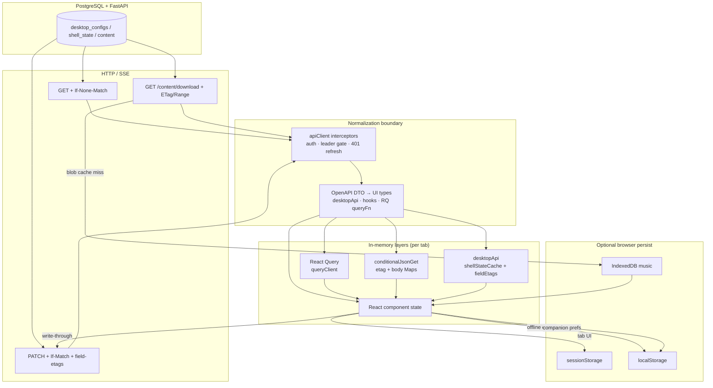
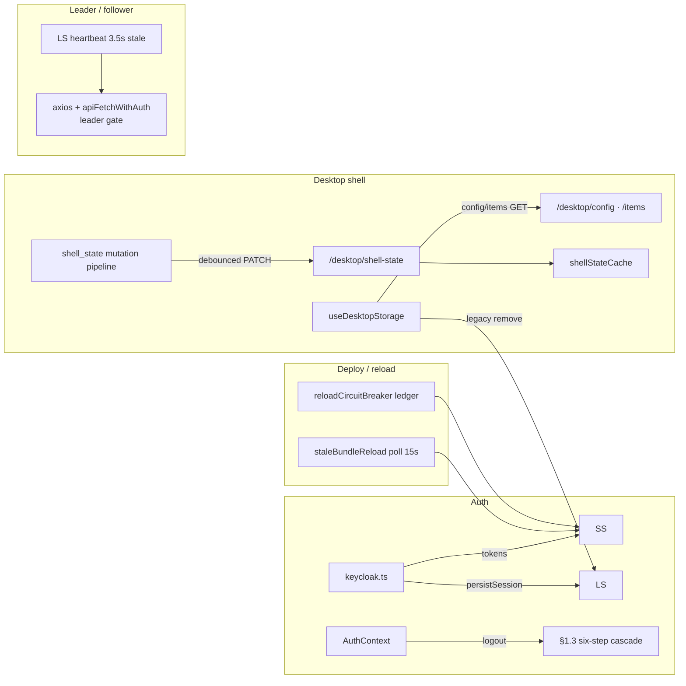
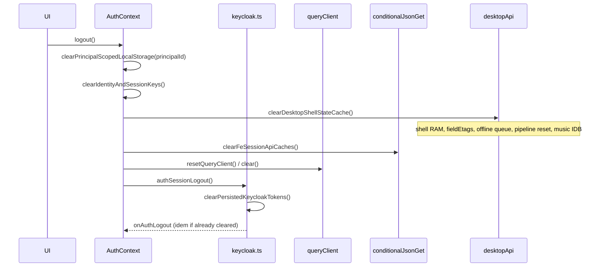

# EliteEW SPA — модель кэша и памяти браузера

Единый **SSOT** для инженеров: как фронт EliteEW держит данные в RAM и персистентных хранилищах браузера, когда они инвалидируются и кто владелец согласованности. Документ описывает **архитектуру слоёв**, а не каталог ключей `localStorage`.

**Границы:** SPA `shared/web/frontend/src/` на origin `app.eliteew.ru` (и embedded mobile WebView с тем же runtime). Не покрывает: native Android SecureTokenStore, server-side Redis, CDN/nginx cache policy (см. `platform/FRONTEND-SECURITY-NGINX-STATIC.md`).

**Связанный канон:**

- OIDC и logout facade — [FRONTEND-AUTH.md](FRONTEND-AUTH.md)
- Vite `VITE_*` / client ids — [FRONTEND-ENV.md](FRONTEND-ENV.md)
- IdP clients / realm ops — [platform/docker-re_doc/KEYCLOAK-ELITEEW.md](../platform/docker-re_doc/KEYCLOAK-ELITEEW.md)
- Desktop `shell_state`, offline queue, 412 FSM — [desktop/DESKTOP-STATE-PERSISTENCE.md](desktop/DESKTOP-STATE-PERSISTENCE.md)
- Post-deploy chunk mismatch — [platform/docker-re_doc/FRONTEND-STALE-CHUNK-404.md](../platform/docker-re_doc/FRONTEND-STALE-CHUNK-404.md)
- Bearer threat model — [platform/FRONTEND-SPA-BEARER-THREAT-MODEL.md](../platform/FRONTEND-SPA-BEARER-THREAT-MODEL.md)

**Diátaxis:** Explanation (почему слои разделены и как согласуются).

---

## 0. Иерархия слоёв (mental model)

```text
PostgreSQL (SSOT для auth-bound user data)
    ↓ Bearer + REST/SSE
Axios client (auth refresh, single-tab gate, maintenance guard)
    ↓ normalize / OpenAPI DTO
┌─────────────────────────────────────────────────────────────┐
│ RAM (tab-scoped, теряется при reload)                       │
│  • React state (Desktop shell, Companion UI)                │
│  • React Query cache (queryClient)                          │
│  • conditionalJsonGet Maps (etagByKey, bodyByKey)           │
│  • desktopApi shellStateCache + fieldEtags                  │
│  • browserTabLeaderState.currentRole (module singleton)     │
└─────────────────────────────────────────────────────────────┘
    ↓ optional write-through / fallback
┌─────────────────────────────────────────────────────────────┐
│ sessionStorage (tab-scoped, до закрытия вкладки)            │
│  • OIDC tokens (default)                                    │
│  • PKCE auth state, SSO replace confirm, deploy/reload ledgers│
│  • Companion output surface (tab UI state)                  │
└─────────────────────────────────────────────────────────────┘
┌─────────────────────────────────────────────────────────────┐
│ localStorage (origin-scoped, переживает reload)             │
│  • OIDC tokens (Remember me)                                │
│  • Desktop offline queue, leader heartbeat, sync meta       │
│  • Companion prefs (per principal), Poemma islands          │
│  • Legacy elite_desktop_* (миграция/удаление при load)      │
└─────────────────────────────────────────────────────────────┘
┌─────────────────────────────────────────────────────────────┐
│ IndexedDB                                                   │
│  • Music audio blobs (LRU, env-capped)                      │
└─────────────────────────────────────────────────────────────┘
```

**Правило чтения:** каждый домен имеет **одного владельца SSOT после login** (см. §3). Параллельные RAM-контуры (React Query vs ETag maps vs `shellStateCache`) — **намеренное** разделение, не баг документации.

---

## 1. Data flow

### 1.1. Общий поток: API → нормализация → RAM → опциональный persist



### 1.2. Домены по потокам



### 1.3. Auth + logout cascade



**Code owners (entry points):** `contexts/AuthContext.tsx`, `services/keycloak.ts`, `providers/QueryProvider.tsx`, `services/api/conditionalJsonGet.ts`, `pages/Desktop/services/desktopApi.ts`, `pages/Desktop/utils/desktopShellStateMutationPipeline.ts`.

---

## 2. Invalidation logic

**Принцип:** у каждого слоя есть **владелец инвалидации** и **триггер**. Logout и `session_replaced` — глобальный reset auth-bound RAM. `localStorage` / IndexedDB очищаются **выборочно**; `localStorage.clear()` — только осознанный путь error boundary (§4.7), не logout.

### 2.1. React Query

| Trigger | Layer | Action | Code owner |
|---------|-------|--------|------------|
| Global defaults expire (`staleTime`) | RQ RAM | Background refetch on focus/reconnect/mount | `providers/QueryProvider.tsx`, `services/api/config.ts` |
| Domain override (UGS 10–60s, AMKA, gallery 5m, products 2m) | RQ RAM | Per-query stale window | `services/api/*QueryOptions.ts`, feature hooks |
| `gcTime` 30 min без observers | RQ RAM | Entry garbage-collected | `API_CONFIG.cache.cacheTime` |
| Mutation success / explicit `invalidateQueries` | RQ RAM | Mark stale → refetch | Feature hooks |
| Logout / `onAuthLogout` | RQ RAM | **`queryClient.clear()`** | `AuthContext.tsx` → `resetQueryClient()` |
| `session_replaced` → `clearToken(true)` | RQ RAM | Same via `onAuthLogout` | `keycloak.ts` → `AuthContext` |
| Principal change (sub switch without logout) | RQ RAM | Logout cache subset via `executePrincipalChangeCacheReset` | `AuthContext.syncWithAuthSession` → `authSessionCoordinator.ts` |

**Defaults:** `staleTime.default = 5 min`, `list = 2 min`, `detail = 10 min`, `static = 30 min`, `gcTime = 30 min`, `refetchOnWindowFocus/reconnect/mount = true`.

### 2.2. conditionalJsonGet (ETag maps)

| Trigger | Layer | Action | Code owner |
|---------|-------|--------|------------|
| First GET 200 | RAM Maps | Store `etag` + `body` under namespaced key | `services/api/conditionalJsonGet.ts` |
| Subsequent GET + `If-None-Match` → 304 | RAM Maps | Return cached body; no network body | `conditionalJsonGet.ts` |
| 304 but body missing (desync) | RAM Maps | Delete etag → recursive full GET | `conditionalJsonGet.ts` |
| Response 200 without ETag header | RAM Maps | Delete etag; replace body | `conditionalJsonGet.ts` |
| Desktop PATCH config success | `desktop:config` | `invalidateDesktopConditionalCache('config')` | `desktopApi.ts` |
| Desktop shell PATCH / reload / logout | `desktop:*` | Invalidate key or prefix `all` | `desktopApi.ts`, `desktopConditionalGet.ts` |
| Logout | All ETag keys | **`clearFeSessionApiCaches()`** | `AuthContext.tsx` |
| Principal change (sub switch without logout) | All ETag keys | Same via `executePrincipalChangeCacheReset` → `clearFeSessionApiCaches` | `authSessionCoordinator.ts` |
| 412 on shell_state PATCH | ETag maps | **Not auto-invalidated**; pipeline `reloadDesktopShellStateForce()` | `desktopShellStateMutationPipeline.ts` |
| Friends overview | `friends:overview` | Cleared on global `clearFeSessionApiCaches` | `features/friends/api/friendsApi.ts` |

**Consumers:** `desktopConditionalJsonGet` (`desktop:config`, `desktop:installed`), friends overview. `shell_state` использует **отдельный** `shellStateCache` + conditional etag для PATCH `If-Match`, не только 304-GET.

### 2.3. Desktop shell_state (server authoritative)

| Trigger | Layer | Action | Code owner |
|---------|-------|--------|------------|
| Login + Desktop mount | RAM + PG | `fetchDesktopShellStateDeduplicated()` — one inflight GET | `desktopApi.ts` |
| Writer mutation (400ms debounce) | RAM → PG | Merge pending keys → PATCH with `If-Match` + field-etags | `desktopShellStateMutationPipeline.ts` |
| Real same-field 412 | RAM | Phase `conflict`; pending preserved; no offline queue for stale write | Pipeline + `DesktopSyncStatus` |
| Bounded 412 recovery | RAM | GET reload → merge pending → one retry PATCH | Pipeline |
| User Refresh / auto-recover | RAM | `reloadShellStateFromServer()` + `resolveShellStateConflict()` | `useDesktopStaleShellStateAutoRecover` |
| Logout / user switch | RAM + queue | **`clearDesktopShellStateCache()`** | `desktopApi.ts`, `AuthContext` |
| pagehide keepalive PATCH | RAM etag | Invalidate etag/body (response unreadable) | `patchDesktopShellStateKeepalive` |
| Cross-device/mobile disjoint write | PG wins | Field-aware etag may accept PATCH without 412 | Backend + `X-Shell-State-If-Match-Fields` |

Подробный FSM и writer contract — [DESKTOP-STATE-PERSISTENCE.md](desktop/DESKTOP-STATE-PERSISTENCE.md) §3.2.

### 2.4. Desktop localStorage (config/items/windows)

| Trigger | Layer | Action | Code owner |
|---------|-------|--------|------------|
| Pre-auth / offline | LS | `loadFromLocalStorage()` — defaults in RAM; **removes** stale `elite_desktop_config` / `elite_desktop_items` | `useDesktopStorage.ts` |
| Post-auth API success | LS | Config **не пишется**; legacy config key **removed** | `useDesktopStorage.ts` |
| Another tab mutates desktop | LS meta | `STORAGE_SYNC_META_KEY` broadcast → `tabConflictDetected` UI flag | `useDesktopStorage.ts` |
| Legacy windows snapshot | LS `elite_desktop_windows` | Read once → migrate to server PATCH → **remove key** | `useDesktopShellWindowPersistence.ts` |
| Offline PATCH queue | LS | `eliteew-desktop-persist-patch-queue-v1` per **auth subject**; drained on online | `desktopPersistPatchQueue.ts` |
| Logout | LS queue | **`clearDesktopPersistPatchQueue()`** inside shell cache clear | `desktopApi.ts` |
| Widget notes/todos offline | LS | Fallback keys; **no auto-merge** on reconnect | [DESKTOP-STATE-PERSISTENCE.md](desktop/DESKTOP-STATE-PERSISTENCE.md) |

### 2.5. sessionStorage

| Trigger | Layer | Action | Code owner |
|---------|-------|--------|------------|
| Close tab | SS | Entire tab SS cleared by browser | — |
| OIDC default session | SS | Tokens in `eliteew.keycloak.oidcTokens.v1` | `keycloak.ts` |
| Remember me | LS | Tokens migrate to LS; pref `eliteew.keycloak.persistencePref.v1` | `keycloak.ts`, [FRONTEND-AUTH.md](FRONTEND-AUTH.md) |
| Deploy/chunk reload ledger | SS | chunk reload flag, bundle mismatch marker, maintenance reload id, reload circuit ledger/hold | `staleBundleReload.ts`, `reloadCircuitBreaker.ts` |
| TTL reload ledger | SS | Entries older **15 min** trimmed | `reloadCircuitBreaker.ts` |
| versionCheck explicit clearCache (user confirm) | SS + SW | **`sessionStorage.clear()`** then restore recovery keys only; SW caches deleted | `versionCheck.ts` via `useVersionCheck.ts` |
| Logout | SS | PKCE state cleared **unless** interactive redirect in flight | `keycloak.ts` |
| Companion output surface | SS | Tab-scoped editor UI state | `companionOutputSurfaceState.ts` |

### 2.6. IndexedDB (music)

| Trigger | Layer | Action | Code owner |
|---------|-------|--------|------------|
| Cache enabled | IDB | `VITE_MUSIC_IDB_CACHE` not `0`/`false` | `pages/Desktop/utils/musicAudioBlobCache.ts` |
| Max size | IDB | Default **250 MB**; override `VITE_MUSIC_IDB_CACHE_MAX_BYTES` | `musicAudioBlobCache.ts` |
| Put blob | IDB | Reject if single blob > limit; **LRU prune** by `lastAccessedAt` | `musicAudioBlobCache.ts` |
| Get hit | IDB | Touch `lastAccessedAt` | `musicAudioBlobCache.ts` |
| Logout / user switch | IDB | **`clearCachedAudioBlobs()`** via `clearDesktopShellStateCache()` | `desktopApi.ts` (commit `47d36c13`) |
| Corrupt / open fail | IDB | `openDb` returns null → silent miss, network download | `musicAudioBlobCache.ts` |

Key format: `contentId:version` (from `shell_state.now_playing.track.version`). Runtime transport (`playing`, `duration`, `<audio>`) — **не** в IDB; см. [DESKTOP-STATE-PERSISTENCE.md](desktop/DESKTOP-STATE-PERSISTENCE.md) §3.2.5.

### 2.7. Maintenance / deploy reload

**Single owner:** deploy detection, auto-reload, and reload-storm protection live in **`staleBundleReload.ts`** + **`reloadCircuitBreaker.ts`**. `versionCheck.ts` is **read-only** metadata sync (`/api/version` → LS `app_version` / `app_build_hash`); it never calls `reloadAllAppTabs` or hard navigation (commit `c3fee09e`).

| Trigger | Layer | Action | Code owner |
|---------|-------|--------|------------|
| Boot prod mismatch | SS + navigation | `bundle_build_mismatch` → one auto reload per deploy id marker | `utils/staleBundleReload.ts` |
| Poll `/app-build-version.txt` 15s | SS | `deploy_version_changed` → `reloadAllAppTabs` via BroadcastChannel | `staleBundleReload.ts` |
| Chunk import failure | SS | First fail auto reload; second → manual overlay | `handleChunkLoadFailure` |
| Backend restart loop | SS ledger | Max **2 auto reloads** / 15 min → hold overlay | `services/maintenance/reloadCircuitBreaker.ts` |
| Maintenance active | — | **Defer** auto reload; OAuth `?code=` in flight also deferred | `shouldDeferStaleBundleReload` |
| Health ok after outage | SS | Clear hold + ledger | `clearReloadCircuitWhenHealthy` |
| `/api/version` metadata change | LS | Sync version/buildHash only; notify hook callback — **no reload** | `versionCheck.ts` (read-only track) |
| User confirms update in UI | SS + SW | `versionCheck.clearCache()` + optional confirm — **not** deploy auto-reload path | `useVersionCheck.ts`, `versionCheck.ts` |

### 2.8. Keycloak tokens

Logout and `session_replaced` run the **full six-step cascade** in fixed order — см. **§3.4** (не «auth-only» purge). Шаг 6 — `clearPersistedKeycloakTokens()` (auth keys в SS или LS по режиму Remember Me).

| Trigger | Layer | Action | Code owner |
|---------|-------|--------|------------|
| Login callback | LS or SS | Persist access/refresh/id + persistence mode | `keycloak.ts` |
| Access token exp | RAM timer | `onTokenExpired` → `updateToken(30)` | `AuthContext` + `keycloak.ts` |
| Tab visible | RAM | Proactive refresh (`setupTokenRefresh`) | `keycloak.ts` |
| API 401 `action=refresh` | Network | Silent refresh + retry once | `services/api/client.ts` |
| Refresh dead | All auth RAM | Toast + IdP logout redirect → full cascade via `onAuthLogout` | `AuthContext` |
| `session_replaced` API | Tokens | **`notifySessionReplaced`** → `clearToken(true)` → `onAuthLogout` (full cascade) | `client.ts`, `keycloak.ts` |
| Cross-tab replace | LS event + BC | `KEYCLOAK_SESSION_EVENT` → peer tabs clear token | `keycloak.ts` |
| Logout / `onAuthLogout` | All auth-bound layers | **§3.4 six-step cascade** (principal LS, GAF E2EE, shell RAM/IDB/queue, ETag maps, RQ, then auth tokens) | `AuthContext.tsx`, [FRONTEND-AUTH.md](FRONTEND-AUTH.md) |

---

## 3. Consistency protocol

### 3.1. PostgreSQL vs localStorage (desktop)

| Data | SSOT when authenticated | localStorage role | Merge rule |
|------|-------------------------|-------------------|------------|
| `desktop_configs` (wallpaper, theme, …) | **PostgreSQL** | Legacy read removed on load; not write-through | API wins; offline → in-memory defaults |
| `desktop_items` | **PostgreSQL** | Legacy items key removed on offline load | API wins; no LS-as-truth |
| `shell_state` | **PostgreSQL** | Offline queue holds **pending patches** per subject | On flush: merge pending atop **fresh GET** after 412 |
| `windows_snapshot` | **PostgreSQL** (`shell_state`) | Legacy `elite_desktop_windows` one-shot migration | Server snapshot first; legacy → PATCH then delete LS key |
| Widget entities offline | API when online | LS fallback display only | **No auto-merge** on reconnect |

**Offline behavior:** UI может показывать последний RAM state + LS widget fallbacks; shell/config **не** silently reconciles без sync chip / user Refresh.

### 3.2. React Query vs ETag cache vs fresh API

```text
Request path A (React Query):  queryFn → often plain api.get → RQ cache by queryKey
Request path B (ETag):         conditionalJsonGet → RAM etag map → 304 short-circuit
Request path C (shell_state):  dedicated shellStateCache + PATCH If-Match
```

| Situation | Winner |
|-----------|--------|
| RQ stale but ETag 304 | ETag body для conditionalJsonGet caller; RQ refetch независимо если stale |
| RQ fresh, server changed without invalidation | Stale до staleTime/refetch/mutation invalidation |
| shell_state PATCH after local edits | Pipeline merge pending → server response **replaces** shellStateCache + etag |
| Logout | **Both** RQ and ETag cleared; next session cold fetch |

**Invariant:** ETag maps и RQ **не unified** — duplicate caching intentional (desktop config ETag GET vs feature queries RQ). См. **per-endpoint owner** table below (Wave 6).

#### Per-endpoint cache owner (Wave 6)

Intentional split — do **not** unify into one RAM layer. Cite this table when choosing invalidate vs refetch.

| Endpoint / data | Owner layer | Invalidate / clear path | Notes |
|-----------------|-------------|-------------------------|-------|
| Desktop config / installed apps | **ETag** (`conditionalJsonGet` / `desktopConditionalJsonGet`) | `invalidateDesktopConditionalCache` / `clearFeSessionApiCaches` | Namespaces `desktop:config`, `desktop:installed` |
| `shell_state` | **shellStateCache** (+ field etags, PATCH `If-Match`) | `clearDesktopShellStateCache` / follower BC invalidate | Not RQ; not plain 304-GET-only |
| Feature lists, marketing cabinet, profile/me | **React Query** | `invalidateQueries` / `resetQueryClient` | Plain `api.get` in `queryFn` |
| Friends overview | **Dual:** RQ (`friendsQueryKeys.overview`) + ETag (`friends:overview`) | Both cleared on logout / principal-change cascade | RQ owns UI freshness; ETag short-circuits GET body — intentional dual until a unify wave |

### 3.3. Leader tab vs follower

| Aspect | Leader | Follower |
|--------|--------|----------|
| Election | LS heartbeat `eliteew-desktop-realtime:heartbeat:{userId}`, stale **3.5s** | Same; yields on `leader-alive` BC message |
| Gated REST (`/desktop/*`, `/ewa/*`, `/friends/*`, …) | Allowed | **Blocked in axios** before HTTP |
| Gated mutations via `apiFetchWithAuth` (POST/PATCH/DELETE, streaming) | Allowed | **Blocked** before `fetch` |
| Gated read-only `apiFetchWithAuth` GET/HEAD | Allowed | Allowed (read-only pass-through) |
| Content media GET download/thumbnail | Allowed | Allowed (read-only exception) |
| Socket.IO | Web Lock mutex + connect | **No socket** (onRelease) |
| shell_state PATCH | Via pipeline | **Never** — blocked at interceptor |
| shell_state pagehide keepalive PATCH | Via `patchDesktopShellStateKeepalive` | **Never** — leader gate in keepalive + pipeline |
| RAM shell_state | Written on GET/PATCH | Initial GET; **invalidated on leader `shell-state-invalidated` BC** after leader PATCH |
| Realtime events | Receives Socket.IO | **No realtime** — follower UX debt §8 |

**Invariants:**

- Follower **never writes** gated REST.
- Leader is **single writer** for shell_state PATCH and most desktop mutations.
- Follower RAM invalidated on leader PATCH via `shell-state-invalidated` BC; React state refetch remains hook-driven (follower GET still gated).

### 3.4. Logout cascade (canonical order)

Explicit `logout()`, `onAuthLogout` (`session_replaced`, terminal refresh failure), **`onAuthError`**, **`onAuthRefreshError`**, and **`keycloak.init()` failure after `clearSession(true)`** execute the **same client teardown** via **`executeAuthSessionTermination()`** (kill switch → §3.4 cache steps). Step **6** remains in `authSessionLogout()` / `clearPersistedKeycloakTokens()`. Порядок фиксирован; шаги 0–5 идут **до** IdP redirect on explicit logout.

| Step | Action | Layers cleared | Code owner |
|------|--------|----------------|------------|
| **0** | `executeAuthSessionTermination({ principalId })` | Re-entry lock + HTTP abort + socket disconnect, then steps 1–5 below | `authSessionCoordinator.ts` |
| **0b** | `abortAllPendingHttpRequests()` | Session-scoped `AbortSignal` + **AbortControllerRegistry** (per-request controllers) for in-flight axios/fetch | `authSessionHttpAbort.ts`, `services/api/client.ts` |
| **0a** | `beginAuthSessionTeardown()` / `endAuthSessionTeardown()` / `clearAuthSessionHttpFreeze()` | Transient teardown lock + **HTTP freeze until next auth success** — blocks axios/fetch/socket refresh/sync re-entry | `authSessionLock.ts`, `AuthContext.tsx` |
| **0c** | `terminateAllAuthenticatedSockets()` | Socket.IO disconnect + registered teardown hooks | `authSessionSocketTeardown.ts`, `useSocketConnection.tsx` |
| **1–5** | `executeFullLogoutCascade({ principalId })` | Steps below in fixed order + token exp RAM cache + notification center RAM | `authSessionCoordinator.ts` |
| **1a** | `clearPrincipalScopedLocalStorage(principalId)` | Principal-scoped **localStorage**: companion/Poemma prefixes, desktop user-content (widget notes/todos/favorites, clipboard history, recent apps/files, notification center, legacy windows snapshot, GAF Chat UX prefs), plus residual activity islands (`lastVisitedPage`, doc recent/search, voice settings, voice-command history/macros, transcription history, desktop persist patch queue, marketing company/project selection, music/now-playing mirrors, EWRP `ewrp-draft-*`, assistant local FAQ, imperorG snapshot, PW ewdesk draft) | `clearPrincipalScopedLocalStorage.ts` |
| **2** | `clearIdentityAndSessionKeys()` | GAF Chat **E2EE crypto material** in LS | `GAFChatCrypto.ts` |
| **3** | `clearDesktopShellStateCache()` | Shell RAM cache, field-etags, offline persist queue, coalesced writer reset, **music IndexedDB** (`clearCachedAudioBlobs()`) | `desktopApi.ts` |
| **4** | `clearFeSessionApiCaches()` | All **conditionalJsonGet** etag/body maps | `conditionalJsonGet.ts` |
| **5** | `resetQueryClient()` + `clearTokenCache()` | **React Query** `queryClient.clear()`; JWT exp RAM cache | `QueryProvider.tsx`, `tokenCache.ts` |
| **6** | `authSessionLogout()` → `clearPersistedKeycloakTokens()` | OIDC tokens in **sessionStorage** (default) or **localStorage** (Remember Me) — auth keys only, not `localStorage.clear()` | `keycloak.ts` |

**Invariants:**

- Ordinary logout **never** calls `localStorage.clear()` / `sessionStorage.clear()` — selective prefix/key purge only (full origin wipe — **§4.7** error boundary only).
- **Preserved on logout:** pre-auth/offline fallbacks `elite_desktop_config`, `elite_desktop_items` (not principal-scoped user content).
- **`session_replaced`:** same cascade via `onAuthLogout`; PKCE state in SS preserved while interactive redirect in flight — [FRONTEND-AUTH.md](FRONTEND-AUTH.md) §Session Replacement UX.
- **Principal change (sub switch without logout):** `AuthContext.syncWithAuthSession` compares previous vs next principal id; when both set and differ, calls **`executePrincipalChangeCacheReset({ principalId: previous })`** (same cache subset as `executeFullLogoutCascade` — steps 1–5) **before** `commitAuthSnapshot`. Does **not** abort HTTP, disconnect sockets, or take `authSessionLock`. Same principal / first login / silent token refresh — no reset.

Automated lock: `authSessionCoordinator.test.ts` (broken init G1/G2), `authSessionDeathSpiral.test.ts` (kill switch / re-entry guard), `full_logout_cascade.test.ts` + `cacheLifecycle.integration.test.ts` (§9 bundle).

### 3.5. Auth token: localStorage vs sessionStorage

| Mode | Storage | Survives |
|------|---------|----------|
| Default login | `sessionStorage` | Tab close |
| Remember me / `persistSession: true` | `localStorage` | Browser restart |
| Preference | `eliteew.keycloak.persistencePref.v1` in LS | Guides next login default |

Step **6** of §3.4 clears persisted tokens in the active storage (SS or LS); steps 1–5 run first regardless of Remember Me mode.

### 3.6. windows_snapshot: server vs legacy LS

```text
Priority on restore:
1. GET shell_state.windows_snapshot (server)
2. If empty/corrupt → legacy LS elite_desktop_windows
3. Legacy ok → immediate PATCH to server + remove LS key
4. Ongoing persistence → only shell_state PATCH (debounce), not LS
```

Runtime window state (position, zIndex) lives in React; serialized snapshot strips transient fields (`sanitizeWindowPayloadForShellPersistence`).

### 3.7. Global invariants (explicit)

1. **After login, shell_state on server is SSOT** for persisted desktop scenarios (MRU, windows, playlists, …).
2. **Logout runs the full §3.4 six-step cascade** — not auth-only or companion-only partial purge.
3. **Deploy auto-reload single owner:** only `staleBundleReload` + `reloadCircuitBreaker`; `versionCheck` is read-only metadata (commit `c3fee09e`).
4. **Follower never writes gated REST.**
5. **412 stale shell write is not retried via offline queue** until rebased on fresh GET.
6. **OIDC PKCE state preserved** during `session_replaced` if interactive login in flight.
7. **Auto reload suppressed** during maintenance window and OAuth callback.
8. **Protected URLs** (`/api/...`, `unified-content/.../download`) never in raw `` / `<audio src>` — authenticated blob/object URL only ([DESKTOP-STATE-PERSISTENCE.md](desktop/DESKTOP-STATE-PERSISTENCE.md) §6).

### 3.8. Verified lifecycle hooks (closed gaps)

| Hook | Trigger | Action | Code owner | Evidence |
|------|---------|--------|------------|----------|
| **Full logout cascade** | `AuthContext` logout / `onAuthLogout` | **§3.4 steps 1–6** in order | `AuthContext.tsx` | commits `48130ed3`, `646f6d43`; `full_logout_cascade.test.ts`, `cacheLifecycle.integration.test.ts` |
| Logout principal-scoped LS purge (step 1) | same | `clearPrincipalScopedLocalStorage(principalId)` — companion/Poemma/desktop user-content prefixes | `clearPrincipalScopedLocalStorage.ts` | commit `4e20bf70`; `clearPrincipalScopedLocalStorage.test.ts` |
| Logout GAF E2EE purge (step 2) | same | `clearIdentityAndSessionKeys()` | `GAFChatCrypto.ts` | commit `48130ed3`; `GAFChatCrypto.logout.test.ts` |
| Logout shell + music IDB (step 3) | same | `clearDesktopShellStateCache()` → `void clearCachedAudioBlobs()` | `desktopApi.ts`, `musicAudioBlobCache.ts` | commit `47d36c13`; `desktopApi.logoutTeardown.test.ts` |
| Deploy detection single owner | Boot mismatch, poll `/app-build-version.txt`, chunk import fail | Auto-reload + circuit breaker ledger only via `staleBundleReload`; `versionCheck` syncs metadata without navigation | `staleBundleReload.ts`, `reloadCircuitBreaker.ts`, `versionCheck.ts` | commit `c3fee09e`; `deployDetectionConsolidation.test.ts` |
| Cache invalidation observability | ETag desync/304, desktop conditional invalidate, shell 412, logout RQ/shell clear | `[CACHE]` structured debug via `logCacheInvalidation` / `ServiceLogger` | `cacheInvalidationLogger.ts`, `conditionalJsonGet.ts`, `desktopApi.ts`, `QueryProvider.tsx` | commit `15a99b39`; `conditionalJsonGet.test.ts`, `desktopApi.shellStatePatch.test.ts` |

---

## 4. Failure modes (Layer B)

Каждый сценарий: **failure → layer → degradation → observable UX**.

### 4.1. IDB quota / corrupted DB (music)

```text
Failure: QuotaExceededError or IDB open/onupgradeneeded error
  → Layer: IndexedDB (musicAudioBlobCache)
  → Degradation: put/get return false/null; withStore catches → null
  → UX: Track plays via network + HTTP ETag/Range; no offline replay cache;
        no user-visible IDB error toast (silent degrade)
```

### 4.2. localStorage quota (wallpaper data URL, Poemma)

```text
Failure: DOMException quota on setItem
  → Layer: localStorage
  → Degradation:
      • Wallpaper PATCH: if len > 500k chars, wallpaper omitted from PATCH
      • useDesktopStorage broadcast/sync: caught, ignored
      • Poemma modules: repository write fails → UI error states
      • Desktop persist queue: enqueue may fail → sync error chip
  → UX: Обои могут не дойти до сервера; Poemma «local only»; desktop sync warning
```

### 4.3. Stale SPA bundle vs API

```text
Failure: Baked JS deploy_id ≠ /app-build-version.txt
  → Layer: Browser HTTP cache (JS) vs deploy watcher
  → Degradation: staleBundleReload → hard navigation; circuit breaker after 2 auto reloads
  → UX: Auto reload once; then manual overlay;
        API may 404 on old routes → AppErrorBoundary
```

### 4.4. Token refresh fail / stale JWT

```text
Failure: refresh_token invalid / network error on updateToken
  → Layer: keycloak.ts → AuthContext onTokenExpired
  → Degradation: clearSession → onAuthLogout → RQ+ETag+shell clear; redirect IdP logout
  → UX: Toast sessionAuth.loginRedirecting; LoginPageFallback
Alternative: session_replaced → no auto IdP redirect; manual «Войти через SSO»
```

### 4.5. ETag desync / 304 miss

```text
Failure: Server returns 304 but client lost body map entry
  → Layer: conditionalJsonGet RAM
  → Degradation: Delete stale etag → recursive full GET (200)
  → UX: Transparent; extra round-trip

Failure: shell_state PATCH 412 (same-field conflict)
  → Layer: mutation pipeline
  → Degradation: phase=conflict; pending preserved; flush blocked
  → UX: DesktopSyncStatus «Обновлено в другом месте» + Refresh
```

### 4.6. Follower tab expecting realtime

```text
Failure: User expects live GAF/desktop sync in second tab
  → Layer: Leader election + socket mutex
  → Degradation: Follower has no Socket.IO; gated writes blocked; shell RAM from initial GET
  → UX: Second tab read/media OK; writes blocked at interceptor;
        stale UI until manual refresh; handoff dialog for leadership transfer
```

### 4.7. AppErrorBoundary localStorage.clear()

```text
Failure: Unhandled React render error
  → Layer: AppErrorBoundary optional «Сбросить и перезагрузить»
  → Degradation: localStorage.clear() + manual hard reload (NOT default logout path)
  → UX: Wipes ALL origin LS including Remember me pref, companion prefs, Poemma, queues;
        sessionStorage survives until reload; user must re-login
Note: Ordinary logout does NOT call localStorage.clear() (by design)
```

---

## 5. Boundary of responsibility

| Layer | Owns | Never owns | Invalidation owner |
|-------|------|------------|-------------------|
| **PostgreSQL** | Durable user desktop, shell_state, content bytes | Client UX state, transport (playing/paused) | Backend migrations/API |
| **Axios client** | Bearer injection, 401 refresh once, leader gate, maintenance guard | Business merge semantics | Public `services/api/client.ts` → `createAPIClient.ts` / `apiFetchWithAuth.ts` (Wave 26) |
| **React Query** | Feature list/detail caches, polling cadence | shell_state etag coherence | Feature hooks + `resetQueryClient` on logout |
| **conditionalJsonGet** | HTTP conditional GET dedup (304) | Mutation side effects | `invalidate*`, `clearFeSessionApiCaches` |
| **desktopApi shell RAM** | shell_state snapshot, field-etags, dedup GET | Cross-tab sync | `clearDesktopShellStateCache`, pipeline reload |
| **shell_state pipeline** | Debounced PATCH, 412 recovery FSM | Direct HTTP from hooks | `desktopShellStateMutationPipeline.ts` |
| **localStorage desktop** | Offline patch queue, leader heartbeat, sync meta | Authoritative config/items post-auth | Queue drain, logout clear, migration hooks |
| **sessionStorage** | Tab session tokens (default), reload ledgers, PKCE | Cross-tab durable prefs | Tab close; selective clear on auth/version |
| **IndexedDB music** | Audio blob bytes LRU | Track metadata (in shell_state) | Env flag; `clearCachedAudioBlobs` on logout via `clearDesktopShellStateCache` |
| **keycloak.ts** | OIDC token lifecycle, cross-tab session events | API data caches | `clearPersistedKeycloakTokens`, `notifySessionReplaced` |
| **Leader election** | Single writer for gated API + socket | shell_state CRDT | Heartbeat timeout 3.5s, handoff BC |
| **staleBundleReload + circuit breaker** | Deploy detection, reload storm protection (single owner) | API data correctness; `/api/version` metadata | Health ok, manual user reload |
| **versionCheck** | Read-only `/api/version` metadata in LS; optional user-initiated clearCache | Deploy auto-reload, hard navigation | Hook callback only; explicit user confirm for clearCache |
| **cacheInvalidationLogger** | `[CACHE]` debug traces at invalidation boundaries | Business merge semantics | `logCacheInvalidation` at ETag/shell/RQ teardown sites |
| **clearPrincipalScopedLocalStorage** | Companion/Poemma/desktop user-content LS purge on logout | Auth tokens; pre-auth `elite_desktop_config` / `elite_desktop_items` | `AuthContext` logout + `onAuthLogout` |

---

## 6. Companion prefs (кратко)

Companion хранит **per-principal** зеркала в LS/SS:

- **localStorage:** voice-out, observation triggers, recent tools, snooze, phrase icons, document drafts, editor hints — **purged on logout / `session_replaced`** via `clearPrincipalScopedLocalStorage()` (prefixes `eliteew.ewaCompanion.*`, `eliteew.companion.*`, `ewa_companion_*`, Poemma `poemmaStoragePrefix(principalId)`).
- **Desktop user-content LS:** widget notes/todos/favorites (`elite_desktop_widget_*`), clipboard history (`desktop-clipboard-history`), recent apps/files, notification center, legacy windows snapshot, GAF Chat UX prefs (`eliteew.gafChat.*`), plus residual activity islands listed in §3.4 step 1a (`lastVisitedPage`, doc recent/search, voice settings, …) — **purged on logout** via the same helper; **not** layout fallbacks `elite_desktop_config` / `elite_desktop_items`, and **not** device chrome prefs (`app_version` / `app_build_hash`, theme, `eliteew.desktop.clipboardPolicy.v1`, guide audio).
- **sessionStorage:** output surface layout, quick presets expanded state, DAG drag session — tab-scoped; cleared when tab closes.

Server sync там, где есть API (observation triggers → companion-user-workflows); остальное — client-first с best-effort persist. Детали UX — [ewa/EWA-COMPANION-USER-UX-MAP.md](ewa/EWA-COMPANION-USER-UX-MAP.md).

---

## 7. What NOT to do

1. **Не** считать `localStorage` SSOT для desktop config/items после login — только API/PostgreSQL.
2. **Не** вызывать gated PATCH из follower tab — interceptor блокирует до HTTP.
3. **Не** класть stale shell_state 412 payload в offline queue без reload GET.
4. **Не** использовать `localStorage.clear()` / `sessionStorage.clear()` в logout — только **§3.4 six-step selective purge**; full origin clear только error boundary (§4.7).
5. **Не** полагать на React Query invalidation для ETag maps — разные контуры.
6. **Не** ожидать auto-merge widget offline LS → server без явного user action.
7. **Не** документировать exhaustive key list — использовать **principal-scoped prefixes** и правила выше.

**Примеры ключей (иллюстрация правил, не каталог):**

- `eliteew.keycloak.oidcTokens.v1` — auth tokens
- `desktop:config` — ETag namespace (RAM key, not LS)
- `eliteew-desktop-persist-patch-queue-v1` — offline shell queue
- `elite_desktop_windows` — legacy migration only
- `eliteew_reload_ledger_v1` — reload circuit SS ledger

---

## 8. Architecture debt (gaps)

| Gap | Risk | Suggested direction | Wave |
|-----|------|---------------------|------|
| ~~Нет единого canon-doc для cache layers~~ | — | **Closed:** этот документ | Wave 0 ✓ |
| ~~Music IDB not cleared on logout~~ | — | **Resolved Wave 1 Thread 1:** `clearDesktopShellStateCache()` calls `clearCachedAudioBlobs()` | Wave 1 ✓ (`47d36c13`) |
| ~~Dual deploy watchers (`staleBundleReload` vs `versionCheck`)~~ | — | **Resolved Wave 1 Thread 2:** `versionCheck` read-only; single owner `staleBundleReload` + `reloadCircuitBreaker` | Wave 1 ✓ (`c3fee09e`) |
| ~~Companion LS islands on logout~~ | — | **Resolved Wave 1 Thread 3:** `clearPrincipalScopedLocalStorage()` on logout / `session_replaced` | Wave 1 ✓ (`4e20bf70`) |
| ~~No structured cache invalidation logging~~ | — | **Resolved Wave 1 Thread 4:** `[CACHE]` via `cacheInvalidationLogger` at invalidation boundaries | Wave 1 ✓ (`15a99b39`) |
| ~~RQ vs ETag duplication~~ | Stale UI in features using both | **Documented Wave 6** (intentional split): per-endpoint owner table in §3.2 — desktop config/installed → ETag; shell_state → shellStateCache; feature lists/marketing/profile → RQ; friends overview dual | Wave 6 ✓ |
| Follower stale shell RAM | Confusing multi-tab UX | **Resolved Wave 2 Thread B:** BroadcastChannel `shell-state-invalidated` on leader PATCH → follower `invalidateDesktopShellStateRamCache()` | Wave 2 ✓ |
| ~~User switch without full logout path~~ | RQ/ETag may retain prior user until replace | **Resolved Wave 6:** `executePrincipalChangeCacheReset` (logout cache subset) from `AuthContext.syncWithAuthSession` when previous ≠ next principal | Wave 6 ✓ |
| ~~No integration test for full cache matrix~~ | — | **Resolved Wave 2 Thread A:** `cacheLifecycle.integration.test.ts` locks login → fetch → logout → empty (RQ, ETag, shell RAM, music IDB, principal LS) | Wave 2 ✓ |
| ~~Phase 1 manual logout proofs not automated~~ | Regression drift | **Resolved Wave 2:** `full_logout_cascade.test.ts` — E2EE + widget + clipboard + OIDC SS sweep | Wave 2 ✓ |
| ~~Residual Cloud logout LS islands (doc/voice/lastVisited/EWRP…)~~ | Cross-user UI residue after selective cascade | **Resolved 2026-08-10:** expanded `clearPrincipalScopedLocalStorage()` inventory; device chrome prefs kept | `077118b82` ✓ |

---

## 9. Operator smoke (cache coherence)

1. **Logout isolation:** Login → Desktop load → logout → login as other user → **no** previous user data in UI (full **§3.4 cascade**: RQ, ETag maps, shell RAM, music IDB, GAF E2EE LS, principal-scoped companion/desktop user-content LS cleared; pre-auth `elite_desktop_config` / `elite_desktop_items` preserved). Network: no authenticated calls with old Bearer after logout.
2. **Leader/follower:** Two tabs same user; leader mutates shell_state → follower shows stale until Refresh; follower PATCH **must not** appear in network log (`/api/v1/desktop/shell-state`).
3. **Deploy rebake:** Change `app-build-version.txt` on prod → auto reload once per deploy id; third failure in 15 min window → manual overlay (circuit breaker hold).
4. **Music IDB:** Replay same track (`contentId:version`) → second play network idle (IDB hit). Set `VITE_MUSIC_IDB_CACHE=0` in dev → always network. Logout clears IDB via `clearDesktopShellStateCache()` (verify empty in DevTools → Application → IndexedDB).
5. **Remember me:** Off → close tab → tokens gone (SS). On → tokens in LS survive restart; logout runs full **§3.4 cascade** (steps 1–5 before step 6 clears auth tokens in LS — not `localStorage.clear()`).
6. **Deploy single owner:** Change `/app-build-version.txt` → one auto reload via `staleBundleReload`; `/api/version` metadata sync alone must **not** trigger navigation. Optional: filter DevTools console for `[CACHE]` during logout or shell 412 conflict.
7. **shell_state 412:** Two tabs; stale write in follower → sync chip «Обновлено в другом месте»; Refresh clears conflict; stale payload not in offline queue as success.
8. **Protected media:** Open Downloads folder preview — no 401 in Network for raw `/api/...` in ``; blob/object URL path only.

**Automated guards (Wave 3 consolidated + Wave 2 logout cascade lock + auth death-spiral kill switch + Wave 6 principal-change):** см. §10 Test Coverage Map. Узкий regression bundle (10 files):

```bash
cd shared/web/frontend && pnpm exec vitest run \
  src/services/auth/__tests__/authSessionDeathSpiral.test.ts \
  src/services/auth/__tests__/full_logout_cascade.test.ts \
  src/services/auth/__tests__/principalChangeCacheReset.test.ts \
  src/services/auth/__tests__/cacheLifecycle.integration.test.ts \
  src/pages/Desktop/utils/__tests__/desktopShellStateFollowerInvalidate.test.ts \
  src/services/api/__tests__/conditionalGetAxiosContract.test.ts \
  src/services/auth/__tests__/clearPrincipalScopedLocalStorage.test.ts \
  src/pages/Desktop/services/__tests__/desktopApi.logoutTeardown.test.ts \
  src/utils/__tests__/deployDetectionConsolidation.test.ts \
  src/services/api/__tests__/conditionalJsonGet.test.ts
```

Дополнительно (не в bundle): `desktopApi.shellStatePatch.test.ts`, `desktopShellStateMutationPipeline.test.ts`, `shellStatePipeline.integration.test.ts`, `e2e/desktop-shell-state-conflict.spec.ts`, `staleBundleReload.test.ts` — см. [DESKTOP-STATE-PERSISTENCE.md](desktop/DESKTOP-STATE-PERSISTENCE.md) §3.3.

---

## 10. Verification status

**Phase 1 audit remediation (2026-07-03):** Threads 1–3 closed — GAF E2EE/XSS (security), single-writer gate (architecture), desktop LS privacy (logout clean slate).

**Wave 2 regression lock (2026-07-03):** `full_logout_cascade.test.ts` — automated invariant that full logout cascade leaves zero sensitive LS/SS keys; pre-auth desktop fallbacks preserved.

**Wave 3 audit (2026-07-03):** Layer A/B/C complete for cache stabilization Waves 0–2 + Phase 1 fixes. Consolidated vitest bundle: **8 files** (see §9 command).

### Test Coverage Map

| Component | Invariant (§3.4 / §3.7 / §2) | Test file | Status |
|-----------|------------------------------|-----------|--------|
| **Full logout cascade (Wave 2 lock)** | §3.4 — zero sensitive LS/SS after logout; pre-auth config/items kept | `full_logout_cascade.test.ts` | **covered** |
| **Principal-change cache reset (Wave 6)** | §3.4 subset without kill switch; AuthContext previous≠next wire | `principalChangeCacheReset.test.ts` | **covered** |
| **Auth death-spiral kill switch** | §3.4 step 0 — HTTP abort + socket teardown + re-entry lock; session-replaced integrity | `authSessionDeathSpiral.test.ts` | **covered** |
| React Query logout reset | §3.4 step 5 — `resetQueryClient()` / empty cache on logout | `cacheLifecycle.integration.test.ts` | **covered** |
| conditionalJsonGet 304/etag | §2.2 — 304 short-circuit, desync retry, axios boundary | `conditionalJsonGet.test.ts`, `conditionalGetAxiosContract.test.ts` | **covered** |
| shell_state pipeline 412 | §2.3 / §3.7 #5 — conflict phase, no blind retry | `desktopApi.shellStatePatch.test.ts`, `desktopShellStateMutationPipeline.test.ts`, `shellStatePipeline.integration.test.ts`, `e2e/desktop-shell-state-conflict.spec.ts` | **covered** (pipeline FSM outside Wave 3 bundle) |
| clearDesktopShellStateCache / music IDB | §3.4 step 3 — `clearCachedAudioBlobs()` on logout | `desktopApi.logoutTeardown.test.ts`, `desktopApi.logoutTeardown.mock.test.ts`, `cacheLifecycle.integration.test.ts` | **covered** |
| clearPrincipalScopedLocalStorage | §3.4 step 1 — companion/Poemma/desktop user-content prefix purge | `clearPrincipalScopedLocalStorage.test.ts`, `cacheLifecycle.integration.test.ts` | **covered** (widget + clipboard F-05) |
| GAF E2EE LS purge on logout | §3.4 step 2 — `clearIdentityAndSessionKeys()` | `GAFChatCrypto.logout.test.ts`, `cacheLifecycle.integration.test.ts` | **covered** |
| staleBundleReload / deploy consolidation | §3.7 #3 — single owner; `versionCheck` read-only | `deployDetectionConsolidation.test.ts`, `staleBundleReload.test.ts` | **covered** (circuit breaker partial in bundle) |
| Follower shell invalidate | §3.3 — BC `shell-state-invalidated` → RAM clear | `desktopShellStateFollowerInvalidate.test.ts` | **covered** |
| cacheInvalidationLogger `[CACHE]` | §3.8 — structured debug at invalidation boundaries | `conditionalJsonGet.test.ts`, `desktopApi.shellStatePatch.test.ts`, `desktopShellStateFollowerInvalidate.test.ts` | **partial** — RQ teardown log not isolated in unit test |

### Layer evidence

| Layer | Evidence |
|-------|----------|
| A (structure) | This doc + cross-links to [FRONTEND-AUTH.md](FRONTEND-AUTH.md), [DESKTOP-STATE-PERSISTENCE.md](desktop/DESKTOP-STATE-PERSISTENCE.md) |
| B (tracing) | Model derived from `input → boundary → normalizer → side effect → observable output` across modules listed in §1 |
| C (behavioral tests) | Wave 1 cause locks (`47d36c13`, `c3fee09e`, `4e20bf70`, `15a99b39`) + Phase 1 stabilization (`48130ed3`) + Wave 2 lock (`646f6d43`, `full_logout_cascade.test.ts`) + integration matrix `cacheLifecycle.integration.test.ts` |

### Complexity note (Wave 1–2 diff since `5118f248`)

| File | Lines now | Δ vs Wave 0 | Flag |
|------|-----------|-------------|------|
| `pages/Desktop/services/desktopApi.ts` | 837 | +43 | **>800** (modest growth; pre-existing god-module) |
| `pages/Desktop/utils/desktopRealtimeLeader.ts` | 653 | +19 | OK |
| All other changed FE sources | ≤513 | — | OK |

No new file **introduced** above 800 lines in Waves 1–2.

---

## Связанные документы

| Документ | Связь |
|----------|-------|
| [FRONTEND-AUTH.md](FRONTEND-AUTH.md) | OIDC storage, logout keys, session replace |
| [desktop/DESKTOP-STATE-PERSISTENCE.md](desktop/DESKTOP-STATE-PERSISTENCE.md) | shell_state pipeline, desktop LS, 412 UX |
| [desktop/DESKTOP-WINDOW-RUNTIME-PERFORMANCE.md](desktop/DESKTOP-WINDOW-RUNTIME-PERFORMANCE.md) | Socket-driven invalidation anti-patterns |
| [platform/docker-re_doc/FRONTEND-STALE-CHUNK-404.md](../platform/docker-re_doc/FRONTEND-STALE-CHUNK-404.md) | Post-deploy chunk 404 |
| [platform/SSO-SESSION-REGISTRY-AND-ADMIN-PRESENCE.md](../platform/SSO-SESSION-REGISTRY-AND-ADMIN-PRESENCE.md) | Leader tab, SSO registry |
