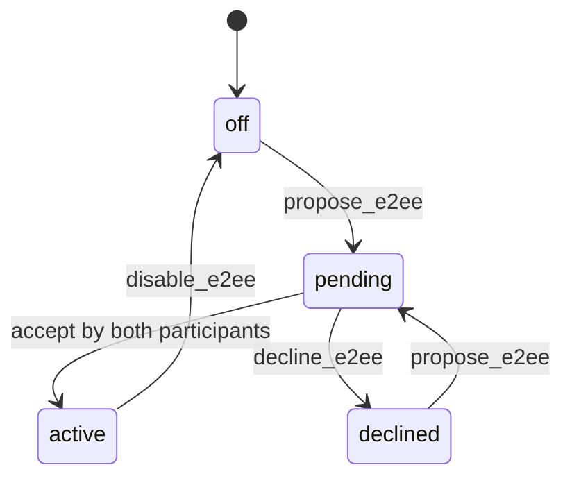

# GAF Chat (Global & Friends)

Внутренний мессенджер 1:1 между пользователями EliteEW: чаты по нику, интеграция с разделом «Друзья», серверное шифрование тела сообщений (фаза 1), задел под E2E (фаза 2). Канон доверенных мобильных устройств и ключей E2EE: [`product/mobile/MOBILE-TRUSTED-DEVICE-BINDING.md`](mobile/MOBILE-TRUSTED-DEVICE-BINDING.md).

> Операторский runtime по умолчанию: **Podman**.

**Фронтенд (Desktop):** структура модулей, композер, очередь вложений, drag/paste, сжатие изображений, горячие клавиши — канон **`product/GAF-CHAT-DESKTOP-REFERENCE.md`**. Historical UI roadmap soft-retired under `trash/` (id 20260812-162003, was …/GAF-CHAT-ROADMAP.md).

---

## 1. Назначение

- **Цель**: переписка между пользователями по нику, быстрый старт чата из раздела «Друзья» в Desktop.
- **Тип чатов**: только 1:1 (без групп).
- **Где**: приложение «GAF Chat» в Desktop (лаунчер), кнопка «Начать чат» в Файловый менеджер рядом с другом.
- **Безопасность**: фаза 1 — серверное шифрование (AES-256-GCM, ключ из конфига); фаза 2 — E2E (таблицы и API ключей заложены).

---

## 2. Схема БД (ai_services)

Миграции применяются к БД **ai_services** (пользователь **ai_user**), так же как у друзей и контента.

### 2.1. Таблицы

| Таблица | Назначение |
|--------|------------|
| **gaf_chats** | Диалог 1:1: `id`, `user_id_1`, `user_id_2`, `created_at`, `updated_at`, `last_message_at`, read/archive columns, and E2EE consent columns (`e2ee_status`, `e2ee_requested_by_user_id`, consent/activated/declined/disabled timestamps). Уникальная пара по `LEAST/GREATEST(user_id_1, user_id_2)`. |
| **gaf_messages** | Сообщения: `id`, `chat_id`, `sender_id`, `body_ciphertext`, `body_plain_preview`, `nonce`, `algorithm`, `encryption_version`, `created_at`, `edited_at`, `deleted_at`, `deleted_for_sender`, `deleted_for_recipient`. |
| **gaf_message_keys** | Задел E2E: зашифрованные сессионные ключи (`chat_id`, `message_id`, `user_id`, `encrypted_key_payload`). |
| **gaf_user_public_keys** | Публичные ключи пользователей для E2E handshake (`user_id`, `public_key_pem`, `algorithm`, `created_at`, `updated_at`). |

### 2.2. Миграции

- **Файлы**: `shared/api/migrations/gaf_chat_tables.sql`, `gaf_chat_keys.sql`, `gaf_chat_rollback.sql`.
- **Runner (канон):** `docker/scripts/apply-eliteew-migrations.sh` — ключ
  `20260903_01|gaf_user_public_keys` → `applied/20260903_01_gaf_user_public_keys.sql`
  (`CREATE TABLE IF NOT EXISTS`). Без этой таблицы `GET/POST /api/v1/gaf-chat/keys/public*`
  дают `UndefinedTableError` (prod incident 2026-09-03: lady_boss mobile).
- **Одноразово / legacy:**
  ```bash
  podman exec -i stack1-postgres psql -U ai_user -d ai_services < shared/api/migrations/gaf_chat_tables.sql
  podman exec -i stack1-postgres psql -U ai_user -d ai_services < shared/api/migrations/gaf_chat_keys.sql
  ```
- **Проверка**: в psql `\dt gaf_*` — `gaf_chats`, `gaf_messages`, `gaf_message_keys`, `gaf_user_public_keys`.
- **Откат**: выполнить `gaf_chat_rollback.sql` (осторожно, не на проде без бэкапа).

---

## 3. API (REST)

Базовый путь: **`/api/v1/gaf-chat`**. Авторизация: тот же механизм, что у Friends/Content (`get_content_user_id`).

| Метод | Путь | Описание |
|-------|------|----------|
| GET | `/me` | Текущий пользователь: `{ "user_id": "<uuid>" }`. |
| GET | `/chats` | Список чатов с `partner`, `last_message_at`, `last_message_preview`, `unread_count`. |
| POST | `/chats/by-username` | Body `{ "username": "nick" }` — получить или создать чат по нику. |
| GET | `/chats/{chat_id}/messages` | Сообщения (cursor: `before`, `after`, `limit`, по умолчанию 50, макс 100). |
| POST | `/chats/{chat_id}/messages` | Отправка: body `{ "body": "текст" }`. |
| POST | `/chats/{chat_id}/read` | Отметить прочитанность (body опционально: `up_to_message_id`). |
| PATCH | `/chats/{chat_id}/messages/{message_id}` | Редактирование (только автор). |
| DELETE | `/chats/{chat_id}/messages/{message_id}` | Удаление (`?for_me_only=true|false`). |
| GET | `/users/search?q=...&limit=20` | Поиск пользователей по username/display_name. |
| GET | `/chats/{chat_id}/partner-desktop-apps` | **Только admin / emperyworld_admin:** приложения каталога, доступные **собеседнику** по его app access group (picker ссылки на приложение). |
| POST | `/chats/{chat_id}/messages/desktop-app-link` | **Только admin:** body `{ "app_id": "…", "note": "…"? }` — сообщение с `metadata.kind=desktop_app_link` и кнопкой `open_app_component` (сервер проверяет видимость app для partner). |
| GET | `/chats/{chat_id}/e2ee` | Статус взаимного согласия E2EE: `off|pending|active|declined`, готовность ключей, кто запросил, timestamps. |
| POST | `/chats/{chat_id}/e2ee/propose` | Предложить E2EE; требует активные trusted-device GAF keys у обоих участников. |
| POST | `/chats/{chat_id}/e2ee/accept` | Принять предложение; mutual acceptance переводит чат в `active`. |
| POST | `/chats/{chat_id}/e2ee/decline` | Отклонить предложение. |
| POST | `/chats/{chat_id}/e2ee/disable` | Отключить E2EE для будущих сообщений; старые E2EE payload остаются ciphertext. |

**Коды ошибок**: 401 — не авторизован; 403 — не участник чата; 404 — чат/сообщение/пользователь не найден; 409 — редактирование/удаление чужого или по таймауту; 429 — rate limit; 400 — валидация.

**Лимиты**: длина тела сообщения — до 10 000 символов; rate limit — 30–60 сообщений в минуту на пользователя (настраивается через `GAF_CHAT_RATE_LIMIT_PER_MIN`, при превышении — 429).


### 3.1. Structured metadata (системные и admin app link)

| `metadata.kind` | Кто может отправить | UI |
|-----------------|---------------------|-----|
| `onboarding_instruction` | только GAF system account (`elite_system`) | шаги + кнопки «Открыть приложение» |
| `desktop_app_link` | admin / emperyworld_admin через POST `…/messages/desktop-app-link` | текст «Приложение: …» + одна кнопка открытия |
| `video_call_event` | сервер (видеозвонок) | статус звонка |

Поля `desktop_app_link`: `app_id`, `app_name`, `open_app_component`, `button_label`. Список для picker desktop-app-link — каталог partner по app access group; для **system onboarding steps** — только `app_components` из `shared/assistant_desktop_link_components.json` (админка и `ALLOWED_DESKTOP_APP_COMPONENTS`); каждый id из manifest также входит в `KNOWN_DESKTOP_APP_COMPONENTS` (`api/routers/desktop.py`).


---

## 4. События WebSocket (Socket.IO)

Сервер эмитит в комнату **`gaf_user_{db_user_id}`** (пользователь подписывается при connect по JWT):

| Событие | Когда |
|---------|--------|
| `gaf_chat.message_new` | Новое сообщение в чате (получатель и отправитель — echo для синхронизации web ↔ mobile). |
| `gaf_chat.message_read` | Собеседник прочитал сообщения. |
| `gaf_chat.chat_created` | Создан новый чат (второй участник). |
| `gaf_chat.message_edited` | Сообщение отредактировано (второй участник). |
| `gaf_chat.message_deleted` | Сообщение удалено (второй участник). |
| `gaf_chat.e2ee_consent_changed` | Изменился chat-level E2EE status (`pending`, `active`, `declined`, `off`). |

На фронте подписка через `EmperyworldSocketService` на эти имена событий и синхронизация с react-query (инвалидация списка чатов и сообщений). После `connection-restored` / `online` открытый чат дополнительно refetch'ится (`GAFChatProvider` + `refetchOnReconnect` в `useGafChatMessages`).

**FCM (mobile push):** после Socket.IO emit сервер **планирует** `maybe_notify_mobile_after_gaf_emit` в фоне (`asyncio.create_task`). HTTP `POST …/messages` и сам emit **не ждут** OAuth/FCM (иначе ConnectTimeout к `oauth2.googleapis.com` давал клиентский «Превышено время ожидания»).

---

## 5. Шифрование

### 5.1. Фаза 1 (серверное)

- **Где**: `api/gaf_chat/crypto.py` — `encrypt_body` / `decrypt_body` (AES-256-GCM).
- **Ключ**: переменная окружения `GAF_CHAT_SERVER_ENCRYPTION_KEY` (32 байта, base64). При отсутствии или неверной длине тело хранится как plain с `algorithm=plain`.
- В БД: `body_ciphertext`, `nonce` (BYTEA), `algorithm`, `encryption_version`. При отдаче сообщений участнику чата тело расшифровывается на сервере и в ответе отдаётся plain.

### 5.2. Фаза 2 (E2E)

- Таблицы `gaf_user_public_keys` и `gaf_message_keys` уже созданы миграциями.
- Дальнейшее: API загрузки публичного ключа, handshake сессионных ключей, клиентское шифрование/дешифрование; сервер хранит только ciphertext.
- E2EE не должен использовать WireGuard key или device identity key. Для GAF нужен отдельный GAF E2EE key family.
- E2EE включается только для пользователей с активными trusted devices, которые опубликовали GAF public/prekeys.
- Для E2EE сообщений `body_plain_preview` должен быть generic (`"Сообщение зашифровано (E2E)"` или локализованный аналог), а не plaintext snippet.
- Socket.IO и FCM для E2EE не должны содержать plaintext body. Realtime может доставлять ciphertext/nonce или заставлять клиент refetch REST и дешифровать локально.
- Потеря GAF private key без переноса означает невозможность читать старые E2EE сообщения. Сервер не восстанавливает ключи.
- Перенос GAF key material разрешён только через активное старое устройство, admin approval и encrypted relay blob, который сервер не может расшифровать.

Phase 7 backend gate (2026-06-17):

- `POST /gaf-chat/chats/{chat_id}/messages` rejects E2EE payloads that also include plaintext `body`.
- E2EE send requires both 1:1 participants to have an active trusted mobile device with non-empty `gaf_public_key`.
- E2EE send also requires chat-level mutual consent: `gaf_chats.e2ee_status='active'`.
- While `e2ee_status='active'`, normal plaintext sends are rejected until either participant disables E2EE for future messages.
- E2EE sends may include `attachment_content_id` (file metadata on server; message body stays ciphertext). Caption text, if any, is inside the E2EE payload.
- Plain chat remains default: `e2ee_status='off'` for new/existing chats unless a participant explicitly proposes E2EE and the partner accepts.
- Plaintext edit path rejects E2EE messages; encrypted edit requires a separate future contract.
- Server persists E2EE ciphertext and generic preview only.
- `gaf_chat.message_new` may include `body_ciphertext` and `nonce`; plaintext remains the generic placeholder.
- Public-key discovery prefers `gaf_user_public_keys` row with `algorithm='rsa_oaep_sha256'` (desktop/mobile wire identity) over active trusted-device `gaf_public_key` (`p256-ecdh` bind key). Trusted-device key is used only when no RSA wire key exists.
- MobileAndroid (2026-06-19): implements the same RSA-OAEP + AES-GCM wire stack as desktop (`GafChatE2eeCrypto.kt`); uploads wire public key via `POST /gaf-chat/keys/public` on first chat open.
- `GET /gaf-chat/chats/lite` must include `e2ee_status`, `e2ee_requested_by_user_id`, and `e2ee_ready` (same as full `/chats`); mobile send gate reads these before choosing plain vs E2EE body.
- `GET /gaf-chat/chats/{id}/messages` includes `e2ee_session_key_envelope` per E2EE row: RSA-wrapped AES session key for the **current viewer** and **that message** (from `gaf_message_keys`). Clients decrypt with a cascade: local session key → per-message envelope → chat-level envelope fallback.
- `gaf_chat.message_new` may include the same `e2ee_session_key_envelope` for the receiving client (recipient or sender's other devices).
- `POST /gaf-chat/chats/{id}/messages` E2EE body may include `e2e_session_key_for_recipient` and `e2e_session_key_for_self` (multi-device read-back on the sender account). Mobile and desktop must not overwrite an existing server wire public key from another device when uploading identity.
- Behavioral coverage: `shared/api/tests/test_gaf_chat_e2ee_trusted_gate.py`, `test_gaf_chat_e2ee_message_envelopes.py`, `test_gaf_chat_lite_partner.py`.

Mutual-consent state machine:



MobileAndroid note: the phone implements wire E2EE send/decrypt; before send it resolves `e2ee_status` from `GET /chats/lite` (or `GET /chats/{id}/e2ee` fallback).

---

## 6. Открытие чата из раздела «Друзья»

- В Файловый менеджер на вкладке «Друзья» у каждого друга есть кнопка **«Начать чат»** (иконка сообщения).
- По клику диспатчится событие `desktop-open-app` с `detail: { appComponent: 'GAFChatApp', targetUsername: '<ник>' }`.
- Desktop открывает окно GAF Chat и передаёт в приложение `initialPayload: { targetUsername }`. GAFChatApp по монтированию вызывает `getOrCreateChatByUsername(targetUsername)` и выбирает открытый/созданный чат.

---

## 7. Тесты

- **Файл**: `api/tests/test_gaf_chat.py`.
- **Роутер**: проверка `GET /me` (возврат user_id при подмене auth), проверка обязательности auth для `GET /chats`, валидация body для `POST /chats/by-username`.
- **GafChatService**: проверка, что `get_or_create_chat` с одним и тем же user_id дважды вызывает `ValueError`; что `get_chat_or_403` при отсутствии чата в БД вызывает `ValueError("Chat not found")` (с подменой пула).
- Запуск (в окружении с установленными зависимостями API, включая FastAPI):
  `pytest api/tests/test_gaf_chat.py -v -o addopts=` (или с отключённым cov в pyproject.toml).

---

## 8. Типовые ошибки и проверка

- **Миграции не применены**: при запросе к GAF API — ошибки вида "relation gaf_chats does not exist". Решение: применить миграции к **ai_services** (пользователь **ai_user**): `podman exec -i stack1-postgres psql -U ai_user -d ai_services < api/migrations/gaf_chat_tables.sql` и при необходимости `gaf_chat_keys.sql`. API подключается к той же БД (POSTGRES_DB=ai_services в контейнере API).
- **«Профиль не найден в системе» (404)**: пользователь авторизован в Keycloak, но его email отсутствует в таблице `users` в БД ai_services. GAF (и контент/друзья) резолвят пользователя по `users.email`. Нужно убедиться, что при первом входе или синхронизации создаётся запись в `users` с тем же email.
- **Нет ключа шифрования**: в логах `[GAF_CHAT]` может быть предупреждение; сообщения сохраняются с `algorithm=plain`.
- **403 на чат**: вызывающий не является участником чата (user_id_1 или user_id_2).

---

## 8.1 Ops file delivery (agent / command-center)

**When:** operator asks to send a local file/archive to EliteEW usernames via GAF without a browser Bearer session.

**Method (locked):**

1. Sender = GAF system account `elite_system` (`00000000-0000-4000-8000-000000000001`).
2. Upload with `ContentStorageService.create_content` (owner = system).
3. `get_or_create_chat(system, recipient)` + `send_message(..., attachment_content_id=…)`.
4. Emit Socket.IO `gaf_chat.message_new` (and `chat_created` if needed).
5. Recipients open the attachment from the system GAF thread; download path uses `get_message_attachment_for_participant` (reads as sender owner).

**Preferred entrypoints:**

| Entry | Path |
|-------|------|
| Skill / slash | `eliteew-gaf-send-file` · `/eliteew-gaf-send-file` |
| Host wrapper | `bash docker/scripts/eliteew-gaf-send-file.sh --file PATH --to user1 user2` |
| In-container script | `.cursor/skills/eliteew-gaf-send-file/scripts/gaf_send_file_ops.py` |

Run the wrapper from **command-center** (`.136`). It `scp`s to prod-core, `podman cp`s into `stack0-eliteew-api-prod-baked`, runs `/opt/venv/bin/python` with `PYTHONPATH=/app`.

**Not covered:** send as a human user (needs that user’s JWT / Desktop UI); EWDesk posts; E2EE ciphertext attachments.

**Proven:** 2026-09-13 delivery of `AI-FB-Sistem-match-20260913.tar.gz` to `poet` and `lady_boss` via this path.

---

## 9. Аудит выполнения (актуализация)

**Дата актуализации**: 2026-05-27.

**Сделано по плану**: миграции (gaf_chat_tables, gaf_chat_keys, rollback), бэкенд (сервис, роутер, схемы, крипто фаза 1), реалтайм (message_new, message_read, chat_created, подписка на фронте), шифрование фаза 1 (AES-256-GCM), Desktop UI (GAFChatApp, список чатов, диалог, ввод, модалка «Новый чат»), документ GAF-CHAT.md, открытие из Друзей (кнопка «Начать чат», передача targetUsername в initialPayload при desktop-open-app), подписка на message_edited / message_deleted на фронте.

**Рекомендации по доведению (из плана доведения)**: (1) В тестах использовать базовый путь `/api/v1/gaf-chat` для всех запросов. (2) Rate limit на POST сообщений (30–60/мин) с ответом 429. (3) Эмиты gaf_chat.message_edited и gaf_chat.message_deleted в socketio_handler и вызов из роутера после edit/delete. (4) Расширить тесты: list_messages, send_message, mark_read, edit/delete, search_users. (5) По желанию вынести компоненты и хуки GAF в отдельные файлы (GAFChatLayout, GAFChatSidebar, useGAFUnreadCount и т.д.) для удобства поддержки.

**Фаза 2 (E2E)**: таблицы и миграции под ключи есть; реализация API ключей и handshake — в объёме следующих итераций.
