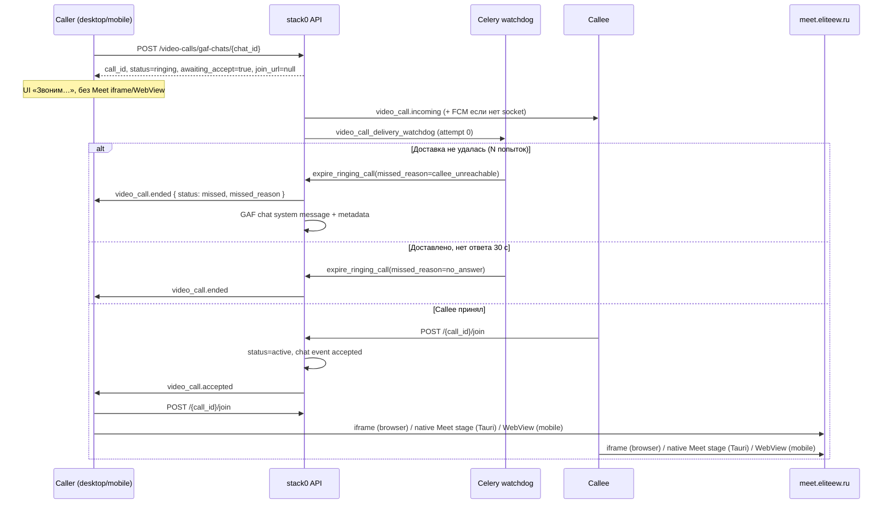

# Внутренние видеозвонки EliteEW

MVP видеозвонков использует отдельный домен приложения **Video Calls** и существующий **stack11 / Jitsi Meet** как медиа-слой. GAF Chat остаётся точкой входа для 1:1 звонков: пользователь нажимает кнопку звонка в открытом диалоге, второй участник получает realtime-уведомление и открывает отдельное окно **VideoCallApp** (desktop) или in-app WebView (Android).

> Операторский runtime по умолчанию: **Podman**.

Публичный **`https://meet.eliteew.ru`**: edge VM → **Meet WG** `10.77.77.2` (primary HTTP backhaul) → prod-core jwt-gate **`127.0.0.1:34002`** (edge listen **`13402`**). Reverse SSH `-R` = **manual reserve** (не primary). Канон топологии: [PRODUCTION-TOPOLOGY-STATE.md](../platform/PRODUCTION-TOPOLOGY-STATE.md) §Current, [WG-HTTP-BACKHAUL-PRIMARY.md](../platform/docker-re_doc/WG-HTTP-BACKHAUL-PRIMARY.md); медиа UDP: [MEET-MEDIA-UDP-NATIVE-PATH.md](../platform/docker-re_doc/MEET-MEDIA-UDP-NATIVE-PATH.md); ops/history tunnel notes: [JITSI-MEET-YANDEX-REVERSE-TUNNEL.md](../platform/docker-re_doc/JITSI-MEET-YANDEX-REVERSE-TUNNEL.md).

**Канон этой волны (2026-06-18):** для **1:1 (`call_kind=direct`)** звонящий **не входит в Jitsi**, пока получатель не примет звонок. Серверный Celery-watchdog завершает «зависшие» ringing-звонки с явной причиной `missed_reason`. **Групповые звонки** (`call_kind=group`) в этой волне **не менялись** — host по-прежнему получает `join_url` на create.

---

## Компоненты

| Уровень | Реализация |
|---------|------------|
| API | `shared/api/video_calls/` (`service.py`, `router.py`, `schemas.py`, `delivery.py`) |

GAF timeline side-effect (`_append_gaf_call_event`): failures (e.g. actor not a chat participant) are **logged and swallowed** so `/join` still returns JWT. Log must use structlog kwarg **`call_event=`**, never `event=` (reserved; caused 500 `BoundLogger.warning() got multiple values for argument 'event'`).

| HTTP | `POST /api/v1/video-calls/gaf-chats/{chat_id}`, `POST .../group`, `POST /{call_id}/invite`, `POST /{call_id}/join`, `POST /{call_id}/end` |
| БД | `20260503_video_calls.sql`, `20260613_video_calls_group.sql`, **`20260618_video_calls_ringing_delivery.sql`** (`ringing_delivered_at`, `missed_reason`) |
| Celery | `shared/api/tasks/video_call_ringing_watchdog.py` — delivery retry + answer timeout; **`video_call_ringing_reconcile.py`** — beat reconcile |
| Realtime | Socket.IO: `video_call.incoming`, **`video_call.accepted`**, `video_call.ended` → комната `gaf_user_{uuid}` |
| FCM fallback | `api/video_calls/delivery.py` — data push `type=video_call_incoming` при отсутствии live socket **и** если `call_target` допускает mobile |
| Call target pref | `users.preferences.video_calls.call_target`: `both` (default) \| `desktop_only` \| `mobile_only` — редакторы: **Связи → Телефон** и **mobile Profile → Видеозвонки** |
| Desktop | `VideoCallApp`, `GAFChatProvider` outgoing ringing, `GAFChatApp` (игнор `mobile_only`) |
| MobileAndroid (≥ 0.2.4) | `OutgoingGafVideoCallScreen`, `IncomingGafVideoCallScreen`, WebView на `join_url` — [`mobile/MOBILE-GAF-VIDEO-CALLS-WEBVIEW.md`](mobile/MOBILE-GAF-VIDEO-CALLS-WEBVIEW.md); игнор `desktop_only` |
| Media stack | `docker/stack/stack11.yml` (`prosody`, `web`, `meet-jwt-gate`, `jicofo`, `jvb`) |

---

## Состояния звонка (`video_calls.status`)

| Статус | Смысл | Кто может `/join` с JWT |
|--------|-------|-------------------------|
| `ringing` | Исходящий 1:1 или групповое приглашение; Meet ещё не открыт у всех | **1:1:** только **callee** (accept). Caller → **409** `awaiting_callee_accept`. **Group:** host и invitees по текущим правилам |
| `active` | Кто-то принял; `started_at` зафиксирован | Все участники |
| `ended` | Звонок состоялся и завершён | — |
| `missed` | Завершён до `active`; в чате `event=missed` + `missed_reason` | — |

Дополнительные колонки (миграция 2026-06-18):

| Колонка | Назначение |
|---------|------------|
| `ringing_delivered_at` | Первый момент, когда watchdog считает, что `video_call.incoming` дошёл до callee (socket room или FCM) |
| `missed_reason` | Каноническая причина пропуска: `declined`, `caller_cancelled`, `no_answer`, `callee_unreachable`, **`callee_mobile_unreachable`** |

---

## Куда принимать звонки (`call_target`)

Единая настройка для personal и group (v1 — один enum).

| Значение | Поведение |
|----------|-----------|
| `both` (default) | Socket в `gaf_user_*` для всех сессий + FCM при необходимости (как раньше) |
| `desktop_only` | Socket только **desktop audience**: browser SPA (`empery-web`) **и** Tauri shells (`empery-desktop` / `empery-fofline`); FCM не шлётся; mobile SID не получает событие |
| `mobile_only` | Socket **только mobile SID** + FCM; desktop audience не получает событие; при провале доставки → `missed_reason=callee_mobile_unreachable` |

- **Owner UI:** `shared/web/frontend` → Связи → Телефон (`MobileHubCallTargetPanel`) и Android Profile → Видеозвонки (`ProfileVideoCallsSection`).
- **Mirror / sync:** `GET /api/v1/mobile-app/profile` поле `call_target`; запись через `PATCH /api/v1/profile/preferences` (`video_calls.call_target`).
- **Категория CHAT off** на mobile также глушит звонки (`NotificationDeliveryGate.shouldDeliverCall`).
- **Реализация:** `api/video_calls/call_target.py` (`is_desktop_audience_presence_session`), emit/FCM/watchdog consult pref.
- **Desktop recovery:** `GET /api/v1/video-calls/pending-incoming` + poll в `usePendingIncomingVideoCallPoll` (**только leader-tab**, 8 s; после трёх пустых `[]` → 30 s). Не привязан к тяжёлому socket-listener effect — иначе перезапуск effect давал спам ~1 req/s в Network.

### Create reuse (обратный «Позвонить»)

На один GAF-чат — не больше одного `ringing`/`active`. Повторный `POST /gaf-chats/{chat_id}` **переиспользует** комнату.

| Кто жмёт «Позвонить» при уже `ringing` | Поведение |
|----------------------------------------|-----------|
| Исходный **caller** | Ответ `awaiting_accept=true`, без `join_url` (исходящий UI) |
| Исходный **callee** | **Accept-via-create**: как `/join` → `active` + `join_url` + `video_call.accepted` caller/callee (не второй room и не пустой Meet) |

Meet всегда рендерится **внутри** Desktop-приложения `VideoCallApp`:

| Клиент | Поверхность Meet |
|--------|------------------|
| Браузер SPA | `<iframe src={join_url}>` |
| EmpiierOS FoFline (no Tauri) | Sibling WebView clipped to the VideoCall stage (`openMeetStage(joinUrl, bounds)` / `setMeetStageBounds`). Not a nested iframe and not a fullscreen FILL. |
| Tauri desktop-client (`desktopNative` / Tauri `foflineNative`) | **top-level** WebviewWindow `video-call-meet`, positioned over the `VideoCallApp` stage |
| MobileAndroid | top-level `EmperyMeetWebViewActivity` |

Не отдельный браузерный popup и не второе Desktop-приложение — Meet привязан к окну «Видеозвонок».

### EmpiierOS WebKit (2026-09-19, English)

`empery-fofline` on EmpiierOS is the same desktop audience as Tauri FoFline. After `/join` 200 the pack measures the VideoCall stage (`getBoundingClientRect`) and calls `window.EmperyDesktopMeetStage.openMeetStage(joinUrl, bounds)`. While the call window is open, layout, resize, and drag call `setMeetStageBounds` with the same rect. Width or height under 48 is still sent; the OS hides the sibling. A URL without bounds is `meet_stage_bounds_required` and is not sent. `join_url` stays on `meet.eliteew.ru`. The room JWT stays in the query. The SPA does not put the OIDC access or refresh token into Meet, and does not rewrite the host to `app.eliteew.ru`.

Do not mount `<iframe src=meet.eliteew.ru>` on this host. Nested Meet in the product WebProcess SIGSEGV'd WebKit (`kind=iframe`, seat 2026-09-19 03:34 +10). Cloud Chrome keeps the iframe. Do not FILL the product WebView and do not request kiosk fullscreen (`ToggleFullscreen` `identifier=*` is forbidden). Chat and the VideoCall chrome stay around the clipped hole. Do not show `videoCallNativeMeetActive*` or `videoCallOsWebKitPending*` here. Parent chrome does not toast “video connected”.

Hangup, unmount, and `empiieros-meet-stage-lost` call `closeMeetStage` when this session opened the stage, then `POST /video-calls/{id}/end`. Product `pagehide` sends keepalive `/end`. Opening `VideoCallApp` does not close `GAFChatApp`. Public SPA pack **`1789794743865-pza6u2zqzf`** is this clipped sibling (`spa-latest` after rsync, sha256 `b5c302794f24…`, `include_audio=false`). Pack `1789750041479-4jxqj4w8lj` nested the iframe and is superseded for FoFline SPA only. Prior `1789730765446-d2ufr39pnb` opened a FILL overlay. Cloud bake `1789720073125-5fjlwh96mc` is unchanged. Shell `latest.json` stays **0.5.36**. If the seat is white again, stop. Do not restore FILL and do not restore the iframe as the OS default.

---

## Поток 1:1 (accept gate) — целевой



### Пошагово (caller)

1. В GAF Chat нажать видеозвонок → `POST /api/v1/video-calls/gaf-chats/{chat_id}`.
2. Ответ при **новом** ringing 1:1:
   - `status`: `"ringing"`
   - `awaiting_accept`: `true`
   - `join_url`, `jwt`, `expires_at`, `meet_base_url`: **`null`**
   - `call_id`, `room_name`, `chat_id`, `callee_user_id` — как раньше
3. Клиент показывает **исходящий ringing** (toast/overlay), **не** открывает `VideoCallApp`/WebView.
4. Ждёт Socket.IO **`video_call.accepted`** с тем же `call_id` **и** параллельно крутит HTTP join-poll (`POST /{call_id}/join` каждые ~2 с; пока `ringing`/`409 awaiting_callee_accept` — продолжать). Poll — страховка, когда Socket.IO hard-reject (`client_build_gate` / `app_build_mismatch`) или событие потеряно.
5. После accept (socket **или** poll увидел `status=active` + `join_url`) → открывает Meet (`VideoCallApp` / WebView делает свой join за JWT).
6. «Отменить» → стоп ring + stop poll → `POST /{call_id}/end` → сервер выставляет `missed` + `missed_reason=caller_cancelled` (если причина не передана явно).

### Пошагово (callee)

1. Получает **`video_call.incoming`** (и при offline mobile — FCM `type=video_call_incoming`).
2. «Ответить» → `POST /{call_id}/join` (accept + join одним шагом) → `status=active`, `join_url` в ответе.
3. Открывает Meet; параллельно API шлёт **`video_call.accepted`** caller **и** callee (callee — чтобы другие устройства того же пользователя сняли ringing UI).
4. «Отклонить» / сброс при ringing → `POST /{call_id}/end` → `missed` + `missed_reason=declined`.

### Device affinity (mobile ↔ desktop)

Socket event `video_call.accepted` доходит во **все** Socket.IO сессии пользователя (`gaf_user_{uuid}`). Клиенты **не** должны из‑за этого открывать Meet на каждом устройстве:

| Клиент | Открыть Meet на `accepted` |
|--------|----------------------------|
| Desktop | Только если **эта** вкладка/сессия ставила исходящий ring (`localOutgoingVideoCallIds`) |
| Android | Только если есть локальный `outgoing` с тем же `call_id` |
| Прочие устройства | Снять toast/ring; **не** join |

Иначе один аккаунт входит в Jitsi дважды (desktop + phone) → ICE/media flaps («медиа отваливается»). Tab-level `videoCallLeader` защищает только вкладки браузера, не mobile↔desktop.

Код: `videoCallDeviceAffinity.ts`, `GAFChatProvider.onVideoAccepted`, `GafVideoCallCoordinator.onVideoCallAccepted`.

### Инвариант join gate (1:1)

В `VideoCallService.join_call` для `call_kind=direct`:

- `status=ringing` и `user_id == caller_user_id` → исключение **`VideoCallAwaitingAcceptError`** → HTTP **409** с телом/кодом **`awaiting_callee_accept`**.
- `status=ringing` и `user_id == callee_user_id` → перевод в `active`, `accepted_now=true`, выдача JWT.
- `status=active` → свежий JWT обоим.

Повторный create при уже открытом ringing/active для того же `gaf_chat_id` **переиспользует** комнату (`reused_existing=true`). Для ringing 1:1 caller снова получает ответ **без** `join_url`, пока звонок не `active`.

---

## HTTP API (контракт)

Базовый префикс: **`/api/v1/video-calls`**. Auth: Keycloak bearer, участник GAF-чата / звонка.

### `POST /gaf-chats/{chat_id}` — начать 1:1

**Ответ (ringing, новый звонок):**

```json
{
  "call_id": "uuid",
  "chat_id": "uuid",
  "room_name": "ew-gaf-…",
  "status": "ringing",
  "call_kind": "direct",
  "provider": "jitsi",
  "callee_user_id": "uuid",
  "awaiting_accept": true,
  "join_url": null,
  "jwt": null,
  "expires_at": null,
  "meet_base_url": null,
  "reused_existing": false
}
```

**Побочные эффекты при `created=true`:**

1. Системное сообщение в GAF Chat: `metadata.kind=video_call_event`, `event=ringing`.
2. `emit_video_call_incoming` callee.
3. `schedule_video_call_ringing_watchdog(...)` — Celery delivery + answer timeout.

### `POST /gaf-chats/{chat_id}/group` — групповой (без изменений в этой волне)

Host получает **`join_url` сразу** на create (как до accept gate). Invitees — `video_call.incoming`, вход через `/join`.

### `POST /{call_id}/join`

**Успех (callee accept):** `status=active`, `join_url` с JWT, `awaiting_accept=false`.

**409 (caller рано):** `awaiting_callee_accept` — клиент показывает ожидание, не error crash.

Роутер после join с `accepted_now` и `call_kind=direct` вызывает:

```python
emit_video_call_accepted(caller_user_id, {
    "call_id": call_id,
    "chat_id": chat_id,
    "accepted_by_user_id": callee_user_id,
})
```

### `POST /{call_id}/end`

**Ответ (`VideoCallEndResponse`):**

```json
{
  "status": "ok",
  "call_id": "uuid",
  "call_status": "missed",
  "missed_reason": "no_answer",
  "already_ended": false
}
```

Idempotent: повторный `/end` → `already_ended=true`, без дублирования chat event.
**HARD:** если звонок уже в терминале `missed` / `ended`, повторный `/end` **не** меняет `status` и **не** затирает `missed_reason` (раньше `missed` ошибочно становился `ended` с очисткой причины).

---

## Причины пропущенного (`missed_reason`)

| Значение | Когда выставляется | System label в чате (RU, server-side) |
|----------|-------------------|--------------------------------------|
| `declined` | Callee завершил при `ringing` | «Видеозвонок отклонён» |
| `caller_cancelled` | Caller завершил при `ringing` | «Видеозвонок отменён» |
| `no_answer` | Celery: `ringing_delivered_at + VIDEO_CALL_RINGING_ANSWER_TIMEOUT_SECONDS`, accept не было | «Видеозвонок пропущен — нет ответа» |
| `callee_unreachable` | Celery: исчерпаны попытки доставки без socket/FCM (режимы `both` / `desktop_only`) | «Видеозвонок не доставлен — абонент недоступен» |
| `callee_mobile_unreachable` | Celery: `call_target=mobile_only` и нет mobile socket / FCM delivery | «Видеозвонок не доставлен — абонент вне зоны действия» |

Metadata в GAF Chat для `event=missed`:

```json
{
  "kind": "video_call_event",
  "event": "missed",
  "call_id": "uuid",
  "status": "missed",
  "missed_reason": "no_answer",
  "actor_user_id": "uuid"
}
```

Desktop/Android UI мапят `missed_reason` на i18n (`gafChat.json`, `strings.xml`); **текст в истории чата** приходит с API (русские labels из `MISSED_REASON_LABELS` в `service.py`).

---

## Socket.IO события

Все события идут в персональную комнату **`gaf_user_{db_user_uuid}`** (см. `socketio_handler._gaf_user_room_for_recipient`).

| Событие | Получатель | Payload (ключи) |
|---------|------------|-----------------|
| `video_call.incoming` | Callee (и повтор при retry) | `call_id`, `chat_id`, `caller_user_id`, `created_at`, **`call_target`**, опц. `participant_user_ids`, `call_kind` |
| **`video_call.accepted`** | **Caller** (1:1) | `call_id`, `chat_id`, `accepted_by_user_id` |
| `video_call.ended` | Другие участники | `call_id`, `ended_by_user_id`, опц. **`status`**, **`missed_reason`** |

**Backward compatibility:** старые клиенты игнорируют новые поля `status`/`missed_reason` в `ended`; новые клиенты обрабатывают toast/UI по причине.

**Desktop:** `EmperyworldSocketService`, `GAFChatProvider` — outgoing state, `accepted` → `requestOpenDesktopApp(VideoCallApp, callId)`.

**Android:** `RealtimeChatBridge` — `VIDEO_CALL_ACCEPTED`, `VIDEO_CALL_ENDED`; `MainViewModel.onVideoCallAccepted` → join + overlay.

---

## Delivery watchdog и answer timeout (Celery)

Модуль: **`shared/api/tasks/video_call_ringing_watchdog.py`**.

Задачи:

| Task | Назначение |
|------|------------|
| `video_call_delivery_watchdog` | Проверка доставки + re-emit incoming |
| `video_call_answer_timeout` | Авто-missed `no_answer` |

Конфиг (`unified_config.py` / env):

| Env | Default | Смысл |
|-----|---------|-------|
| `VIDEO_CALL_RINGING_ANSWER_TIMEOUT_SECONDS` | **30** (10–120) | Секунд после **первой успешной доставки** до `no_answer` |
| `VIDEO_CALL_DELIVERY_RETRY_COUNT` | **3** (1–10) | Число попыток доставки |
| `VIDEO_CALL_DELIVERY_RETRY_INTERVAL_SECONDS` | **5** (2–60) | Пауза между попытками |

### Логика доставки (`delivery.py` + watchdog)

**Attempt 0 (сразу после create):**

- Проверка: callee в socket room `gaf_user_{uuid}` **или** (если FCM настроен) есть Android push-токены.
- Если да → `mark_ringing_delivered` → планируется `video_call_answer_timeout` с `countdown=VIDEO_CALL_RINGING_ANSWER_TIMEOUT_SECONDS`.

**Attempt ≥ 1:**

- `deliver_video_call_incoming`: повторный socket emit + FCM push (`send_video_call_incoming_push`).
- Успех → как выше (delivered + answer timeout).

**После исчерпания попыток без доставки:**

- `expire_ringing_call(missed_reason=callee_unreachable)`
- `emit_video_call_ended` caller (и другим) с `status=missed`, `missed_reason=callee_unreachable`

**Answer timeout:**

- Если `status` всё ещё `ringing` → `expire_ringing_call(missed_reason=no_answer)` + notify.

**Идемпотентность:** задачи no-op, если `status != ringing`. Явный `/end` от пользователя переводит в `missed`/`ended` — поздние Celery countdown не должны перезаписывать финал (проверка статуса в task).

**Periodic reconcile (phase 2):** Celery Beat каждые **15 с** — `reconcile_stale_ringing_video_calls` (`api/tasks/video_call_ringing_reconcile.py`, очередь `short`, без rate_limit). Сканирует `status=ringing` direct 1:1 через `VideoCallService.list_ringing_calls`:

| Состояние | Условие | Действие |
|-----------|---------|----------|
| Доставлен, accept просрочен | `ringing_delivered_at + VIDEO_CALL_RINGING_ANSWER_TIMEOUT_SECONDS` | `expire_ringing_call(no_answer)` + notify |
| Не доставлен, окно исчерпано | `created_at + retry_count×interval + interval` | `expire_ringing_call(callee_unreachable\|callee_mobile_unreachable)` + notify |
| Не доставлен, в окне | иначе | `video_call_delivery_watchdog` с `attempt=min(floor(elapsed/interval), retry_count-1)`; dedupe Redis `video_call:ring_reconcile:{call_id}:{attempt}` SET NX, TTL=interval |

Страховка от потери countdown при hard restart worker до срабатывания answer timeout / delivery retry.

---

## Клиенты

### Desktop GAF Chat

| Файл | Поведение |
|------|-----------|
| `GAFChatApp.tsx` | Create success без `join_url` → outgoing UI, не `VideoCallApp` |
| `GAFChatProvider.tsx` | Outgoing toast «Звоним…»; cancel → stop ring + stop join-poll + `endVideoCall`; socket `accepted`/`ended`; **HTTP outgoing join-poll** (`videoCallOutgoingJoinPoll.ts`) как fallback при мёртвом socket |
| `VideoCallApp.tsx` | Browser: Meet iframe после `/join` при `active`; 409 `awaiting_callee_accept` → ожидание (retry не логирует как error). Tauri: `video_call_meet_stage_*` поверх сцены (`videoCallNativeMeetStage.ts`) |
| `videoCallNativeMeetStage.ts` | Invoke open/bounds/close; только product shell |
| W-transport SOCKS ACL | Meet stage applies the same fail-closed `proxy_url` as `product_open`. Hostname product map must include **`meet.eliteew.ru`** (and `*.meet.eliteew.ru`) → edge `10.88.89.1:443` — otherwise SOCKS reply `0x02` surfaces in WebKit as **«SOCKSv5 connection not allowed by ruleset»**. WebRTC **UDP** media to public edge VIP still bypasses TCP SOCKS (canon: [MEET-MEDIA-UDP-NATIVE-PATH.md](../platform/docker-re_doc/MEET-MEDIA-UDP-NATIVE-PATH.md)). |
| Linux Meet media (WebKitGTK) | Meet stage is a **separate** WebView from product SPA. OS Portal prompts from SPA before the call do **not** grant capture to Meet. Rust attaches `permission-request` allow for `UserMedia` / `DeviceInfo` and enables `enable-media-stream` + `enable-webrtc` (`commands/linux_meet_media.rs`). Without that, getUserMedia fails with NotAllowedError and Meet shows no camera/mic/sound. **PeerConnection / ICE on stock WebKitGTK is often incomplete** — browser-equivalent mutual A/V: system Chrome/Chromium on `https://app.eliteew.ru` (not a second desktop runtime). |
| `GAFChatMessageBubble.tsx` | Отображение `metadata.missed_reason` |
| `gafVideoCallOutgoing.ts` | Локальный мост исходящего ringing |
| `videoCallOutgoingJoinPoll.ts` | Poll `POST /join` пока локальный outgoing id жив; 409 awaiting — continue |

### MobileAndroid

| Файл | Поведение |
|------|-----------|
| `MainViewModel.startGafVideoCallFromChat` | `awaiting_accept` / пустой `join_url` → `_outgoingGafVideoCall`, не WebView |
| `OutgoingGafVideoCallScreen.kt` | Overlay «Звоним…» + отмена |
| `IncomingGafVideoCallScreen.kt` | Accept / **explicit** Decline → `/end`; system Back / predictive-back **consumed** (не auto-decline) |
| `IncomingGafCallWakeActivity.kt` | Lock-screen wake UI; Back только закрывает Activity — FGS ringtone + notification продолжают звонить |
| `GafVideoCallStateReducer` / `GafVideoCallCoordinator` | Outgoing join-poll; **`StopIncomingRingtone`** на accept/decline/remote ended/accepted/logout (гасит FGS `IncomingCallRingtoneService`) |
| `VideoCallsApiContracts.kt` | `join_url`, `jwt` nullable; `awaiting_accept` |
| `RealtimeChatBridge.kt` | `VIDEO_CALL_ACCEPTED` |

Клиентский 30s timer на Android — **backup**; источник истины — серверный Celery.

---

## Групповой звонок (без изменений accept gate)

1. В GAF-чате кнопка с иконкой **людей** → выбор друзей (собеседник из чата включён автоматически).
2. `POST /api/v1/video-calls/gaf-chats/{chat_id}/group` с `{ "additional_participant_ids": ["<uuid>", ...] }` → `call_kind=group`, host получает **`join_url` на create**.
3. `video_call.incoming` каждому invitee; `POST /{call_id}/invite` для новых участников.
4. `video_call.ended` рассылается всем остальным в комнате.
5. Guard дружбы/блокировок: `FriendsService.assert_can_interact`.

---

## Периметр HTTP (meet.eliteew.ru)

- **Media images:** `docker.io/jitsi/{prosody,web,jicofo,jvb,jibri}:stable-11031` in [`docker/stack/stack11.yml`](../../docker/stack/stack11.yml). Engine is **Jitsi Meet (Apache-2.0)**; EliteEW UI is de-branded (no Jitsi/8x8 watermarks, deep-link/mobile promo, or JaaS endpoints). Attribution for the engine stays in this canon and [STACK11-JITSI-11031-UPGRADE.md](../platform/docker-re_doc/STACK11-JITSI-11031-UPGRADE.md) — do not strip LICENSE from images.
- **Комнаты и медиа:** только с **API-JWT** (`JWT_ALLOW_EMPTY=0`, гости выключены в stack11).
- **Публичный UI Meet:** **JWT-gate** — контейнер **`stack11-meet-jwt-gate`** на **`127.0.0.1:34002`**. Edge → Meet WG primary `10.77.77.2:13402` → socat/proxy → `:34002` (SSH `-R 13402` только в reserve mode). Без `?jwt=` (или без embed с `app.eliteew.ru` / trusted `Origin`) корень и комнаты → **403**; открыты `config.js`, статика и `xmpp-websocket` / `colibri-ws`.
- **JVB media (prod):** public UDP `93.77.165.185:13400` → Meet WG → `10.77.77.2:34000` — [MEET-MEDIA-UDP-NATIVE-PATH.md](../platform/docker-re_doc/MEET-MEDIA-UDP-NATIVE-PATH.md). Не смешивать с legacy UDP-over-SSH. **JVB в `stack11.yml` — `network_mode: host`** (не bridge): иначе ICE face ≠ harvester и в браузере нет A/V при живом сигналинге.
- Шаблон location: `docker/host_conf/nginx-meet-server.inc`; sidecar: `docker/stack/stack11/nginx/meet-jwt-gate.conf`.

---

## Ограничения MVP

- Только пользователи сервиса; внешние гости в `stack11` выключены.
- Групповые звонки — приглашённые друзья EliteEW (без публичной Jitsi-ссылки).
- `JVB` должен рекламировать адреса, достижимые браузерами: `JITSI_JVB_ADVERTISE_IPS` в `docker/env_file/.env.stack11`.
- Для iframe на фронте: `CSP_FRAME_EXTRA` с `https://meet.eliteew.ru` в env frontend nginx.
- Jitsi prejoin выключен (`ENABLE_PREJOIN_PAGE=0`).
- Завершение звонка через кнопку **VideoCallApp** / Android end — чтобы API зафиксировал `ended` / `missed`.
- **MobileAndroid (≥ 0.2.4):** WebView + `WebChromeClient.onPermissionRequest` — [`mobile/MOBILE-GAF-VIDEO-CALLS-WEBVIEW.md`](mobile/MOBILE-GAF-VIDEO-CALLS-WEBVIEW.md).
- Jitsi web: `openBridgeChannel=datachannel`, `preferSctp=true`, `useStunTurn=false`, `gravatar.disabled=true`, `ENABLE_JAAS_COMPONENTS=0`, UI de-brand via `stack11-jitsi-interface-custom.js` — см. `docker/scripts/stack11-jitsi-web-custom-config.js` / `apply-stack11-jitsi-web-custom-config.sh`.
- Официальные Jitsi images через s6 `/init`; pin **`stable-11031`** (не `11146` rootless); для `prosody`, `web`, `jicofo`, `jvb` не задавать compose `user:`.

---

## Операторские шаги

### 1. Миграции (stack1)

```bash
podman exec -i stack1-postgres psql -U ai_user -d ai_services < shared/api/migrations/20260503_video_calls.sql
podman exec -i stack1-postgres psql -U ai_user -d ai_services < shared/api/migrations/20260613_video_calls_group.sql
podman exec -i stack1-postgres psql -U ai_user -d ai_services < shared/api/migrations/20260618_video_calls_ringing_delivery.sql
```

Проверка колонок:

```bash
podman exec stack1-postgres psql -U ai_user -d ai_services -c \
  "\d+ video_calls" | rg 'ringing_delivered_at|missed_reason'
```

### 2. Секреты Jitsi

`JITSI_APP_SECRET` / `JITSI_JWT_SECRET` в env stack0 и stack11 — **один секрет** для API и Prosody.

### 3. Env watchdog (опционально, defaults OK)

В config plane / `docker/env_file/.env.stack0.backend`:

```bash
VIDEO_CALL_RINGING_ANSWER_TIMEOUT_SECONDS=30
VIDEO_CALL_DELIVERY_RETRY_COUNT=3
VIDEO_CALL_DELIVERY_RETRY_INTERVAL_SECONDS=5
```

### 4. Деплой (command-center → prod-core)

```bash
# с command-center .136 — полный stack0 release (не partial --frontend-only / --backend-only)
bash docker/scripts/eliteew-deploy.sh release stack0 --all
# Android OTA после сборки на .136; артефакты OTA живут на prod-core .111
```

Celery route: `api.tasks.video_call_ringing_watchdog.*` зарегистрирован в `celery_app.py`. Hotfix без rebake — line B (`eeprodline`), не замена release.

### 5. Smoke после выката

| # | Сценарий | Ожидание |
|---|----------|----------|
| A | Desktop A звонит desktop B, B принимает | A **не** в Meet до accept; после accept оба в Meet; в чате `ringing` → `accepted` → `ended` |
| B | B offline: нет socket room и нет FCM-токенов | Через ~`(RETRY_COUNT-1)*INTERVAL` с (~10–15 s при defaults) `missed` + `callee_unreachable`, toast у A, запись в чат |
| C | B видит incoming, не отвечает | Через **30 s после доставки** `missed` + `no_answer` |
| D | A отменяет во время ringing | `caller_cancelled`, у B гасится incoming |
| E | B отклоняет | `declined` |
| F | Групповой звонок | Host сразу с `join_url`; 1:1 gate **не** применяется |

**API health:**

```bash
ssh 192.168.1.111 'curl -sf http://127.0.0.1:29000/api/health'
```

**Focused pytest (command-center):**

```bash
bash docker/scripts/run-stack0-api-tests.sh tests/test_video_call_accept_gate.py -q
```

### 6. stack11 standup (если медиа слой поднят отдельно)

```bash
podman compose -f docker/stack/stack11.yml --env-file docker/env_file/.env.stack11 up -d prosody web meet-jwt-gate jicofo jvb
```

Публикация **`https://meet.eliteew.ru`**: Meet WG primary + SSH reserve — [WG-HTTP-BACKHAUL-PRIMARY.md](../platform/docker-re_doc/WG-HTTP-BACKHAUL-PRIMARY.md); tunnel ops notes — [JITSI-MEET-YANDEX-REVERSE-TUNNEL.md](../platform/docker-re_doc/JITSI-MEET-YANDEX-REVERSE-TUNNEL.md).

---

## Тесты и верификация (разработка)

| Слой | Файл / команда |
|------|----------------|
| API accept gate | `shared/api/tests/test_video_call_accept_gate.py` |
| Block contract | `tests/test_video_calls_block_contract.py` |
| Android DTO | `VideoCallsApiContractsTest.kt`, `GafChatSocketEventContractTest.kt` |
| Desktop | `GAFChatEncryptionIconButton.test.tsx`, `gafChatMessageUtils.test.ts` (при изменении bubble) |

---

## Ссылки

- Android HTTP контракт: [`api/ANDROID-API-CONTRACTS.md`](../api/ANDROID-API-CONTRACTS.md) § Video Calls
- GAF Chat backend: [`product/GAF-CHAT-BACKEND.md`](GAF-CHAT-BACKEND.md)
- Deploy policy: `.cursor/rules/project-and-deploy.mdc`
- Topology: `platform/PRODUCTION-TOPOLOGY-STATE.md` §Current · HTTP backhaul `platform/docker-re_doc/WG-HTTP-BACKHAUL-PRIMARY.md`
- Медиа: `platform/docker-re_doc/MEET-MEDIA-UDP-NATIVE-PATH.md` · methodology `platform/docker-re_doc/JITSI-MEDIA-INCIDENT-2026-05-28.md`
- Social Hub phone / call_target: [SOCIAL-HUB.md](SOCIAL-HUB.md)
