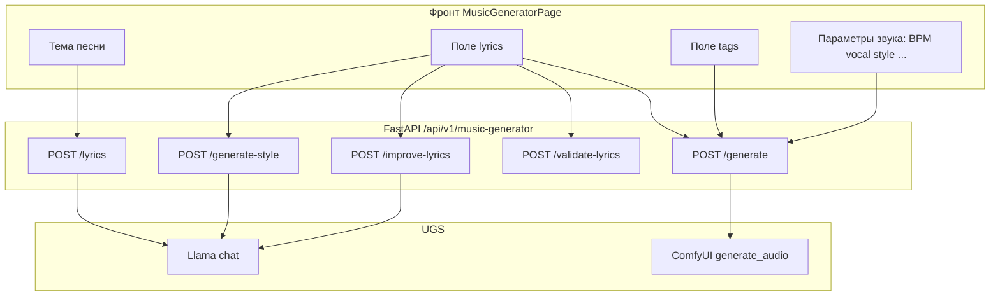

# Генератор песен: полная сводка (продукт и техника)

> **Desktop UI superseded (2026-06-28):** пользовательский стол — MusicForge ([`MUSIC-FORGE-APP.md`](MUSIC-FORGE-APP.md)). Frontend `MusicGeneratorPage` в `trash/`; таблица путей ниже сохранена для legacy API и operator.

Документ для оператора и разработчика: **что где лежит**, **как собираются промпты**, **какие стили**, **что уходит в запросы**, **как формируется итоговая генерация музыки**. Канонические детали API: [`MUSIC-GENERATOR.md`](MUSIC-GENERATOR.md). Пользовательский стол: [`MUSIC-FORGE-APP.md`](MUSIC-FORGE-APP.md). Historical MusicGeneratorPage flow soft-retired under `trash/` (id 20260812-155119, was …/MUSIC-GENERATOR-FLOW.md).

---

## 1. Карта репозитория

| Область | Путь |
|--------|------|
| API роутер parent (HTTP `/music-generator/*`: style/suggest/validate/promo/like; mounts lyrics + generate children) | `shared/api/routers/music_generator.py` |
| Lyrics/improve child router (`POST /lyrics`, `POST /improve-lyrics`; no extra prefix) | `shared/api/routers/music_generator_lyrics_routes.py` |
| Generate/edit child router (`POST /generate`, `POST /edit`; no extra prefix) | `shared/api/routers/music_generator_generate.py` |
| Generate/edit support helpers (no router; idempotency, style map, UGS audio, persist) | `shared/api/routers/music_generator_generate_support.py` |
| Lyrics/style runtime helpers (enrich, ACE guidance, suggest parsers, Llama title) | `shared/api/routers/music_generator_lyrics_style.py` |
| Lyrics prompt constants / pure string builders (`LYRICS_*`, style guide, form instructions) | `shared/api/routers/music_generator_lyrics_prompts.py` |
| Shared limits (`MAX_LYRICS_LENGTH`, companion context) | `shared/api/routers/music_generator_constants.py` |
| ACE tags finalize (BPM, EDM markers, XL Base compress) | `shared/api/routers/music_generator_tag_finalize.py` |
| Санитайз, валидация lyrics, outline/canonical структура для style | `shared/api/routers/music_lyrics_validation.py` |
| Вызов UGS из студии | `shared/api/routers/creative_studio_utils.py` → `run_studio_ugs_generate` |
| Llama: выбор модели для текстовых type_key | `shared/api/services/ugs/provider_manager_service_v2.py` |
| Сборка Comfy workflow ACE / DiffRhythm | `shared/api/services/studio_comfy_workflows.py` |
| **XL Base pipeline (`v2_base`)** | `shared/api/services/music_generator_xl_base_pipeline.py` |
| **XL Base quality loop (batch, debug compare)** | `shared/api/services/music_generator_xl_base_quality_loop.py`, `shared/api/services/music_batch_tests.py`, `shared/api/scripts/compare_xl_base_comfy_debug.py` |
| JSON workflow ACE | `host/comfyui/audio_ace_music.json` |
| JSON workflow XL Base | `host/comfyui/Musicv2_base.json` |
| UI формы (legacy, в trash/) | `trash/*/pages/MusicGenerator/MusicGeneratorPage.tsx` — пользовательский UX → `MusicForgeApp` |
| Описания UGS в БД (после миграции) | `generation_types` в PostgreSQL; см. `shared/api/migrations/applied/20260405_music_generator_generation_types_descriptions.sql` |

---

## 2. Контракт: lyrics vs tags

| Поле | Назначение | Язык / формат |
|------|------------|----------------|
| **lyrics** | Слова вокала + секционные заголовки в legacy/enriched формате: `[Verse]` или `[Verse: instruments/effects/transitions, N BPM feel]`; optional строка `(Voice: ...)` | Обычно русский (или язык из формы); имя секции в `[]` — английское, enriched-хинты поддерживаются в автогенерации |
| **tags** | Вся аранжировка для ACE Step 1.5: BPM, инструменты, секции `[intro]`, `[build up]`, `[drop]`, эффекты, микс | **Английский**, один сплошной абзац (через запятые), до 2000 символов на бэкенде |

Сервер валидирует lyrics (`validate_lyrics_for_music`): enriched-секции и `(Voice: ...)` разрешены; блокирующая ошибка остаётся для тех. продакшн-фраз в обычных строках, предупреждение — для русских «миксовых» намёков вне ремарок. Фронт больше не вырезает `[Drop]/[Build Up]/[Breakdown]` из текста, но для выбранных **клубных EDM** пресетов (не **`luna`**, не широкая **«Электроника»** в селекте) по-прежнему требует в tags и `[build up]`, и `[drop]` (сервер при `generate-style` может дописать BPM и недостающие маркеры через `finalize_ace_step_style_tags` в [`music_generator_tag_finalize.py`](../../shared/api/routers/music_generator_tag_finalize.py)). После ответа модели вызываются **`simplify_tags_for_ace`** и для **`luna`** — **`soften_luna_ace_tags`**.

**Согласование пресета и текста (anti–drum-and-bass bleed):** в промпт `POST /generate-style` добавлены явное требование следовать жанру из UI и строка **`lyrics_mood_hints_for_style_prompt`** (эвристика по RU/EN ключевым словам: меланхолия, фея/сказка и т.д.). Перед `finalize_ace_step_style_tags` вызываются **`coerce_tags_to_genre_preset`** (если пресет не drum and bass — убрать «drum and bass», типичный 174 BPM и клубные хвосты, подставить BPM/формулировку жанра по пресету) и **`ensure_intro_section_tag_if_lyrics_have_intro`** (если в lyrics есть `[Intro]`, а в tags нет `[intro]` — вставить блок перед первым `[verse]`/`[chorus]`). Те же два шага применяются к полю `tags` в **`POST /generate`** до `simplify_tags_for_ace`.

---

## 3. Поток данных (высокоуровнево)

---

## 4. Эндпоинты и UGS `type_key`

| HTTP | Назначение | UGS `type_key` | Провайдер |
|------|------------|----------------|-----------|
| `POST /lyrics` | Текст по **теме** + пресет стиля текста + язык | `music_generator_lyrics` | Llama (`messages` + `options`) |
| `POST /generate-style` | Теги звучания по **lyrics** + стиль + вокал | `music_generator_style` | Llama |
| `POST /improve-lyrics` | Правка текста по **направлению** | `music_generator_improve_lyrics` | Llama |
| `POST /promo-script` | Короткий промо-сценарий + English tags по тезисам/сырому тексту | `music_generator_promo_script` с `suppress_notification=true` | Llama (`format=json`) |

**SQL (stack1):** `shared/api/migrations/applied/20260620_music_promo_script_generation_type.sql`. Structured JSON types: **`documentation/platform/docker-re_doc/STACK0-LLM-OVERVIEW.md`** §8.1.
| `POST /validate-lyrics` | Проверка без LLM | — | Локально |
| `POST /generate` | MP3 | `music_generator_generate_ace` или `music_generator_generate_diffrhythm` | ComfyUI |
| `POST /generate` (companion XL Base) | MP3 из чата спутника | **`music_generator_generate_ace_v2_base_companion`** (`billing_mode=companion_xl_base`, `ugs_workflow=v2_base`) | ComfyUI |
| `POST /edit` | Правка аудио M2M | `music_generator_edit` | ComfyUI |
| `POST /v3/lyrics` | V3-текст по теме, стилю, языку и вокалу | `music_generator_v3_lyrics` | Llama |
| `POST /v3/suggest-production-params` | V3-параметры трека | `music_generator_v3_suggest_params` | Llama + fallback presets |
| `POST /v3/generate-style` | V3 English tags | `music_generator_v3_style` | Llama + V3 tag normalizer |
| `POST /v3/generate` | V3 MP3 | `music_generator_generate_ace_v3` | ComfyUI split 4B workflow |

V3 audio body supports `generation_mode=auto|manual` and full ACE Step 1.5 controls: `bpm`, `duration_seconds`, `keyscale`, `timesignature`, encoder knobs `cfg_scale`, `temperature`, `top_p`, `top_k`, `min_p`, and Comfy knobs `steps`, `cfg`, `sampler_name`, `scheduler`, `denoise`, `batch_size`, `shift`.

In the V3 UI, **auto** exposes theme, style, language, vocal and optional `soloist`; musical params come from `/v3/suggest-production-params` plus deterministic V3 style preset defaults. **Manual** exposes the same full control set as the API. The selected `vocal` is user-owned: style changes no longer reset it, suggest does not override it, Russian solo lyrics are aligned to male/female first-person forms, and duet lyrics/tags include explicit male/female/duet ownership markers.

`soloist` values are character presets for prompt-level vocal control: `venera`, `sever`, `mira`, `neon`, `iskra`, `orbita` or `none`. If a soloist has fixed `vocal`, it overrides the free vocal field. The implementation follows ACE Step / ComfyUI guidance: vocal character is expressed through `tags`/caption and lyrics meta tags, not through a TTS speaker profile.

V3 normalizes lyrics/tags before ACE: it preserves or creates enriched `[Section: English production hints, N BPM feel]`, removes ordinary Russian parenthetical echoes, and derives a matching `tags` section skeleton from the same lyrics. The V3 Comfy workflow saves MP3 with `SaveAudioMP3.quality=320k`.

**Официальные примеры ACE-Step 1.5** (колонки Caption vs Lyrics на демо-странице) — [ACE-Step 1.5 project page](https://ace-step.github.io/ace-step-v1.5.github.io/): в нашем контуре поле `tags` в `TextEncodeAceStepAudio1.5` соответствует **caption** (звук, аранжировка, стиль), поле `lyrics` — **lyric** (вокальный текст и секции).

Модель Llama для **всех текстовых** шагов музыки: если в env бэкенда задано **`LLAMA_MODEL_MUSIC_TEXT_GEN`**, используется оно (иначе дефолт провайдера в БД / запасной **`LLAMA_MODEL`** из `.env.stack0.backend` в коде провайдера).

---

## 5. Пресеты «стиля» (ключ `style`)

Один и тот же ключ `style` используется:

- во **фронте** — селект жанра, подстановка стартовых **tags** из `STYLE_TAGS` и типичного BPM (быстрые пресеты);
- в **API** — блок `LYRICS_STYLE_GUIDE_RU` в промпте `/lyrics` (как писать текст под жанр);
- в **`POST /generate`** — префикс `Style: {english label}. …` к полю `tags` и clamp BPM по `ACE_STEP_TYPICAL_BPM_BY_STYLE` в `/generate-style` (подсказка BPM в промпте).

### 5.1 Ключи пресетов (совпадают фронт ↔ бэкенд)

| Ключ `style` | Кратко |
|--------------|--------|
| `pop` | Поп |
| `rock` | Рок |
| `electronic` | Электроника |
| `ballad` | Баллада |
| `drum and bass` | Drum and bass |
| `hip_hop` | Хип-хоп |
| `classical` | Классика / оркестр |
| `dubstep` | Dubstep |
| `luna` | Luna-стиль (русский инди electro-pop, длинный пресет tags на фронте) |
| `rnb_classic_female` | Классическое R&B (женский вокал) |
| `lofi_chill` | Lo-fi / chill |
| `noir_cabaret` | Нуар / кабаре-джаз |
| `folk` | Народная / частушки |
| `trap` | Trap / 808 |
| `punk_rock` | Punk rock |
| `shoegaze` | Shoegaze / dream rock |
| `darkwave` | Darkwave / coldwave |
| `eurodance` | Eurodance |
| `uk_garage` | UK garage / 2-step |
| `flamenco_pop` | Flamenco pop |
| `city_pop` | Japanese city pop |

Стартовые **английские строки tags** для подстановки при смене стиля заданы в **`STYLE_TAGS`** в `MusicGeneratorPage.tsx` (см. объект в коде — длинные описания для `luna` и др.). Типичные параметры формы (BPM, длительность, вокал, тональность, слайдеры) вынесены в `MusicGenerator/musicStyleProfiles.ts`, чтобы новые жанры не требовали правки длинной цепочки `if/else`.

### 5.2 Типичный BPM по пресету (бэкенд, подсказка для `generate-style`)

Словарь `ACE_STEP_TYPICAL_BPM_BY_STYLE` в [`music_generator_tag_finalize.py`](../../shared/api/routers/music_generator_tag_finalize.py) (например: pop/rock 120, electronic 128, drum and bass 174, dubstep 140, edm/hardstyle 128/150, ballad 72, hip_hop 92, lofi_chill 82, luna 118, новые trap 140, punk_rock 172, shoegaze 96, darkwave 122, eurodance 138, uk_garage 132, flamenco_pop 98, city_pop 112, …). В ответе `generate-style` к тегам может добавиться `{N} BPM,`, если в тексте тегов ещё нет `bpm`. Для пресетов из **`ELECTRONIC_STYLES_REQUIRING_DROP`** (techno, house, trance, edm, hardstyle, eurodance, drum and bass, dubstep — **без** широкого **`electronic`** и **без `luna`**) при отсутствии `[build up]` и/или `[drop]` бэкенд **дописывает** недостающие фрагменты; для **drum and bass** и **dubstep** дополнительно может добавиться `[breakdown]`, если его не было. Пресет **`luna`** в этот набор не входит: инди electro-pop, пик энергии в `[chorus]`, не обязателен агрессивный `[drop]`. После ответа модели для ACE применяются **`format_ace_tags_prose_to_sections`** (хвосты вида «… intro» → `[intro] …`), для **`luna`** при полном отсутствии маркеров — **`ensure_luna_ace_section_tags`**, затем **`luna_append_signature_production`** (supersaw/sidechain/modern production, если забыты).

---

## 6. Как собираются промпты (AI-текст)

### 6.1 `POST /lyrics`

**Вход тела:** `theme` (обязательно), `style`, `language`, `vocal`, опционально `voice_diversity` (`subtle` / `balanced` / `wild`), `luna_mode` (`classic` / `experimental`, только для `style=luna`), `temperature`, `cfg_scale`, `top_p`, опционально **`ewa_companion_context`** (Assistant wizard, до **32 768** символов), `run_id` / `generation_run_id` (стабильный seed mood), `song_mood` / `mood` (явный mood), `random_song_mood`, `target_ugs_workflow` / `ace_workflow`.

**Логика (studio default):**

1. Собирается **system prompt**: приоритет темы (`LYRICS_THEME_PRIORITY_UNIVERSAL_RU`), опционально форма по теме (`_get_form_specific_instructions`), базовая разметка с enriched-секциями (`LYRICS_MARKUP_RULES_BASE_RU` + `LYRICS_MARKUP_EDM_IF_THEME_EXPLICIT_RU`), **дефолтная структура** если тема не требует иного: `[Intro] → [Verse 1] → [Pre-Chorus] → [Chorus] → [Verse 2] → [Bridge] → [Chorus]` (припев минимум два раза; секции не пустые), блок стиля из `LYRICS_STYLE_GUIDE_RU[style]`, язык, футеры (формат вывода, анти-каракули, «голос песни», без мета-описаний музыки), **жёсткий запрос** на штампы `ритм* / звук* / такт*` в лирических строках, **тон:** без нытья и бесконечного самосожаления даже в грустных темах, опционально строка с ползунками (`_lyrics_creative_extra_block_ru`).
2. **User prompt:** тема, пресет стиля, язык + инструкция писать полный текст с enriched `[Section: ... BPM feel ...]`.
3. В UGS уходит `input_data: { "messages": [...], "options": llama_opts }`.

**Companion branch** (непустой `ewa_companion_context`, русский текст):

- Разметка: **`COMPANION_LYRICS_MARKUP_SIMPLE_RU`** — только `[Verse 1]` / `[Chorus]`, без BPM в `[ ]`, без `(Arrangement:)` / `(Voice:)` в lyrics.
- **`COMPANION_LYRICS_SINGABILITY_RU`**, tone balance blocks из `companion_music_creative_context`.
- **`skip_enriched_sections`** в post-process; **`validate_companion_russian_singability`** + 1× retry.
- **`resolve_song_mood`:** theme + companion context; negation («не про грустный …») → uplift moods, не `melancholic` по подстроке «груст».
- Ответ может включать `companion_singability_errors`, `companion_lyrics_retry_used`, `song_mood`.

**Llama `options`** (см. `_llama_options_for_lyrics_pipeline`): `num_predict` 8192; при наличии ползунков — `temperature`, `top_p`, `repeat_penalty` (зависит от `cfg_scale`). Stack2 Gemma: `enable_thinking=false` для lyrics path.

**Ответ (studio):** `sanitize_lyrics_ai_output` → автообогащение enriched-секций → согласование рода голоса → `scrub_forbidden_meta_music_words` → `{ "lyrics": "..." }`.

**Comfy (Turbo v2 + companion run):** `prepare_companion_vocal_lyrics_for_comfy` в `studio_comfy_workflows` — в node 94 только sung-lines (см. [EWA-COMPANION-MUSIC-GENERATION.md](ewa/EWA-COMPANION-MUSIC-GENERATION.md) §2.4).

### 6.1.1 Shared limits (`music_generator_constants.py`)

| Константа | Значение |
|-----------|----------|
| `MAX_WIZARD_THEME_CHARS` | 160 |
| `MAX_LYRICS_LENGTH` | 8000 |
| `MAX_EWA_COMPANION_CONTEXT_CHARS` | 32768 |

### 6.1.2 Lyrics/style helpers (Phase C.4)

| Module | Role |
|--------|------|
| `music_generator_lyrics_style.py` | Runtime helpers: ACE guidance, creative sliders, enrich/parenthetical pipeline, suggest-production parsers, `_call_llama_chat` / `_generate_song_title`. Re-exports prompt symbols for `music_generator.py` and `music_evolution_lyrics_craft` (via parent). |
| `music_generator_lyrics_prompts.py` | `LYRICS_*` prompt/string constants, `LYRICS_STYLE_GUIDE_RU`, `IMPROVE_DIRECTIONS`, and pure builders (`_lyrics_style_block_ru`, language/form/vocal grammar, luna/R&B English lines, `_normalize_luna_mode`). |

No `APIRouter` — public URL shapes stay on the parent router. Dependency direction: **prompts → (nothing of style/parent)**; **style → prompts**; **parent → style** (facade). Must not form a cycle with `music_generator.py`.

### 6.1.3 Generate/edit child router (Phase C.4 wave 3–4)

| Module | Role |
|--------|------|
| `music_generator_generate.py` | Child `APIRouter(tags=["Music Generator"])` **without** extra prefix. Owns `POST /generate` (`generate_music`) and `POST /edit` (`edit_music`). Target ≤1000 LOC. |
| `music_generator_generate_support.py` | No `APIRouter`. Shared helpers: idempotency / in-progress 409, debug request JSON, liked-recipe JSON, track BPM, `MusicEditRequest`, style-English map, UGS audio unwrap/decode, promo TTS mix, content metadata + persist/notify. |

Mount: parent `music_generator.py` keeps `prefix="/music-generator"` and calls `router.include_router(music_generator_generate_router)`. Public paths stay `/api/v1/music-generator/generate` and `/api/v1/music-generator/edit` (domain mounts parent only — no double-prefix). Dependency direction: **support → lyrics_style / services** (must **not** import generate or parent); **generate → support**; **parent → generate** (mount + re-exports `generate_music` / helpers for `companion_music_pipeline` and lyrics routes).

### 6.2 `POST /generate-style`

**Вход:** `lyrics`, `style`, `vocal`, опционально `luna_mode` (`classic` / `experimental` для `style=luna`) и те же ползунки.

**Дополнительно к промпту:**

- `lyrics_track_structure_canonical_for_style_prompt(lyrics)` — каноническая цепочка вроде `[intro] → [verse] → [chorus]`;
- `lyrics_section_outline_for_style_prompt(lyrics)` — заголовки как в тексте (включая enriched hints), с повторными индексами;
- `lyrics_section_music_hints_for_style_prompt(lyrics)` — извлечённые BPM/аранжировочные подсказки по секциям.

**System prompt** включает блок **ROLE SEPARATION**: lyrics может содержать enriched-секционные хинты, но tags остаётся единственным целевым форматом аранжировки; плюс правила ACE Step 1.5 (секции, эффекты, не цитировать текст).

**Ответ:** постобработка `_finalize_ace_step_style_tags` → `{ "tags": "..." }`.

### 6.3 `POST /improve-lyrics`

**Вход:** `lyrics`, `direction` (ключ из словаря `IMPROVE_DIRECTIONS`), ползунки.

**System:** редактор + `LYRICS_MARKUP_RULES_FOR_MODEL_RU` + фиксы + `LYRICS_IMPROVE_NO_PRODUCTION_SECTIONS_RU` (сохранить/дополнить enriched-секции вместо удаления) + тот же абсолютный запрет табу-лексики `ритм* / звук* / такт*`; после LLM применяется пост-процесс чистки `scrub_forbidden_meta_music_words`.

### 6.4 `POST /promo-script`

**Вход:** `mode=brief|raw`, `theses` или `raw_text`, `target_duration_sec`, `promo_preset`, `vocal`, `language`, те же ползунки `temperature` / `cfg_scale` / `top_p`, плюс promo director факторы 1–10:

- `promo_tempo_intensity` — темп подачи и плотность пауз;
- `promo_rhythm_intensity` — ритмический драйв фраз, стоп-акценты;
- `promo_genre_bias` — насколько сильно вжимать выбранный preset в звук;
- `promo_voice_strength` — сила/проекция/хрип/напор диктора;
- `promo_bed_level` — плотность музыкального пледа под речью;
- `promo_stinger_intensity` — сила ударов, райзеров, логотипных акцентов;
- `promo_drama_contrast` — контраст, тишина перед CTA, драматургия;
- `promo_clarity` — приоритет разборчивости речи.

**Контракт:** это не песня, а дикторский ролик. Prompt требует один JSON-object с `lyrics` и `tags`; в `lyrics` допустимы только `[Intro]`, `[Verse]`, `[Bridge]`, `[Outro]`, короткие фразы и английские `(Arrangement: ...)` / `(Voice: ...)`. В `tags` — только английский, один абзац, с `[intro] [verse] [bridge] [outro]`.

**Постобработка:** `music_generator_promo.py` извлекает `lyrics` из валидного или malformed JSON-like ответа, отрезает хвост `,"tags": ...`, переводит `[Line]`/`[Sting]` в ACE-friendly секции, разносит inline parentheticals на отдельные строки и заменяет кириллицу внутри `(Arrangement)`/`(Voice)` английскими подсказками по `promo_preset` и `vocal`. Затем `recommend_promo_duration_and_bpm` считает слова в итоговом дикторском тексте и возвращает `recommended_duration_sec`, `recommended_bpm`, `estimated_spoken_words`; `enrich_promo_tags_with_director` добавляет в tags режиссёрскую информацию: жанровый уклон, rhythm drive, speech ducking, bed level, stingers, drama contrast, CTA spotlight.

**BPM:** `bpm_speech_for_promo(target_duration_sec)` даёт 112 BPM до 45с, 108 до 75с, 104 до 120с, 100 для длинных роликов. Promo director дополнительно сдвигает BPM по факторам tempo/rhythm/stinger/drama; frontend после `/promo-script` выставляет рекомендованную длительность и отправляет те же факторы в `POST /generate`.

**Уведомления:** промежуточный `promo-script` идёт через `music_generator_promo_script`, но передаёт `suppress_notification=true`, чтобы не показывать пользователю тост «текст песни». Финальный audio-step уведомляется через обычный контент-результат генератора.

### 6.5 Случайный mood (`music_song_mood.py`)

Используется в `/lyrics` (Turbo, XL Base, companion): `resolve_song_mood(theme=…, companion_context=…, explicit_mood=…, seed=…)`.

- Взвешенный random по `_SONG_MOOD_VARIANTS`.
- **Blocklist для random:** `melancholic`, `dark_intense`.
- **`detect_mood_from_text`:** keyword scoring; при **negation** sadness («не про грустный …», «без грусти») → uplift moods (`triumphant`, `joyful`, …), не `melancholic` из подстроки «груст».
- Явный `song_mood` / `mood` в теле запроса → `explicit_request` (включая blocklisted moods).

---

## 7. Ползунки «Стандарт» (влияние на LLM)

На фронте обычно:

| UI | Поле API | Смысл в Llama |
|----|----------|----------------|
| Вариативность | `temperature` | Разброс формулировок 0…1 |
| Следование описанию | `cfg_scale` | Через `repeat_penalty` в options (сильнее следование теме/жанру) |
| Разнообразие плана | `top_p` | Разнообразие лексики |

Те же поля уходят в `/lyrics`, `/generate-style`, `/improve-lyrics` (см. `MusicGeneratorPage.tsx`).

Для **генерации музыки** (`POST /generate`, движок `ace_step`) эти три параметра попадают в **`input_data`** и дальше в узел Comfy (ниже).

---

## 8. `POST /generate` — тело запроса и нормализация

### 8.1 Pydantic-модель `MusicGenerateRequest` (основные поля)

| Поле | Описание |
|------|----------|
| `lyrics` | Обязательно после trim/sanitize |
| `tags` | Опционально; пусто → дефолтная строка на бэкенде |
| `model` / `engine` | `ace_step` или `diffrhythm` |
| `style` | Ключ пресета (см. таблицу выше) |
| `vocal` | `male` / `female` / `duet` |
| `bpm` | 40…320, по умолчанию 120 |
| `duration_seconds` | 30…300 |
| `language`, `keyscale`, `timesignature` | Для ACE |
| `temperature`, `cfg_scale`, `top_p` | Для ACE (и уходят в workflow) |
| `seed` | Опциональный fixed seed для воспроизводимости: если передан, используется в runtime (с clamp в диапазон `0..2^53-1`); если не передан — сервер генерирует новый случайный seed |
| `luna_mode` | Опционально для `style=luna`: `classic` (ближе к базовому Luna-почерку) или `experimental` (смелее контрасты и фактуры) |
| `generate_title`, `name` | Название трека (или AI-название через прямой Llama `_generate_song_title`) |
| `steps`, `cfg` | В основном для DiffRhythm; для ACE `steps`/`cfg` тоже в `input_data` с ограничениями в роутере |
| `skip_lyrics_validation` | Пропустить проверку текста |
| `idempotency_key` | Опционально: UUID для защиты от двойного списания при retry клиента; дублирует UGS-запись (см. `UGS-IDEMPOTENCY.md`). In-progress → **409** `music_generate_in_progress`. |

### 8.2 Что делает сервер перед UGS

1. Обрезка длины lyrics/tags, **`sanitize_lyrics_ai_output(lyrics)`**.
2. Если не `skip_lyrics_validation` — **`validate_lyrics_for_music`**; при ошибках **422** с `code: lyrics_validation_failed`.
3. **tags:** если нет `male/female/duet vocal` в тексте — дописывается суффикс вокала; затем **`Style: {english}. `** + tags (маппинг `style` расширен в роутере по сравнению с `studio_comfy_workflows` для luna/rnb/noir и т.д. — см. `generate_music` в `music_generator_generate.py`).
4. Формируется **`input_data`** словарь (lyrics, tags, vocal, style, bpm, duration_seconds, language, keyscale, timesignature, temperature, cfg_scale, top_p, seed, steps, cfg): если клиент передал `seed`, используется он (с clamp в safe-range), иначе сервер генерирует новый случайный seed.
5. Если задан **`idempotency_key`**, роутер ищет существующий UGS-запрос того же **`type_key`**; completed → повторный результат без второго billing-вызова; queued/processing → **409**.
6. Выбор **`type_key`:** `music_generator_generate_ace` или `music_generator_generate_diffrhythm`.

### 8.3 Comfy UI (ACE): куда попадают поля

В `build_ace_music_workflow` подставляются inputs узла **`94`** (при наличии в JSON):

- `tags`, `lyrics`, `bpm`, `duration`, `language`, `keyscale`, `timesignature`, `temperature`, `cfg_scale`, `top_p`, `seed`

**`keyscale`:** узел ACE принимает только **фиксированный список из 34 строк** (как в селекте фронта `KEYSCALE_OPTIONS`). Сокращения вроде `Am` / `F#m` дают `value_not_in_list` в Comfy; на бэкенде **`normalize_keyscale_for_ace_comfy`** (в `studio_comfy_workflows.py`) приводит значение к канону (`Am` → `A minor`), в т.ч. для `POST /generate` и ответа `suggest-production-params`.

Узел **`98`**: `seconds` = длительность. Узел **`3`**: `seed`.

Выход аудио: узел **`107`** (возвращается из функции).

Контурный роутинг Comfy (audio vs image):

- Для музыкальных `generation_type` (`music_generator_*`) UGS сначала проверяет `generation_providers.config_json.audio_base_url` (или `comfyui_audio_base_url`), затем `COMFYUI_AUDIO_URL`, и только потом общий `base_url`/`COMFYUI_URL`.
- Для image/video-path UGS сначала проверяет `generation_providers.config_json.image_base_url` (или `comfyui_image_base_url`), затем `COMFYUI_IMAGE_URL`, и только потом общий `base_url`/`COMFYUI_URL`.
- Это позволяет развести нагрузку по двум Comfy endpoint без ломки старой single-endpoint конфигурации.
- Для музыки действует floor таймаута: минимум **600 сек** (с верхней границей 1800 сек), даже если в provider row указан меньший таймаут.

### 8.4 Ответ клиенту

После успешной генерации: декодирование base64 MP3, **`ContentCreate`** с `metadata.music_generator_lyrics`, `music_generator_tags`, `music_generator_lyrics_format`, in-app уведомление.

**Тело ответа:** `{ "content_id": "<uuid>", "name": "..." }`.

### 8.5 Отладка: сохранение JSON-тела запросов на сервере

Если в окружении API задано **`MUSIC_GENERATOR_DEBUG_JSON_DIR`** (абсолютный путь в контейнере или на хосте при монтировании тома), при каждом запросе к `POST /lyrics`, `/improve-lyrics`, `/generate-style`, `/validate-lyrics`, `/generate`, `/edit` в эту директорию пишется один файл с полным телом запроса в том виде, в каком его принял FastAPI: для тел с Pydantic-моделью — `model_dump(mode="json")`, для `dict` — распарсенный JSON. Файлы складываются **в подпапки по эндпоинту** (например `generate/20260405_123456_789012_abcdef12.json`, `lyrics/...`), а не в одну кучу в корне.

В Docker stack0 переменная должна быть и в `docker/env_file/.env.stack0.backend`, и **явно проброшена** в сервис `eliteew-api-prod` в `docker/stack/stack0_b.yml` (у API нет `env_file:` на весь файл — только перечисленные `environment:`).

Пример пути в контейнере API (том `generated_files` уже смонтирован): `MUSIC_GENERATOR_DEBUG_JSON_DIR=/app/generated_files/music_generator_debug_json` (на хосте: `host/generated_files/music_generator_debug_json/`). Включайте только для отладки: диск растёт с каждым запросом.

### 8.6 Отладка: финальный запрос в ComfyUI (`POST /prompt`)

Если задано **`COMFYUI_DEBUG_SAVE_PROMPT_DIR`**, провайдер Comfy в UGS **перед** вызовом `POST {resolved_comfy_base_url}/prompt` сохраняет в файл тот же JSON, что уходит в теле запроса: **`{ "prompt": <полный граф workflow> }`** (для музыки это уже собранный `audio_ace_music.json` с подставленными `lyrics`/`tags`/BPM в узлах). Для music-path `resolved_comfy_base_url` может прийти из `audio_base_url` / `COMFYUI_AUDIO_URL`, для image/video — из `image_base_url` / `COMFYUI_IMAGE_URL`. Файлы пишутся в подкаталоги **`audio/`**, **`video/`**, **`image/`** по типу генерации.

Пример: `COMFYUI_DEBUG_SAVE_PROMPT_DIR=/app/generated_files/comfyui_debug_prompts` → на хосте `host/generated_files/comfyui_debug_prompts/audio/…`. Только отладка: каждая генерация — новый файл. Проброс в контейнер — так же через `docker/stack/stack0_b.yml` (`COMFYUI_DEBUG_SAVE_PROMPT_DIR=…`).

**Проверка итогового prompt после мастера «Основной»:** откройте последний по времени файл в `…/audio/`, распарсите JSON и посмотрите **`prompt["94"]["inputs"]`** — там финальные **`tags`** и **`lyrics`** (после `clean_and_merge_ace_tags_for_comfy` → `final_clean_ace_tags_for_comfy` в `build_ace_music_workflow`), плюс BPM/длительность и прочие поля, уходящие в ACE.

---

## 9. Итоговая «структура передачи» для генерации музыки

Упрощённо, что реально влияет на **звук ACE**:

1. **Текст вокала** — `lyrics` (после санитайза и валидации).
2. **Описание аранжировки** — `tags`, обогащённые префиксом `Style: …` и при необходимости явным типом вокала в строке.
3. **Темп и длина** — `bpm`, `duration_seconds`.
4. **Гармония/язык** — `language`, `keyscale`, `timesignature`.
5. **Сэмплер LLM внутри музыкальной модели** — `temperature`, `cfg_scale`, `top_p`, `seed`.
6. **Пресет `style`** — задаёт английскую метку в начале tags и типичный BPM в подсказках для `generate-style`; сам по себе не дублируется отдельным полем в Comfy, кроме как через строку `Style: …` в tags.

Формат на границе HTTP: **JSON** `POST /api/v1/music-generator/generate` с полями из п. 8.1; внутри Docker — **UGS.generate** → **ComfyUI** workflow JSON.

---

## 10. Чеклист для следующего шага (что можно уточнить у продукта)

- Нужны ли **дополнительные пресеты** `style` или синхронизация `STYLE_TAGS` с маркетинговыми названиями.
- Нужен ли **отдельный гайд для пользователя** (не разработчика) в коротком виде — можно вынести из этого файла в UX-док.
- После применения SQL-миграции описаний UGS — проверить отображение в админке/тарифах, если используется.

---

## 11. UI (`MusicGeneratorPage.tsx`): разметка, сохранённое состояние, линтер

| Тема | Суть |
|------|------|
| Группы переключателей | Язык/вокал/аналогичные ряды чипов и блок **«Пайплайн UGS»** оформлены как **`<fieldset>`** с **`aria-labelledby`** на заголовок; у внутренних fieldset без собственной рамки — классы **`border-0 p-0 m-0 min-w-0`** (сброс UA-стилей). |
| `localStorage` | В JSON состояния поле **`activeTab`** может быть legacy **`ugs_v2`** / **`ace_v2`**; тип **`MusicGeneratorSavedState`** включает эти литералы, иначе TypeScript и восстановление при загрузке расходятся. |
| Модалка согласия на генерацию | Клик по **backdrop** закрывает окно; на тот же корневой **`div`** добавлен **`onKeyDown`** ( Escape ), чтобы удовлетворить парность с **`onClick`** у Biome; глобальный Escape по-прежнему в **`useEffect`**. |
| `useEffect` горячих клавиш | Зависимости эффекта **Ctrl/Cmd+Enter** не содержат функций **`generateMusic`** / **`generateChaoticMusic`** / **`runWizardPipeline`** — они в замыкании не используются (открывается только диалог согласия). |
| Проверка текста lyrics | **`lyricsHasForbiddenProductionMarkers`**: цикл без присваивания в условии **`while`** (Biome **`noAssignInExpressions`**). |

---

## 12. XL Base (`v2_base`) — pipeline hardening и quality loop (2026-05-23)

**Статус:** программа Phases 1–5 **Done**. Канон:

| Документ | Содержание |
|----------|------------|
| [MUSIC-GENERATOR-XL-BASE-QUALITY-RUBRIC.md](MUSIC-GENERATOR-XL-BASE-QUALITY-RUBRIC.md) | Операторский rubric + batch/compare steps |
| [MUSIC-GENERATOR.md](MUSIC-GENERATOR.md) / code `music_generator_xl_base_*.py` | Living XL Base pipeline (dated 24h plan + lyrics-tags one-shots → `trash/`) |

### Проблема (исходный кейс)

Comfy history `3da09fb1`: KSampler OK, но **lyrics = skeleton** (только `[Section]` + Arrangement/Voice, без строк для пения). Seed wire `["109", 0]` — не число; applied seed в `prompt.109.inputs.value`.

### Серверный контракт

| Этап | Модуль / функция |
|------|------------------|
| Lyrics gate | `prepare_xl_base_lyrics_for_comfy`, `validate_xl_base_lyrics_substance` |
| `/lyrics` retry | `assess_xl_base_lyrics_pipeline` (1× auto-retry) |
| Tags finalize | `prepare_xl_base_tags_for_comfy` — dedupe Style/genre, cap 10 sections, compress 1600 |
| Observability | `xl_base_lyrics_sung_lines`, `xl_base_seed_applied`, `xl_base_tags_len`, gate logs |
| Batch parity | `_finalize_v2_base_batch_row` — те же шаги на `v2_base` batch rows |
| Liked recipes → batch | `POST …/batch-tests/approaches/from-liked-recipes`, `effective_params_from_recipe_metadata` |
| Debug compare | `compare_comfy_debug_prompts`, CLI `compare_xl_base_comfy_debug.py` |

### Batch quality loop (оператор)

1. Лайкнуть треки (`POST /record-like-recipe`).
2. `POST /api/v1/music-generator/batch-tests/approaches/from-liked-recipes` с `content_ids`, `ksampler_use_comfy_template: true`.
3. Оценить по rubric; compare JSON: `uv run python scripts/compare_xl_base_comfy_debug.py before.json after.json --pretty`.

Skeleton lyrics при создании подхода → **400** (не доходят до Comfy).

### Тесты

`test_music_generator_xl_base_pipeline.py`, `test_music_generator_xl_base_quality_loop.py`, `test_music_generator_liked_recipe_helpers.py`; batch row: `test_v2_base_batch_payload_applies_xl_pipeline` в `test_music_batch_tests.py`.
