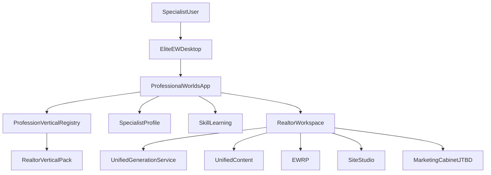

# EliteEW Professional Worlds

**Status:** living product SoT (large hub, 116k). Prefer thin contracts for day-to-day: [PROFESSIONAL-WORLDS-PACK-V2-CONTRACT.md](PROFESSIONAL-WORLDS-PACK-V2-CONTRACT.md), [PROFESSIONAL-WORLDS-SMOKE-STACK0.md](PROFESSIONAL-WORLDS-SMOKE-STACK0.md), [PROFESSIONAL-WORLDS-VERTICAL-TEMPLATE.md](PROFESSIONAL-WORLDS-VERTICAL-TEMPLATE.md), [PROFESSIONAL-WORLDS-NEXT-BASELINE.md](PROFESSIONAL-WORLDS-NEXT-BASELINE.md). Mobile entry: `pack-cloud/mobile/` embedded SPA (not a second product tree).

Канон продукта для модульной экосистемы профессиональных рабочих сред внутри EliteEW Desktop. Технический slug: `professional-worlds`. Первый вертикальный пакет: `realtor` для риэлтора/специалиста по продаже и аренде недвижимости.

## Назначение

Professional Worlds превращает Desktop в персональную профессиональную среду: специалист выбирает профессию, заполняет профиль, получает рабочие сценарии, обучение, AI-рецепты, контент-студию, легкий CRM-контур и связку с существующими приложениями EliteEW.

Главный принцип: не отдельное приложение только для риэлторов, а расширяемый слой профессий. Риэлторская вертикаль нужна как первый доказательный MVP, после которого можно добавлять консультантов, юристов, преподавателей, гидов, мастеров услуг и другие профессии без копирования архитектуры.

### Mobile Android (embedded SPA, OTA ≥ 0.2.165)

- Hash: `#/mobile-professional-worlds` → `MobileProfessionalWorldsPage` → `ProfessionalWorldsApp embeddedMobile`.
- Compact sidebar shell; native toolbar owns title.
- Точка входа: **Desktop Hub**. Канон: [MOBILE-ANDROID-EMBEDDED-SPA-UI-STYLE.md](mobile/MOBILE-ANDROID-EMBEDDED-SPA-UI-STYLE.md) §4.8.

## Текущее состояние (2026-07-03)

| Контур | Статус |
|--------|--------|
| **Backend** | Router split phase 1–5; `/api/v1/professional-worlds/*` стабилен; snapshot aggregate + Realtor Pro REST |
| **OpenAPI pilot + Zod** | Waves 2–24 **Done** — JSON write paths via `desktop/api.ts` barrel → `desktop/api/*`; исключения в `openapi/pilot-professional-worlds-write-path-exceptions.json` |
| **Desktop CRM mesh** | Cross-panel deep-links, communications quick log, pipeline/clients/objects bridges **Done** (2026-05-27) |
| **Realtor ecosystem flow** | Objects → listing-centric addons сохраняет выбранный объект; после сохранения объекта форма показывает безопасные next steps; cross-app draft handoff потребляется EWRP, Site Studio, GAF Chat, EWDesk, Файловый менеджер как черновик |
| **Post-adoption UX** | Waves 26–28 **Done** — write forms, edit/update (documents, campaigns), toasts (`useProfessionalToasts`), playbook Resume, deploy gate |
| **Desktop visible redesign** | **Done** — normal-state Overview shows hero, next-best-step card, readiness rail, journey cards and trust note above the fold; sidebar is grouped by journey stage |
| **Realtor UX redesign** | **Done** — Objects/Photos default path is realtor-facing (`Add photos` / `Choose from library`), advanced processing is disclosed, active listing starts with facts → photos/description, sidebar uses Today/Listings/Clients/My image/Drafts mental model |
| **Delete confirm (Cause-First W1)** | Clients, deals, drafts, listings, showings, tasks — `ProfessionalWorldsDeleteAction` (no typed DELETE); см. §Delete confirm |
| **Realtor vertical notes** | Ecosystem roadmap + tools — professional-worlds/`documentation/plans/product/professional-worlds/REALTOR-ECOSYSTEM-ROADMAP.md` *[operator-local process plan; gitignored — not living canon]*, [professional-worlds/REALTOR-TOOLS.md](professional-worlds/REALTOR-TOOLS.md) |
| **Workspace context fixtures** | Panel tests must stub **`reloadSnapshot`** (alias of `refresh`) on `ProfessionalWorldsWorkspaceContextValue` |
| **Stack0 smoke** | `./docker/scripts/professional-worlds-stack0-smoke.sh` (+ `--with-vitest`); runbook `PROFESSIONAL-WORLDS-SMOKE-STACK0.md` |
| **Admin pack v2 / rollouts** | Backend + admin UI — см. `PROFESSIONAL-WORLDS-NEXT-BASELINE.md` |
| **Fast-Track Multi-Vertical (2026-07-18)** | Four gods → barrels ≤500 LOC; media facade `targetId`/`contextType`; `professionalVerticalTemplate`; consultant seed viable |

Операторская проверка после деплоя фронта: `pnpm run build:react-compiler` → `node scripts/verify-app-build-id.mjs` → recreate stack0 frontend (см. `FRONTEND-STALE-CHUNK-404.md`).

## JTBD-основа

По методологии Ивана Замезина сегмент проверяется через повторяющиеся истории людей: триггер и контекст, ожидаемый результат, желаемое эмоциональное преображение, важность работы, текущие решения, барьеры, привычки и готовность платить. Для Professional Worlds это означает, что каждая профессия должна описываться не списком фич, а набором работ специалиста.

### Realtor-сегменты MVP

- Новичок: когда нет стабильного потока клиентов, хочет быстро выглядеть компетентно и не теряться в переговорах, чтобы почувствовать контроль и профессиональную уверенность.
- Растущий специалист: когда уже есть объекты и первые сделки, хочет системно вести клиентов и контент, чтобы доход меньше зависел от случайности.
- Топ-агент: когда репутация и скорость реакции важнее ручной рутины, хочет быстро упаковывать объекты и личный бренд, чтобы масштабировать доверие.
- Агент-командир: когда ведет помощников или мини-команду, хочет стандартизировать материалы и обучение, чтобы не держать все в голове.
- Независимый эксперт: когда работает без сильного бренда агентства, хочет создать публичную витрину и экспертный образ, чтобы компенсировать дефицит институционального доверия.

### Интервью-гайд для проверки

1. Какая ситуация заставила вас в последний раз искать новый объект, клиента или сделку?
2. Какой результат вы хотели получить и почему именно сейчас?
3. Как вы хотели себя чувствовать после решения этой задачи?
4. Насколько важна была эта работа по шкале 1-10?
5. Какими инструментами вы пользовались по шагам?
6. Где возникли потери времени, стресса, денег или доверия?
7. Что вы уже пробовали менять и почему оставили старый способ?
8. Сколько стоит текущее решение: деньги, время, энергия, репутационные риски?
9. Что должно произойти, чтобы вы наняли новый инструмент вместо привычки?
10. Какие материалы, навыки или сценарии чаще всего отделяют успешную сделку от провала?

## Конкурентные ориентиры по “Этажам”

Публичная витрина `vl.etagi.com` показывает сильные элементы доверия: бренд агентства, рейтинг и отзывы специалистов, стаж, специализацию, наличие объектов, гарантии сделки, ипотеку, быстрый контакт, сервисы подбора и понятный путь клиента к заявке. Для Professional Worlds это не повод копировать агентство, а ориентир для личного кабинета специалиста: профиль, достижения, отзывы, объекты, экспертность, скорость ответа и готовые материалы.

## MVP Job Stories для риэлтора

- Когда я получаю новый объект, хочу быстро собрать описание, визуальную подачу и сценарий показа, чтобы объект выглядел ценнее и понятнее для целевого покупателя.
- Когда клиент сомневается, хочу сформулировать ответ на возражение без давления и юридически рискованных обещаний, чтобы сохранить доверие и следующий шаг.
- Когда у меня нет стабильного потока лидов, хочу получить контент-план и посты под личный бренд, чтобы регулярно напоминать рынку о своей экспертизе.
- Когда я готовлю показ, хочу видеть ключевые факты, эмоциональные мотивы и вопросы клиента, чтобы вести коммуникацию спокойно.
- Когда я учусь профессии, хочу короткие практические уроки и role-play, чтобы быстрее перейти от теории к уверенным действиям.
- Когда я устал от неопределенности дохода, хочу видеть понятный прогресс по объектам, клиентам, контенту и обучению, чтобы чувствовать управляемость недели.

## Definition Of Done MVP

MVP готов, когда пользователь может установить приложение Professional Worlds на Desktop, выбрать профессию “Риэлтор”, заполнить профиль, добавить объект, сгенерировать JTBD-описание, получить content pack для соцсетей, сохранить артефакт, завести клиента/сделку, пройти первые уроки и открыть тренажер возражений. MVP не заменяет агентскую CRM и не обещает юридические, ипотечные или инвестиционные гарантии.

## Архитектура



### Backend

Кодовый контур:

- `shared/api/domains/professional_worlds.py`
- `shared/api/routers/professional_worlds.py` (aggregate router: mounts all sub-routers under `/professional-worlds`)
- `shared/api/routers/professional_worlds_core.py` (bootstrap: verticals, profile, runtime, activations, snapshot)
- `shared/api/routers/professional_worlds_realtor_crm.py` (Realtor Pro CRM CRUD: leads, schedule, documents, communications, listing CRUD)
- `shared/api/routers/professional_worlds_realtor_media.py` (Realtor media attach/upload, intake streams, enhancement batches, PW albums)
- `shared/api/routers/professional_worlds_realtor_media_runtime.py` (media SSE/stream helpers; no route registration — unit-test safe)
- `shared/api/routers/professional_worlds_crm_lite.py` (generic CRM-lite clients/deals)
- `shared/api/routers/professional_worlds_ai_streams.py` (text AI SSE: description, content-pack, coach)
- `shared/api/routers/professional_worlds_ai_runtime.py` (UGS text stream helpers; no route registration)
- `shared/api/routers/professional_worlds_playbooks.py` (playbook list/run/resume SSE)
- `shared/api/routers/professional_worlds_learning.py` (learning courses/lessons, artifacts list)
- `shared/api/routers/professional_worlds_workspace.py` (brand visual kit, cross-app drafts, property draft handoffs)
- `shared/api/routers/professional_worlds_deps.py` (shared `_service`, `_current_user_id`, `_sse`, idempotency + prompt helpers)
- `shared/api/schemas/professional_worlds.py`
- `shared/api/models/professional_worlds.py`
- `shared/api/services/professional_worlds/`
- `shared/api/migrations/applied/20260505_01_professional_worlds.sql`

**Module ownership (`api/services/professional_worlds/`):**

| Module | Responsibility | Facade methods (representative) |
|--------|----------------|----------------------------------|
| `service.py` | Thin orchestration facade (**586L** after Wave 4): runtime/snapshot/CRM/media delegations; mixin `service_realtor_delegations.py` for Realtor Pro CRUD | `load_user_snapshot`, `get_runtime_config`, `get_ai_action`, … |
| `service_realtor_delegations.py` | Realtor Pro showings/tasks/leads/marketing delegations (mixin on `ProfessionalWorldsService`) | `list_realtor_tasks`, `delete_realtor_property_showing`, … |
| `vertical_schema_service.py` | Active vertical JSON schema lookup + required-field validation | `get_active_schema`, `validate_against_active_schema`, `ActiveSchemaValidationError` |
| `brand_kit_service.py` | User brand visual kit read/upsert | `get_brand_visual_kit`, `upsert_brand_visual_kit` |
| `runtime_lookup_service.py` | Runtime/admin AI action + photo preset lookup (includes `prompt_template` for operator paths) | `get_ai_action`, `get_photo_preset`, `render_ai_action_prompt` |
| `realtor_generation_prompts.py` | UGS prompt builders for realtor copy + coach role-play | `build_realtor_prompt`, `build_coach_prompt`, `build_ugs_input` |
| `runtime_config_service.py` | Runtime config resolver + user vertical activations (user payload **omits** `prompt_template`) | `get_runtime_config`, `list_verticals`, `list_user_vertical_activations`, `upsert_user_vertical_activation`, `patch_user_vertical_onboarding`, `list_runtime_configs_for_user` |
| `runtime_service.py` | Thin runtime facade for routers (delegates to `runtime_config_service` via session) | `get_config` |
| `object_intake_parsing.py` | Object-intake prompt build + JSON parse/normalize | `build_object_intake_prompt`, `parse_object_intake_result` |
| `object_intake_jobs_service.py` | Object-intake preview jobs + commit into listings | `save_object_intake_preview`, `commit_object_intake` |
| `snapshot_helpers.py` | Snapshot fetch flags, vertical constants, UGS type key | `_should_fetch_*`, `REALTOR_VERTICAL_SLUG` |
| `snapshot_service.py` | Desktop bootstrap snapshot assembly (module-aware parallel fetches) | `load_user_snapshot`, `UserSnapshotDeps` |
| `professional_profile_service.py` | Specialist profile read/upsert | `get_profile`, `upsert_profile` |
| `professional_learning_service.py` | Learning courses + lesson progress | `list_courses`, `complete_lesson` |
| `realtor_leads_service.py` | Realtor Pro leads CRUD | `list_leads`, `create_lead`, … |
| `realtor_properties_service.py` | Listing CRUD, media attach, accepted enhancement apply | `list_properties`, `create_property`, `attach_property_media`, … |
| `professional_crm_service.py` | CRM-lite clients/deals + deal↔property backfill | `list_clients`, `create_deal`, `backfill_deal_property_links` |
| `professional_artifacts_service.py` | Generated artifacts persist/list/filter | `list_artifacts`, `save_artifact`, `list_artifacts_filtered` |
| `media_enhancement_service.py` | Single-photo enhancement jobs (non-batch) | `create_media_enhancement_job`, `set_media_enhancement_decision`, … |
| `media_batch_service.py` | Batch enhancement envelope + line status | `create_media_batch_job`, `get_media_batch_job`, … |
| `professional_media_albums_service.py` | PW cross-property media albums | `list_professional_media_albums`, `patch_professional_media_album`, … |
| `quota_service.py` | User quota summary + consume-after-success | Used by routers/admin ops |
| `ops_metrics_service.py` | Operator ops metrics SQL | Used by admin Ops tab |
| `realtor_pro.py` | Thin re-export barrel for Realtor Pro domain | Public import path for showings/tasks/… |
| `realtor_pro_*.py` | Domain modules: ownership, buyers/sellers, deals/docs, marketing/comms, pricing/quality, showings/tasks | Called via `realtor_pro` barrel |
| `admin_service.py` | Thin admin facade (mixin composition) | `ProfessionalWorldsAdminService` |
| `admin_typing.py` | Shared TypedMixin host so sibling mixins type-check `_audit` / catalog calls | `ProfessionalWorldsAdminTypedMixin` |
| `admin_*.py` | Admin mixins: audit, overview, verticals, modules, schemas, AI/presets, integrations/export | Mounted via admin facade |

**Architecture split — Cause-First program (2026-07, coordinate with retired Cursor plan `pw_cause-first_program_0e63d2a4.plan.md` (not in monorepo tree)):**

| Layer | Target | Current (2026-07-03) |
|-------|--------|------------------------|
| **Backend Wave 4** | `service.py` **<800L** thin facade | **Done:** `service.py` **586L**; extracted `service_realtor_delegations.py` (367L), `vertical_schema_service.py`, `brand_kit_service.py`, `runtime_lookup_service.py`, `realtor_generation_prompts.py`; `pw_media_*` helpers moved to `media_output_naming.py` |
| **Frontend Wave 3** | `RealtorProPanels.tsx` barrel-only re-exports; each panel **≤800L** in `runtimePanels/realtorPro/` | **Done:** barrel **34L** re-exports 14 panels from `realtorPro/*.tsx`; Wave 1 delete confirm in `ShowingsCalendarPanel` / `TasksPanel` + Vitest locks |

Public HTTP and lazy-import paths **must not change** during split; proof = full PW Vitest + `tests/ -k professional_worlds`.

**Router split (phase 1–5, 2026-05-27):** sub-router'ы — bootstrap (`professional_worlds_core.py`), CRM (`professional_worlds_realtor_crm.py`), media (`professional_worlds_realtor_media.py` + `_runtime`), CRM-lite (`professional_worlds_crm_lite.py`), text AI (`professional_worlds_ai_streams.py` + `_ai_runtime`), playbooks (`professional_worlds_playbooks.py`), learning (`professional_worlds_learning.py`), workspace extras (`professional_worlds_workspace.py`); deps — `professional_worlds_deps.py`. Aggregate entry `professional_worlds.py` ~47 строк (`include_router` × 8). Публичный контракт `/api/v1/professional-worlds/*` **не менялся**.

API-префикс: `/api/v1/professional-worlds`.

Реализованные MVP endpoints:

- `GET /verticals`
- `GET /me/snapshot?vertical_slug=realtor` (aggregate Desktop bootstrap; module-aware fetches)
- `GET /me/profile?vertical_slug=realtor`
- `PUT /me/profile`
- `GET /realtor/properties`
- `POST /realtor/properties`
- `GET /realtor/properties/{property_id}`
- `PATCH /realtor/properties/{property_id}`
- `DELETE /realtor/properties/{property_id}`
- `GET /realtor/properties/{property_id}/media`
- `POST /realtor/properties/{property_id}/media`
- `DELETE /realtor/properties/{property_id}/media/{media_id}`
- `GET /clients` (query `vertical_slug`, иначе дефолт `realtor`)
- `POST /clients`
- `PATCH /clients/{client_id}`
- `DELETE /clients/{client_id}` — hard delete; **409** `client_has_deals` when linked deals remain
- `GET /deals` (query `vertical_slug`, иначе дефолт `realtor`)
- `POST /deals`
- `POST /deals/backfill-property-links` (query `vertical_slug`; idempotent merge `deal_data.property_id` для legacy title-match)
- `PATCH /deals/{deal_id}`
- `DELETE /deals/{deal_id}` — hard delete (user-scoped)
- `GET /realtor/showings`
- `POST /realtor/showings`
- `GET /realtor/showings/{showing_id}`
- `PATCH /realtor/showings/{showing_id}`
- `DELETE /realtor/showings/{showing_id}`
- `GET /realtor/tasks`
- `POST /realtor/tasks`
- `GET /realtor/tasks/{task_id}`
- `PATCH /realtor/tasks/{task_id}`
- `DELETE /realtor/tasks/{task_id}`
- `GET /learning/courses` (опционально `vertical_slug`, иначе дефолт `realtor`)
- `GET /learning/courses/{course_id}` (опционально `vertical_slug` для согласованного списка)
- `POST /learning/lessons/{lesson_id}/complete`
- `GET /artifacts` (query `vertical_slug`, иначе дефолт `realtor`)
- `DELETE /artifacts/{artifact_id}` — hard delete saved draft (user-scoped)
- `POST /realtor/properties/{property_id}/generate-description/stream`
- `POST /realtor/properties/{property_id}/generate-content-pack/stream`
- `POST /coach/simulate/stream`
- `GET /playbooks/{vertical_slug}/{playbook_key}/estimate-cost`
- `POST /playbook-runs/{run_id}/resume/stream`

Основные таблицы:

- `profession_verticals`
- `specialist_profiles`
- `professional_generation_recipes`
- `professional_artifacts`
- `professional_learning_courses`
- `professional_learning_lessons`
- `professional_learning_progress`
- `professional_clients`
- `professional_deals`
- `professional_tasks` (generic vertical tasks; см. § Tasks ниже)
- `realtor_properties`
- `realtor_property_media`
- `realtor_property_showings` (переименование с `realtor_showings` + расширение полей показа)
- `realtor_tasks`

Инварианты:

- Все пользовательские данные scoped by `user_id`.
- Доменные данные не хранятся в `desktop_configs.shell_state`.
- `shell_state` используется только для workspace profiles, app collections и сценариев Desktop.
- Долгие AI-операции идут через SSE и UGS, с keep-alive и idempotency key.
- Результаты генераций сохраняются как `professional_artifacts`; подходящие медиа/документы связываются с Unified Content.

### Tasks: `professional_tasks` vs `realtor_tasks`

| Слой | Решение (2026-05-27) |
|------|----------------------|
| **Realtor MVP UI** | Модуль **`realtor_tasks`** (`GET/POST/PATCH/DELETE /realtor/tasks`) — единственный tasks-контур в Profession tools. |
| **Generic CRM-lite** | Поле **`next_action`** на `professional_clients` / `professional_deals` — синтетические «следующие шаги» без отдельной таблицы. |
| **`professional_tasks`** | **Schema-only / reserved:** таблица и ORM-модель сохранены для будущих вертикалей без Realtor pack; **нет** публичного HTTP API и **нет** записи в Desktop snapshot. Колонка `reminder_at` добавлена миграцией `20260505_07_realtor_tasks.sql` для совместимости с reminder UX Realtor Pro. |
| **Не делаем сейчас** | Дублировать задачи в `professional_tasks` и `realtor_tasks`; смешивать generic tasks API с `realtor_tasks` в одной панели без явных секций. |

Операторская проверка snapshot-теста (без импорта FastAPI router):

```bash
cd shared/api
UV_PROJECT_ENVIRONMENT=../.venv uv sync --extra dev
PYTHONPATH=.. ../.venv/bin/python -m pytest \
  tests/test_professional_worlds_router_split.py \
  tests/test_professional_worlds_snapshot.py \
  tests/test_deal_property_linkage.py -q
```

Host venv: **`.venv`** (см. [platform/TESTING-STRATEGY.md](../platform/TESTING-STRATEGY.md) §Host venv). В контейнере — `/app/.venv`, без изменений.

Контракт монтирования sub-router'ов: `tests/test_professional_worlds_router_split.py` (без тяжёлого import monolith/media multipart).

Полный `tests/test_professional_worlds.py` по-прежнему требует runtime deps из stack0 `api.lock` (router import: Pillow, python-multipart).

**HTTP DELETE router tests:** `tests/test_professional_worlds_delete_http.py` — `TestClient` на `crm_lite_router` + `learning_router` (`DELETE /clients/{id}`, `/deals/{id}`, `/artifacts/{artifact_id}`); service layer замокан, проверяются только HTTP status и JSON body (204, 409 `client_has_deals` + `deal_count`, 404).

```bash
bash docker/scripts/run-stack0-api-tests.sh tests/test_professional_worlds_delete_http.py -q
```

**Legacy deal→listing backfill:** `POST /api/v1/professional-worlds/deals/backfill-property-links?vertical_slug=realtor` — записывает `deal_data.property_id`, когда заголовок сделки **однозначно** содержит ровно один title listing (case-insensitive). UI: Profession tools → Pipeline → **Save listing links**. Отображение до backfill использует ту же unique-inference логику (`resolveEffectiveDealPropertyId`); новые сделки — только FK.

### Frontend

Кодовый контур:

| Контур | Путь |
|--------|------|
| Desktop runtime | `shared/web/frontend/src/features/professional-worlds/desktop/` |
| Desktop entry | `shared/web/frontend/src/pages/Desktop/apps/ProfessionalWorlds/ProfessionalWorldsApp.tsx` |
| Unified Admin | `shared/web/frontend/src/features/professional-worlds/admin/` |
| i18n | `shared/web/frontend/src/i18n/locales/ru/professionalWorlds.json` / `shared/web/frontend/src/i18n/locales/en/professionalWorlds.json` |

Ключевые файлы desktop:

| Файл | Назначение |
|------|------------|
| `ProfessionalWorldsApp.tsx` | Toolbar, snapshot bootstrap, nav, AI lanes |
| `api.ts` | HTTP + SSE client; Zod parse на read/write paths |
| `professionalWorldsApiZod.ts` | Тонкий backward-compatible barrel (`export *` only), сохраняющий прежний import path |
| `zod/*.ts` | Доменные runtime parsers и write-body validators: CRM, Realtor Pro, listings, media/brand, runtime, playbooks, snapshot aggregate, streaming и cross-app drafts; каждый модуль ≤800 LOC |
| `professionalWorldsApiError.ts` | `formatProfessionalWorldsApiError` — user-facing сообщения |
| `ProfessionalToast.ts` | `useProfessionalToasts` → EliteEW notification center |
| `types.ts` / `professionalWorldsOpenApi.ts` | Pilot type aliases |
| `runtimeModuleRegistry.tsx` | Lazy addon panels; `realtor_playbooks` → `PlaybooksRegistryPanel` |
| `ProfessionalWorldsWorkspaceContext.tsx` | Snapshot, nav, CRM bridge focus |
| `ProfessionalPlaybooksRuntimePanel.tsx` | SSE runner + Resume для failed/cancelled runs |
| `professionalWorldsCrossAppDraft.ts` | Consumer-side parser for `professionalWorldsCrossAppDraftKey` capsules |
| `runtimePanels/RealtorProPanels.tsx` | **Barrel only (34L):** named re-exports for 14 Realtor Pro addon panels; lazy-load entry for `runtimeModuleRegistry.tsx` |
| `runtimePanels/realtorPro/*.tsx` | Per-panel ownership (Wave 3 split): `LeadsPanel`, `ClientsPanel`, `ShowingsCalendarPanel`, `TasksPanel`, … (14 panels; each **≤800L**) |
| `runtimePanels/realtorPro/shared.ts` | Shared formatters, `AsyncState`, `resolvePreferredPropertyId`, `useListingCrmBridge`; re-exports JSX helpers from `sharedUi.tsx` |
| `runtimePanels/realtorPro/sharedUi.tsx` | `PanelStatus`, `ListingCrmBridgeActions`, `Badge`, `JsonPreview` |
| `runtimePanels/realtorPro/index.ts` | Optional aggregated panel exports (registry/tests import parent barrel) |
| `components/ProfessionalWorldsDeleteAction.tsx` | Shared confirm-delete modal wrapper for workspace destructive actions |
| `runtimePanels/PlaybooksWorkspacePanel.tsx` | Nav Playbooks workspace (runner / about tabs) |
| `desktop/layout/*` | Shared workspace chrome |

Desktop wiring:

- `app_id`: `app-professional-worlds`
- `app_component`: `ProfessionalWorlds`
- App Store catalog row добавляется миграцией.
- В `DEFAULT_APPS`, registry и `desktopWindowAppContent` добавляется lazy window entry.
- Workspace profile template `realtor` открывает Professional Worlds, EWRP, Файловый менеджер, Site Studio и GAF Chat как типовой рабочий сценарий специалиста.
- i18n namespace: `professionalWorlds` (`ru` и `en`).

Frontend MVP — lazy Desktop-приложение `ProfessionalWorldsApp.tsx` (~900 строк: toolbar, snapshot, nav, AI lanes) и панели `runtimePanels/`:

| Панель | Путь | Назначение |
|--------|------|------------|
| Overview | `runtimePanels/OverviewWorkspacePanel.tsx` | Visible hero + task board, readiness rail, journey cards, trust note, pulse-метрики, Today's focus CRM CTAs (tasks, communications follow-ups, pipeline/listing links), onboarding wizard |
| Objects (realtor) | Barrel `RealtorObjectsWorkspacePanel.tsx` → `runtimePanels/realtorObjects/*` + `hooks/realtorObjects/*` (composer `useRealtorObjectsWorkspace.ts`) | Каталог объектов, intake, editable listing facts, simplified photos, listing description/materials. После `POST /realtor/properties` форма предлагает 1–2 безопасных next steps без автосоздания downstream records; deal/showing/document links are behind **More for this listing** |
| Clients (generic) | `runtimePanels/ClientsWorkspacePanel.tsx` | CRM-lite клиенты/сделки для любой профессии |
| Profile | `runtimePanels/ProfileWorkspacePanel.tsx` | Профиль специалиста (presence / positioning) |
| Learning | `runtimePanels/LearningWorkspacePanel.tsx` | Курсы + role-play coach |
| Brand | `runtimePanels/BrandWorkspacePanel.tsx` | Стартеры бренда + media-kit link |
| Artifacts | `runtimePanels/ArtifactsWorkspacePanel.tsx` | Библиотека артефактов |
| Playbooks | `runtimePanels/PlaybooksWorkspacePanel.tsx` | Runtime playbooks runner |
| Profession tools | `runtimePanels/ProfessionToolsWorkspacePanel.tsx` | `ModulePanelRegistry` + `realtor_*` addons |
| Realtor Pro addons | `runtimePanels/RealtorProPanels.tsx` | 12 `realtor_*` modules in catalog (`20260505_03` + `20260523_pw_realtor_pro_four_modules_catalog.sql`): leads, buyers, sellers, pipeline, documents, marketing, insights, playbooks, **showings, tasks, communications, objections** — `ProfessionalWorldsWorkspacePanel` + CRM write forms (waves 26–28) |
| Setup hint | `runtimePanels/RuntimeSetupHintPanel.tsx` | Первый запуск до активации runtime |
| AI rail | `runtimePanels/ProfessionalWorldsAiOutputRail.tsx` | Brand / learning / **listing** generated text под скроллом; status-only progress/notice messages do not create a bottom output panel |
| Shared UI | `professionalWorldsDesktopUi.tsx` | Re-export layout + utils; алиасы `FieldLabel` / subtabs для обратной совместимости |

**Workspace context:** `ProfessionalWorldsWorkspaceContext.tsx` — snapshot, nav, listing selection, AI lanes (`brandStream`, `learningStream`, `listingStream`), runtime config; панели objects/brand/artifacts/overview/playbooks/profession tools читают через `useProfessionalWorldsWorkspace()`. Profile/clients/learning оставляют form-handlers в App.

**Realtor ecosystem handoff (2026-05-29):** listing-centric addons (`realtor_showings`, `realtor_documents`, `realtor_marketing`, `realtor_insights`) берут начальный объект из workspace `selectedPropertyId` и при ручной смене обновляют этот же context. Это закрывает переход `Objects -> documents/marketing/insights/showing draft` без query-string и без нового backend контракта.

**Object post-create next steps (2026-05-29):** после сохранения нового объекта `useRealtorObjectsWorkspace` запоминает созданный listing и выбирает его как активный. `RealtorObjectsWorkspacePanel` показывает user-facing блок `Listing saved` / `Объект сохранён` с ручными переходами в рабочее место объекта, создание сделки/клиента и подключённые addon-модули (`realtor_showings`, `realtor_documents`, `realtor_marketing`). Эти кнопки только фокусируют существующие поверхности и не создают downstream records автоматически. Активное рабочее место объекта дополнительно начинается с named region `Active listing context` / `Активный контекст объекта`, чтобы screen-reader/keyboard smoke видел выбранный объект и next-step CTA с сохранённым `linkedPropertyId`.

**Cross-app draft consumers:** `openProfessionalDraftDestination.ts` по-прежнему пишет one-shot capsule в `sessionStorage` и отправляет только `professionalWorldsCrossAppDraftKey` через `desktop-open-app`. `buildProfessionalWorldsDraftOpenPayload()` пропускает этот one-shot ключ только в реальные consumer apps (`GAFChatApp`, `UserSiteStudio`, `EWDeskApp`, `EWRP` / `Presentations` / `PresentationsArchive`) и не передаёт capsule в неподдержанные окна. Destination adapters теперь такие:

- `EWRP` — заполняет презентационный brief/source как раньше.
- `Site Studio` — предзаполняет setup title/topic/brief или assistant input для существующего site workspace.
- `GAF Chat` — добавляет composer seed и, если есть unified content id, attachment preview после выбора чата.
- `EWDesk` — показывает операторский markdown draft card; публикация остается ручной.
- `Файловый менеджер` — получает `unified_content_ids` через существующий focus/link contract, без автопубликации.

**UI layout (2026-05):** `desktop/layout/` — единые `WorkspaceSection`, `WorkspacePanel` (`embedded` для вложенного body без двойного chrome), `WorkspaceSubtabs`, `StatusBanner`, `FormField`, `Textarea`, `AiOutputPanel`, `SidebarNav`, responsive shell (`useProfessionalWorldsSurfaceLayout`). Токены: `professionalWorldsLayoutTokens.ts` — panel/shell классы, `PW_TONE_LABEL_CLASS`, `PW_PIPELINE_STATUS_CHIP_CLASS`, `pwJobProgressEventSurfaceClass()` (палитра как у `StatusBanner`). Shared runtime widgets — через `WorkspacePanel`; `ProfessionalMediaWorkbench` — `embedded` внутри Objects media panel. Прямой `DesktopAppPanel` только в layout-primitives и shell sidebar. Утилиты форм: `desktop/utils/professionalWorldsFormUtils.ts`. Desktop family: `ProfessionalWorlds` → `shell`.

**Follow-up после layout-refactor (2026-05-23, UI only, API без изменений):**

| Область | Что сделано |
|---------|-------------|
| `ProfessionalWorldsStatusBanner` | Виды `success` / `error` / `info` / **`warning`**; prop `role`: `status` (тег `p`) или **`alert`** (тег `div`) для intake и критичных предупреждений |
| Единые ошибки форм | `SchemaDrivenForm.tsx`, `AiActionLauncher.tsx`, `IntegrationHandoffPanel.tsx` — `kind="error"` вместо локальных `div` |
| AI rail | `listingStream` generated text вынесен из `RealtorObjectsWorkspacePanel` в `ProfessionalWorldsAiOutputRail` (копирование через `copyLane('listing')`); status-only parse/media notices stay local and do not render the bottom rail |
| i18n | `professionTools.empty` в `en`/`ru` `professionalWorlds.json`; `ProfessionToolsWorkspacePanel` без `defaultValue` |
| Objects (realtor) | `RealtorObjectsWorkspacePanel`: полностью на `WorkspaceSection` / `WorkspacePanel` / `Subtabs` / `Textarea` / `StatusBanner`; generated listing text — только в `ProfessionalWorldsAiOutputRail` (не в панели), while parse/status notices do not open the rail |
| Realtor Pro panels | `RealtorProPanels.tsx`: все 12 runtime addon-панелей на `WorkspacePanel`; `PanelStatus` и load errors — `StatusBanner`; write-path toasts — `useProfessionalToasts` |
| Shared runtime UI | `SchemaDrivenForm`, `AiActionLauncher`, `IntegrationHandoffPanel`, `ArtifactHub`, `JobProgressStream`, `FieldConfidenceReview`, `BeforeAfterMediaCompare`, `UnifiedContentPickerBridge`, `RuntimeOnboardingWizard`, `ProfessionalLearningCoursesPanel` — `WorkspacePanel`; picker `embedded` → body-only режим |
| Shell | `ProfessionalWorldsRuntimeShell.tsx` — sidebar `PW_SHELL_SIDEBAR_PANEL_CLASS`; activation/toolbar alerts — `StatusBanner` `kind="error"` `role="alert"` |
| Tests | `layout/__tests__/professionalWorldsLayout.test.tsx` — `warning` + `role="alert"`, `WorkspacePanel` `embedded`, tone tokens |
| Tone / chips | `professionalWorldsLayoutTokens.ts` — `PW_TONE_LABEL_CLASS`, `PW_PIPELINE_STATUS_CHIP_CLASS`, `pwJobProgressEventSurfaceClass()` |
| Media workbench | Stable path `ProfessionalMediaWorkbench.tsx` (thin re-export) → `mediaWorkbench/*` compose + panels; `WorkspacePanel` `embedded` в Objects media panel. **Wave E atomization (2026-08-10):** facade ≤400 LOC; children ≤500 LOC; lock `mediaWorkbench/__tests__/ProfessionalMediaWorkbench.atomization.contract.test.ts`. |
| a11y / forms | Learning coach, Playbooks variables, `SchemaDrivenForm`, BeforeAfter split, Showings (`RealtorProPanels`) — `FormField` + стабильные `id` |

**Статус Desktop layout-слоя (2026-05-23):** **Done** — массовая миграция `DesktopAppPanel` в feature-коде завершена; точечные доводки (playbooks, media, tone tokens, a11y) закрыты. Дальше — только продуктовые фичи, не повторная миграция chrome.

**Хронология Desktop UI:** chat + `git log` (worklog journals retired — [`worklog/README.md`](../worklog/README.md)). Living status: [`PROFESSIONAL-WORLDS-NEXT-BASELINE.md`](PROFESSIONAL-WORLDS-NEXT-BASELINE.md).

Общая логика пакета — `verticalModuleLogic.ts`, матрица mount — `runtimeModuleMount.ts`. Риэлторские DTO — `realtorLogic.ts`. В `runtimeModuleRegistry` модуль `objects` — `panelKind: dedicated` (UI монтируется из App с host-props). **`realtor_playbooks`:** `panelKind: dedicated` (`PlaybooksRegistryPanel`), но mount **только nav** (sidebar «Playbooks») — не дублируется в Profession tools stack (`VERTICAL_PACK_NAV_ONLY_MODULE_KEYS`).

**Runtime copy hygiene (2026-05-29):** видимый runtime chrome не должен показывать backend/module seed names как основной текст. `resolveRuntimeModuleNavLabel()` сохраняет кастомные `module_name`, но для generic seed `realtor_playbooks = "AI Playbooks" / "AI-плейбуки"` возвращает локализованный fallback sidebar label (`Сценарии` / `Scenarios`). Основной subtitle, onboarding hints and safety invariant use human copy (`умные подсказки` / `guided assistance`) instead of raw `AI` labels; internal keys (`realtor_playbooks`, AI action APIs, SSE lanes) remain unchanged.

**Media runtime copy hygiene (2026-05-29):** обычный пользовательский слой `ProfessionalMediaWorkbench` и upload progress в `RealtorObjectsWorkspacePanel` не показывают raw job diagnostics (`Status:`, `Output:`, `SSE:`, `Review:`), UUID и migration/runbook текст как основной copy. Статусы обработки, решения по кадру и upload states переводятся через `professionalWorlds.json`; UUID исходника/результата остаются только в раскрываемых «Технических деталях». Если альбомы недоступны из-за schema/migration drift, toast говорит пользователю, что альбомы временно недоступны, а не выводит route/table instructions.

**Interface perfection contract (2026-07-02):** долгие сценарии Professional Worlds используют один честный UI-контракт: run/stream не считается успешным без явного terminal event, `Stop waiting` останавливает только live-ожидание через `AbortSignal` и ведёт пользователя к `Recent runs` для восстановления итогового статуса (`done`, `failed`, `cancelled`, `running`). Ошибка загрузки истории не превращается в пустой список. Locked sidebar items остаются keyboard-focusable (`aria-disabled`) и показывают visible lock reason; `title` tooltip не считается доступным объяснением. Before/after media review, mobile embedded session recovery and job toasts не имеют raw English/RU fallback literals in source; copy guard scans locale values and audited source files.

**Journey state map (2026-07-02):** общий primitive `ProfessionalWorldsStatePanel` покрывает `normal`, `empty`, `loading`, `error`, `permissionDenied`, `offline`, `stale`, `longRunning` with localized title/body, optional retry, live-region role and support disclosure. Primary API error copy идёт через `formatProfessionalWorldsApiError`; raw `Error.message` разрешён только как support detail (`formatProfessionalWorldsApiSupportDetail`).

| Journey | State coverage owner |
|---------|----------------------|
| Desktop activation / first profession | `RuntimeSetupHintPanel` → `ProfessionalWorldsStatePanel(state="empty")`; locked modules stay reachable in `ProfessionalWorldsSidebarNav`. |
| Overview quick start / nav disclosure | `RuntimeOnboardingWizard`, overview pulse cards and nav mode helpers; state proof lives in focused nav/layout tests. |
| Profile save | `ProfileWorkspacePanel` banners + shared error formatter; success never creates downstream records automatically. |
| Objects / listing / media | `RealtorObjectsWorkspacePanel`, `ProfessionalMediaWorkbench`, `JobProgressStream`; batch stream terminal states and copy guard cover long-running/offline/stale copy. |
| Clients / deals | `ClientsWorkspacePanel` and Realtor Pro panels; mutation failures use human primary copy, support detail is optional. |
| Playbooks | `ProfessionalPlaybooksRuntimePanel`; run/resume/stop-waiting/history failure states have terminal/recovery proof. |
| Results / handoff | `ArtifactsWorkspacePanel` and cross-app draft panels; stale handoff is explicit before opening destinations. |
| Admin pack flow | New World `@/pages/Admin/ui` atoms (`AdminButton`, `AdminStatusBanner`, `AdminJsonPreview`, …) plus pack/rollout confirmation flows; operator JSON stays behind admin/support surfaces. |
| Mobile embedded | `MobileProfessionalWorldsPage` + `embeddedMobile` shell; session recovery copy is localized and mobile allowlist keeps primary actions reachable. |

**Shared primitive convergence (Wave 3, 2026-08-05):** Professional Worlds Unified Admin uses New World tokens/atoms from `shared/web/frontend/src/pages/Admin/ui/` (`ADMIN_UI_ROOT_CLASS`, `AdminButton`, `AdminField`, `AdminSelect`, `AdminSectionTabs`, `AdminStatusBanner` with `tone`, `AdminJsonPreview`, `AdminModal`/`AdminDrawer`). Old World `adminUiShared.tsx` is soft-retired (soft-retired under `trash/` (id 20260805-165257)). Media review overlays still use `PW_MEDIA_OVERLAY_BADGE_CLASS`, `PW_MEDIA_SPLIT_HANDLE_CLASS`, and `PW_MEDIA_MODAL_BACKDROP_CLASS`.

**Outcome and progressive navigation (2026-07-02):** `professionalWorldsNavMode.ts` exposes `deriveNavProgressStage()` with explicit `firstRun` / `midProgress` / `complete` states; full sidebar is suggested only after profile, onboarding and first listing milestones are all true. `ProfessionalWorldsOutcomeCard` is the shared success/partial-failure surface: profile save says nothing was published automatically and links to public-page setup; listing create says no deal/message/showing/document/publication/handoff was created and offers explicit next actions.

**Visible normal-state redesign (2026-07-02):** `OverviewWorkspacePanel` now uses `ProfessionalWorldsHeroPanel`, `ProfessionalWorldsActionCard`, `ProfessionalWorldsProgressRail` and `ProfessionalWorldsTrustNote` for the default Desktop Overview. First-run, mid-progress and complete states select different hero titles through `deriveNavProgressStage()`. Above the fold must answer four questions in the first seconds: what this workspace is, what to do next, what progress already exists, and what will not be done automatically. `ProfessionalWorldsSidebarNav` groups the rail into Today / Listings / Clients & deals / My image / Drafts while keeping locked rows focusable with the same `aria-disabled` and visible reason contract. New visual tokens live in `professionalWorldsLayoutTokens.ts` and avoid low-GPU/reduced-motion dependencies.

**Progress rail / trust note contract (2026-07-28):** `ProfessionalWorldsProgressRail` requires a `title` (shared readiness copy: `overview.visible.progress.title` on non-overview panels). `ProfessionalWorldsTrustNote` takes body copy as **children** (not a `body` prop) — same pattern as Overview.

**Premium journey panels (2026-07-03):** The same hero/progress/trust primitive stack now covers **Profile**, **Learning**, **first-run setup**, **Drafts**, **Guided tasks**, **Clients**, **Public image (Brand)**, **Listings**, and **Deals and tasks (ProfessionTools)** — one primary action above the fold, tab bodies and forms below progressive disclosure.

**Delete confirm (Cause-First Wave 1 + Delete MVP, 2026-07-03):** Все destructive workspace actions используют `ProfessionalWorldsDeleteAction` → `ConfirmDeleteModal` (**без typed DELETE**). Первый клик открывает modal; confirm вызывает DELETE; список/snapshot обновляется только после **204**; при ошибке API modal закрывается dismissible, строка остаётся.

| Surface | Panel | HTTP | i18n keys | Notes |
|---------|-------|------|-----------|-------|
| Client | `ClientsWorkspacePanel` | `DELETE /clients/{id}` | `clients.deleteTitle` / `deleteWarning` / `deleteAction` | **409** `client_has_deals` → conflict banner + filter deals for client |
| Deal | `ClientsWorkspacePanel` | `DELETE /deals/{id}` | `deals.delete*` | Hard delete, user-scoped |
| Saved draft | `ArtifactsWorkspacePanel` | `DELETE /artifacts/{id}` | `artifacts.delete*` | Does not revoke content already published via cross-app handoff |
| Listing | `RealtorObjectsWorkspacePanel` | `DELETE /realtor/properties/{id}` | `objects.delete*` | Soft-hide from portfolio; linked deals **SET NULL** on `property_id` |
| Showing | `ShowingsCalendarPanel` | `DELETE /realtor/showings/{id}` | `realtorPro.showings.delete*` | Modal `itemName` = listing title + scheduled time (or id fallback) |
| Task | `TasksPanel` | `DELETE /realtor/tasks/{id}` | `realtorPro.tasks.delete*` | Modal `itemName` = task title |

Shared modal chrome: `deleteModal.cancel`, `deleteModal.removing`. Vitest lock: delete click must **not** call API until confirm (`RealtorProPanels.test.tsx` + panel tests). Operator smoke: [`PROFESSIONAL-WORLDS-SMOKE-STACK0.md`](PROFESSIONAL-WORLDS-SMOKE-STACK0.md) §3.12.

**Realtor UX redesign (2026-07-02):** Objects/Photos no longer exposes the media cockpit as the default path. The first screen says what to do next: choose existing photos or upload photos; upload attaches without AI processing by default. Enhancement presets, album targeting and the media workbench are behind `Advanced: improve photos` / `Дополнительно: улучшение фото`. Active listing starts with listing summary and editable facts, then description/materials, then photos. Post-create success does not fan out into deal/showing/document/marketing modules; those remain explicit choices inside `More for this listing`.

**A11y / responsive / reduced-cost proof (2026-07-02):** `ProfessionalWorldsApp.mobile-embedded.contract.test.ts` executes the mobile view allowlist and layout token helpers (`filterNavItemsForMobileEmbedded`, `pwShellBodyClass(true)`, `pwFormGridClass(true)`, `pwSidebarPanelShellClass(true)`) instead of relying only on source-string assertions. Layout tests cover focusable locked nav, `ProfessionalWorldsStatePanel` live-region behavior, media tokens without blur/black overlay dependency, and reduced-motion source guards for progress/admin controls.

### Runtime module mount matrix

| `module_key` | Mount | Где в UI |
|--------------|-------|----------|
| `profile`, `objects`, `clients`, `learning`, `public-presence`, `artifacts` | `nav` | Sidebar |
| `realtor_playbooks` | `nav` | Sidebar «Playbooks» (не дублируется в Profession tools) |
| `deals` | `embedded` | Вкладка «Клиенты» (create/directory сделок) — gate по модулю |
| `media-studio` | `embedded` | Медиа в «Объектах» — gate по модулю (без fallback presets) |
| `realtor_*` (кроме playbooks) | `addon` | «Инструменты профессии» — **один активный модуль** (subtabs), lazy mount через `ModulePanelRegistry` |

**Runtime performance (2026-05-27):** snapshot bootstrap prefers **`GET /me/snapshot?vertical_slug=`** (aggregate payload, module-aware fetches on server; slice queries run in parallel via `asyncio.gather`; activations fetched once per snapshot). Переключение vertical в toolbar — **`refresh({ silent: true })`** без полноэкранного skeleton. Fan-out GETs остаются fallback с **`console.warn`** в desktop client. Profession tools монтирует только выбранный addon. Локальные `patchSnapshot` обновления после create client/deal/property, lead→client, property save/intake commit, learning lesson complete, onboarding patch, profile save, artifacts — без полного refresh. **CRM bridge:** пустой справочник «Клиенты» → Leads; create deal — picker **`client_id`** + **stage**, auto-select после create client, **`deal_data.property_id`** выбранного listing (FK-only для записи); directory и **Deals pipeline** показывают клиента/объект (чтение — FK или **unique** title inference); legacy backfill — **`POST /deals/backfill-property-links`** + UI **Save listing links**; клик по клиенту **фильтрует сделки**; **Use for deal** / **Create deal** (pipeline queue) → capture через **`openClients({ linkedPropertyId })`**; после create deal с клиентом → directory + фильтр; pipeline detail — **stage PATCH**, **`openClients({ filterClientId })`**, **`openProperties({ propertyId })`**, **`openPipeline({ dealId })`**; Clients directory — **Clear filter**, deal row **Open in pipeline** / **Open listing**, **stage PATCH**; Overview **Deals** metric → pipeline. **Overview Pulse:** пять метрик (в т.ч. Results → вкладка «Результаты»); Clients/Deals открывают нужный subtab; при незаполненном профиле — CTA «Complete profile». Leads: success banner + «Open Clients» (с фильтром) / «Create deal» / **Open pipeline** (при `realtor_pipeline`). Tasks: CRM suggested → **openPipeline({ dealId })** / **openClients({ filterClientId })** / **`openCommunications`** (deal/client focus); scheduled **`realtor_tasks`** → **`resolveTaskCommunicationFocus`**. **Showings:** create auto-links **`deal_id`** при unique match listing+client; карточки — **Open listing/client/deal in pipeline**. **Documents:** listing picker + **Open listing** / **Open deal in pipeline** (unique deal) или **Create deal**; per-document **Open deal in pipeline** via `deal_id` FK или unique listing match. **Communications:** structured filter по related type, loading/empty states, row CRM deep-link (`deal`→pipeline, `client`→directory, `property`→Objects, `lead`→Leads), **quick log capture** (POST `/realtor/communication-logs`, snapshot entity pickers для deal/client/property, lead inbox picker + **`openCommunications({ relatedType, relatedId })`** из Leads, **Deals pipeline** detail, **Clients directory**, **Showings** (deal→client→listing priority), **Objects** listing header, listing-centric addon panels, **Tasks**, **Objections**). **Objections:** блок **Practice with active deals** → pipeline + **`openCommunications({ dealId })`**. **Marketing / Insights:** shared listing CRM bridge (`Open listing` / pipeline / create deal). **Buyers (`realtor_buyers` → ClientsPanel):** client cards + matcher rows deep-link to Clients/Objects/pipeline. **Sellers (`SellerOnboardingPanel`):** seller clients + linked profiles → Clients directory. **Overview Pulse:** Clients tile → Leads when empty + module enabled; Today's focus — CRM tasks, **Communications follow-up log** (`openCommunications` on first deal/client `next_action` when `realtor_communications` enabled), listing-link backfill, pipeline review. Overview **Today's focus**: **Review deals pipeline** при `openDeals > 0`. Результаты: вкладка **Send to apps**. Seller onboarding: форма create. Новый объект наследует `city` из профиля; `list_realtor_leads` и fallback-пути `get_runtime_config` / activations логируют с `exc_info`.

Канон кода: `runtimeModuleMount.ts` (`RUNTIME_MODULE_MOUNT`, `VERTICAL_PACK_NAV_ONLY_MODULE_KEYS`).

Навигация: для известных `realtor_*` addon-модулей пользовательские подписи и краткие описания берутся из i18n (`Лиды`, `Покупатели`, `Сделки`, `Документы`, `Аналитика` и т.д.); `module_name` остаётся fallback для кастомных/admin-модулей, а pending seed `20260529_02_pw_realtor_runtime_labels_ru.sql` обновляет backend fallback-каталог на русские пользовательские названия. «Объекты» показываются только при `verticalSupportsListingWorkspace`; «Рабочие инструменты риэлтора» — при включённых addon-модулях. Внутренние Realtor Pro панели и shared runtime widgets не должны выводить сырые enum/key пользователю: статусы лидов, задач, маркетинг-кампаний, каналов публикации, типов документов, типов коммуникаций, возражений, тегов и стадий сделок форматируются через i18n с fallback на исходное значение для неизвестных/custom значений. Placeholder и registry lock/missing states не показывают технический `module_key` как основной текст. Runtime onboarding для известных step keys (`profile`, `first-object`, `first-artifact`) переопределяет seed title/description через i18n и показывает «Быстрый старт» вместо backend-шаблонов. Русская runtime-копия для обычного пользователя избегает `AI`, `workspace`, `runtime`, `SSE`, `UGS request`, `rollout` и «Артефакты» как основного visible text: в UI используются «ИИ», «рабочее место», «активная конфигурация», «поток обработки», «запрос отправлен», «выкат» и «Результаты», а JTBD-термины разворачиваются как «задача клиента» там, где это понятнее риэлтору. Admin schemas/copy/validation labels тоже живут в `professionalWorlds.json`: diff preview, schema JSON, UI schema, pack manifest, module default config, vertical profile/workspace JSON и photo preset parameters не должны оставаться hardcoded English/technical labels в операторских ошибках. Snapshot: `vertical_slug` на `clients`, `deals`, `artifacts`, `learning/courses`; условная загрузка `realtor/properties`.

OpenAPI pilot:

- `GET /api/v1/professional-worlds/me/snapshot` — в `openapi/pilot/professional-worlds.openapi.json` (после export + `openapi:refresh-pilots`; на Podman: `podman exec stack0-eliteew-api-prod python /app/api/scripts/export_openapi.py …` вместо `pnpm run openapi:export`, если нет `docker` CLI)
- `POST /deals/backfill-property-links`, `POST/GET /realtor/communication-logs` — в том же pilot (CRM mesh; 2026-05-27)
- Crux-path manifest: `openapi/pilot-professional-worlds-crux-paths.json` + Vitest `professionalWorldsPilot.contract.test.ts`
- Write-path exceptions (empty-body / multipart): `openapi/pilot-professional-worlds-write-path-exceptions.json` + audit в `professionalWorldsApi.adoption.test.ts`
- Type aliases: `src/features/professional-worlds/desktop/professionalWorldsOpenApi.ts` → `@/generated/professional-worlds-openapi.ts`
- Admin pack/release/rollout/test/export Outs (BE→FE Wave B3): `admin/professionalWorldsAdminOpenApi.ts` + `tests/test_professional_worlds_admin_openapi.py` — see `documentation/plans/api/BE-FE-CONTRACT-INTEGRITY-REMEDIATION.md` *[operator-local process plan; gitignored — not living canon]*

### OpenAPI pilot adoption (waves 2–24)

**Статус (2026-05-27):** все JSON write paths в `desktop/api.ts` покрыты Zod parsers; исключения (empty-body POST, multipart) — `openapi/pilot-professional-worlds-write-path-exceptions.json` + audit `professionalWorldsApi.adoption.test.ts`.

**Zod atomization (Wave 2 FE residual Cause, 2026-07-31):** публичный import path `desktop/professionalWorldsApiZod.ts` сохранён как тонкий `export *` barrel. Реализация разделена по доменам в `desktop/zod/*.ts`; `snapshotAggregate.ts` собирает только sibling Out schemas и не создаёт обратных зависимостей. Структурный lock: `professionalWorldsApiZod.atomization.contract.test.ts` (barrel ≤150 LOC, каждый доменный модуль ≤800 LOC, re-export representative symbols).

| Wave | Фокус |
|------|--------|
| 2–4 | Communications create, snapshot strict rows, CRM Out aliases |
| 5–6 | Clients/deals create+update; fan-out list parsers |
| 7–8 | Leads/tasks; properties/showings write paths |
| 9–10 | Learning/artifacts; bootstrap strict rows + documents |
| 11 | Runtime config + playbook runs strict in snapshot |
| 12–13 | CRM mesh Out (buyer reqs, seller profiles, deal events, media, insights, marketing) |
| 14–15 | Backfill, publication channels, objection upsert write-path Zod |
| 16–17 | Publication channels UI; objection library upsert form |
| 18 | Adoption handoff — crux manifest, intake preview types |
| 19–23 | CRM-lite, realtor core, extended/media/platform write bodies |
| 24 | Playbook launch/resume SSE body + final adoption audit |

Артефакты: `openapi/pilot/professional-worlds.openapi.json` (117 paths), `src/generated/professional-worlds-openapi.ts`, scripts `openapi:pilot:professional-worlds`, `openapi:pilots:lite`.

Хронология session summaries: `documentation/worklog/README.md` *[monthly journals retired — stub only]* (блоки `2026-05-27 — pw-openapi-*`, `pw-post-adoption-*`).

### Post-adoption UX (waves 25–28)

| Wave | Deliverable |
|------|-------------|
| **25** | Verification gate: Vitest **165/165**, `build:react-compiler`, `verify-app-build-id.mjs` |
| **26** | Write forms: marketing campaign, document checklist, buyer requirement, deal timeline append (+ auto event on stage change); `formatProfessionalWorldsApiError`; `resumeProfessionalPlaybookStream` + Resume UI; stack0 smoke script + runbook |
| **27** | `useProfessionalToasts` / `notifyApiError`; edit/update documents & campaigns; i18n EN/RU; `PlaybooksRegistryPanel` in registry; Vitest **209/209** |
| **28** | Toasts on communications, objections, publication channels, deal stage/backfill; playbook run/resume error toasts; `PlaybooksWorkspacePanel.test.tsx`; Vitest **211/211** |
| **29 (UX P0, 2026-06-21)** | User-facing polish: locked nav human labels; onboarding navigate + auto-complete; active context strip; handoff toast + retry open; leads/showings/seller toasts |
| **30 (UX P1, 2026-06-21)** | Overview «My week» focus panel; compact/full sidebar progressive disclosure + toolbar toggle; expand hint after quick-start milestones |
| **31 (UX P1-8, 2026-06-21)** | Results library one-click handoff CTAs (presentation / chat / feed / site) without opening Handoff tab |
| **32 (UX P1-9, 2026-06-21)** | Brand starters → EWDesk reminder banner + deep-link to Results handoff tab |
| **33 (UX P2-10, 2026-06-21)** | Profile «Public page» wizard → Site Studio preview capsule (client-side, no auto-publish) |
| **34 (UX P2-12, 2026-06-21)** | Mobile embedded field-mode hub (contact / showings / listing photos) on Overview pulse |
| **35 (UX P2-13, 2026-06-21)** | Non-realtor vertical notice when active profession ≠ realtor pack |
| **36 (UX closure, 2026-06-21)** | Showings reschedule/edit (PATCH) + seller profile edit; write table parity |
| **37 (UX-07 continuity, 2026-06-21)** | `openShowings({ propertyId, clientId })` focus; deal pipeline + context strip + field-mode + overview CTAs |
| **38 (screen intros, 2026-06-21)** | Overview / Clients / Objects new-draft intro leads |
| **39 (objects + tasks continuity, 2026-06-21)** | Saved listings + listing workspace leads; `openTasks({ draftTitle, propertyId, clientId, dealId })` focus |
| **40 (results + scenarios intros, 2026-06-21)** | Saved results library/handoff/sources tab leads; Playbooks runner + about intro leads |
| **41 (remaining nav polish, 2026-06-21)** | Learning courses/coach tab leads + progress; Brand starters/media kit leads; Profession tools focus hint + empty lead |
| **42 (user copy pass, 2026-06-21)** | Runtime UI de-operatorized: RU product title «Профессиональные миры»; internal app names (Site Studio/EWRP/GAF/EWDesk) replaced with user labels in handoff/brand/tour; UUID/JSON hidden behind collapsed «Подробности для поддержки»; media picker shows localized content types; batch frames numbered; album scope uses listing title |
| **43 (support panel, 2026-06-21)** | Shared `SupportDetailsPanel`; artifact JSON export + record id moved under support disclosure; playbook variables/advanced blocks reuse the same pattern |
| **44 (realtor pro + learning, 2026-06-21)** | Realtor Pro JSON previews (seller context, documents, insights) collapsed; AI action parameters in advanced panel; learning exercises show readable prompt text first |

| **46 (objects UX + mobile, 2026-06-21)** | Listing cards show localized deal/type/status; JTBD and deal-step actions collapsed; mobile field mode deep-links to listing photos; simplified mobile upload; brand kit hidden in mobile photo flow |

**Wave 36 user UX (2026-06-21):**

- Showings calendar: **Edit** on each row — reschedule datetime, client, notes (listing locked on edit per API); toast on update.
- Seller onboarding: **Edit** on saved profiles — update `seller_context` via PATCH; shared form with create/cancel.

**Wave 37 user UX (2026-06-21, work continuity):**

- Workspace `openShowings(options?)` → Profession tools → Showings with optional listing/client prefill (consumes focus token).
- Deals pipeline selected deal: **Schedule showing** when listing link exists.
- Active context strip, Overview context summary, Field mode — showings actions pass active listing/client when available.

**Wave 38 user UX (2026-06-21, screen intros):**

- Overview **Pulse**: week-at-a-glance intro lead; context summary panel lead before realtor focus cards.
- **Clients**: capture tab intro + deal panel lead; directory tab intro + workspace counts summary.
- **Objects → New listing**: intro lead before intake/form (plain-language or structured path).
- Vitest PW desktop suite **258/258** after intro copy tests.

**Wave 39 user UX (2026-06-21, objects intros + tasks continuity):**

- **Objects → Saved listings**: portfolio intro lead + listing count summary (hint unchanged).
- **Objects → Listing workspace**: intro lead before active listing context block.
- Workspace `openTasks({ draftTitle?, propertyId?, clientId?, dealId? })` → Profession tools → Tasks with new-task prefill and CRM links on create.
- Overview follow-up **Review client tasks**, context summary **Tasks**, active context strip — use `openTasks` with snapshot context (mirrors wave 37 `openShowings`).
- Vitest PW desktop suite **260/260**.

**Wave 40 user UX (2026-06-21, results + scenarios intros):**

- **Saved results** — library intro + count; handoff tab intro; sources tab intro (detailed `sourcingBody` unchanged).
- **Playbooks / Scenarios** — `runnerLead` on runner tab (+ registry panel); `aboutLead` on How it works tab.
- Vitest PW desktop suite **262/262**.

**Wave 41 user UX (2026-06-21, remaining nav polish):**

- **Learning** — courses tab lead + lesson progress summary; coach tab lead.
- **Brand** — starters and media kit tab leads (section subtitle moved to tab leads).
- **Profession tools** — deep-link focus hint when modules enabled; expanded empty-state lead.
- Vitest PW desktop suite **268/268**.

**Wave 42 user UX (2026-06-21, cross-app draft lifecycle UI):**

- **Saved results → Send to apps** — `CrossAppDraftLinksPanel` lists persisted `professional_cross_app_draft_links` with destination label, lifecycle state, stale recovery banner, **Open app**, and **Refresh status** (`GET /cross-app/drafts`, `POST …/refresh`).
- Pure helpers in `crossAppDraftLifecycleLogic.ts` (tone, recovery detection, merge after refresh).
- New handoff bumps `refreshSignal` so the links panel reloads after create.
- Vitest PW desktop suite **275/275**.

**Wave 43 user UX (2026-06-21, cross-app stale context + recovery):**

- Draft links load with `stale_check_property_id` from the listing selected on **Listings** (`selectedPropertyId`).
- Server stale reasons mapped to localized hints (`staleReasonPropertyChanged`, `cancelledHint`); custom `stale_hint` from API still shown as-is.
- **Recreate handoff** on stale/cancelled rows focuses the handoff form on the linked artifact; successful **Open app** best-effort bumps lifecycle via refresh API.
- `openArtifacts({ tab: 'handoff', artifactId })` focus for deep-links.
- Vitest PW desktop suite **278/278**.

**Wave 44 user UX (2026-06-21, handoff end-to-end):**

- Recreate handoff preselects **destination** + artifact; destination-specific success copy (EWRP / Site Studio / GAF / EWDesk).
- Stale rows: **Open listing** CTA + localized server stale reasons.
- `IntegrationHandoffPanel` accepts `preferredDestinationKey`.

**Wave 45 user UX (2026-06-21, listing media chain):**

- `ListingMediaNextStepsPanel` after media workbench on Objects — brand starters, Site Studio handoff, stay on listing.
- Brand **Media kit** tab shows active listing + handoff when results exist.

**Wave 46 user UX (2026-06-21, overview actions):**

- «My week» lines get one-click actions (profile, listings, clients, deals, tasks, learning, results).
- `OverviewStaleDraftsBanner` on pulse when cross-app links need recovery.

**Wave 47 user UX (2026-06-21, profile + scenarios polish):**

- Profile public page: post-open Site Studio hint banner.
- Playbooks runner: active context strip + after-run CTAs (results, handoff, listings).

**Wave 48 user UX (2026-06-21, cross-app remote lifecycle sync):**

- `POST /cross-app/drafts/{link_id}/report` — destination apps record `opened` / `updated` / `published` / `cancelled` plus optional `remote_tracking` (`ewrp_job_id`, `site_instance_id`).
- `POST …/refresh` polls remote state (EWRP job status, Site Studio publication) before local bookkeeping bump.
- Handoff capsule carries `cross_app_link_id`; EWRP, Site Studio, GAF Chat, EWDesk report on consume; EWRP/Site Studio report `published` when generation/site goes live.

**Wave 49 user UX (2026-06-21, GAF send → published):**

- GAF Chat reports `published` to PW after the user successfully sends a handoff-seeded message (text or attachment), storing `gaf_message_id` in `remote_tracking`.
- OpenAPI pilot includes `/cross-app/drafts/{link_id}/report`; operator smoke checklist §3.11 covers handoff lifecycle.

**Wave 50 user UX (2026-06-21, EWDesk admin publish chain):**

- EWDesk handoff banner: admins get **Open admin publish** → Unified Admin EWDesk form prefilled via session bridge.
- Successful admin publish reports `published` + `ewdesk_news_id` to PW cross-app draft link.

- Vitest PW desktop suite **290/290**.

**Wave 29 user UX (2026-06-21):**

- Locked sidebar sections show localized module names in tooltips (`resolveRuntimeModuleUserLabel`), not raw `module_key`.
- Quick start wizard: primary **Go** navigates to profile/listings/results; steps auto-complete when profile/listing/artifact signals exist in snapshot.
- `ProfessionalWorldsActiveContextStrip` shows selected listing + linked client/deal on non-overview views (no fallback to first snapshot row).
- Artifacts handoff: toast feedback + **Open destination app again** when launch fails.
- Leads convert/create, showings CRUD, seller onboarding create — `useProfessionalToasts` parity with other Realtor Pro panels.

**Wave 30 user UX (2026-06-21):**

- Overview pulse tab: **My week** panel (`buildRealtorWeekFocusLines`) — up to four snapshot-derived focus lines (profile blockers, deals, follow-ups, listing links, learning).
- Sidebar **compact** mode (default, `eliteew.professionalWorlds.navMode.v1`): Overview, Profile, Listings, Clients, Learning only; brand, artifacts, playbooks, profession tools hidden from nav (views still reachable via deep links / CTAs).
- Toolbar toggle **Compact menu** / **Full menu**; redirect to Overview if current view is hidden in compact mode.
- After quick-start milestones (profile ready + onboarding steps + ≥1 listing), Overview shows hint to expand to full menu.

**Wave 31–35 user UX (2026-06-21, audit P1/P2 closure):**

- **31:** Each listing-linked result in the library shows accent buttons «To presentation / chat / feed / site» (enabled integrations only); same handoff path as IntegrationHandoff with toast + retry open.
- **32:** When brand lane has generated copy and EWDesk integration is on, Brand → Starters shows reminder + button to Results handoff tab.
- **33:** Profile → **Public page** tab: checklist + **Open Site Studio preview** (sessionStorage capsule from profile fields; no property draft API).
- **34:** Mobile embedded Overview pulse prepends **Field mode** panel (log contact, showings, listing photos).
- **35:** Switching to a non-realtor vertical shows an info banner that realtor-specific tools/metrics may be hidden or locked.

**Клиентский слой ошибок и уведомлений:**

- `formatProfessionalWorldsApiError(err, t, fallback?)` — `ProfessionalWorldsApiParseError` → i18n `realtorPro.errors.apiContract`; иначе `Error.message` или fallback.
- `useProfessionalToasts()` — `notifySuccess`, `notifyApiError`, `notifyJobEvent` (SSE jobs); шина — `@/notifications`, без параллельного toast store.
- Inline banners (`ProfessionalWorldsStatusBanner`, panel `formSuccess`/`formError`) **сохранены** параллельно toasts на write-path.

**Write / edit UI (Realtor Pro panels):**

| Panel | Create | Update | Toasts |
|-------|--------|--------|--------|
| Marketing campaigns | ✓ | ✓ edit mode | success + error |
| Document checklist | ✓ | ✓ edit mode | success + error |
| Buyer requirements (Clients) | ✓ | — | success + error |
| Deals pipeline — timeline event | ✓ | — | success + error |
| Deals pipeline — stage change | ✓ | — | success + error (wave 28) |
| Deals pipeline — property backfill | ✓ | — | success + error (wave 28) |
| Communications quick log | ✓ | — | success + error (wave 28) |
| Objection library upsert | ✓ | ✓ edit | success + error (wave 28) |
| Publication channels | ✓ add / patch status | — | success + error (wave 28) |
| Playbooks runner | Run / Resume SSE | — | error on catch (wave 28) |
| Leads create/convert | ✓ | — | success + error toasts (wave 29 UX) |
| Showings CRUD | ✓ | ✓ reschedule/notes/client (wave 36) | success + error toasts |
| Seller onboarding | ✓ | ✓ seller_context edit (wave 36) | success + error toasts |

**Status allowlists (API schema, 2026-07-27):** showing `status` is restricted to `planned|interested|follow_up|declined`; publication-channel `status` to `pending|published|failed` (`api/schemas/realtor_status.py` + Pydantic validators on create/update/upsert/patch). Unknown values → **422**. Coverage: `api/tests/test_realtor_status_allowlist.py`. FE i18n vocabulary must stay aligned.

**Playbooks:**

- Nav: `PlaybooksWorkspacePanel` — subtabs Runner / How it works.
- Registry: `PlaybooksRegistryPanel` → `ProfessionalPlaybooksRuntimePanel` (playbooks from snapshot runtime config).
- Resume: кнопка для runs `failed` / `cancelled`; API `POST /playbook-runs/{run_id}/resume/stream`.

- **Исключения (намеренно вне pilot Out / JSON Zod):** `ProfessionalWorldsSnapshot` (mapped UI shape), `StreamCallbacks` (SSE callbacks), multipart upload bodies (`FormData`), empty-body POST actions (convert lead, enhancement accept/reject, cross-app refresh, listing quality recompute, lesson complete)

**Локальная верификация (desktop client + deploy gate):**

```bash
cd shared/web/frontend
pnpm exec vitest run src/features/professional-worlds/desktop/
pnpm run build:react-compiler
node scripts/verify-app-build-id.mjs
```

Focused subset (OpenAPI adoption regression):

```bash
cd shared/web/frontend
pnpm exec vitest run \
  src/features/professional-worlds/desktop/api.test.ts \
  src/features/professional-worlds/desktop/__tests__/professionalWorldsApi.zodBoundary.test.ts \
  src/features/professional-worlds/desktop/__tests__/professionalWorldsPilot.contract.test.ts \
  src/features/professional-worlds/desktop/__tests__/professionalWorldsApi.adoption.test.ts \
  src/features/professional-worlds/desktop/__tests__/professionalWorldsApiError.test.ts \
  src/features/professional-worlds/desktop/__tests__/ProfessionalToast.test.ts \
  src/features/professional-worlds/desktop/__tests__/ProfessionalPlaybooksRuntimePanel.test.tsx \
  src/features/professional-worlds/desktop/runtimePanels/PlaybooksWorkspacePanel.test.tsx \
  src/features/professional-worlds/desktop/professionalWorldsSnapshotUtils.test.ts \
  src/features/professional-worlds/desktop/realtorLogic.test.ts \
  src/features/professional-worlds/desktop/runtimePanels/RealtorProPanels.test.tsx \
  src/features/professional-worlds/desktop/runtimePanels/RealtorObjectsWorkspacePanel.test.tsx \
  src/features/professional-worlds/desktop/runtimeModuleMount.test.ts \
  src/features/professional-worlds/desktop/verticalModuleLogic.test.ts \
  src/features/professional-worlds/desktop/runtimeComponents.test.tsx
```

Stack0 operator smoke: `./docker/scripts/professional-worlds-stack0-smoke.sh` (опционально `--with-vitest`); runbook — [`PROFESSIONAL-WORLDS-SMOKE-STACK0.md`](PROFESSIONAL-WORLDS-SMOKE-STACK0.md).

Ожидание: Vitest desktop suite **385/385** (63 files, Professional Worlds, 2026-07-03); prod-сборка без ошибок; deploy id в `dist-build/app-build-version.txt` совпадает с `src/generated/appBuildId.ts` (иначе см. `documentation/platform/docker-re_doc/FRONTEND-STALE-CHUNK-404.md`).

Операторская заметка: миграция `shared/api/migrations/applied/20260505_01_professional_worlds.sql` создаёт доменные таблицы, seed вертикали `realtor`, базовые AI-рецепты, стартовый курс и строку App Store `app-professional-worlds`. После применения миграции приложение доступно через каталог; фронтовый `DEFAULT_APPS` также содержит fallback-ярлык.

## Realtor AI Recipes

Базовый набор:

- `realtor_property_description_jtbd`
- `realtor_property_content_pack`
- `realtor_property_social_post_vk`
- `realtor_property_social_post_telegram`
- `realtor_property_reels_script`
- `realtor_property_audio_tour_script`
- `realtor_property_presentation_outline`
- `realtor_client_objection_reply`
- `realtor_seller_negotiation_plan`
- `realtor_buyer_needs_summary`
- `realtor_area_investment_brief`
- `realtor_profile_positioning`
- `realtor_weekly_content_plan`
- `realtor_learning_roleplay`

Пользовательские названия рецептов не раскрывают внутренние движки UGS. В UI это “описание объекта”, “контент-пак”, “тренажер возражений”, “позиционирование профиля” и т.п.

## Безопасность, приватность и ограничения

- Не обещать доходность недвижимости, одобрение ипотеки, юридическую чистоту или рост цены без проверки фактов.
- В описаниях объектов отделять факты от эмоциональной подачи.
- Клиентские данные не попадают в публичный текст, презентацию или пост без явного действия пользователя.
- Для инвестиционных формулировок использовать осторожный тон: “может быть интересен”, “требует проверки”, “оцените риски”.
- Тренажеры коммуникаций помогают эмпатии и ясности; манипулятивные NLP-паттерны не должны становиться продуктовой нормой.

## Интеграции

- UGS: генерации текста, content pack, role-play.
- Unified Content: хранение артефактов и медиа объекта.
- EWRP: презентации объекта и pitch deck.
- Site Studio: будущая публичная витрина специалиста или объекта.
- Marketing Cabinet: JTBD/RAG-методология и возможный перенос зрелых маркетинговых практик.
- EWDesk: только ручная публикация оператором в админке; из handoff — кнопка **Открыть публикацию в админке** (wave 50), без автопостинга из ленты.
- GAF Chat: будущая отправка артефактов клиентам/команде через вложения.

## Expansion: Admin-Managed Platform

Следующий слой превращает Professional Worlds из набора seed-данных в управляемую платформу. Администратор в Unified Admin управляет профессиями, модулями, схемами, AI-действиями, фото-пресетами, курсами и интеграциями. Пользовательский runtime читает только активную конфигурацию, а пользовательские доменные данные остаются scoped by `user_id`.

Новые контуры:

- Admin API: `/api/v1/professional-worlds/admin/*` для vertical registry, modules, schemas, AI actions, photo presets, integration bindings и audit log.
- Admin UI: `ProfessionalWorldsAdminSection.tsx` в **Unified Admin** (не Desktop shell) — см. § Admin UI ниже.
- Runtime config: `/api/v1/professional-worlds/me/runtime-config?vertical_slug=realtor` возвращает включённые модули, публичные AI action descriptors, фото-пресеты и интеграции без внутренних prompt-шаблонов.
- Object intake: риэлтор вставляет сырой текст объявления, AI извлекает структурированные поля, `confidence`, `warnings` и при необходимости `intake_diagnostics` (ясно ли доверять превью); сохранение происходит только после подтверждения пользователя; desktop показывает это в UI.
- Media enhancement: фото объекта берётся из Unified Content или upload, обрабатывается через существующие Image Studio / UGS контуры, результат сохраняется в Unified Content и привязывается к объекту.
- Cross-app drafts: EWRP, Site Studio, GAF Chat и EWDesk получают подготовленные черновики; автопубликации и автоотправки нет.

В админке (**Интеграции**) фронт выполняет **рекомендательные (advisory)** проверки: активные фото-пресеты требуют включённой связи **`integration_key`**, содержащего `image` (сид добавляет **`image_studio`**), плюс в `config` целевых биндов заданы подсказки (`draft_type`, `recipient_context_source`, `operator_publish_only`, `asset_kind`). Они могут дополняться из pack import.

Админские данные и пользовательские данные разделены:

- `professional_modules`, `professional_vertical_modules`, `professional_vertical_schemas`, `professional_ai_actions`, `professional_photo_presets`, `professional_integration_bindings` — конфигурация продукта.
- `professional_ai_action_runs`, `realtor_object_intake_jobs`, `realtor_media_enhancement_jobs`, `professional_artifacts` — пользовательские run/job/artifact данные, всегда с `user_id`.

AI-интеграция должна переиспользовать существующие контуры:

- текстовые сценарии идут через UGS text generation types;
- stream-роуты (`generate-description/stream`, `generate-content-pack/stream`, `coach/simulate/stream`) передают в UGS `type_key` из `professional_ai_actions.ugs_type_key` (`professional_worlds_*`), а не generic `text_chat`;
- редактирование/очистка фото — через `image_studio_image_edit`;
- ракурсы/варианты — через `image_studio_image_rotate`;
- upscale/restoration/enhancement — через SUPIR generation modes, если они включены в UGS;
- inpaint/remove-object — через существующие Stable Diffusion / ComfyUI edit flows, когда доступно.

В UI нельзя показывать внутренние имена движков как пользовательское объяснение. Пользователь видит действия: “разобрать текст объекта”, “улучшить фото”, “убрать лишний предмет”, “сделать продающее описание”, “подготовить презентацию”.

### Admin UI (Unified Admin)

Канон New World: `shared/web/frontend/src/pages/Admin/ui/` (tokens + atoms). Shell: `ProfessionalWorldsAdminSection.tsx` under `ADMIN_UI_ROOT_CLASS`. **Не** переиспользует `ProfessionalWorldsWorkspacePanel` из desktop. Old World `adminUiShared.tsx` soft-retired under `trash/` (id 20260805-165257).

**Примитивы (New World barrel `@/pages/Admin/ui`):**

| Примитив | Назначение |
|----------|------------|
| `AdminStatusBanner` | `tone`: success / danger / warning / info |
| `AdminField` / `AdminSelect` / `AdminToggle` | поля ввода |
| `AdminButton` | primary / secondary / danger / ghost |
| `AdminJsonPreview` | JSON drilldown |
| `AdminModal` / `AdminDrawer` | overlays (dry-run, test drawers) |
| `AdminSectionTabs` | shell tablist |
| `DangerConfirmModal` / `EntityLifecycleBar` | destructive / lifecycle |

**Вкладки** (`admin/tabs/`):

| Tab id | Компонент | Фокус |
|--------|-----------|--------|
| `overview` | `OverviewTab.tsx` | счётчики, быстрые переходы |
| `ops` | `OpsTab.tsx` | ops probes |
| `verticals` | `VerticalsTab.tsx` | CRUD профессий |
| `modules` | `ModulesTab.tsx` | модули + assignment |
| `schemas` | `SchemasTab.tsx` | JSON-schema profile/object |
| `ai-actions` | `AiActionsTab.tsx` | AI actions + test |
| `playbooks` | `PlaybooksTab.tsx` + `PlaybookStepBuilder.tsx` + `PlaybookDryRunDrawer.tsx` | multi-step playbooks |
| `evaluation` | `EvaluationsTab.tsx` | eval datasets/runs |
| `photo-presets` | `PhotoPresetsTab.tsx` | фото-пресеты + test |
| `integrations` | `IntegrationsTab.tsx` | bindings + advisory validation |
| `packs` | `PacksTab.tsx` | pack v2 import/export/diff |
| `rollouts` | `RolloutsTab.tsx` | rollout / epoch |
| `audit` | `AuditTab.tsx` | audit log |

**Тесты (Vitest):** `ProfessionalWorldsAdminSection.test.tsx`, `*Tab.test.tsx` (packs, ai-actions, playbook step builder), `adminPackDiff.test.ts`, `adminI18nParity.test.ts`; New World atoms — `pages/Admin/ui/__tests__/`.

**Admin RU terminology (2026-05-29):** операторская копия в `professionalWorlds.json` не должна показывать англоязычные `Rollouts`, `dry-run`, `manifest`, `payload`, `Changelog` как основной текст. В русском UI используются «Пакеты», «Выкаты», «Пробная проверка», «Манифест пакета», «Входные данные» и «Список изменений»; технические идентификаторы (`release_id`, `pack_version_id`, `allowlist`, `entity_type`) остаются в подсказках только там, где оператор должен скопировать или отфильтровать конкретное поле API.

**Admin integrations copy (2026-05-29):** предупреждения интеграций сначала объясняют оператору смысл по-русски («тип генерации», «сервис обработки изображений», «медиатека», «ручная внутренняя проверка», «автоматическая отправка»), а конкретные config-поля (`UGS type`, `internal_review_required`, `auto_send`, `recipient_context_source`, `operator_publish_only`, `asset_kind`, `deep_link_template`) остаются в скобках только как точка настройки.

**RU jargon polish (2026-05-29):** пользовательская и операторская RU-копия не должна показывать `pipeline`, «онбординг», `CRM-задачи`, «датасеты», «сэмплы», «плейбуки» или «пресеты» как основной термин. В runtime используются «воронка», «быстрый старт», «задачи по клиентам» и «вариант обработки фото»; в admin — «наборы примеров», «сценарии ИИ» и «фото-настройки». Внутренние ключи (`realtor_pipeline`, `playbook_key`, `preset_key`, `variables`) остаются в API/JSON-полях и технических placeholder-ах, где оператор действительно работает с контрактом.

**RU human-language polish (2026-05-29):** русская Realtor-копия должна избегать русифицированного CRM/маркетингового сленга как primary text. Видимый пользовательский термин для `realtor_leads` — «Обращения», не «Лиды»; `content_pack` показывается как «пакет материалов»; EWRP/Site Studio draft starters говорят «задание» или «структура», а не «бриф»; evaluation `cases` в admin — «примеры». Backend fallback seed `20260529_02_pw_realtor_runtime_labels_ru.sql` должен оставаться синхронизирован с этим словарём, чтобы runtime не откатывался к старым label при отсутствии i18n.

**RU workflow copy (2026-05-29):** вкладки и CTA Realtor runtime должны описывать рабочее действие, а не CRM-термин. `clients.tabs.capture` отображается как «Новый клиент», `clients.tabs.directory` — «Список клиентов», `realtor_marketing` — «Продвижение», `realtor_communications` — «Контакты». Внутри продвижения пользователь видит «площадки публикации» и «план продвижения» вместо «каналы»/«кампания» как primary text; внутри контактов — «записать контакт», «способ связи», «история контактов» вместо «коммуникация». Backend fallback seed и `test_professional_worlds_runtime_config.py` фиксируют те же labels.

**RU form guidance (2026-05-29):** ключевые формы Realtor runtime не должны оставлять риэлтора с пустыми полями без примера. В `ClientsWorkspacePanel` поля нового клиента и сделки имеют placeholders с практическими примерами (имя, мотив, потребность, название сделки, следующий шаг). В `RealtorProPanels` формы «Новое обращение» и «Профиль продавца» подсказывают, какие факты записывать: источник/контакт/время связи, мотивация продажи, ожидания по цене, документы/фото/показы/сроки. Это только UX-guidance: payload keys и backend contracts не меняются.

**RU object guidance (2026-05-29):** форма объекта и задача клиента в `RealtorObjectsWorkspacePanel` должны вести пользователя примером, а не только коротким названием поля. Поля объекта подсказывают формат названия, района, цены, площади, комнат, вида и инфраструктуры; поля JTBD объясняют триггер, желаемый результат и эмоциональное состояние клиента; фото-инструкция даёт конкретные примеры обработки («осветлить кухню», «убрать личные вещи», «выровнять вертикали»). Это UX-guidance поверх существующих payload keys (`jtbd_context`, `photoInstruction`) без изменения API.

**RU runtime placeholder polish (2026-05-29):** пользовательские формы Realtor Pro не должны предлагать технические slug/tag examples как основной путь ввода. В задачах, линии сделки, контактах, плане продвижения и библиотеке возражений placeholders должны быть практическими примерами действия или ситуации; поле возражения стартует пустым, а не с `price_too_high`. Если API продолжает хранить строковый key/tag, это остаётся внутренним контрактом, а visible guidance объясняет бизнес-смысл.

**RU admin helper copy (2026-05-29):** operator-facing admin forms may expose stable keys only with explanatory guidance. Placeholders in audit filters, verticals, modules, schemas, AI actions, photo settings, pack releases and rollouts must say what the operator should paste or choose (for example «ID опубликованного релиза», «служебный ключ схемы», «scope доступа»), not only raw `schema_key`, `action_key`, `release_id` or `allowlist`. Backend field names remain in JSON/API contracts and validation where operators intentionally edit structured payloads.

**RU admin metadata labels (2026-05-29):** admin list rows and secondary metadata lines must label technical values before showing them. Vertical slugs, module keys/categories, schema keys/versions, AI action keys/UGS types, photo setting categories/UGS types, pack version IDs and rollout/release IDs should render with nearby text («служебный slug», «ключ модуля», «ID выката») instead of appearing as unlabeled `objects · listing_quality_audit · professional_ai_action` style strings. Operator contracts stay visible, but the role of each value must be obvious.

**Admin selector/helper copy (2026-05-29):** admin forms may keep stable service keys, JSON editors and test payloads, but each visible selector/editor needs a human frame. AI action module options render as module name plus service key; the test payload drawer explains that the operator may use a sample, edit fields and validate JSON before dry-run. Evaluation target types/statuses render as «Действие ИИ» / «Сценарий» and localized run states, while target keys remain explicit operator inputs with examples.

**Remaining copy-debt closure (2026-05-29):** advanced/admin/runtime copy must have recovery guidance where operators edit JSON and human examples where users see optional advanced fields. Playbook `input_mapping`, pack manifests and evaluation case arrays explain what to paste and how to recover from validation errors; runtime playbook variables default to an empty field with a concrete example placeholder. Active Realtor DB fallback copy must not reintroduce legacy labels such as `AI-сценарии`, `Lead inbox and qualification` or `Objection library`; legacy applied seeds are allowed only as explicitly documented test exceptions because the pending runtime-label seed supersedes them.

**Max UX wave guardrails (2026-05-29):** shared Professional Worlds widgets (`AiActionLauncher`, `JobProgressStream`, `FieldConfidenceReview`, `SchemaDrivenForm`) must resolve visible helper/status/aria copy through `professionalWorlds.json`, and unknown runtime events or enum values must render as human fallback labels, not raw identifiers. Realtor Pro panels format custom document types, communication channels/related types, objection keys/tags, publication channels and status buckets through i18n; focused tests cover unknown/custom fallback behavior, unique active photo preset keys and status vocabulary labels. Desktop overview, placeholder panels and object workspace group CTAs by intent and provide explicit next-step guidance for empty states without changing API identifiers.

**Admin/operator residual UX guardrails (2026-05-29):** admin JSON views must use the shared `JsonPreview` frame with title/helper/copy affordance so structured payloads are clearly operator-only evidence, not primary UI. AI action and module metadata editors must show visible labels before service keys/configuration text. Playbook step editing keeps invalid JSON visible for repair, labels move controls, and describes `input_mapping` as step input mapping. The pending Realtor runtime-label seed now also rewrites runtime-exposed action, playbook, schema and legacy photo preset labels to Russian fallback copy; `test_professional_worlds_runtime_config.py` guards these labels alongside module labels, active photo preset uniqueness and status vocabulary coverage.

**Residual admin/runtime polish (2026-05-29):** audit rows must render action/entity/risk/actor with operator labels, while `before_data` / `after_data` stay inside titled `JsonPreview` blocks with evidence-focused helper copy. Vertical, schema and photo preset editors must label every visible service key, version, name, prompt/instruction and JSON field before the input. Runtime `ProfessionalVerticalModuleOut` includes `module_description` from `professional_modules.description`, so localized fallback descriptions seeded in DB are actually available to Desktop/module placeholders; source-level tests guard this SQL/schema contract. Focused EN runtime copy checks reject raw `UGS`, `JTBD`, `artifact`, `pipeline` and `CRM` terms in primary Desktop strings.

**Статус Admin UI chrome (2026-05-23):** **Done** для статусных баннеров и destructive-кнопок во всех вкладках; ad-hoc `border-red-*` / `emerald-*` alert `div` в tabs удалены.

**Smoke (оператор, Unified Admin):**

1. Admin → Professional Worlds → вызвать ошибку сохранения (невалидный JSON в schema) → `AdminStatusBanner` error, не сырой `div`.
2. **Integrations** — при broken bindings warning-баннер; при OK — success-баннер.
3. **Packs** → diff groups используют `ADMIN_DIFF_TONE_CLASS`; Confirm import / Rollback — `AdminDestructiveButton` solid.

## Admin API

Админский контракт смонтирован под `/api/v1/professional-worlds/admin`.

- `GET /overview` — счётчики вертикалей, модулей, AI-действий, фото-пресетов и предупреждения по сломанным связям.
- `GET|POST|PATCH|DELETE /verticals` — управление профессиями; delete работает как safe-disable.
- `GET|POST|PATCH /modules` и `POST|DELETE /verticals/{slug}/modules/{module_key}` — каталог модулей и assignment для vertical pack.
- `GET|POST /verticals/{slug}/schemas`, `PATCH /schemas/{schema_id}`, `POST /schemas/{schema_id}/activate` — versioned JSON-schema для profile/object payloads.
- `GET|POST|PATCH /ai-actions` и `/ai-actions/{action_key}/test` — каталог server-side AI actions; test endpoint dry-run, без пользовательского артефакта.
- `GET|POST|PATCH /photo-presets` и `/photo-presets/{preset_key}/test` — high-level фото-пресеты поверх Image Studio / UGS.
- `GET|PATCH /integrations`, `GET /audit`, `GET /verticals/{slug}/export`, import dry-run/import scaffold.

## Runtime UX

Пользовательский экран Professional Worlds строит навигацию по `runtime-config`. В Realtor pack базовые модули: `profile`, `objects`, `media-studio`, `artifacts`, `clients`, `deals`, `learning`, `public-presence`.

Object intake:

0. UGS **`professional_worlds_realtor_object_extract`** (gate в `text_llm_constants.py`) — stack2 **`format=json`** / OpenAI `json_object`; промпт задаёт JSON Schema полей `property`, без дублирования boilerplate «только JSON».
1. Пользователь вставляет сырой текст объекта.
2. `/realtor/properties/intake/parse/stream` отдаёт SSE preview: `property`, `confidence`, `warnings`, `job_id`, а также объект `intake_diagnostics` (флаги разбора: не-JSON ответ модели, отсутствие блока `property`, пустой блок полей и т.д.).
3. Desktop UI показывает предупреждения: технические сообщения модели/`warnings`, плюс при `intake_diagnostics.intake_fallback` заметный баннер **`ProfessionalWorldsStatusBanner`** (`kind="warning"`, `role="alert"`) со структурированным текстом (i18n), без расшифровки «костыльных» строк на клиенте; отдельно — маркеры риска по утверждениям в исходном тексте (юриспруденция, ипотека, доходность).
4. `/realtor/properties/intake/commit` создаёт или обновляет объект только после явного подтверждения.

Media enhancement:

1. Источник — `content_id` из Unified Content или upload flow, который сначала сохраняет оригинал.
2. Preset lookup идёт по `professional_photo_presets`.
3. UGS/Image Studio сохраняет результат обратно в Unified Content с `source_service=professional_worlds`.
4. Пользователь принимает/отклоняет кандидата; **«Принять»** заменяет привязку объекта `source_content_id → output_content_id` в `realtor_property_media` (или добавляет output, если исходник не был привязан); отклонение может удалить output из Unified Content.

Safe content rules:

- Не утверждать юридическую чистоту, одобрение ипотеки, гарантированную доходность или инвестиционный результат без проверки.
- AI может улучшать упаковку, структуру, стиль, визуальное качество фото; факты объекта не подменяются.
- EWRP / Site Studio / GAF / EWDesk integration endpoints создают только draft artifacts, без auto-send и auto-publish.

## QA Checklist

- Desktop: после layout-pass все ошибки intake/форм/playbooks — `ProfessionalWorldsStatusBanner`; listing generated text появляется в `ProfessionalWorldsAiOutputRail` только при view `properties`, но status-only сообщения вроде “разбор завершён” не создают нижний блок “Результат ИИ”.
- **Post-adoption UX:** write forms показывают success toast; API/parse errors — `notifyApiError` + i18n `realtorPro.errors.apiContract` (не raw Zod).
- **Edit flows:** Documents и Marketing campaigns — Edit → Save changes → list refresh; Cancel edit сбрасывает форму.
- **Playbooks:** Resume visible только для `failed` / `cancelled` runs; Run/Resume errors — toast + inline `runError`.
- Admin: ошибки мутаций и success-сообщения вкладок — `AdminStatusBanner`; pack diff tones — `ADMIN_DIFF_TONE_CLASS`.
- Admin creates a module, assigns it to `realtor`, refreshes runtime, and user sees the module-driven navigation.
- Admin disables an AI action; runtime config no longer returns it and the user cannot launch it from the action catalog.
- User pastes raw object text, starts intake stream, reviews confidence/warnings, accepts fields, and commits a property.
- AI extraction flags risky investment, mortgage, legal-cleanliness or guaranteed-return claims for human verification.
- User uploads or selects a Unified Content photo, chooses a preset, adds optional cleanup instruction, receives enhanced output, accepts it and attaches it to property media.
- User A cannot access User B properties, intake jobs, media enhancement jobs or artifacts.
- EWRP, Site Studio, GAF Chat and EWDesk flows create draft artifacts only; no publishing and no sending without explicit user action.
- Heavy UGS/Image Studio work starts only after the AI/media panel action is triggered, not during desktop app mount.

## QA-сценарии

- Новый пользователь открывает Desktop, устанавливает Professional Worlds, выбирает “Риэлтор”, заполняет профиль, добавляет объект, запускает генерацию, видит сохраненный артефакт и уроки.
- При ошибке UGS пользователь видит понятный статус и может повторить запрос без дубля списания при том же idempotency key.
- Пользователь А не видит объекты, клиентов, сделки и артефакты пользователя Б.
- Переключение `ru`/`en` не дает битых ключей.
- Тяжелые AI/voice части не монтируются в фоне до открытия соответствующего экрана.

## Next expansion (платформенные паки, Realtor Pro, rollout)

Чекпоинт реализации и матрица «сделано / частично» — **`product/PROFESSIONAL-WORLDS-NEXT-BASELINE.md`**. Контракт JSON pack v2 (импорт/экспорт) — **`product/PROFESSIONAL-WORLDS-PACK-V2-CONTRACT.md`**.

Кратко по продукту:

- **Vertical pack v2**: сохраняемые версии манифеста, пробные import jobs, релизы (`draft` → `approved` → `published`), выкат/rollout (all / allowlist / percentage / paused), монотонный **runtime epoch** для инвалидации кэша фронта.
- **Runtime UX**: в ответе `/me/runtime-config` у фото-пресетов **нет** `prompt_template`; добавлены `playbooks`, `config_version_hash`, `active_release_id` (если rollout попал на пользователя).
- **Безопасность импорта**: `POST .../verticals/import` (подтверждение с `job_id`) и публикация/rollback релиза / мутации rollout — через **`require_emperyworld_admin`** (см. `shared/api/routers/desktop_admin.py`).
- **Выкат/rollout без «лишней» конфигурации**: пустой список на вкладке **Выкаты** в админке не означает «сломано» для dev/staging — runtime может брать уже **опубликованный** релиз пакета. Отдельный выкат нужен, когда требуется поэтапное включение: на вкладке **Выкаты** задаётся `release_id` из опубликованного релиза, режим (`all`, `percentage`, `allowlist`, `disabled`) и, при необходимости, доля аудитории; см. техдокументы по pack v2 выше и обзор в админке (**Обзор → быстрые переходы**). В UI — пошаговый текст оператору и пояснения к полям (`shared/web/frontend/src/features/professional-worlds/admin/tabs/RolloutsTab.tsx`).
- **Пользователь**: `GET/POST/PATCH /professional-worlds/me/vertical-activations`, `GET /me/runtime-configs`, минимальный контур **realtor leads** (`GET/POST /realtor/leads`) после применения миграции.
- **Миграции** (через `api/migrations/apply_migrations.sh`): `20260505_03_professional_worlds_next.sql` (8 `realtor_*` в каталоге); `20260523_pw_realtor_pro_four_modules_catalog.sql` — **showings, tasks, communications, objections** в каталоге + bump runtime epoch.

## Data rollback notes (PW migrations `202605*`)

Операторские миграции Professional Worlds под префиксом `202605*` в `shared/api/migrations/applied/` **не** откатываются `DROP TABLE` / `DELETE` «вручную» на prod без baseline kit. Канон безопасного отката: [platform/docker-re_doc/PROD-DB-CONTOUR-UPGRADE-2026-06-19.md](../platform/docker-re_doc/PROD-DB-CONTOUR-UPGRADE-2026-06-19.md) и `project-and-deploy.mdc` (logical dump + volume snapshot **до** рискованного шага).

### Перед применением новой PW-миграции на prod-core

1. Создать каталог baseline, например `/home/owned/db-upgrade-backups/<UTC-timestamp>-pw-migration-baseline/`.
2. **Logical dump** БД stack0 (как минимум схемы `public` с PW-таблицами): `pg_dump` / operator wrapper из prod runbook; сохранить в `<baseline>/dumps/`.
3. Зафиксировать `SHA256SUMS.txt` для артефактов; при необходимости — snapshot тома Postgres stack1 (см. prod DB contour doc).
4. Применить миграции только через `shared/api/migrations/apply_migrations.sh` (или stack0 migration wrapper с command-center), не ad-hoc SQL на `.111`.

### PW migration inventory (`202605*`)

| Migration | Scope | Rollback pointer |
|-----------|--------|------------------|
| `20260505_01_professional_worlds.sql` | Core PW tables: verticals, profiles, artifacts, learning, clients/deals, realtor properties/media | Restore pre-migration dump; **no** partial drop of FK-linked user data without full restore plan. |
| `20260505_02_professional_worlds_expansion.sql` | Admin modules, AI actions, generation recipes, realtor jobs | Same; verify `professional_ai_actions` / UGS type keys if reverting. |
| `20260505_03_professional_worlds_next.sql` | Pack v2: versions, import jobs, releases, rollouts, activations, runtime epoch | Published release + rollout rows — restore dump; epoch bump is forward-only in normal ops. |
| `20260505_04_realtor_pro_schemas_ai_playbook_seeds.sql` | Realtor Pro schema + playbook seeds | Idempotent seeds; rollback = restore dump or disable vertical/modules in admin (soft), not delete user rows. |
| `20260505_05_playbook_run_artifacts.sql` | Playbook run ↔ artifact linkage | Restore dump if link table corrupted. |
| `20260505_05_pw_media_crossapp.sql` | Media albums, batch idempotency, cross-app hooks | User media rows in `realtor_property_media` / UC — restore dump; do not orphan UC without operator task. |
| `20260505_06_pw_integration_bindings_admin_hints.sql` | Integration binding hints | Config-only seeds; safe to re-apply idempotent migration after restore. |
| `20260505_06_realtor_property_showings.sql` | Showings table evolution | User showings data — logical dump restore only. |
| `20260505_07_realtor_tasks.sql` | `realtor_tasks` + `professional_tasks.reminder_at` | User task rows — dump restore. |
| `20260506_01_pw_realtor_photo_presets_ru_quality.sql` | Photo preset quality parameters (RU) | Preset config seeds; re-apply idempotent after restore. |
| `20260523_pw_realtor_pro_four_modules_catalog.sql` | Catalog modules: showings, tasks, communications, objections | Module catalog + assignments; runtime epoch bump — restore dump if epoch/catalog inconsistent. |
| `20260525_pw_generation_recipes_ugs_type_key_repair.sql` | Repair `professional_generation_recipes.ugs_type_key` | Data repair migration; rollback = pre-repair dump. |
| `20260529_02_pw_realtor_runtime_labels_ru.sql` | RU runtime module labels in catalog | Label seeds; idempotent re-apply OK after restore. |

### После отката

- Пересоздать stack0 API только по deploy runbook (`eeprodbaked` / `eeprodline` — не bare `DROP` на prod).
- Smoke: `./docker/scripts/professional-worlds-stack0-smoke.sh` и health `curl -sf http://127.0.0.1:29000/api/health` на prod-core.
- Зафиксировать путь baseline kit в worklog / session summary (без секретов в markdown).

**Запрещено в routine ops:** `DROP TABLE` / `TRUNCATE` PW tables, `DELETE FROM profession_verticals` с cascade на prod, откат одной миграции без logical dump evidence.

## Расширение второй профессией

После Realtor MVP добавление второй вертикали должно требовать vertical config, profile schema, recipes, courses и optional domain screens. Копирование риэлторских таблиц/компонентов для каждой профессии считается архитектурной ошибкой.

**Checklist (operator + engineer):** [`PROFESSIONAL-WORLDS-VERTICAL-TEMPLATE.md`](PROFESSIONAL-WORLDS-VERTICAL-TEMPLATE.md) · pilot pack `documentation/product/packs/consultant-core-pack-v1.json`.

## Связанные документы

| Документ | Назначение |
|----------|------------|
| [PROFESSIONAL-WORLDS-NEXT-BASELINE.md](PROFESSIONAL-WORLDS-NEXT-BASELINE.md) | матрица next expansion, Fast-Track gods, admin audit |
| [PROFESSIONAL-WORLDS-PACK-V2-CONTRACT.md](PROFESSIONAL-WORLDS-PACK-V2-CONTRACT.md) | контракт pack v2 |
| [PROFESSIONAL-WORLDS-VERTICAL-TEMPLATE.md](PROFESSIONAL-WORLDS-VERTICAL-TEMPLATE.md) | чеклист второй профессии / vertical onboarding |
| [PROFESSIONAL-WORLDS-SMOKE-STACK0.md](PROFESSIONAL-WORLDS-SMOKE-STACK0.md) | stack0 smoke + manual desktop checklist |
| [worklog/README.md](../worklog/README.md) | worklog retired stub (хронология: chat + `git log`) |
| `shared/web/frontend/src/features/professional-worlds/desktop/layout/` | канон Desktop UI primitives |
| `shared/web/frontend/src/pages/Admin/ui/` | канон Admin New World UI primitives |
| `./docker/scripts/professional-worlds-stack0-smoke.sh` | automated API pytest + optional Vitest |
