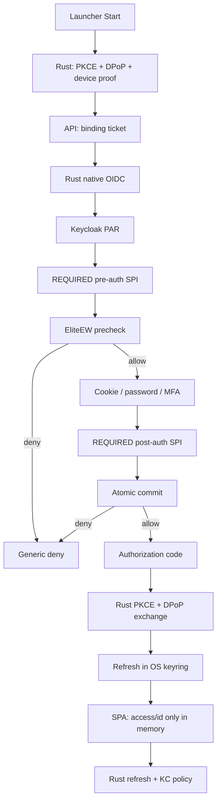

# Desktop Atomic Conditional Access — living SoT

**Status:** living **target** SoT (Wave 0–6 + pre-7 locked; **Wave 7 enforce cutover 2026-08-14** on prod-core). Rollback drill documented §9.8.
**Edition:** `client` — Connected Cloud (`empery-desktop`) and FoFline (`empery-fofline`). Offline-only launch remains local entitlement without OIDC.
**Process plan (revisable history):** retired Cursor plan `desktop_atomic_conditional_access_bedd8452.plan.md` (not in monorepo tree) — **this file wins** on product/auth contracts when they diverge.

**Peers (as-is transport / seat / launcher UX):**

| Doc | Role |
|-----|------|
| [DESKTOP-TAURI-CONNECTED-CLIENT.md](DESKTOP-TAURI-CONNECTED-CLIENT.md) | Connected Start, `session/assert` **as-is** until cutover |
| [DESKTOP-FOFLINE-EDITION.md](DESKTOP-FOFLINE-EDITION.md) | FoFline client, XOR, local SPA pack |
| [DESKTOP-CLIENT-SECURITY-BOUNDARIES.md](DESKTOP-CLIENT-SECURITY-BOUNDARIES.md) | Tauri IPC / keyring / Capsule — wins on **host trust** |
| [FRONTEND-AUTH.md](../FRONTEND-AUTH.md) | OIDC profiles, token storage |
| [KEYCLOAK-ELITEEW.md](../../platform/docker-re_doc/KEYCLOAK-ELITEEW.md) | Realm clients, harden scripts |
| [SSO-SESSION-REGISTRY-AND-ADMIN-PRESENCE.md](../../platform/SSO-SESSION-REGISTRY-AND-ADMIN-PRESENCE.md) | `client_class`, XOR |

**Executable locks (Wave 0):**

| Layer | Module | Tests |
|-------|--------|-------|
| API | `shared/api/services/desktop_client/atomic_conditional_access_contract.py` | `tests/test_desktop_atomic_conditional_access_contract.py` |
| SPA | `shared/web/frontend/src/services/desktopClient/atomicConditionalAccessContract.ts` | `__tests__/atomicConditionalAccessContract.test.ts`, `atomicConditionalAccessWave0.contract.test.ts` |
| Launcher | `pack-organization/connection-agent/src/lib/launcher/atomicConditionalAccessContract.ts` | `atomicConditionalAccessContract.test.ts` |

---

## 1. Cause-first (locked)

| Field | Value |
|-------|-------|
| **Symptom** | Keycloak issues authorization code / tokens before license, device, and native-key binding are proven; successful OIDC callback confirms credentials even when product authorization would deny access. |
| **Failure layer** | Client-specific Keycloak authentication flow + refresh-token grant; post-token `POST /api/v1/desktop-client/session/assert`. |
| **Root cause** | Desktop/FoFline reuse browser-style PKCE; license bind happens **after** token issuance via [`session/assert`](../../../shared/api/routers/desktop_client/license.py); refresh does not repeat binding decision. |
| **Cause fix** | Pre/post-auth Keycloak SPI + refresh policy executor; native proof-of-possession (DPoP); API PEP on binding claims **before** ordinary routes accept native tokens. |
| **Out of scope (v1)** | `empery-web` / `empery-mobile` flow changes; full DPoP on every HTTP/Socket.IO access token; global password-oracle elimination across all realm clients; mass MFA rollout. |

**v1 DPoP scope:** authorization-code and refresh-token binding are **required**. Access token stays short-lived Bearer (existing API/Socket.IO consumers); protection = mandatory binding claims + server PEP. Full access-token DPoP is a **follow-up wave** after HTTP/WS consumer inventory.

---

## 2. Target invariant (normative)

For `empery-desktop` and `empery-fofline`:

```text
Identity authenticated
  ∧ license active
  ∧ channel allowed (allow_online / allow_fofline)
  ∧ device active
  ∧ native key possessed (DPoP JKT matches binding)
  ∧ account binding matches (sub ↔ license ↔ device)
= authorization code / refresh result allowed
```

Any negative result:

- does **not** issue authorization code or refresh result;
- does **not** reveal deny reason to the client (generic surface only);
- records detailed reason in protected audit only;
- does **not** auto-revoke license from auth-risk pipeline.

---

## 3. Threat model (locked)

**Attacker may control:** product WebView content, IPC parameters, crafted URLs, replayed tickets, stale OIDC callbacks, client-supplied fingerprints.

**Attacker must not achieve:** token/code without current binding; refresh without same DPoP key; API access with web/mobile token shape on native-only PEP; privilege escalation via client-supplied flags; victim lockout via unsigned replay spam (rate-limit only).

**Trusted (in model):** verified Rust binary, OS keyring within declared edition scope, server signing keys, Keycloak after SPI deploy, EliteEW PostgreSQL SoT.

---

## 4. Data ownership

| Store | Owns |
|-------|------|
| **Keycloak** | User, credentials, `sub`, verified email, roles; SSO session; brute-force counters; **read-model** managed attrs `eliteew_binding_id`, `eliteew_binding_epoch`, `eliteew_auth_state`; DPoP JKT in session context |
| **EliteEW PostgreSQL** | License status/expiry/channel/seats; device registry + signing key; atomic `sub ↔ license ↔ device ↔ DPoP JKT` binding; quarantine; auth tickets (hash only); security audit |
| **Tauri / Rust** | Ed25519 device-signing + X25519 Capsule keys; **P-256 DPoP** private key (edition keyring); PKCE verifier/state/nonce; **refresh token** (never JS) |

**Forbidden:**

- Full license mirror in Keycloak user attributes;
- Client-supplied IP/fingerprint as sole authorization;
- User-editable binding attributes;
- Fake moderator/admin/honey flags from client;
- Automatic license revoke from auth-risk pipeline.

---

## 5. Binding state machine

`desktop_client_identity_bindings.state`:

| State | Meaning | Token issuance |
|-------|---------|----------------|
| `active` | Normal bound session | allow when all other gates pass |
| `restricted` | Elevated risk; limited refresh | deny or policy-limited (server policy) |
| `quarantined` | Device blocked pending admin | deny (generic) |
| `revoked` | Binding terminated | deny |

**Auth ticket** (`desktop_client_auth_tickets`): single-use, bound to one KC auth session + DPoP JKT; plaintext ticket never stored (hash/JTI only).

Monotonic **`authz_epoch`** on binding; refresh and API PEP must match current epoch.

---

## 6. Token claims (native clients)

Required on access/id token for PEP (when enforce cutover active):

| Claim | Purpose |
|-------|---------|
| `acr` | `eliteew-device-bound` |
| `eliteew_binding_id` | Opaque binding row id |
| `eliteew_binding_epoch` | Integer epoch for invalidation |
| `cnf.jkt` | DPoP key thumbprint |

**Forbidden in token mappers:** raw `license_id`, device fingerprint, quarantine reason, operator email in custom claims.

---

## 7. Generic error contract (user-facing)

| Surface | Rule |
|---------|------|
| Pre-auth deny | No credential form; same external denial family as wrong password |
| Post-auth / refresh deny | Generic auth-policy message; **one** user-facing copy with Retry/Recovery |
| Transport outage | May use honest connection copy (does not confirm credentials) |
| Audit / admin | Detailed reason allowed |

Canonical user message key: `desktop.atomicAuth.genericDeny` (i18n `desktopUi.atomicAuth.genericDeny`) — Wave 4 copy + retry/recovery keys landed.

Public API deny bodies for license/device/ticket failures: **identical shape** (opaque).

---

## 8. Target flow (summary)



**Start URL (target):** only profile marker query params allowed (e.g. `eliteewDesktopClient=1`); **no** `eliteewLicenseId` / `eliteewDeviceId` in product/nginx URL.

**Direct Keycloak URL:** without valid ticket → no credential form for native clients.

**Existing SSO Cookie:** pre-auth ticket + post-auth binding remain **REQUIRED**; Cookie does not bypass device/license gate.

---

## 9. As-is → target gaps (honest, Wave 0)

| Area | As-is (living) | Target wave |
|------|----------------|-------------|
| Start URL | Profile marker only (`productStart.ts`, `product.rs`, FoFline origin) — **Wave 2 locked** | Wave 2 |
| Post-token bind | Leftover `session/assert` only when bind ids exist **and** host bridge is absent | 410 after enforce (Wave 7) |
| Refresh owner | JS refresh for browser PKCE when bootstrap is empty; native bridge omits refresh from storage | Wave 4 inject + **pre-Wave-7 Hub** `native_oidc_interactive_login` |
| Keycloak flow | Standard browser PKCE residual when Hub soft-continues; SPI compiled for 26.7.1, not attached | Wave 3 SPI deploy + Wave 7 enforce |
| API PEP | Client-scoped: native + binding claims → DB current binding; missing claims deny only when `ELITEEW_KC_ATOMIC_AUTH_ENFORCE=1` | Wave 4 (enforce still 0) |
| DPoP | P-256 key + proofs on native token/refresh commands; KC policy not yet required | Wave 2–3 |

Until enforce cutover, legacy path remains **known vulnerability** — not closed by Wave 0 locks alone.

---

## 9.1 Wave 1 — binding schema + decision API (locked 2026-08-13)

**Migration:** `shared/api/migrations/applied/20260813_02_desktop_client_atomic_auth_binding.sql`  
**Runner key:** `20260813_02|desktop_client_atomic_auth_binding` in `docker/scripts/apply-eliteew-migrations.sh`.  
**Applied on prod-core** `192.168.1.111` `stack1-postgres` / `ai_services` **2026-08-13** (`schema_migrations` `20260813_02|desktop_client_atomic_auth_binding`). API routes still require stack0 deploy before live ticket/SPI calls.

| Table | Role |
|-------|------|
| `desktop_client_identity_bindings` | Atomic `sub ↔ license ↔ device ↔ DPoP JKT`; `authz_epoch`; state machine |
| `desktop_client_auth_tickets` | Pre-OIDC signed ticket (hash only); KC session bind; idempotency |

**Service:** `shared/api/services/desktop_client/auth_binding.py` (+ `auth_binding_crypto.py`)

| Route | Auth | Purpose |
|-------|------|---------|
| `POST /api/v1/desktop-client/auth/challenge` | Public (JWT skip) | Server nonce for device-signed ticket transcript |
| `POST /api/v1/desktop-client/auth/ticket` | Public (JWT skip) | Issue single-use binding ticket after Ed25519 + license/device gate |
| `POST /api/v1/desktop-client/auth/internal/precheck` | `X-Desktop-Client-Binding-Spi-Token` = `DESKTOP_CLIENT_BINDING_SPI_TOKEN` | Keycloak pre-auth SPI decision |
| `POST /api/v1/desktop-client/auth/internal/commit` | SPI token | Post-auth atomic bind + epoch bump |
| `POST /api/v1/desktop-client/auth/internal/refresh-decision` | SPI token | Refresh-token policy gate |

Public failures: opaque `auth_policy_denied` (identical body). Precheck and commit replay a stored outcome only when the request ticket hash is the ticket that stored the idempotency key. The SPI sends the Keycloak auth-session id as that key; a later ticket in the same session releases the previous key in the same transaction and is processed itself. SPI routes are **not anonymous**: OAuth middleware hands off only exact `POST` paths, then each router requires `X-Desktop-Client-Binding-Spi-Token` using constant-time comparison; missing server config fails with `503`, and missing/wrong credentials fail with `401`. Ordinary Bearer/JWT routes are unchanged. Leftover `session/assert` stays until enforce cutover (not 410 in Wave 4).

**Regression (Wave 1):**

```bash
cd shared/api && UV_PROJECT_ENVIRONMENT=../../.venv uv run pytest tests/test_desktop_client_auth_binding_crypto.py tests/test_desktop_client_auth_binding.py -q
```

---

## 9.2 Wave 2 — native OIDC + P-256 DPoP (locked 2026-08-13)

Rust owns DPoP, PKCE, binding ticket, and refresh keyring. Start URL builders emit **only** the profile marker.

| Piece | Location |
|-------|----------|
| P-256 DPoP key | `device_keys.rs` account `device.dpop.p256.sk.v1`; JKT bound with Ed25519 over `eliteew-dpop-jkt-v1\|{jkt}` |
| Typed OIDC | `src-tauri/src/native_oidc/` — baked `https://auth.eliteew.ru/realms/empery` endpoints only |
| Commands | `native_oidc_start` / `complete` / `refresh` / `logout` / `interactive_login` — **main window only**, not `capabilities/product.json`. Product WebView uses host inject + `product_session_refresh` / `product_session_logout` (no `native_oidc_*`) |
| Ticket | `product_open` / `native_oidc_start` / Hub interactive issue Wave 1 ticket; **403** and **live 2xx without ticket** fail-closed Start; **404/network** honest skip (API not baked); invalid `device_id` omitted, license still tickets |
| Redirect | desktop `https://app.eliteew.ru/`; FoFline `https://app.eliteew.ru/fofline-oidc-bridge.html` |
| SPA assert | Missing bind ids → skip without logout (Start URL no longer carries them) |

**Honest residual (updated pre-Wave-7):** Hub Start runs `native_oidc_interactive_login` (refresh-or-auth-window → complete) before `product_open`, soft-continuing to living browser PKCE when native fails while enforce=0. Live stack6 is **26.7.1** with SPI JAR and `start --optimized` (`prod-stack6-20260908-0936`). Living prod has `ELITEEW_KC_ATOMIC_AUTH_ENFORCE=1` for desktop/FoFline. Refresh token is never in the native command view or the product bridge JSON.

**Regression (Wave 2):**

```bash
cd pack-organization/connection-agent/src-tauri && cargo test --no-default-features --features retail native_oidc dpop_crypto fofline_spa_origin::tests::build_local_start_url commands::product::tests::start_url
cd pack-organization/connection-agent && pnpm exec vitest run src/lib/launcher/productStart.test.ts src/lib/launcher/bindHydration.test.ts src/lib/tauri-bridge/capabilityAcl.contract.test.ts
cd shared/web/frontend && pnpm exec vitest run src/services/desktopClient/__tests__/desktopClientSessionAssert.test.ts src/services/desktopClient/__tests__/atomicConditionalAccessContract.test.ts
```

---

## 9.3 Wave 3 — Keycloak 26.7.1 SPI + stack6 bake (locked 2026-08-13)

Cause layer: Keycloak must not issue a code until EliteEW precheck/commit succeed. Provider is compiled against **26.7.1** (DPoP supported, including PAR + authorization-code binding). Host JDK may be 25; bytecode is **Java 21**.

| Piece | Location |
|-------|----------|
| Maven provider | `docker/keycloak/providers/eliteew-binding/` — pre-auth `eliteew-binding-preauth`, post-auth `eliteew-binding-postauth`, refresh executor `eliteew-binding-refresh` |
| Decision HTTP | Provider env `ELITEEW_BINDING_API_BASE_URL` + header `X-Desktop-Client-Binding-Spi-Token` (`DESKTOP_CLIENT_BINDING_SPI_TOKEN`). Cloud prod-baked maps it to same-host `eliteew-api-prod:8000` via `ELITEEW_BINDING_INTERNAL_API_BASE_URL`; no public-edge hairpin. Empty token fail-closed. 64 KiB body cap + circuit. |
| Ticket visibility | Rust PAR (`native_oidc/par.rs`) puts `eliteew_ticket` in the PAR body. Auth URL is `client_id` + `request_uri` only. Product Start URL still has no ticket. |
| Harden | `keycloak-harden-empery-realm.sh` — admin-only attributes, confidential `eliteew-binding-spi`, flow alias created by harden. **Wave 3 snapshot (2026-08-13):** candidate/detached default used flow `…-v1` and left native clients unbound. **Living (post §9.15 Applied):** flow `eliteew-desktop-conditional-access-v2` is attached to `empery-desktop` / `empery-fofline` with DPoP/PAR required; `ELITEEW_KC_ATOMIC_AUTH_ENFORCE=1` on prod-core. Enforce-off clears override **and** DPoP/PAR only with `KEYCLOAK_ATOMIC_ROLLBACK_CONFIRM=1`. `empery-web` / `empery-mobile` unchanged. |
| Baked image | `docker/builders/stack6-keycloak/Containerfile` persists `--transaction-xa-enabled=false` (must match `KC_TRANSACTION_XA_ENABLED`). Living prod-core: `localhost/eliteew-keycloak:prod-stack6-20260908-0936` with SPI JAR; **`command: ["start","--optimized"]`**. Persist proof is pre-load `show-config` `(Persisted)`; living smoke requires `--optimized` + healthy + JAR + no XA mismatch log. |
| Release CLI | `bash docker/scripts/eliteew-deploy.sh release stack6 --all` (implementer `eeprodstack6.sh`). Build on `.136` only. **Do not run recreate without an explicit operator deploy command.** |

Living SPI auth is the static header (Wave 1 API). Harden still creates `eliteew-binding-spi` + role `desktop-binding-decision` for a later service-JWT cutover; Java does not use that secret in Wave 3.

**Regression (Wave 3):**

```bash
mvn -f docker/keycloak/providers/eliteew-binding/pom.xml test
cd pack-organization/connection-agent/src-tauri && cargo test --no-default-features --features retail native_oidc
bash -n docker/scripts/eeprodstack6.sh docker/scripts/keycloak-harden-empery-realm.sh
```

---

## 9.4 Wave 4 — API PEP + SPA native OIDC adapter + host inject (locked 2026-08-13)

Cause: native `azp` tokens reached ordinary API routes with no current-binding check, and product WebView still owned browser PKCE (refresh in JS storage).

**Do not set `ELITEEW_KC_ATOMIC_AUTH_ENFORCE=1`.** Do not 410 `session/assert`. Do not add `native_oidc_*` to `capabilities/product.json`.

### API PEP

| Mode | When |
|------|------|
| `skip` | `azp` not `empery-desktop` / `empery-fofline`; **or** native token lacks binding claims **and** enforce is off (living browser PKCE) |
| `require_current_binding` | Native token already has `acr=eliteew-device-bound`, `eliteew_binding_id`, `eliteew_binding_epoch≥1`, `cnf.jkt` — **always** DB-check, even when enforce=0 |
| `deny` | Native token missing those claims **and** `ELITEEW_KC_ATOMIC_AUTH_ENFORCE` is on |

Wire: `enforce_native_access_pep` after JWT validate in `oauth2_auth.get_oauth2_user` and `websocket_auth.validate_websocket_token`. Deny → generic 401 `auth_policy_denied` / `invalid_token`. DB outage on REQUIRE → **503** `auth_provider_unavailable`. Allow-cache TTL 5s keyed `(sub, binding_id, epoch)`; never cache deny. SPI routes stay SPI-token, not this PEP.

### SPA adapter + host inject

`keycloakDesktopNativeOidc.ts` — native session owner:

- Host injects `window.EmperyDesktopNativeOidc` **and** `getBootstrapJson` yields an access token → hydrate access/id only; skip PKCE `location.assign`; refresh via bridge; omit refresh from storage; skip leftover `session/assert`.
- Native profile with an unhydrated SPA session → recover through `product_session_refresh`, apply the returned access/id pair, and fire `onAuthSuccess`.
- Native profile with absent/empty/failed bridge → fail closed and return to Hub recovery. Browser PKCE remains exclusive to the `web` profile; it cannot bypass PAR-required native clients.

Launcher (`product_open`): origin-guarded `initialization_script` on the product WebView. Refresh/logout from the product window are `product_session_refresh` / `product_session_logout` (product capability, `require_product_window`, client from last `product_open` — not caller-supplied). `native_oidc_*` stay on `capabilities/default.json` only. Bootstrap JSON never includes a refresh token.

i18n: `desktopUi.atomicAuth.genericDeny` / `retry` / `recovery`.

**Living:** Hub Start owns native interactive login before `product_open`. SPA logout in the product WebView (`desktopNative` / `foflineNative`) clears local session + `logoutSessionJson` → `product_session_logout` (wipe IdP cookies, **deferred `destroy` of the product window** — synchronous `close()` from the same WebView is a no-op on WebKitGTK). Closing status (`loginFallback.desktopClosing`) is shown only while `hasExplicitLogoutPending()`. The product SPA does **not** use Keycloak browser login/logout redirects for native profiles. Browser `web` profile remains unchanged.

**Regression (Wave 4):**

```bash
cd shared/api && PYTHONPATH=.. ../../.venv/bin/python -m pytest tests/test_desktop_atomic_conditional_access_contract.py tests/test_desktop_native_access_pep.py tests/test_desktop_client_auth_binding.py tests/test_desktop_client_auth_binding_crypto.py -q
cd shared/web/frontend && pnpm exec vitest run src/services/desktopClient/__tests__/atomicConditionalAccessContract.test.ts src/services/desktopClient/__tests__/desktopClientSessionAssert.test.ts src/services/__tests__/keycloakDesktopNativeOidc.test.ts src/services/__tests__/keycloakOidcLogoutFlow.test.ts src/services/__tests__/keycloakOidcLoginFlow.foflineFragment.test.ts src/services/__tests__/keycloakTokenStorage.test.ts
cd pack-organization/connection-agent && pnpm exec vitest run src/lib/tauri-bridge/capabilityAcl.contract.test.ts src/lib/tauri-bridge/productNativeOidcBridge.contract.test.ts
cd pack-organization/connection-agent/src-tauri && cargo test --no-default-features --features retail native_oidc product_session product_open_injects
```

---

## 9.5 Wave 5 — auth-risk + admin recovery (locked 2026-08-14)

Cause: unsigned noise could not be distinguished from signed replay, and operators could not quarantine/restore a device binding without touching license status.

**Historical (pre-2026-08-14):** enforce was off through Waves 4–6. **Living (post §9.8):** `ELITEEW_KC_ATOMIC_AUTH_ENFORCE=1` on prod-core stack6 + stack0 API; atomic flow attached to desktop/fofline only.

| Piece | Location |
|-------|----------|
| Contract | `auth_risk_next_binding_state` / `auth_risk_may_change_license_status` — unsigned/unverifiable: audit only; registered-device stale nonce / replay: revoke tickets + raise device risk (no auto-quarantine from repeating the same kind); license status never written |
| Schema | `20260814_01_desktop_client_auth_risk.sql` — `desktop_client_auth_risk_events`, `desktop_client_admin_recovery_actions`, `transcript_jti`, `rebind_allowed_until` |
| Ticket path | `auth_binding.issue_ticket` verifies device signature **before** consuming the nonce. First-mint tickets may omit `device_id`. Escalatory risk kinds (`stale_nonce` / `valid_replay`) apply **only** when the signing pubkey matches a registered active device for that license; otherwise audit as unverifiable with no binding-state change. Process-local nonce `missing` is unverifiable (no state change); live `mismatch` is stale nonce when registered; duplicate JTI is valid replay |
| Admin API | `GET /api/v1/desktop/admin/platform-ops/licenses/{id}/auth-bindings`; `POST .../auth-bindings/{id}/actions` (`require_admin_user`, confirm + reason + scoped idempotency `{binding}:{action}:{key}`; concurrent insert race rolls back and replays winner) |
| Admin UI | Platform Ops workspace **Binding recovery** |
| KC sessions / login failures | `KeycloakService.logout_all_user_sessions` + `clear_user_brute_force` — separate from license/binding; **503** if admin credentials missing or KC call fails (no fake success) |

Admin actions: `end_sessions` (Keycloak user logout first, then **always** bump `authz_epoch` + consume tickets + native SSO rows), `quarantine_device`, `restore_login`, `allow_rebind` (24h window; quarantined still needs restore), `clear_kc_login_failures`.

**Honest residual:** enforce off; OTA uptake of the Hub-native client build and stack6 flow attach remain Wave 7 / operator publish; same-license multi-device can still share one `license_id+client_id` binding for risk attachment.

**Regression (Wave 5):**

```bash
cd shared/api && PYTHONPATH=.. ../../.venv/bin/python -m pytest tests/test_desktop_atomic_conditional_access_contract.py tests/test_desktop_client_auth_binding.py tests/test_desktop_client_auth_recovery.py -q
cd shared/web/frontend && pnpm exec vitest run src/services/desktopClient/__tests__/atomicConditionalAccessContract.test.ts
```

---

## 9.6 Wave 6 — atomic binding fleet inventory + migrate (locked 2026-08-14)

Cause: licenses with historical `bound_keycloak_sub` (from leftover `session/assert`) had no `desktop_client_identity_bindings` row and no Keycloak managed binding attrs, so enforce/SPI cutover would strand existing fleets.

**Do not set `ELITEEW_KC_ATOMIC_AUTH_ENFORCE=1`.** Do not attach the atomic Keycloak flow. Do not 410 `session/assert`. Desktop OTA publish of a native-atomic client build remains an **operator deploy** step (not closed by this wave alone).

| Piece | Location |
|-------|----------|
| Contract | `MIGRATION_PENDING_DPOP_JKT`, `binding_migration_slot_action`, `commit_email_verified_grandfathered` (**license `bound_keycloak_sub` only**), `native_channels_for_license_flags` |
| Schema | `20260814_02` unique live binding `(license_id, client_id) WHERE state <> 'revoked'` — migration first revokes duplicate live rows (keep priority: active > quarantined > restricted, then newest), then creates the index |
| Service | `auth_binding_fleet.py` — shared slot iterator for inventory + migrate; create restricted + pending PoP + rebind; KC attrs client-scoped (`eliteew_binding_id__{client_id}`) with unscoped set for single-channel or desktop primary; PG SoT |
| Commit gate | Existing **license** `bound_keycloak_sub == sub` may commit with `email_verified=false`; binding-only match does **not** grandfather (admin license clear sticks); **new** first bind still requires verified email |
| Admin API | `GET /api/v1/desktop/admin/platform-ops/atomic-binding-fleet`; `POST .../atomic-binding-fleet/migrate` (`dry_run` default; apply needs `confirm=true`) |
| Admin UI | Platform Ops workspace **Atomic binding fleet** (distinct from Capsule v2 **Fleet migration**) |

Keycloak `merge_user_attributes_by_id` PUTs the full GET user representation with only `attributes` merged (credentials stripped; never invents `enabled=True`).

Unbound licenses stay claimable only through a valid active device ticket (unchanged Wave 1 path). Missing device identity remains product-owned before login (Hub Start shows an honest deny / soft dual-path).

**Honest residual:** enforce off; Desktop OTA uptake of Hub-native builds and stack6 flow attach are Wave 7; Capsule `desktop_client_fleet_migration` is a **different** table/program.

**Regression (Wave 6):**

```bash
cd shared/api && PYTHONPATH=.. ../../.venv/bin/python -m pytest tests/test_desktop_atomic_conditional_access_contract.py tests/test_desktop_client_auth_binding.py tests/test_desktop_client_auth_binding_fleet.py -q
cd shared/web/frontend && pnpm exec vitest run src/services/desktopClient/__tests__/atomicConditionalAccessContract.test.ts
```

---

## 9.7 Pre-Wave-7 readiness — Hub native Start + SPA keyring logout (locked 2026-08-14)

Cause: Wave 4–6 left Hub Start on living browser PKCE and SPA logout unable to clear the native keyring, so enforce cutover would still strand users on empty bootstrap / orphaned refresh.

**Do not set `ELITEEW_KC_ATOMIC_AUTH_ENFORCE=1`.** Do not attach the atomic Keycloak flow. Do not 410 `session/assert`. Do not put `native_oidc_*` on `capabilities/product.json`.

| Piece | Location |
|-------|----------|
| Hub interactive | `native_oidc/hub_login.rs` + `native_oidc_interactive_login` (main window): refresh → else auth WebView (`oidc-auth`) with IdP allowlist plus `about:blank*` / `ipc.localhost` / `tauri.localhost` bootstrap; **incognito** + W-transport **proxy_url** (fail-closed when SOCKS is on); PAR `prompt=login`. Denied product origin **re-navigates** to the auth URL (does not abort login or leave WebKit «Operation was cancelled» as the UI). Leftover `oidc-auth` is **destroyed before recreate**. |
| Hub Start wire | Historical: soft dual-path while enforce=0. **Living:** §9.9 — native fail does not call `product_open` |
| `product_open` | Historical: ticket/PAR prepare as stand-in for login. **Living:** §9.9 — unexpired native session or keyring refresh only |
| Prepare / PAR | Historical PAR soft-skip. **Living:** PAR failure after ticket fails closed (`native_oidc_par_soft_skip` removed in 0.5.12) |
| Product logout | `product_session_logout` + bridge `logoutSessionJson`; SPA `clearDesktopNativeOidcSessionViaBridge` from `oidcLogout`; **desktop/FoFline product WebView skips Keycloak end_session**; host **wipes then deferred-destroys** the product window on the main thread while `PRODUCT_LOGOUT_CLOSING` until `Destroyed`. **Connected IPC:** `capabilities/product-connected-session.json` grants `product_session_*` to `https://app.eliteew.ru` (`product.json` stays local-only — F-01). Without that remote session capability, `__TAURI_INTERNALS__` is missing on the cloud SPA — `logoutSessionJson` returns a generic deny, SPA can look logged out, keyring refresh survives, next Hub Start is `native_oidc_interactive_refresh_ok` (no Keycloak form). |
| Ops | Migration `20260814_02` on prod-core; stack0 bake **`prod-baked-20260814-1604`** (`26ba4986c`); Desktop RPM OTA **0.5.10** live (Connected v2 seq **72**, FoFline v2 seq **74**, `spa-latest.json` 200) — `611238995` Connected logout IPC via `product-connected-session.json`; Wave 7 baseline kit `20260814-051557-desktop-atomic-auth-baseline`; **enforce still off** |

**Note on `device_id=None`:** license preflight and first-mint tickets may omit `device_id` (canon Wave 5/6). Backend `auth_ticket_issued` with `device_id=None` is **not** an `auth_policy_denied` cause. Seat symptom `Не удалось открыть: auth_policy_denied` on 0.5.1 was `product_open` hard-denying after a successful ticket when PAR/prepare failed — fixed by soft dual-path above (OTA **0.5.2**).

**Hub copy (living §9.9):** native cancel/deny does **not** open the product. Opaque English (`Authentication could not be completed`, `Sign-in was cancelled or timed out`) maps to `HUB_NATIVE_REQUIRED_RU`. Keycloak «Назад в приложение» is not a login.

**Devices vs login:** Admin «Устройства» counts `desktop_client_devices` from **license redeem/enroll**, not from Keycloak SSO. Soft dual-path / living browser PKCE login (`/api/v1/auth/sso/callback`) does **not** mint a device row. Atomic `identity_bindings` + device PoP binding harden at Wave 7 enforce — not yet. Capsule seats may run with `device_optional` preflight (`device_id=None`) until a redeem path creates the device.

**Honest residual (historical 9.7):** this subsection froze Hub wiring before enforce. **Living:** enforce is on (§9.8); seat binary **0.5.13** requires a completed native session before `product_open` (§9.9). Windows NSIS remains `lag` 0.4.61.

**DPoP clock (0.5.10+):** Keycloak **26.7.1** `DPoPIsActiveCheck` uses `DEFAULT_PROOF_LIFETIME=10` and `DEFAULT_ALLOWED_CLOCK_SKEW=15` — proof `iat` must land in roughly `[server_now−25s, server_now+15s]`. Live seats hit `invalid_dpop_proof` / `DPoP proof is not active` when Hub signed with **local** wall clock. Fix: `native_oidc/dpop_iat.rs` resolves `iat` from baked issuer HTTP `Date` (`choose_dpop_iat_from_http_date`). When Date **lags** local, apply **+8s forward bias**. When Date is **ahead** of local (poet seat: `skew_vs_local_secs=8`), use Date clamped to local+15s — **never** fall back to local.

**Linux launch name:** RPM `package_id` is `elite-ew-desktop-client`; PATH binary / `.desktop` Exec is `mainBinaryName` **`eliteew-desktop-client`**. Console `elite-ew-desktop-client` is not a command.

**Same-version OTA after manual RPM:** `dnf install` does not persist OTA `highest_sequence`. Live metadata with a higher sequence used to offer `ota_same_version_repair` of the already-installed semver. Check now returns `up_to_date` and **adopts** live sequence/sha (`adopt_live_sequence_when_current`). Broken bits need a TREE semver bump, not an in-app reinstall of the same version.

**Product logout close:** `PRODUCT_LOGOUT_CLOSING` stays armed until `WindowEvent::Destroyed` on label `product`. `destroy()` runs on the GTK main thread (`run_on_main_thread`). SPA Выход revokes via RFC 7009 then destroys the product window without quitting Hub. **Hub/product window close and tray Выйти** call `tray::request_quit` (revoke both clients, then orderly process exit) — they do **not** hide-to-tray. **Connected logout IPC (0.5.10):** `product.json` stays local-only (F-01); `capabilities/product-connected-session.json` grants `product_session_refresh` / `product_session_logout` on `https://app.eliteew.ru` only. Poet proof: `[STEP] product_session_logout_begin` → `native_oidc_revoke_ok` / `native_oidc_logout_local_cleared` → `product_session_logout_close closed=true via=destroy`; next Hub Start must not be silent `interactive_refresh_ok` after real logout.

**Historical soft dual-path (0.5.8, superseded by §9.18):** browser PKCE used to continue when native bootstrap existed but SPA auth had not hydrated it. This became invalid once `empery-desktop` / `empery-fofline` required PAR and caused a post-commit callback loop.

**Regression (pre-Wave-7):**

```bash
cd pack-organization/connection-agent/src-tauri && cargo test --lib --no-default-features --features retail \
  'hub_login|dpop_iat|product_session|verified_update_plan'
cd pack-organization/connection-agent && pnpm exec vitest run \
  src/lib/launcher/nativeOidcHubSession.contract.test.ts \
  src/lib/launcher/trayQuitOrderly.contract.test.ts \
  src/lib/updater/updaterSocksRecovery.contract.test.ts \
  src/lib/tauri-bridge/capabilityAcl.contract.test.ts \
  src/lib/tauri-bridge/productNativeOidcBridge.contract.test.ts
cd shared/web/frontend && pnpm exec vitest run src/services/__tests__/keycloakDesktopNativeOidc.test.ts
```

---

## 10. Implementation waves (pointer)

| Wave | Deliverable | Exit proof |
|------|-------------|------------|
| **0** | This SoT + contract locks | pytest + vitest green on contract modules |
| **1** | Binding schema + decision API | Transaction tests, idempotent precheck/commit — **Wave 1 locked** |
| **2** | Rust native OIDC + P-256 DPoP | Cargo tests; no bind IDs in Start URL — **Wave 2 locked** |
| **3** | Keycloak 26.7.1 SPI + stack6 image | Maven tests; living bake `prod-stack6-20260813-2245` with `--optimized` and XA persist — **Wave 3 deployed (enforce off)** |
| **4** | API PEP + FE native adapter + host inject; leftover assert not 410 | pytest PEP + vitest adapter + cargo/vitest inject locks — **Wave 4 locked (enforce off)** |
| **5** | Quarantine + admin recovery | Admin RBAC + audit — **Wave 5 locked (enforce off; product keyring UX residual)** |
| **6** | Fleet migration | Inventory + idempotent bind rows — **Wave 6 locked (enforce off; OTA uptake residual)** |
| **pre-7** | Hub native Start + SPA keyring logout | cargo/vitest Hub + bridge locks; stack0 + Desktop OTA on operator command — **pre-Wave-7 locked (enforce still off)** |
| **7** | Cutover + rollback drill | **2026-08-14:** stack6 flow attached + DPoP/PAR; stack0 `prod-baked-20260814-1807`; Desktop **0.5.12** fail-closed; KC harden + legacy OIDC disabled — canaries on operator seats |

Deploy/publish only on explicit operator command.

---

## 9.8 Wave 7 enforce cutover + rollback drill (2026-08-14)

**Applied (prod-core):**

| Layer | Action | Evidence |
|-------|--------|----------|
| stack6 | `ELITEEW_KC_ATOMIC_AUTH_ENFORCE=1`; validated `eliteew-desktop-conditional-access-v2` + DPoP/PAR on `empery-desktop` / `empery-fofline` | Exact graph validator OK; both client overrides = v2; DPoP/PAR `true`; `stack6-keycloak-smoke.sh` OK |
| stack0 | `prod-baked-20260814-2322` (`7f7e82538`); API `ELITEEW_KC_ATOMIC_AUTH_ENFORCE=1` in runtime `.env.stack0.api`; OpenAPI pilots refresh at bake | `curl /api/health` OK; public user-path gate OK; rollback `stack0-env-before-all.env` on prod-core |
| KC hygiene | `dewa-*` / `ewpower-*` / `empery-parity` disabled; `eliteew-binding-spi` + atomic flow; `eliteew-admins`→`msi`; `empery-web` `sub-access-token` | harden 2026-08-14 |
| Desktop OTA | Public Linux RPM **0.5.36** (TREE **0.5.37** pending OTA). EBrowser P/U+ | CHANNEL_MATRIX linux `lag` 0.5.36 — [DESKTOP-CLIENT-VERSION-SOT.md](DESKTOP-CLIENT-VERSION-SOT.md) |

**Rollback (operator, only for a proven v2 regression):**

1. Rebind `empery-desktop` / `empery-fofline` to the captured previous v1 flow while keeping DPoP/PAR `true`. This restores the prior fail-closed outage; it does not silently bypass binding.
2. Do **not** use `ELITEEW_KC_ATOMIC_AUTH_ENFORCE=0` as an availability workaround: that clears the browser override and PAR/DPoP client flags. Any emergency security-mode rollback requires a separate explicit operator decision and coordinated stack0 policy rollback.
3. Verify exact client override + DPoP/PAR, `stack6-keycloak-smoke.sh`, Keycloak events, then a human login/logout canary.

Pre-v2 sanitized baseline: `/home/owned/keycloak-auth-baselines/20260814-162910-desktop-native-flow-v2` on command-center.

---

## 9.9 Session-required product open (2026-08-14)

**Symptom:** Hub opened Keycloak; pre-auth/cookie mapped to «неверный логин или пароль» without a password form; «Назад в приложение» loaded `https://app.eliteew.ru/` inside `oidc-auth`. Logs: `native_oidc_ticket_ok` → `native_oidc_interactive_deny reason=auth_timeout_or_cancel` → `product_open` with `product_session_bridge_skip reason=no_native_session`.

**Cause:** Wave 7 fail-closed only ticket/PAR *prepare*. Interactive cancel still called `product_open`. `oidc-auth` allowed the baked redirect origin without `code`+`state` (Keycloak `backToApplication` = client `rootUrl`).

**Living gate:**

| Layer | Behavior |
|-------|----------|
| Hub | `ensureNativeOidcBeforeProductOpen` — no soft-continue field; Cloud/FoFline/deep-link **return** on `!nativeOk` |
| `product_open` | Opens only with unexpired session cache **or** successful keyring refresh. No `prepare_for_product_open` stand-in. Else `auth_policy_denied` (`native_oidc_session_required`) |
| `oidc-auth` nav | HTTPS IdP + `about:blank*` + `ipc.localhost` / `tauri.localhost` only. `https://app.eliteew.ru` without `code`+`state` is **not** loaded as SPA; the window **re-navigates** to the PAR auth URL (`oidc_auth_nav_retry`). Callback with `code`+`state` still captured. User close of `oidc-auth` still cancels. |

**User copy:** `HUB_NATIVE_REQUIRED_RU` / `humanizeProductOpenFailure('auth_policy_denied')` — not «стол открыт, войдите в окне».

**TREE:** `0.5.13` (shipped in public Linux RPM **0.5.14**).

**Regression:**

```bash
cd pack-organization/connection-agent && pnpm exec vitest run \
  src/lib/launcher/nativeOidcHubSession.contract.test.ts \
  src/lib/tunnel/productChannelPreflight.test.ts
cd pack-organization/connection-agent/src-tauri && cargo test --lib --no-default-features --features retail \
  'hub_login|product_open_requires_native_session'
```

---

## 9.10 Window close = Keycloak revoke (2026-08-14)

**Symptom:** User clicks the window close control (or tray Выйти). Backend shows Socket.IO disconnect and license heartbeat may still run. Keycloak Users → Sessions still lists the SSO session until idle/max.

**Cause:** `CloseRequested` hid to tray and kept refresh/heartbeat. Keycloak **SSO Session Idle** resets on refresh token use, so the IdP never saw the user leave. Native logout used a **legacy** `POST /logout` with `refresh_token`, without DPoP, and ignored the HTTP status.

**Living gate (Keycloak tools only — no extra Hub dialogs):**

| Action | Behavior |
|--------|----------|
| Hub or product window close | `tray::request_quit` — RFC 7009 `POST /revoke` (DPoP, baked URL) for `empery-desktop` and `empery-fofline`, wipe keyring, orderly webview destroy, **process exit** |
| Tray **Выйти** | Same `request_quit` |
| SPA Start-menu Выход | Same revoke for the product client; destroy product window; Hub stays |
| `oidc-auth` close | Login cancel only — does not quit or revoke a completed session |
| Offline / revoke HTTP fail | Local wipe + exit anyway; log `native_oidc_revoke_fail`. Keycloak idle (2h) is the IdP fail-safe until the network call succeeds |

**TREE:** `0.5.14`. Public Linux RPM **live** (Connected seq **75** / FoFline seq **77**).

**Regression:**

```bash
cd pack-organization/connection-agent && pnpm exec vitest run \
  src/lib/launcher/trayQuitOrderly.contract.test.ts
cd pack-organization/connection-agent/src-tauri && cargo test --lib --no-default-features --features retail \
  token
```

---

## 9.11 Login window must show Keycloak, not WebKit cancel (2026-08-14)

**Symptom:** «Открыть EliteEW» opens the Hub sign-in window with a single English line **Operation was cancelled**. No username/password form. API `auth/ticket` 200; Keycloak has no LOGIN for that click.

**Cause:** WebKit paints that string when `on_navigation` **ignores** a top-level load. After 0.5.13, `https://app.eliteew.ru` without `code`+`state` (Keycloak `rootUrl` / stale WebKit SSO cookie after RFC 7009 revoke) was treated as login **cancel** (`try_send` empty + `return false`) and left the cancelled page visible. `oidc-auth` also lacked W-transport `proxy_url` and shared the persistent cookie jar with the product WebView. Tauri 2 may first navigate `https://tauri.localhost` (not only `ipc.localhost`).

**Living gate:**

| Layer | Behavior |
|-------|----------|
| Egress | `oidc-auth` uses the same SOCKS `proxy_url` as product when W-transport is fail-closed |
| Cookie | `incognito(true)` so leftover AUTH_SESSION cookies cannot skip or poison the form |
| PAR | Interactive login sends `prompt=login` |
| Nav | Log every top-level URL (host+path only) plus `has_code`/`has_state` booleans. Product origin **with** `code` but wrong `state` is not retried. Product origin without `code` (Keycloak `backToApplication`) is **not** loaded as SPA and must **not** auto-navigate or mint another PAR. Login POST requires typed username and password. |
| Bootstrap | Allow exact `ipc.localhost` **and** `tauri.localhost` / `tauri://localhost` |

**TREE:** `0.5.15`. Public Linux RPM **live** (Connected seq **76** / FoFline seq **78**).

**Regression:**

```bash
cd pack-organization/connection-agent && pnpm exec vitest run \
  src/lib/launcher/nativeOidcHubSession.contract.test.ts
cd pack-organization/connection-agent/src-tauri && cargo test --lib --no-default-features --features retail \
  hub_login
```

---

## 9.12 Same PAR retry must not replay Keycloak POST (2026-08-14)

**Symptom:** After «Открыть EliteEW», `oidc-auth` shows the Keycloak form, then error.ftl **«Мы сожалеем… Неправильное имя пользователя или пароль»** and «Назад в приложение». Hub logs: `authenticate` → `oidc_auth_nav_deny reason=product_without_code` → `oidc_auth_nav_retry` → `authenticate` again. Keycloak: burst `LOGIN_ERROR invalid_user_credentials` (`userId=null`) on one `code_id`, plus `invalid_request` **Pushed Authorization Request is only allowed.**

**Cause:** 0.5.15 recovered WebKit «Operation was cancelled» by `WebviewWindow::navigate` to the **same** PAR `request_uri`. That URI is one-shot. After `/login-actions/authenticate`, Keycloak `backToApplication` = client `rootUrl` (`https://app.eliteew.ru/` without `code`). Re-navigating the consumed auth URL made WebKit **replay POST authenticate** (empty/unknown user → `userId=null`) and sometimes hit `/auth` without `request_uri` (PAR-only policy).

**Historical (0.5.16–0.5.17, insufficient):** never re-`navigate` the same `request_uri`; JS blocked empty `submit` / `form.submit()`. Native WebKitGTK `submit-form` still posted empty fields (JS `preventDefault` does not cancel it). Staying on error.ftl (`auto_retry=0`) left the user stuck. Living gate: **§9.13**.

**TREE / public Linux RPM at this wave:** `0.5.17` (Connected seq **78** / FoFline **80**).

**Regression:**

```bash
cd pack-organization/connection-agent/src-tauri && cargo test --lib --no-default-features --features retail \
  hub_login
```

---

## 9.13 Native WebKit form gate + one fresh PAR window (2026-08-15)

**Historical (0.5.18, insufficient):** Linux `submit-form` blocked empty **text** username/password and rebuilt `oidc-auth` once. Empty field list was allowed; JS stubbed only `#kc-form-login.submit` after `DOMContentLoaded`. Keycloak WebAuthn hidden `form.submit()` still reached `error.ftl`. Living gate: **§9.14**.

**Symptom:** TREE **0.5.15–0.5.17** still land on Keycloak `error.ftl` («Мы сожалеем… Неправильное имя пользователя или пароль» / «Назад в приложение») instead of keeping `login.ftl`. Keycloak: `LOGIN_ERROR invalid_user_credentials` with `userId=null` and `AuthenticationFlowException` on `POST /login-actions/authenticate`.

**Cause:** WebKitGTK `WebView::submit-form` submits the login form **outside** the DOM `submit` event. JS `preventDefault` does not stop it. Dropping the last `FormSubmissionRequest` ref **auto-submits**. Empty username/password (or a hidden WebAuthn failure form) never resolves a user, so Keycloak renders the unrecoverable error page rather than the form with a banner. Navigating the same PAR `request_uri` after «Назад в приложение» replays that POST.

**Living gate:**

| Layer | Behavior |
|-------|----------|
| Linux native | `oidc-auth` connects WebKit `submit-form`. Empty **text** username/password keys are blocked (this is the `error.ftl` / `userId=null` POST). WebKit may omit `password` from `list_text_fields` — a non-empty username alone is allowed (native wins over JS). Empty field list (API GFALSE, hidden-only forms) is **allowed** so OTP still submits. WebAuthn hidden auto-POST is **not** visible to `list_text_fields`; JS `form.submit` stub is that defense. Extra-ref + `mem::forget` so dispose cannot auto-submit. Field **values are not logged** (`fields={len}` only). |
| JS (defense-in-depth) | On `#kc-form-login`, block empty DOM `submit`; `form.submit()` only when **both** username and password are filled. Native `submit-form` does not use this path. |
| Same `request_uri` | Never `navigate` / `location.replace` it. No `oidc_auth_nav_retry` / `oidc_auth_nav_repar`. |
| `error.ftl` / `backToApplication` | Destroy `oidc-auth`, mint **one** fresh PAR GET, open a new window. Budget `AtomicU8=1`. Log `oidc_auth_window_rebuild`. Bump `AUTH_GENERATION` **before** destroy so the old `Destroyed` does not cancel login. |
| Callback with `code` + wrong `state` | Deny + log `callback_state_mismatch`; do not mint another PAR from that URL |

**TREE / public Linux RPM at this wave:** `0.5.18` (Connected seq **79** / FoFline **81**). Seat evidence 2026-08-15: `submit-form` did not log allow/block; `/auth` → `/authenticate` → `error.ftl`; one rebuild; then `rebuild=0`. Living gate: **§9.14**.

**Regression:**

```bash
cd pack-organization/connection-agent/src-tauri && cargo test --lib --no-default-features --features retail \
  form_gate
cd pack-organization/connection-agent && pnpm exec vitest run \
  src/lib/launcher/nativeOidcHubSession.contract.test.ts src/releaseVersion.contract.test.ts
```

---

## 9.14 Historical WebAuthn hypothesis — disproved by 0.5.19 evidence (2026-08-15)

**Symptom:** TREE **0.5.18–0.5.19** opens Keycloak `error.ftl` («Мы сожалеем… Неправильное имя пользователя или пароль» / «Назад в приложение») immediately after Hub «Вход EliteEW», rebuilds once with a fresh ticket/PAR, then sticks. Logs: `oidc_auth_form_gate attached=webkit_submit_form` → `/auth` → `/login-actions/authenticate` → `oidc_auth_error_page rebuild=1` → fresh ticket/PAR → `rebuild=0`. There is still **no** `oidc_auth_form_block` / `oidc_auth_form_submit`.

**Disproved hypothesis:** 0.5.18/0.5.19 assumed a hidden Keycloak WebAuthn form was auto-posting before user input. 0.5.19 patched `HTMLFormElement.prototype.submit` / `requestSubmit` at document start, disabled `PublicKeyCredential` in `oidc-auth`, and made Linux `submit-form` fail closed. The same server event remained: `LOGIN_ERROR invalid_user_credentials`, `userId=null`. The live flow inventory then proved that no credential execution was reachable at all; the WebAuthn theory was not the cause.

**Consequence:** do not add another WebKit form interception or weaken Keycloak/DPoP/PAR. The 0.5.19 guards are containment only and may restrict password-reset/required-action forms; they are removed when native OIDC moves to the system browser (§9.15). Same-PAR replay remains forbidden.

**TREE / public Linux RPM containing containment:** `0.5.19` (Connected seq **80** / FoFline **82**).

---

## 9.15 Native conditional-access flow v2 — credential step between pre/post (2026-08-15)

**Root cause (live inventory):** `eliteew-desktop-conditional-access-v1` was wired as:

```text
EliteEW binding pre-auth      REQUIRED
eliteew-ca-browser-core-link  DISABLED  (empty)
EliteEW binding post-auth     REQUIRED
```

The harden script copied a stock browser flow into `eliteew-ca-browser-core`, but Keycloak cannot attach an existing flow by creating an `executions/flow` “link”. That call created a new empty, disabled subflow. `PostAuthAuthenticator` therefore ran with `context.getUser() == null` and failed closed; Keycloak rendered it as `invalid_user_credentials` before any form submission.

**Living v2 graph:**

```text
EliteEW binding pre-auth                       REQUIRED
eliteew-ca-native-forms-v2                     REQUIRED
  Username Password Form                       REQUIRED
  eliteew-ca-native-conditional-otp-v2          CONDITIONAL
    Condition - user configured                 REQUIRED
    OTP Form                                    REQUIRED
  User Session Count Limiter                    REQUIRED
EliteEW binding post-auth                       REQUIRED
```

| Invariant | Enforcement |
|-----------|-------------|
| Ticket before credentials | `eliteew-binding-preauth` is first and REQUIRED |
| PAR note contract | Keycloak stores custom PAR fields as `client_request_param_<name>`; SPI reads `client_request_param_eliteew_ticket` and prefixed/direct `dpop_jkt`, never expects the raw custom key only |
| Real Keycloak authentication | Password form is REQUIRED; configured OTP remains CONDITIONAL/REQUIRED |
| Device binding before code | `eliteew-binding-postauth` is last and REQUIRED |
| No alternate bypass | v2 has no Cookie, IdP redirect, WebAuthn, copied-flow link, or empty enabled subflow |
| Candidate-first cutover | `KEYCLOAK_ATOMIC_CANDIDATE_ONLY_OVERRIDE=1` creates/reconciles and validates v2 without changing client bindings |
| Machine graph proof | `keycloak-atomic-native-flow-verify.sh` requires the exact eight-execution graph and ordering before harden may bind clients |
| Client policy | `empery-desktop` / `empery-fofline` keep PAR required + DPoP-bound access tokens; other clients are unchanged |
| Drift/rollback guard | Enforce-off cannot clear a live atomic override **or** mandatory DPoP/PAR client flags unless the operator explicitly sets `KEYCLOAK_ATOMIC_ROLLBACK_CONFIRM=1`; already-clear clients are a no-op |

**Applied:** v2 exact graph is live on both native clients; client overrides point to v2 and DPoP/PAR remain `true`. The encrypted Config Plane bundle was rebuilt from command-center SoT and pushed to runtime tmpfs so reboot/harden cannot drift enforcement back to off. A dedicated 256-bit binding SPI secret is injected only into Keycloak and the stack0 API role. The API middleware delegates only the three exact internal `POST` routes to their SPI-token guard; all other routes retain Bearer/default-deny handling. No stack0 image rebake or RPM publish is part of this correction.

**Regression:**

```bash
bash -n docker/scripts/keycloak-harden-empery-realm.sh \
  docker/scripts/keycloak-atomic-native-flow-verify.sh
shellcheck docker/scripts/keycloak-harden-empery-realm.sh \
  docker/scripts/keycloak-atomic-native-flow-verify.sh
bash docker/scripts/keycloak-atomic-native-flow-verify.sh --selftest
```

## 9.16 Native first-use SSO registry handoff (2026-08-15)

**Symptom after successful v2 login:** password and binding commit succeed, Rust receives and validates the callback, then Hub shows «Вход был прерван» and repeats the cycle. API audit records `sso_session_rejected` / `session_replaced`.

**Root cause:** native Rust exchanges the authorization code directly with Keycloak, so it never calls backend `POST /api/v1/auth/sso/callback`, which was the only ordinary HTTP boundary allowed to replace the previous registry `sid`. Production evidence proved that the pre-auth `keycloak_auth_session_id` equals the issued token `sid`; the rejected incoming `sid` was new, while the registry still held the prior desktop session.

**Living order:** `JWT signature/audience validation → native current-binding PEP → SSO registry`. Only a token whose `acr`, binding id/epoch, DPoP JKT, and PostgreSQL current binding all pass may set `allow_session_replace=True` on its first API or Socket.IO request. Browser takeover still requires explicit confirmation; stale/revoked native tokens fail before registry mutation; FoFline↔browser XOR policy remains in force.

**Regression:**

```bash
bash docker/scripts/run-stack0-api-tests.sh \
  tests/test_desktop_native_access_pep.py tests/test_sso_session_registry.py -q
```

## 9.17 Binding decision transport stays inside prod-core (2026-08-15)

**Symptom:** a later canary again rendered immediate `invalid_user_credentials`; Keycloak logged `eliteew_binding_preauth_deny reason=precheck`, while API had a fresh ticket but no `/auth/internal/precheck`.

**Root cause:** stack6 first resolved `ELITEEW_BINDING_API_BASE_URL` to the public edge. Prod-core host could reach edge `:443`, but the rootless Keycloak container could not, so the fail-closed HTTP client denied before credentials. After moving to the reachable internal endpoint, Java `HttpClient` still attempted a cleartext HTTP/2 (`h2c`) upgrade that Uvicorn rejected with `400` before the SPI route guard. An in-container probe reproduced `default client → 400` and `forced HTTP/1.1 → 401` for the same unauthenticated request.

**Living cloud route:** `stack6.prod-baked.override.yml` maps the provider endpoint to `http://eliteew-api-prod:8000/api/v1/desktop-client` (override input `ELITEEW_BINDING_INTERNAL_API_BASE_URL`), and `BindingHttpClient` pins `HttpClient.Version.HTTP_1_1`. This is same-host service traffic, does not traverse the public edge, and does not weaken the dedicated SPI token, exact POST allowlist, PAR, DPoP, or binding PEP. A missing/unreachable internal service still fails closed.

**Architecture next step (separate change):** replace the embedded credential WebView with the RFC 8252 system browser plus a loopback callback. Keep authorization code + PKCE, PAR, DPoP, ticket precheck/commit, exact state/nonce, bounded timeout, and native-client redirect allowlists. This restores browser passkeys/password managers and removes the need for application-side form interception; it is not permission to fall back to browser SPA tokens or weaken the native binding flow.

## 9.18 Native SPA handoff never downgrades PAR (2026-08-15)

**Symptom after successful credential + binding commit:** Keycloak completes `/auth/internal/precheck` and `/auth/internal/commit`, then the product shows «Вход был прерван». Keycloak records `invalid_request`, reason `Pushed Authorization Request is only allowed`.

**Root cause:** the already-open product SPA received a new `EmperyDesktopNativeOidc` bootstrap after its initial auth pass. The legacy soft dual-path branch saw `host.authenticated=false` and launched ordinary browser PKCE with `client_id=empery-desktop`. That request had no PAR `request_uri`, so the enforced native client policy rejected it. The native authorization itself had already succeeded.

**Living handoff:** when a native bridge has a bootstrap but SPA auth is not hydrated, `oidcStartAuthorizationRequest` calls the host-owned refresh bridge, applies the resulting access/id pair, emits `onAuthSuccess`, and does not navigate. Native profiles with an absent, empty, or failed bridge fail closed for Hub recovery. Only the `web` profile may start browser PKCE directly. This preserves PAR, PKCE, DPoP, binding PEP, refresh-keyring ownership, and the product-window IPC boundary.

**Regression:**

```bash
cd shared/web/frontend
pnpm exec vitest run src/services/__tests__/keycloakDesktopNativeOidc.test.ts
```

## 9.19 DPoP time source must track Keycloak (2026-08-15)

**Symptom:** native PAR or token refresh intermittently returns `500 unknown_error`; Keycloak logs `IllegalArgumentException: lifespanInSeconds must be positive` from `DPoPReplayCheck`.

**Root cause:** Keycloak 26.7.1 accepts a proof inside the 10-second lifetime plus 15-second clock-skew window and retains its replay key for the same 25-second interval. Edge nginx `Date` was about 23 seconds behind prod-core because Yandex SG blocked every UDP/123 reply and `systemd-timesyncd` had never synchronized. Network transit pushed otherwise active proofs to zero/negative replay-cache lifetime. The seat clock was another seven seconds behind edge, so local time was not a safe substitute.

**Living clock path:** native DPoP keeps its narrow Keycloak checks and replay protection. Edge installs `eliteew-edge-time-sync.timer`, whose fixed source is prod-core nginx over authenticated Meet WG `10.77.77.2:29001`. It rejects invalid/unreachable input and adjustments over 120 seconds; synchronized native NTP takes precedence. Canon/installer: [`WG-HTTP-BACKHAUL-PRIMARY.md`](../../platform/docker-re_doc/WG-HTTP-BACKHAUL-PRIMARY.md#edge-clock-fallback-over-authenticated-wg). Do not fix this incident by disabling DPoP, removing replay checks, widening public trust, or using the seat wall clock.

---

## 11. Failure / Edge-Case Matrix

| Axis | Target behavior |
|------|-----------------|
| **Offline-only** | No OIDC; local signed entitlement unchanged. Cloud/FoFline without decision service → fail-closed + product retry. |
| **Dual profile** | Typed Rust target must match KC client; desktop+FoFline conflict → generic deny (no fallback). Hub must become edition-aware so it does not offer an action the current binary will deny. |
| **Concurrent first bind** | Row lock / CAS — one winner; second opaque deny. |
| **Wrong password** | KC brute-force only; license/device unchanged. |
| **Wrong IP** | Audit/risk signal only. |
| **Unsigned bad proof** | Deny + rate limit; no quarantine (anti-DoS). |
| **Valid replay** | Ticket/session revoke + risk event; quarantine only on corroborated policy. |
| **Keyring loss / stale refresh** | No product WebView; Hub interactive login required. |
| **Cancel / «Назад в приложение»** | Product root without `code` is not loaded in `oidc-auth`. Same PAR URL is never re-navigated (no POST replay). At most one fresh PAR GET. User close of the auth window cancels; Hub does **not** `product_open`. |
| **Window close / tray Выйти** | RFC 7009 revoke + local wipe + process exit. Not hide-to-tray. Offline: local wipe; IdP idle is fail-safe. |
| **API/KC timeout** | Bounded retry; new login fail-closed; no fake success. |
| **Permission** | Product admin has no binding bypass; SPI uses dedicated service role only. Product WebView cannot invoke `native_oidc_*`; `product_session_refresh` / `product_session_logout` are product-window only and do not accept a client. |

**Regression (Wave 0+):**

```bash
cd shared/api && UV_PROJECT_ENVIRONMENT=../../.venv uv run pytest tests/test_desktop_atomic_conditional_access_contract.py -q
cd shared/web/frontend && pnpm exec vitest run src/services/desktopClient/__tests__/atomicConditionalAccessContract.test.ts src/services/desktopClient/__tests__/atomicConditionalAccessWave0.contract.test.ts
cd pack-organization/connection-agent && pnpm exec vitest run src/lib/launcher/atomicConditionalAccessContract.test.ts
```

---

## 12. Definition of Done (program)

Done only when:

- invalid license/device/binding never produces native code/token;
- every refresh proves same DPoP key + current binding epoch;
- API cannot bypass launcher gate without binding claims;
- `session/assert`, raw bind URLs, native JS refresh tokens **retired**;
- no fake privilege flags or automatic license revocation;
- quarantine/rebind/admin recovery end-to-end;
- Connected + FoFline canaries, rollback drill, Tauri Security F-01…F-13, Hard Acceptance **VERIFIED**.
