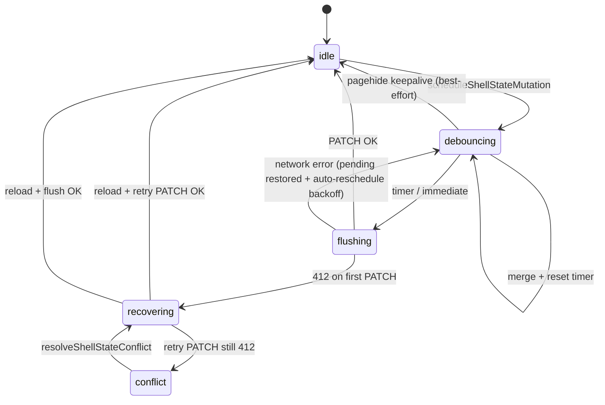

# Сохранение состояния рабочего стола на сервере

Документ описывает, как сохраняются обои, иконки, тема и прочие настройки рабочего стола (Desktop), где хранятся данные, как работает синхронизация и что было сделано для устойчивости (обои после очистки куки, защита от 401 при загрузке защищённых ресурсов).

---

## 1. Обзор

- **Источник правды при авторизации:** PostgreSQL (таблицы `desktop_configs`, `desktop_items`). Все запросы идут через API с Bearer-токеном.
- **Локальный кэш (P3, 2026-07-28):** subject-scoped envelope `eliteew-desktop-workspace-local-cache-v1` (`desktopWorkspaceLocalCache.ts`) — items + optional config snapshot + `itemsDirty`. Используется как:
  - кэш после успешной загрузки / успешного full items PUT;
  - durable offline snapshot при reload / reconnect (**не** silent wipe на offline boot);
  - при reconnect: dirty items **flush (PUT) before GET**, иначе локальные offline-правки затираются сервером.
- **Legacy keys** `elite_desktop_config` / `elite_desktop_items` — не SSOT для offline items после P3; config PATCH peer остаётся `desktopPersistPatchQueue`.
- **Синхронизация:** при изменении конфига (обои, тема, размер иконок и т.д.) вызывается `PATCH /api/v1/desktop/config`; при перетаскивании иконок — debounced `PUT /api/v1/desktop/items/{id}` (full sync — `PUT /desktop/items`).

---

## 2. Backend: таблицы и поля

### 2.1. `desktop_configs` (одна запись на пользователя)

| Поле | Тип | Описание |
|------|-----|----------|
| `id` | UUID | PK |
| `user_id` | UUID | FK → users.id, уникальный |
| `wallpaper` | Text | Текущие обои: градиент (CSS) или data URL картинки |
| `wallpapers_history` | JSON | Массив строк (история обоев), последние первые, макс. 15 |
| `icon_size` | Enum | SMALL / MEDIUM / LARGE |
| `theme` | Enum | DARK / LIGHT / AUTO |
| `accent_color` | String | purple, blue, pink, … |
| `live_wallpaper` | Boolean | Включены ли «живые» обои |
| `snap_to_grid` | Boolean | Привязка к сетке |
| `grid_step` | String | small / medium / large |
| `widgets_panel_position` | String | top-right, top-left, bottom-right, bottom-left |
| `compact_widgets` | Boolean | Компактный вид виджетов |
| `show_widgets_panel` | Boolean | Показывать панель виджетов |
| `show_widget` | Boolean | Показывать виджет (legacy) |
| `widget_position` | JSON | { x, y } |
| `created_at`, `updated_at` | DateTime | |

Файл моделей: `api/models/desktop.py` (класс `DesktopConfig`).

### 2.2. `desktop_items` (иконки на рабочем столе)

| Поле | Тип | Описание |
|------|-----|----------|
| `id` | UUID | PK |
| `config_id` | UUID | FK → desktop_configs.id |
| `item_id` | String | Уникальный идентификатор (например `documents`, `app-store`, `app-content`) |
| `item_type` | Enum | FOLDER / APP / FILE |
| `name` | String | Отображаемое имя |
| `position` | JSON | { x, y } в пикселях |
| `color`, `gradient` | String | Оформление иконки/папки |
| `is_pinned` | Boolean | Закреплён ли элемент |
| `app_component` | String | Компонент приложения (для типа APP) |
| `parent_id` | UUID | FK → desktop_items.id (внутренний) |
| `parent_item_id` | String (API wire) | Родительская папка по `item_id` (например `folder-123`); вложенность без лимита глубины |
| `is_system`, `system_key` | Boolean, String | Системные папки (Документы, Загрузки и т.д.) — **только корень стола**, нельзя вкладывать в пользовательские папки |

**Окно папки (2026-06):** вложенные `desktop_items` с `parent_item_id` отображаются в секции **«На рабочем столе»** (сетка/список как у файлов библиотеки). Unified Content — секция **«В библиотеке»**; строки **перетаскиваются** на дерево слева, **breadcrumb** и **область списка** (тот же MIME, что в Файловый менеджер). Ярлыки стола — отдельный drag MIME (`desktopNestedItemDrag.ts`); drop на **фон стола** или **иконку папки** на сетке — вынести на корень / переместить в папку (`desktopNestedItemDrop.ts`). Слева — дерево папок; корень **«Корневой раздел»** (= Файловый менеджер «Без папки», `folder_unassigned`). Над списком — breadcrumb с drop-целями; **Alt+←** / **Backspace** — родительская папка. Пакетное **«Переместить»** и контекстное меню вложенных ярлыков — выбор папки (с guard циклов), **иконка папки**, **свойства**. **F2** — переименование вложенной пользовательской папки. **Delete** / batch delete — убрать ярлыки с рабочего стола (с потомками). **Ctrl+A** / **Enter** в секции nested. Пользовательские **folder_icon** в nested grid/list. **Wave 3 (2026-06-30, UI audit 3/20):** при drag-over области списка — live overlay (`folderWindow.dropUpload` / `dropMoveLibrary` / `dropMoveShortcut`); улучшенные empty states (hero, nested-only panel, filter-empty с clear search); locale-safe даты (`formatFolderItemDate`); preview prev/next по списку; paste hint (Ctrl+V); «?» в шапке — горячие клавиши (`desktopUi.shortcuts.folderWindow`); list body `role=region` + `aria-multiselectable`. Навигация: `retargetFolderWindow` в `useWindowManager`. UI: `DesktopFolderNestedItems.tsx`, `DesktopFolderExplorerSidebar.tsx`, `DesktopFolderPathBar.tsx`, `folderWindowLibraryDrag.ts`, `folderWindowTreeDrop.ts`. Модал **свойств** — `ItemPropertiesModal.tsx` (i18n `itemPropertiesModal.*`).
| `created_at`, `updated_at` | DateTime | |

Файл моделей: `api/models/desktop.py` (класс `DesktopItem`).

Реализация items API: `api/routers/desktop_items.py`; recent files/feed: `api/routers/desktop_recents.py`; bootstrap (system folders, App Store icon): `api/routers/desktop_bootstrap.py` (re-export через `desktop_workspace.py` → `desktop.py`). Системные папки создаются при `GET /desktop/items` и `GET /desktop/config` (`ensure_system_folders`, `ensure_app_store_icon`).

Дополнительно в БД хранятся: виджеты-заметки (`desktop_widget_notes`), виджеты-задачи (`desktop_widget_todos`), избранное дашборда (`user_dashboard_favorites`, поле `sort_order`) — см. `api/routers/desktop_widgets.py` (Phase 1c split; re-export из `desktop.py`) и `DESKTOP-API-AND-APPS.md`.

**Widget entity API (авторизованный пользователь):**

| Сущность | GET | POST | PATCH | DELETE | Offline fallback |
|----------|-----|------|-------|--------|------------------|
| Notes | `/widget-notes` | `/widget-notes` | `/widget-notes/{id}` | `/widget-notes/{id}` | `STORAGE_KEYS.WIDGET_NOTES` |
| Todos | `/widget-todos` | `/widget-todos` | `/widget-todos/{id}` | `/widget-todos/{id}` | `STORAGE_KEYS.WIDGET_TODOS` |
| Favorites | `/favorites` | `/favorites` | `/favorites/reorder` (bulk `favorite_ids`) | `/favorites/{id}` | `STORAGE_KEYS.WIDGET_FAVORITES` |

При недоступности API UI показывает `workspace.localOnlyHint` и `data-local-only="true"`; сбой записи в `localStorage` — `workspace.localStorageWriteFailed`.

**Wave B (2026-07-18) — transactional widget-sync + outbox**

| Layer | Contract |
|-------|----------|
| HTTP | `POST /api/v1/desktop/widget-sync` — body `{ ops: [...] }`; header **`Idempotency-Key`** required (8–128 chars). Existing per-entity CRUD unchanged (online happy-path). |
| Server tx | One Postgres session apply for the whole batch; hard failure → rollback (no mid-batch commit). Response lists per-op `applied` / `skipped_lww` / `noop`. |
| Redis idempotency | Key `desktop_widget_sync:{user_id}:{sha256(key)[:40]}`, TTL 24h. Flow: GET replay → SET NX `in_progress` → apply → SETEX JSON result. Redis down with key present → **503 fail-closed** (client keeps outbox). |
| Client outbox | `desktopWidgetOutboxQueue.ts` (`eliteew-desktop-widget-outbox-v1`), subject-scoped. Local-only mutations enqueue ops. Flush = one sync POST; **clear only on 2xx**. Network drop / 500 → outbox intact + same `inflightIdempotencyKey` + sync chip error (`syncError` via persist flush merge). |
| Logout | Outbox key purged with widget LS (`clearPrincipalScopedLocalStorage` + `clearDesktopShellStateCache`). |

Modules: `api/services/desktop_widget_sync.py`, `api/routers/desktop_widgets.py` (`POST /widget-sync`), FE `useDesktopWidgetOutboxFlush.ts`. Tests: `test_desktop_widget_sync.py`, `desktopWidgetOutboxQueue.test.ts`.

**Wave C (2026-07-18) — shell_state Prometheus SLI**

Observability only on `GET/PATCH /desktop/shell-state`. Emit is best-effort and must not change HTTP outcomes.

| Metric | Labels / notes |
|--------|----------------|
| `desktop_shell_state_patch_total` | `result=ok\|conflict_412\|error\|idempotent_replay\|redis_unavailable\|in_progress_409` (P2 expanded) |
| `desktop_shell_state_patch_latency_seconds` | Histogram, same `result` labels |
| `desktop_shell_state_get_304_total` | Counter when `If-None-Match` yields 304 |

Helpers: `observe_desktop_shell_state_patch`, `observe_desktop_shell_state_get_304` in `api/monitoring/metrics.py`. Wired in `api/routers/desktop_shell_state_routes.py` (mounted via `desktop_shell_config` aggregator). Tests: `test_desktop_shell_state_metrics.py`, `test_desktop_shell_state_idempotency.py`. No new admin UI — scrape via existing Prometheus `/metrics` contour.

**P2 (2026-07-28) — shell PATCH integrity:** `FOR UPDATE` on `desktop_configs` + optional Redis `Idempotency-Key` (module `api/services/desktop_shell_state_idempotency.py`). No Redis/idempotency required when header absent.

**Wave D (2026-07-18) — E2E contour closeout**

Operator/CI: **`DESKTOP-SHELL-E2E-CI.md`** — post-update checklist, `workflow_dispatch`, bundled `pnpm run test:e2e:desktop` includes **`e2e/desktop-widget-sync-outbox.spec.ts`** (offline note → outbox → online widget-sync → clear). Secrets remain operator-owned.

---

## 3. API (базовый путь `/api/v1/desktop`)

Все эндпоинты требуют авторизации (OAuth2/Keycloak).

| Метод | Путь | Назначение |
|-------|------|------------|
| GET | `/desktop/config` | Получить конфиг пользователя (создаётся по умолчанию, если нет) |
| POST | `/desktop/config` | Создать конфиг |
| PATCH | `/desktop/config` | Частичное обновление (обои, тема, icon_size, и т.д.) |
| PUT | `/desktop/config` | Полная замена конфига |
| GET | `/desktop/items` | Список элементов рабочего стола (папки, приложения, файлы) |
| PUT | `/desktop/items/{id}` | Обновить элемент (в т.ч. позицию) |
| POST | `/desktop/items` | Создать элемент (например, новую папку) |
| DELETE | `/desktop/items/{id}` | Удалить элемент |
| PATCH | `/desktop/items/{id}` | Частичное обновление (имя, позиция, is_pinned и т.д.) |
| GET | `/desktop/recent-files` | Недавние файлы (unified_content) для Start/Widgets |
| GET | `/desktop/recent-content-feed` | Слайсы библиотеки (opened/added/generated/uploaded/projects) |
| POST | `/desktop/widget-sync` | Wave B: transactional notes/todos/favorites batch + `Idempotency-Key` (Redis) |

Роутер items/recent: `api/routers/desktop_workspace.py` (Phase 1d). URL-пути без изменений. Widget-sync: `api/routers/desktop_widgets.py`.

Полный контракт и список `app_component`: см. **DESKTOP-API-AND-APPS.md**.

### 3.1. Расширения `shell_state` для Desktop UI

`GET/PATCH /desktop/shell-state` хранит пользовательские сценарии поверх `desktop_configs.shell_state`, без отдельной таблицы и без миграции БД:

- `workspace_profiles` — профили рабочих пространств: название, связанный виртуальный стол, приложения, папки и виджеты.
- `window_layout_presets` — сохранённые снимки раскладок окон (`PersistedWindowState[]`) для текущего пространства.
- `widgets_layout` — состав панели виджетов и флаг per-workspace набора; системные мониторинги не добавляются. Типы слотов включают `assistant-plan` и `agenda` (проекция companion-plans); `todos` — opt-in scratch. Новые слоты дописываются через `mergeMissingDefaultWidgetSlots`.
- `app_collections` — пользовательские коллекции приложений для Start Menu/App Store discovery.
- `content_shortcuts` — быстрые ссылки на проектные папки, сохранённые фильтры или desktop folder scope.
- `assistant_context_actions` — видимые действия Assistant/GAF из выделения, окна, контекстного меню или панели свойств; без новых hotkeys.
- `visual_style_presets` — именованные пользовательские снимки оформления (волна 8).

**OpenAPI wire schemas (волна 8, 2026-05-27):** в `desktop_shell.py` (Phase 1 split, 2026-07-04; re-export из `desktop.py`) expansion-поля `DesktopShellStateOut` / `DesktopShellStatePatch` типизированы Pydantic-моделями (`DesktopWorkspaceProfilesWire`, `DesktopWindowLayoutPresetWire`, `DesktopAppCollectionWire`, …) с `_coerce_*_wire()` при сериализации ответа. Pilot: `openapi/pilot/desktop.openapi.json` → `src/generated/desktop-openapi.ts`. Контракт-тест: `desktopApi.contract.test.ts`. Миграция: living pattern in [ATOMIC-ROUTER-DECOMPOSITION-CANON.md](../../platform/ATOMIC-ROUTER-DECOMPOSITION-CANON.md) (dated `DESKTOP-ROUTER-SHELL-SPLIT-MIGRATION-2026-07-04.md` → `trash/`).

### 3.2. Single mutation pipeline (`shell_state`)

> **Статус (2026-06-30):** канонический модуль — **`desktopShellStateMutationPipeline.ts`** (`scheduleShellStateMutation`, phase FSM, single etag holder, bounded 412 recovery). **`desktopShellStateWriteCoordinator.ts`** — thin facade для legacy patch-object API и durable/offline wiring; новые writers импортируют pipeline напрямую.

#### 3.2.1. Архитектура

Все фронтовые изменения `shell_state` идут через **один mutation pipeline**, а не через прямой `PATCH`:

```text
Writer (hook/context) → scheduleShellStateMutation[*] → merge pending top-level keys
  → debounce (400 ms) → runFlush → patchDesktopShellStateMerged (If-Match + field-etags)
  → on real same-field 412: reload GET → re-merge pending → one retry PATCH (max 2 PATCH per flush)
```

| Слой | Модуль | Ответственность |
|------|--------|-----------------|
| Writers | hooks/contexts (см. §3.2.3) | Формируют partial patch; не вызывают HTTP |
| Mutation pipeline | `desktopShellStateMutationPipeline.ts` (+ facade `desktopShellStateWriteCoordinator.ts`) | Merge, debounce, inflight serialization, phase FSM, bounded 412 recovery |
| HTTP + ETag | `services/desktopApi.ts` (aggregator; impl `services/desktopApi/shellState.ts`) | `GET`/`PATCH`, keepalive pagehide; resource ETag + field-etags owned by pipeline |
| Single-tab gate | `BrowserTabLeaderProvider`, `browserTabLeaderState.ts`, `services/api/createAPIClient.ts` (via `client.ts`), `apiFetchWithAuth` | **Leader only** for gated REST mutations: axios request interceptor (`shouldBlockSingleTabApi`) **and** `apiFetchWithAuth` mutation gate (`shouldBlockSingleTabApiMutation` — POST/PATCH/DELETE/streaming blocked; GET/HEAD pass-through). Нормализованный path match (`baseURL + url` → `/api/v1/desktop/shell-state`). **Keepalive:** `patchDesktopShellStateKeepalive` и `flushShellStatePipelineOnPageHide` — leader-only. Канон: [FRONTEND_BROWSER_CACHE_MODEL.md](../FRONTEND_BROWSER_CACHE_MODEL.md) §3.3 |
| Offline durability | `desktopPersistPatchQueue.ts` + `useDesktopWorkspacePersistQueue` | Config + generic shell PATCH copies (LS); drain после online |
| Shell domain journal (P1) | `desktopShellCommandJournal.ts` + `useDesktopShellCommandJournalFlush` | IDB journal for `windows` / `virtualDesktops`; clear only after successful flush |
| Conflict UX | `useDesktopShellStatePipelineSync`, `useDesktopStaleShellStateAutoRecover`, `DesktopSyncStatus` | `subscribeShellStatePipeline` → chip; user Refresh → `reloadShellStateFromServer()` + `resolveShellStateConflict()` |

**Merge semantics:** pending patch — объект top-level ключей; последнее запланированное значение **побеждает per key** (как server merge). Прямой **`patchDesktopShellStateMerged`** — только внутри coordinator и API-слоя.

**Pipeline sources (P0, 2026-07-28):** `ShellStateMutationSource` — один merge fn на source в `pendingMerges`. Независимые домены **не** делят ключ:

| Source | Writer | Ключи (типично) |
|--------|--------|-----------------|
| `windows` | `useDesktopShellWindowPersistence` | `windows_snapshot`, derived `ewa_hints` |
| `virtualDesktops` | `useVirtualDesktops` | `virtual_desktops` |
| `expansion` / `mru` / `nowPlaying` / `chrome` / `persist` / `other` | см. §3.2.3 | соответствующие slices |

Раньше VD и windows оба писали в source `windows` → последний merge fn мог вытеснить другой домен до flush. **L2 law:** concurrent `windows` + `virtualDesktops` → один PATCH с **обоими** ключами.

**Terminal Restore Ready (windows, P0):** `useDesktopShellWindowPersistence` открывает outbound persist / `pagehide` только после `windowsPersistAllowed` (restore из GET shell_state, legacy migrate, corrupt skip или unavailable). До барьера empty local `windows[]` **не** планирует `windows_snapshot` (закон L1). VD по-прежнему: `allowPersistRef` после hydrate.

**Shell command journal (P1, 2026-07-28):** IndexedDB `eliteew-desktop-shell-command-journal-v1` (`desktopShellCommandJournal.ts`) — subject-scoped envelope, coalesce **one op per domain** (`windows` | `virtualDesktops`). Immediate/offline durable path journals before/alongside pipeline; domain cleared only after successful flush. Flush bridge: `useDesktopShellCommandJournalFlush` (auto once per online subject; merged into workspace persist retry). Logout: `clearDesktopShellStateCache` → `clearShellCommandJournal()`. If IDB unavailable → `{ ok: false, reason: 'unavailable' }` + warn log — **не** утверждать локальную прочность; last-resort LS `desktopPersistPatchQueue` только если journal enqueue failed. Vitest L3: `desktopShellCommandJournal.test.ts`.

**Field-aware optimistic merge (2026-06-30):** `GET /desktop/shell-state` и успешный `PATCH` возвращают `ETag` для всего ресурса и `X-Shell-State-Field-ETags` — opaque etag-карту top-level ключей. Browser pipeline кеширует карту и при `PATCH` отправляет `X-Shell-State-If-Match-Fields` только для ключей текущего patch. Backend всё ещё проверяет общий `If-Match`, но если общий ETag устарел, а etag-и patch keys совпали с текущим состоянием, patch принимается без 412. Это убирает ложные конфликты `windows_snapshot` vs `quiet_mode` / `music_playlists` / mobile-side writes, сохраняя 412 для реальной конкуренции за один и тот же top-level ключ.

**P2 row lock + Idempotency-Key (2026-07-28):** `PATCH /shell-state` берёт `desktop_configs` через `SELECT … FOR UPDATE` (`_lock_desktop_config_row_for_update`) перед ETag-check и merge. Опциональный header **`Idempotency-Key`** (8–128): Redis claim/replay (`desktop_shell_state_idempotency.py`); при **присутствии** ключа и недоступном Redis → **503** fail-closed. Без ключа — legacy/keepalive path. FE pipeline генерирует UUID на flush (reuse на 412 retry). Metrics `result`: `ok` | `conflict_412` | `error` | `idempotent_replay` | `redis_unavailable` | `in_progress_409`. Tests: `test_desktop_shell_state_idempotency.py`.

**Workspace items/config durable cache (P3, 2026-07-28):** `desktopWorkspaceLocalCache.ts` + `useDesktopStorage` — subject-scoped LS envelope; offline mutations set `itemsDirty`; `loadFromAPI` flush-before-GET; success clears dirty; logout `clearDesktopShellStateCache` → `clearDesktopWorkspaceLocalCache()`. Vitest L4: `desktopWorkspaceLocalCache.test.ts`. Shell windows/VD durability остаётся в IDB journal (P1), не в этом envelope. **P13 copy honesty (2026-07-28):** offline banner / sync-unavailable / chrome sync error+tour strings scope the promise to **desktop icons/layout (this browser)** — not “all changes on this device”; Vitest `desktopOfflineDurabilityCopy.p13.test.ts`.

**Semantic UI contracts (P4, 2026-07-28; Wave 0 harden 2026-07-28):** `shellSemanticContracts.ts` — focus (portal trap+restore L5), reachability (welcome nudge **absolute** above taskbar in `[data-desktop-ui-scale]` + `useDesktopInViewportReachability` → `inert` when off-viewport; never `bottom-full` / transform-`fixed`), viewport (`resolveEffectiveWindowMinSize` + default size clamp L6 + **`commitWindowsIntoWorkArea` on `#desktop-main` ResizeObserver** for non-maximized windows; open commit fits non-max geometry), destructive (VD delete confirm). See `SHELL-LIFECYCLE-AND-CHROME-SSOT.md` §C.1. **P6 Settings chrome:** panel-width sidebar gate (`desktopSettingsChromeLayout.ts`) — clamp ≠ usable chrome at ≤640. **P7 launcher honesty:** `openWindow` no longer waits on `preloadDesktopApp` before committing a window (avoids Start close + “opened” with empty chrome); roles in `desktopLauncherRoles.ts`. **P8 cold links / App Store open:** `peekPendingDesktopOpen` until `installedAppsLoading` clears; `resolveDesktopAppLaunchItem` (shortcuts → installed catalog → DEFAULT_APPS) for pending open, `desktop-open-app`, and `openDesktopAppByComponent`. **P9 false empty honesty:** `useDesktopStorage` still clears config `isLoading` before items GET finishes (`isItemsHydrating`); `shouldShowDesktopStoragePreloader` / `shouldShowDesktopEmptyState` (`desktopEmptyStateHonesty.ts`) keep the shell preloader up and suppress the empty CTA until items hydrate completes. **P10 transient PATCH auto-reschedule:** after non-412 flush failure the pipeline restores pending merges and re-arms `scheduleGlobalFlush` with exponential backoff (400 ms → 8 s cap) so a stay-open tab retries without a new writer mutation.

**Сброс сессии:** explicit logout / `onAuthLogout` (`session_replaced`) → полный **§3.4 six-step cascade** в `AuthContext` (шаг 3: **`clearDesktopShellStateCache()`** + **`resetCoalescedDesktopShellStateWriter()`** — включая shell journal + workspace local cache). **Смена пользователя без logout** cascade **не** запускает — см. [FRONTEND_BROWSER_CACHE_MODEL.md](../FRONTEND_BROWSER_CACHE_MODEL.md) §8.

Типы partial patch: **`types/desktopShellStatePatch.types.ts`** (`CoalescedDesktopShellStatePatch`).

#### 3.2.2. Phase FSM

Pipeline и conflict-recovery образуют конечный автомат. Фазы **idle / debouncing / flushing / conflict / recovering** живут в **`desktopShellStateMutationPipeline.ts`**; UI читает snapshot через **`subscribeShellStatePipeline`** (`useDesktopShellStatePipelineSync`).



| Фаза | Где | Условие входа | Поведение |
|------|-----|---------------|-----------|
| **idle** | pipeline | `pendingMerges` пуст, нет `inflightFlush` | Writers принимают новые mutations |
| **debouncing** | pipeline | per-source + global debounce timer (default **400 ms**); после transient PATCH fail — **auto-reschedule** с backoff `400 → 800 → … → 8000 ms` (P10) | Merge fn per `source`; последний merge fn побеждает для source |
| **flushing** | pipeline + `desktopApi` | `runFlush()` / `inflightFlush` | Deep-merge всех pending sources → один PATCH |
| **conflict** | pipeline + UI | 412 после bounded retry → `phase=conflict`, `lastConflict` set | **Flush заблокирован**; pending merges сохранены; debounce timers не стартуют; chip «Обновлено на другом устройстве» |
| **recovering** | pipeline | `resolveShellStateConflict()` / bounded 412 retry | `reloadShellStateFromServer()` → re-merge pending → flush; **новые debounced flush не стартуют** |

**Инвариант no PATCH storm:** пока `phase === 'conflict' | 'recovering' | 'flushing'`, pipeline **не** планирует новые debounced flush (merges только в очередь). `inflightFlush` резервируется **до** первого `await` в `runFlush()` — параллельные `scheduleShellStateMutation` + `flushShellStatePipelineNow` схлопываются в один PATCH. Transient network/5xx: pending restored + `scheduleGlobalFlush(backoff)` (не conflict; не storm — backoff capped at 8s). Auto-recover (`useDesktopStaleShellStateAutoRecover`) — **одна** попытка на conflict-эпизод до `phase=idle` (переход через `recovering` не сбрасывает флаг). Conflict снимается после успешного **`resolveShellStateConflict()`** (user Refresh/Retry или auto-recover). Hook-level **`setCoalescedDesktopShellStateWriteConflictPaused`** **не используется**.

**Инвариант single writer:** в обычном браузере только tab-leader может делать mutating gated REST, включая `PATCH /api/v1/desktop/shell-state`. Non-leader tabs блокируются **до HTTP** двумя контурами:

1. **Axios** — request interceptor (`shouldBlockSingleTabApi`) на shared `apiClient`.
2. **`apiFetchWithAuth`** — `shouldBlockSingleTabApiMutation` (mutations/streaming blocked; read-only GET/HEAD allowed).

**Pagehide keepalive** (`patchDesktopShellStateKeepalive`, `flushShellStatePipelineOnPageHide`) — также leader-only.

Важно: многие clients задают `baseURL=/api/v1` и `url=/desktop/shell-state`; gate обязан матчить **нормализованный** путь `baseURL + url`, иначе follower tab обходит блокировку и создаёт реальные 412 против leader. Follower shell RAM инвалидируется по BroadcastChannel `shell-state-invalidated` после leader PATCH (см. cache model §3.3).

#### 3.2.3. Writer contract (`scheduleShellStateMutation`)

Каждый источник **обязан** вызывать pipeline entrypoint, а не HTTP. Опции:

| Опция | Назначение |
|-------|------------|
| `debounceMs` | Override debounce (редко; default 400) |
| `immediate: true` | Offline queue drain, visual pack import, legacy now_playing migration |
| `persistSubjectKey` | Durable path → `scheduleDurableCoalescedDesktopShellStatePatch` + offline queue on network fail (не на 412) |

| Writer / источник | Pipeline `source` | Ключи `shell_state` (примеры) | Durable |
|-------------------|-------------------|----------------------------------|---------|
| Expansion settings | `expansion` | `workspace_profiles`, `widgets_layout`, `visual_style_presets`, … | explicit queue offline |
| Virtual desktops | `virtualDesktops` | `virtual_desktops` | да (после Terminal Restore Ready — `membershipPersistReady`) |
| Window snapshot | `windows` | `windows_snapshot` (+ dedupe serialized snapshot) | да (после Terminal Restore Ready) |
| MRU apps | `mru` (типично) | `recent_app_ids`, `recent_app_ids_by_desktop` | да |
| Recent files | `other` / domain writer | `recent_file_ids` | нет |
| Taskbar prefs | `chrome` / domain writer | `tray_show_*`, `clock_show_seconds` | нет |
| Now playing | `nowPlaying` | `now_playing` | нет (см. §3.2.5) |
| Music library | domain writer | `music_playlists` | нет |
| GAF chat sound | domain writer | `gaf_chat_sound_enabled` | нет |
| Clipboard | `clipboard` | `clipboard_history` (caps §3.2.6) | нет |
| Floating widget | domain writer | `timezone`, `quiet_mode` | offline queue path |
| Settings Center import | `expansion` | expansion slices | `immediate` |
| Persist queue drain | `persist` | queued patches | `immediate` |

Ошибки flush: **`subscribeCoalescedShellStatePatchErrors`** → `useDesktopExpansionSettings.error` + Settings Center sync card (без duplicate toast).

#### 3.2.4. Optimistic conflict (412) и UX

**Wire:** `GET /desktop/shell-state` → `ETag` + `X-Shell-State-Field-ETags`; `PATCH` → `If-Match` + `X-Shell-State-If-Match-Fields`. Конфликт: **412**, code `desktop_shell_state_conflict`, optional `current_etag`, optional `current_field_etags`.

**False-positive conflict guard:** если другой session/mobile изменил другой top-level ключ, backend принимает stale resource ETag по совпавшим field-etags patch keys. **412 должен остаться только при same-key конфликте** или при legacy client без field-etags. Native/mobile clients, которые не отправляют `If-Match`, сохраняют прежний merge-only path.

**Retry chain** (bounded, **`desktopShellStateMutationPipeline.ts`**): первый PATCH с `If-Match` → если backend считает конфликт реальным, **412** → `reloadShellStateFromServer()` → deep-merge pending → **один** retry PATCH → второй **412** → `phase=conflict`, **`DesktopShellStateConflictError`**. Не более **двух** PATCH на flush. `desktopApi.patchDesktopShellStateMerged` **не** делает внутренний retry loop. Stale-write **не** кладётся в offline queue.

Если 412 повторяется без явного второго устройства, сначала проверять **single-tab gate**: request interceptor должен видеть путь как `/api/v1/desktop/shell-state`, даже когда `desktopApi` отправляет `url=/desktop/shell-state` с `baseURL=/api/v1`. Follower tabs не должны доходить до backend вообще.

**UI** (`DesktopSyncStatus`, i18n `desktopChrome.syncStatus`):

| Состояние chip | EN (пример) | RU (пример) |
|----------------|-------------|-------------|
| Офлайн (navigator / connectivity) | Offline — retry when ready | Офлайн — повторите при связи |
| Офлайн next action | Retry (`onRetry` / `onRefresh`, same as error) | Повторить |
| Обычная ошибка сохранения | Couldn't save | Не удалось сохранить |
| Идёт sync / auto-recover | Syncing… | Синхронизация… |
| Конфликт с другой вкладкой/сессией | Updated elsewhere | Обновлено в другом месте |
| Действие после неудачного auto-recover | Retry | Повторить |
| Явное обновление до auto-attempt | Refresh | Обновить |

`staleShellStateConflict` = `pipeline.phase === "conflict" && pipeline.lastConflict != null`. Recovery: **`recoverDesktopShellStateFromPipelineConflict`** (`reloadShellStateFromServer()` + optional UI refresh + `resolveShellStateConflict({ skipReload: true })`). **`useDesktopSyncSavedPulse`**: краткий «Сохранено» после успешного sync. Diagnostics: **`getCoalescedDesktopShellStateTelemetry()`**, **`getStaleShellAutoRecoverDiagnostics()`** — export из Settings Center (`coalescedWriter` + `persistQueue`).

#### 3.2.5. NowPlaying boundary (shell_state vs runtime)

`NowPlayingContext` — единственный writer ключа **`now_playing`**. Граница «что уходит на сервер» vs «только runtime»:

| Поле / состояние | В `shell_state.now_playing` | Только runtime / local |
|------------------|----------------------------|-------------------------|
| Track identity | `track.id`, `name`, `thumbnail_url`, `version` | `mime_type`, `source_surface` |
| Transport | `current_time`, `volume` | `playing`, `duration`, `bufferedRanges`, `playbackRate` |
| Diagnostics | — | `diagnostics`, `error`, `isLoading`, mic ducking gain |
| Blob / stream | — | IndexedDB audio cache, object URLs, `<audio>` element |

**Persist triggers (anti-storm):**

1. **`useEffect` на `state.track` / `state.volume`** — не подписан на `currentTime` React state (нет PATCH на каждый render tick).
2. **`audio timeupdate`** — throttled **`PERSIST_THROTTLE_MS` (2000 ms)** через `scheduleShellPersist` → pipeline.
3. До **`shellHydratedRef`** (после GET shell-state) persist не шлётся.

Playback errors, loading stall hints и ducking **не** пишутся в `shell_state`.

#### 3.2.6. Payload guards и смежные writers

**Window snapshot hardening (2026-06-29):** backend валидирует `windows_snapshot`; фронт — **`windowManagerRestoreSnapshot.ts`**, dedupe в `useDesktopShellWindowPersistence` (unchanged serialized snapshot → no mutation). **P0 restore barrier (2026-07-28):** нет schedule/`pagehide` до Terminal Restore Ready (`windowsPersistAllowed`); Vitest L1 в `useDesktopShellWindowPersistence.lifecycle.test.ts`.

**Virtual desktop membership reconcile (2026-08-18):** `virtual_desktops.desktops[].windows` — индекс живых окон, не история. Restore раньше минтил новые window id (`w-{Date.now()}-{index}`), поэтому append-only членство копило сироты и раздувало PATCH. **Wave 2 (2026-08-18):** (1) `windows_snapshot.windows[].id` сохраняется и восстанавливается стабильным id; (2) VD outbound PATCH gated на тот же барьер, что и `windows_snapshot` (`membershipPersistReady` ← Terminal Restore Ready); (3) hydrate one-shot reconcile по ids из snapshot / legacy heuristic; (4) backend `_sanitize_virtual_desktops` отсекает id вне snapshot при GET/PATCH persist. После Terminal Restore Ready `useDesktopShellWindowPersistence` вызывает `reconcileWindowMembership(liveIds)`; `restoreWindows` передаёт assignments из `desktopId` снимка. Хелпер `reconcileVirtualDesktopWindowMembership.ts`: выбросить id вне live set, каждый live id на одном столе. Vitest: `reconcileVirtualDesktopWindowMembership.contract.test.ts`, `virtualDesktopShellSnapshotHelpers` tests, restore/lifecycle locks; pytest: `test_desktop_shell_state_virtual_desktops.py`.

**Window geometry (Wave 9):** **`windowManagerRestoreGeometry.ts`**, open policy — **`windowManagerOpenPolicy.ts`**.

**Clipboard caps:** **`clipboardHistoryPersistence.ts`** — max 25 items, string cap 120k; oversized image data URL и **`persistScope: session`** (JWT/API-key-like text, oversized inline image) не попадают в `shell_state`.

**Clipboard engine (2026-08-19):** единый workspace writer — **`useDesktopShellClipboardHistory`** + **`DesktopClipboardHistoryProvider`**. Background OS capture в **`sync`** (poll `DESKTOP_POLLING.CLIPBOARD_MS`, tab visible); in-app copies через **`desktopClipboardCaptureBus`** (`safeCopyToClipboard` и др.). Persist — pipeline source **`clipboard`** (не `other`); `pagehide` flush + offline queue по `persistSubjectKey`. UI — **`ClipboardManager`** (только presentation); таскбар — **`onOpenClipboard`** / Win+V.

**Clipboard policy:** `clipboardPolicy.ts` + ClipboardManager toggle. Cloud / Connected default **`sync`** (OS poll every `DESKTOP_POLLING.CLIPBOARD_MS` + shell_state history). FoFline (`foflineNative`) defaults to **`quarantine`** until the user opts into `sync`. **`quarantine`** disables OS poll, OS write from ClipboardManager (session-history toast only), and auto `clipboard_history` PATCH (clears remote history on enable). Native Tauri: product WebView (`label=product`) cannot invoke `clipboard_read` / `clipboard_write` / `clipboard_status` (`clipboard_quarantine`); FoFline bundle history file is `clipboard/history_fofline_v1.json` (isolated from Connected `history_v1.json`). Not a silent Safe Workspace sterile claim — see `SITE-PROD-LANDING.md` §Fact vs Hypothesis.

**Pagehide:** **`flushCoalescedDesktopShellStatePatchOnPageHide`** → **`patchDesktopShellStateKeepalive`**; hook **`useCoalescedDesktopShellStatePagehideFlush`**.

**Telemetry:** **`getCoalescedDesktopShellStateTelemetry()`** — `pendingKeys`, `inflight`, latencies, `conflictFlushCount`, `keepaliveFlushCount` (client-session only).

### 3.3. Операторский smoke для shell persistence

1. Открыть две вкладки одного пользователя, дождаться загрузки desktop и открыть настройки shell/performance или любой surface с sync chip.
2. В первой вкладке изменить состояние, которое пишет `shell_state` (например virtual desktop или recent app), во второй вкладке выполнить stale write до повторного GET: sync chip показывает dedicated stale-state recovery, не generic error.
3. Дождаться auto-rehydrate или нажать **Refresh** / **Обновить** вручную: shell-state refresh очищает conflict; stale payload не попадает в offline retry queue, пока не будет пересобран от свежего server state.
4. Не меняя окна, оставить вкладку на sync chip: повторный одинаковый `windows_snapshot` не должен вызывать бесконечную серию 412; новый PATCH допустим только после реального изменения окон или refresh.
5. Mobile/web disjoint smoke: изменить `quiet_mode` или `music_playlists` с другой сессии, затем с web-tab сохранить `windows_snapshot`. Network не должен показывать 412, если `X-Shell-State-If-Match-Fields` содержит неизменённый `windows_snapshot`.
6. Playwright guard: `e2e/desktop-shell-state-conflict.spec.ts` opens two authenticated tabs, injects repeated 412 responses for one shell-state PATCH, verifies the dedicated stale chip, then checks recovery clears it. Run through `pnpm run test:e2e:desktop` with `MC_E2E_BASE_URL` + storage state.
7. Export diagnostics summary из Settings Center: JSON должен содержать `persistQueue` и `coalescedWriter` (`pendingKeys`, `inflight`, `lastFlushLatencyMs`, `failedFlushCount`, `conflictFlushCount`, `lastConflictAtMs`, `keepaliveFlushCount`).
8. Перевести вкладку offline, изменить раскладку окон или virtual desktops, вернуть online: queued patches должны drain-иться; при stale server state ошибка остаётся видимой, очередь не очищается как успешная.
8. Проверить restore: валидный multi-desktop `windows_snapshot` восстанавливает окна с сохранёнными `desktopId` и `zIndex`; при повреждённом snapshot виден нейтральный toast `sessionRestoreSkipped*`. После restore `virtual_desktops.desktops[].windows` содержит **только** id живых окон (сироты с прошлых сессий не копятся в PATCH).
9. **Partial restore report (2026-06-30, plan UI 02/20 R05):** если часть окон отфильтрована (`filterRestoredWindows` — uninstalled/legacy), `assessWindowsSnapshotRestore` возвращает `skippedCount` / `requestedCount`; `useDesktopShellWindowPersistence` показывает non-blocking toast `sessionRestorePartial*` («We restored N windows; M couldn't be reopened»).
10. Открыть 10+ окон: taskbar переходит в dense mode, titles доступны через tooltip/aria, sync errors при этом не скрываются.

---

## 4. Frontend: загрузка и сохранение

### 4.1. Хук `useDesktopStorage`

Оркестратор: `web/frontend/src/pages/Desktop/hooks/useDesktopStorage.ts` (**≤800 LOC**, P22; Wave B 2026-08-10 — thin facade composing `hooks/desktopStorage/*`). Публичный API хука и re-export `MAX_WALLPAPER_LENGTH` / `isWallpaperTooLargeForApi` стабильны. Scope: **config + items only**; `shell_state` остаётся в отдельных shell-state hooks / pipeline.

| Модуль | Роль |
|--------|------|
| `hooks/useDesktopStorage.types.ts` | `UseDesktopStorageReturn`, persist options, default config |
| `hooks/desktopStorage/constants.ts` | sync debounce, sync-meta key, default config alias, load-stall ms |
| `hooks/desktopStorage/useDesktopStoragePresence.ts` | online listeners, tab conflict, mutation broadcast |
| `hooks/desktopStorage/useDesktopStorageLocalCache.ts` | subject workspace local load/save |
| `hooks/desktopStorage/useDesktopStorageConfigHydration.ts` | API hydrate, initial load, config PATCH / snapshot / refresh |
| `hooks/desktopStorage/useDesktopStorageItemsSync.ts` | pending/full items sync, CRUD, replace, unload flush |
| `utils/desktopStorageItemMerge.ts` | `mergeDesktopItemsWithDefaults`, `dedupeDesktopItemsById` |
| `utils/desktopStorageHydrateApi.ts` | `loadDesktopStorageFromApi` (bootstrap + dirty flush-before-GET + retries) |
| `utils/desktopStorageItemsSync.ts` | pending position PUT + full ITEMS PUT / queue |
| `utils/desktopStorageItemMutations.ts` | create folder factory, markdown create flow, delete 409 message |
| `utils/desktopConfigPatch.ts` | wallpaper normalize/cap + config API patch/merge |
| `utils/desktopWorkspaceLocalCache.ts` | P3 subject durable cache |
| `utils/desktopPersistPatchQueue.ts` | offline config patch queue |

- **При монтировании:**
  - Если пользователь **авторизован** и есть сеть: `loadFromAPI(signal)` → `loadDesktopStorageFromApi` — `GET /desktop/config` (или shell-bootstrap), затем при `itemsDirty` — flush `PUT /desktop/items` из subject cache, затем `GET /desktop/items`. Успех пишет clean envelope (`itemsDirty: false`). Эффект держит `AbortController`: abort / `CanceledError` **не** ретраятся (`classifyDesktopLoadFailure` → `aborted`). Transient **502/503** после axios interceptor приходят как `APIError` с **`statusCode`** (без `response`); classifier читает `statusCode` → `kind: 'server'`, чтобы локальный hydrate-retry и `workspace.loadError.server` сработали, а не «неизвестная ошибка». Bodyless 5xx в `api/client` мапятся на `ErrorMessages.serverError`.
  - Смежные fetch в дереве workspace (`useDesktopRecentContentFeed`, `useRecentFiles`, `useDesktopWorkspaceWidgetAvatar` → `getProfile({ signal })`) тоже abort-on-unmount с silent catch.
  - Если **не авторизован** или **офлайн**: `loadFromLocalStorage()` читает subject envelope (если есть); **не** удаляет чужой/свой durable snapshot. Без cache — defaults.

- **При изменении конфига** (обои, тема, размер иконок, позиция панели виджетов и т.д.):
  - Сразу обновляется локальный state и workspace local cache (config snapshot).
  - Если есть сеть — вызывается `api.patch(API_ENDPOINTS.CONFIG, patchPayload)` с базой `DESKTOP_API_BASE = '/api/v1'`. Offline config patches — `desktopPersistPatchQueue`.

- **При перетаскивании иконок / full replace:**
  - Позиции — debounced `PUT /desktop/items/{id}` via `syncDesktopPendingItemUpdates`; offline / sync failure — `itemsDirty` в workspace cache; `syncToServer` → `syncDesktopItemsFullPut` clears dirty on success.

Ключ P3: `eliteew-desktop-workspace-local-cache-v1`. Прочие `STORAGE_KEYS.*` в `constants/index.ts` могут оставаться для смежных chrome/helpers — не SSOT items offline.

Locks: `hooks/__tests__/useDesktopStorage.p22.atomization.contract.test.ts`, `utils/__tests__/desktopStorageP22.helpers.test.ts`.

---

## 5. Обои: сохранение на сервере и ограничение размера

### 5.1. Проблема

Раньше значение `wallpaper` в виде большой data URL (загруженная пользователем картинка) **не отправлялось** в `PATCH /desktop/config`, чтобы не получать 413 из-за размера тела запроса. В результате при очистке куки или данных сайта текущий выбор обоев терялся: с сервера приходил только старый градиент или дефолт.

### 5.2. Решение

- Обои (в том числе data URL) **отправляются на сервер** при каждом изменении через `updateConfig({ wallpaper })` → `PATCH /desktop/config`.
- Введён лимит длины строки обоев в символах: **500 000** (`MAX_WALLPAPER_LENGTH` в `desktopConfigPatch.ts`, re-export из `useDesktopStorage`). Если строка длиннее, поле `wallpaper` из payload для PATCH **выбрасывается** (не отправляется), чтобы не вызывать 413; в лог пишется предупреждение. Обычные загруженные обои (в т.ч. WebP после сжатия в WallpaperPicker) укладываются в лимит.
- На бэкенде при обновлении `wallpaper` обновляется и **история обоев** (`wallpapers_history`), чтобы в выборе обоев отображались последние варианты (в т.ч. загруженные), даже после смены устройства или очистки куки.

Итог: после входа конфиг и обои подтягиваются с API; выбор обоев переживает очистку куки/локального хранилища, если размер не превышает лимит.

### 5.3. Константы и файлы

- Фронт: `MAX_WALLPAPER_LENGTH = 500_000` в `utils/desktopConfigPatch.ts` (re-export из `useDesktopStorage.ts`); формирование `patchPayload` — `buildDesktopConfigApiPatchPayload`.
- Бэкенд: `api/routers/desktop_shell.py` — обработка `wallpaper` и `_update_wallpaper_history()` при PATCH/POST/PUT config (монтируется из `desktop.py`).

---

## 6. Защищённые URL и отсутствие 401 в img/audio/href

### 6.1. Проблема

Ссылки на скачивание или отображение контента вида `/api/...` или `.../unified-content/.../download` требуют заголовка `Authorization: Bearer <token>`. Если такой URL подставить в `src` картинки, `src` аудио или `href` ссылки, браузер выполняет запрос **без** заголовка авторизации, что приводит к 401 (в т.ч. в папке «Загрузки» и при просмотре превью файлов).

### 6.2. Принятый подход

Для любого **защищённого** URL (путь начинается с `/api` или содержит `unified-content`):

- **Не** подставлять его напрямую в `src` у ``, `<audio>` или в `href` у `<a>`.
- Для **preview/embed** (`src` у ``, `<audio>`, `<video>`, `iframe`) использовать authenticated Blob/object URL: выполнить `api.get(url, { responseType: 'blob' })`, создать object URL через `createRevocableObjectUrlFromBlob` / `URL.createObjectURL`, затем отложенно revoke.
- Для **save-as/download** использовать ticket URL, а не Blob-first: `contentApi.downloadContentToBrowser(...)` сначала делает authenticated `POST /api/v1/content/{id}/download-ticket`, затем открывает `GET /api/v1/content/{id}/download-by-ticket?ticket=...` через `triggerBrowserDownloadFromUrl`. Ticket короткоживущий, opaque, без Bearer/JWT в query; consume route повторно проверяет ACL. Если ticket mint недоступен, helper возвращается на Blob fallback и показывает busy-copy в UI.

### 6.3. Где внедрено

| Место | Файл | Что сделано |
|-------|------|------------|
| Превью/скачивание файла | `FilePreviewModal.tsx` | Preview bytes остаются Blob/object URL; кнопка «Скачать» использует cached Blob, если preview уже загружен, иначе `contentApi.downloadContentToBrowser(...)` с ticket-first URL и Blob fallback. |
| Аватар в профиле | `UserProfile.tsx` | Убран fallback ``. Используется только аватар, загруженный через api + blob (`avatarObjectUrl`), или плейсхолдер. |
| Аватар в виджете на рабочем столе | `DesktopWorkspaceContent.tsx` | Если `avatarSrc` — защищённый путь, в `` не подставляется; только `avatarObjectUrl` или плейсхолдер. |
| Текущий аватар и история в настройках профиля | `ProfileSettings.tsx` | Для защищённого `profile.avatar_url` загрузка через `api.get(..., responseType: 'blob')` и object URL. Для истории аватаров — компонент `SafeAvatarImage`, который для защищённого URL грузит через api и отображает по blob. |
| Вложения в чате (ArlyQueen) | `MessageAttachmentsPanel.tsx` | Аудио: компонент `SecureAudio` — загрузка по `api.get(..., responseType: 'blob')`, object URL в `<audio src>`. Ссылка «Скачать»: компонент `SecureDownloadButton` — по клику `api.get(..., responseType: 'blob')` и сохранение файла через временный object URL, без прямого `href` на защищённый download. |

API-клиент с Bearer: `web/frontend/src/services/api/client.ts`. Проверка «защищённый ли URL» на фронте: строка начинается с `/api` или содержит `unified-content`.

---

## 7. Тесты

### 7.1. Обои (persistence)

Файл: `web/frontend/src/pages/Desktop/hooks/useDesktopStorage.wallpaper.test.tsx`.

Проверяется поведение хука `useDesktopStorage` при вызове `updateConfig({ wallpaper })`:

1. **Обои нормального размера уходят в PATCH** — data URL длиной порядка 10k символов присутствует в теле запроса к `api.patch` (конфиг сохраняется на сервере).
2. **Очень большие обои не уходят в PATCH** — data URL длиной 600k символов не включается в payload (ограничение 500k), чтобы не допустить 413.
3. **Градиентные обои уходят в PATCH** — встроенный градиент сохраняется на сервере как текущие обои.

Запуск только этих тестов:

```bash
cd web/frontend && pnpm test -- useDesktopStorage.wallpaper
```

Полный прогон тестов фронта:

```bash
cd web/frontend && pnpm test
```

---

## 8. Краткое резюме изменений

- **Обои:** сохранение текущего выбора (в т.ч. data URL) на сервере через PATCH config с лимитом 500k символов; история обоев на бэкенде; после очистки куки обои подтягиваются с API при следующем входе.
- **Иконки и раскладка:** позиции и список элементов хранятся в `desktop_items`, синхронизация через GET/PUT items при загрузке и после перетаскивания с debounce.
- **Конфиг (тема, размер иконок, панель виджетов и т.д.):** хранятся в `desktop_configs`, обновляются через PATCH config; при отсутствии авторизации/сети используется кэш из localStorage.
- **Защищённые URL:** ни один ``, `<audio>` или ссылка скачивания не используют напрямую URL вида `/api/...` или `unified-content/...`; везде загрузка через авторизованный api-клиент и blob/object URL.
- **Тесты:** добавлены три теста в `useDesktopStorage.wallpaper.test.tsx` на отправку/неотправку обоев в PATCH в зависимости от размера и типа значения.

Дополнительно по API и списку приложений: **DESKTOP-API-AND-APPS.md**.

---

## 9. Music Player persistence update (2026-04-10, boundary §3.2.5)

- В `shell_state.now_playing.track` добавлено поле `version` (строка ревизии/хеша файла) для стабильного cache-key при повторном воспроизведении.
- Воспроизведение использует blob-cache в IndexedDB (`user/session side`) по ключу `contentId:version`; при совпадении версии после refresh трек может быть поднят из локального кеша без полной повторной загрузки.
- API `/api/v1/content/{id}/download` поддерживает `ETag`, `If-None-Match` (`304`), `Accept-Ranges`/`Range` (`206`) и `Cache-Control: private`, что снижает сетевую нагрузку даже при cache miss в IDB.
- Persist позиции — throttled через mutation pipeline; runtime transport state не в `shell_state` (см. **§3.2.5**).
