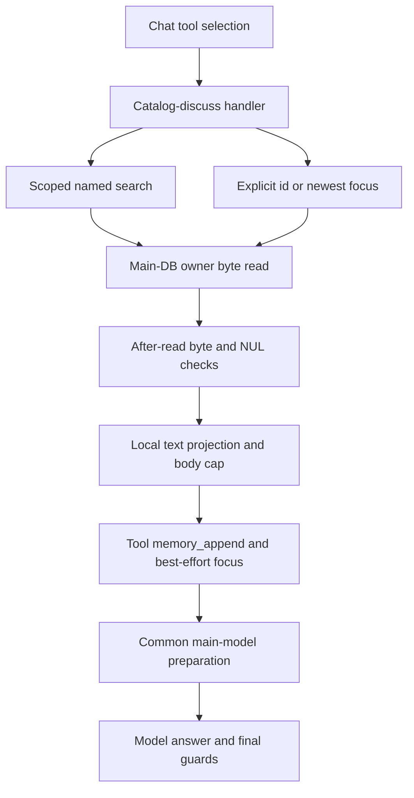

# Companion catalog-discuss read contract

Product technical reference · source review dated 2026-10-11. Catalog-discuss reads document bytes and supplies a bounded text projection to the main-model memory section. It does not edit content, open an editor, produce a durable generation task or prove the final answer accurately summarizes the document.

## Source and data ownership

[Registered handler](../../../shared/api/ewa_platform/companion/orchestration/tools/handlers_files.py) implements catalog_discuss; [registry core](../../../shared/api/ewa_platform/companion/orchestration/tools/registry_core.py) dispatches it and extracts the `(block, unified_content_id, file_label)` helper tuple. The older tool_registry import path is a re-export. [catalog_file_discuss.py](../../../shared/api/ewa_platform/companion/storage/catalog_file_discuss.py) owns intent predicates, catalog resolution, byte reads, normalization and the prefetch skip predicate.

Content catalog/storage use the **main application** pool and unified_content. `_resolve_main_pool` uses the context pool when present, otherwise the application database manager. The companion profile/focus ring uses the separate EWA pool. Passing EWA_DATABASE_URL's pool to the unified-content reader is not interchangeable with the main pool. The focus-opinion caller's pool boundary remains an independent integration check; no real DB acceptance was performed here.

Named searches call [catalog_pick_owner_row](../../../shared/api/ewa_platform/companion/storage/catalog_pipeline.py): extract/normalize a phrase, try filename/stem variants, request compact owner-only EwaFile rows (45 per variant), deduplicate ids, prefer document-like rows and apply the shared picker. A single merged result can be used when the picker returns no result; multiple unresolved candidates return no injection. Missing/invalid ids also return no injection. This is heuristic selection, not guaranteed exact-name matching or an interactive disambiguation response.

[Workspace helpers](../../../shared/api/utils/ewa_companion_folder.py) request folder_item_id=ewa_file and owner_only=true. The [list SQL](../../../shared/api/services/unified_content/content_storage_list.py) includes ewa-task-% rows for that root query. Owner-only listing excludes general public/shared access conditions; alternate owner ids remain a query compatibility input. Body reading separately checks its supplied content owner and does not retry an alternate owner on denial.

## Input paths and gates

All handler paths require a nonempty catalog user and the discuss feature gate. There is no dedicated catalog-discuss HTTP endpoint here; the registered tool is selected through companion chat/orchestration/other dispatchers, with the enclosing authentication contract documented in [chat phases](EWA-COMPANION-CHAT-TURN-PHASES.md).

- Ordinary named input needs a recognized discuss/read/summarize/analyze/find verb and a resolvable file reference. A full-replace/rewrite predicate takes precedence. A bare filename is insufficient.
- Ordinary deictic input needs a recognized discuss verb, an “его/её/it/this” cue and an existing valid file-focus stack, without a named file reference. It uses the newest focus entry.
- Router bypass requires file_query or unified_content_id. A direct id without file_query goes straight to the byte reader; with a query it uses [resolve_file_target](../../../shared/api/ewa_platform/companion/orchestration/flows/catalog_resolve.py). Explicit ids and deictic focus in that resolver do not execute a fresh catalog query.

UUID parsing and owner checks apply to direct byte reads. **EwaFile folder membership is not rechecked for direct ids/focus reads** (DOC-CODE-060). A file moved outside EwaFile can remain readable to its owner through these paths. This is a workspace-boundary gap, not cross-owner access: the actual storage method denies a different owner. The older claim that every tool read can only reach EwaFile was unsupported.

## Storage read and text projection

[ContentStorageService.read_file_bytes_for_owner](../../../shared/api/services/unified_content/content_storage_service.py) selects a non-deleted row by id, verifies user_id equals the supplied owner, resolves its storage backend and retrieves the complete body. Metadata includes name/MIME/original filename/type/size, without folder id. No content mutation, semantic index or extracted_text read is used by this method.

The discuss reader then checks nonempty bytes and the download-byte limit, rejects NUL in the first 4096 bytes, and calls [normalize_text_document](../../../shared/api/services/doc_editor_text_normalizer.py). Markdown/text/HTML are locally projected; UTF-8 decoding replaces invalid chunks and supports BOM. Optional HTML/Markdown dependencies have local fallbacks. This path does not invoke Tika or a PDF/DOCX extractor.

The current byte limit is an **after-read acceptance check**, not a streaming download/memory cap: a full oversized body has already been returned before rejection (DOC-CODE-061). NUL detection is not comprehensive binary validation. A NUL-free PDF can be decoded as raw syntax and injected as document text (DOC-CODE-063). Normalized empty/whitespace text still produces a nonempty metadata/directive block (DOC-CODE-062), so block presence alone is insufficient evidence of usable document content.

The projection takes markdown or plain_text, strips it and clips it to the configured character cap with an ellipsis and truncation notice. The memory block contains a RU/EN server-read heading, a directive to answer from the body despite a missing desktop editor window, file label/id and a fenced body. The cap applies to the body, not the total block/prompt. It is a per-turn excerpt, not permanent long-term memory ingestion. The Russian preface still says full text even when truncation is noted later; consumers must use the explicit excerpt boundary.

## Settings defaults and limits

Distinguish direct-helper fallback from seeded catalog defaults. [Settings bootstrap](EWA-PLATFORM-SETTINGS-DB.md) can synchronize environment values and install its cache-backed getenv shim. Source defaults are not proof of current PG/environment/deployment values.

- EWA_COMPANION_CATALOG_DISCUSS_ENABLED: absent direct environment value enables the helper; explicit 0/false/no/off disables it. The [settings catalog](../../../shared/api/ewa_platform/settings/catalog_entries.py) seed default is **0**.
- EWA_COMPANION_CATALOG_DISCUSS_MAX_CHARS: direct fallback **24000**, clamp **2000–180000**; catalog seed **8000**.
- EWA_COMPANION_DOC_BODY_MAX_DOWNLOAD_BYTES: direct fallback **4000000**, clamp **10000–20000000**; catalog seed **5242880**. Oversize checking occurs after retrieval.
- EWA_COMPANION_DEGRADE_DEBUG: enabled by default, explicit false values suppress additional debug calls. Its [helper](../../../shared/api/ewa_platform/companion/observability/degrade_log.py) uses the settings accessor; the logger must also enable DEBUG for output to be visible.

The old unqualified “on / 24000” operational defaults were inaccurate for seeded settings. Prompt/capacity tuning remains environment-specific; increasing a cap is not evidence of adequate inference memory.

## Result, fallback and focus

Successful handler output is a ToolResult with tool=catalog_discuss, status=memory_append, reply empty, actions empty and task_run null. Data includes memory_section_append, orchestration_branch=catalog_discuss, unified_content_id and file_label. The orchestrator's adapter returns continue_main_llm with memory/branch; the separate tuple helper retains the id/label for compound downstream steps.

The handler attempts [companion_record_file_focus](../../../shared/api/ewa_platform/persistence_pg/companion_asyncpg.py) when an EWA pool exists. The transaction appends a validated id/name/source/time row, keeps the newest five entries and updates profile updated_at without a companion_revision/audit bump. False returns are ignored and exceptions are logged: read success does not guarantee a persisted future focus target. [Focus parser](../../../shared/api/ewa_platform/companion/sidecar/file_focus.py) validates UUIDs and uses newest-last; it does not prove current folder/location or body availability.

Undefined schema, permission/missing-content, retrieval errors, empty/oversized bytes and initial NUL return no block with source-specific logs. Ordinary named/deictic augment exceptions are caught by the handler and return None. Main-pool resolution is outside that catch; bypass query exceptions can reach the registry boundary, which turns handler exceptions into status=error. A returned None permits later routing/model processing; it is not a guaranteed user-facing “file not found” response.

Compound/read-open and named/deictic file-study use the registry tuple helper. Focus-only file-study fallback and opinion refresh call lower-level readers. The registry is therefore the common named/deictic compound dispatch entry, while documented direct-reader callers remain. Actual precedence and deferred queue limits are in [multi-intent/TurnPlan](EWA-COMPANION-MULTI-TASK-ORCHESTRATION.md).

## Prefetch and main-model integration

[prefetch_catalog_find_bundle_for_turn](../../../shared/api/ewa_platform/companion/turn/phases/catalog_prefetch.py) skips list/find appendix when memory_append is nonempty, branch is catalog_discuss/compound_file_chain/file_study_compose, or named/deictic discuss intent matches. The branch test does not require a successful body read; any nonempty memory append also suppresses this appendix. Otherwise the helper needs a catalog id and available query service and builds the separate list/find bundle with profile preferences.

The skip predicate currently ignores the discuss-enabled gate. With discuss disabled, an otherwise matching find/read request can still suppress the potential catalog-find fallback (DOC-CODE-064). Skipping redundant grounding is an implemented predicate, not a guarantee that every turn has one successful grounding source.

[Main preparation](../../../shared/api/ewa_platform/companion/turn/phases/main_llm_prepare.py) invokes prefetch, merges deferred memory and adds FINAL_REMINDER__catalogue_body_in_memory when the heading marker exists. Both sync and stream main-model paths use this common preparation. That reminder overrides misleading desktop-window absence; it does not validate usable body, protect against every model fabrication or establish overall prompt-budget compliance.



## Observability and verification

INFO/WARNING/ERROR prefixes identify ambiguous resolution, skip/denial/schema/retrieval, injection and handler failure; debug companion_degrade contexts identify finer resolve/read/augment/focus/registry reasons. Debug-default enabled does not override logger level. Review logging through the environment's normal observability tools; host/container identities belong only to [production topology](../../platform/PRODUCTION-TOPOLOGY-STATE.md).

Existing catalog/focus/scope/degrade selection: **31 passed, one test deselected**. Four selected registry catalog-discuss cases: **4 passed, 110 deselected**. The initial selection stalled in test_resolve_catalog_discuss_memory_inject_delegates and was interrupted: its monkeypatch changes the re-export while the resolver calls registry_core's local dispatch (DOC-CODE-065). This test is not a pass and the initial attempt is not counted as an isolated no-network check. The safe repeat and ephemeral probes use mocked dependencies; no live schema/storage/provider acceptance was completed.

Actual reader/handler/storage-method probes with synthetic DB/backend objects confirmed outside-folder owner read and foreign-owner denial, after-read oversize rejection, empty projected body, raw PDF injection and disabled-discuss prefetch suppression. They do not establish production frequency, complete storage-backend behavior or final model output. No application/test/configuration change was made.

From the repository root, the completed bounded selection was:

```bash
PYTHONPATH=shared .venv/bin/python -m pytest -q -o cache_dir=/tmp/eliteew-documentation-pytest shared/api/tests/test_ewa_companion_catalog_discuss_wave_c.py shared/api/tests/test_companion_catalog_file_discuss.py shared/api/tests/test_ewa_companion_degrade_log.py shared/api/tests/test_ewa_companion_file_focus.py shared/api/tests/test_ewa_companion_catalog_scope.py -k 'not test_resolve_catalog_discuss_memory_inject_delegates'
```

Full filename/ambiguity/alternate-owner selection, actual folder moves, supported binary extraction, backend streaming caps, ACL integration, enabled/disabled fallback, complete answer quality and concurrent focus persistence remain pending acceptance. [File catalog](EWA-COMPANION-FILE-CATALOG.md) retains its own broader create/rename/delete/folder/mission review; [code findings](../../../docs/CODE_ISSUES.md) track confirmed defects separately.
