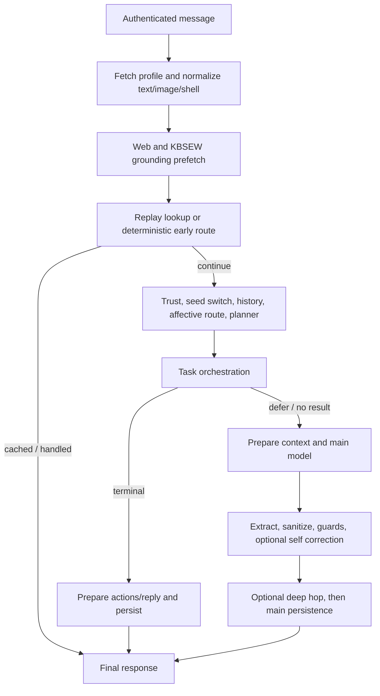

# EWA companion chat turn phases and delivery contract

Source contract review: 2026-10-11. [chat_turn.py](../../../shared/api/ewa_platform/companion/turn/chat_turn.py) coordinates sync JSON and SSE through shared phase helpers. Its current 434-line size is an inspected tree fact, not a deployment/refactor acceptance criterion. This guide covers turn composition, message/stream boundary, persistence and delivery differences; task-run administration, workflow engines, vision/OCR internals and complete tool contracts have separate review scopes.

## Message and stream HTTP boundary

[Router](../../../shared/api/ewa_platform/gateways/routers/companion_chat.py), [models](../../../shared/api/ewa_platform/schemas/pydantic/companion_chat.py):

- `POST /api/v1/ewa/companion-chat/message` → typed JSON `CompanionChatMessageOut`.
- `POST /api/v1/ewa/companion-chat/stream` → `text/event-stream`, using the same `CompanionChatMessageIn`.

Both require OAuth identity, application content-user resolution (`get_current_user_db_id`) and application DB session dependency. The handler derives principal from auth and reads the EWA pool from app state. Token extraction supplies downstream bearer context; body cannot select another principal. Missing EWA pool → structured 503 before constructing the stream.

Request example (profile already initialized):

```json
{"message":"Review my current notes","shell_context":null,"image_attachment":null,"use_web_search":false,"client_turn_id":"example-turn-1"}
```

| Field | Request validation / behavior |
|---|---|
| `message` | String, default empty, max 12000. A nonblank message or image attachment is required (`message_or_image_required`). Turn normalization truncates text to 8000 before its downstream use; HTTP acceptance is not a 12000-character retention promise. |
| `image_attachment` | Optional `{mime_type, data_base64}`; nonempty MIME max 64, nonempty base64 string max 6000000. Model length validation does not alone validate actual image bytes/type/vision availability. |
| `shell_context` | Optional object; schema_version integer default 1, optional client_surface desktop/mobile/embedded, active desktop/window ids max 128, at most 40 typed windows. Version is not a Literal-1 model constraint. |
| Window row | Required window_id 1–128; app component max 96, title 256, z index 0–2000000, minimized false, optional desktop id max 128, excerpt/selection/listing each max 4000. Shared shell normalizer applies further sanitization. |
| `use_web_search` | Boolean default false. [Grounding prefetch](../../../shared/api/ewa_platform/companion/turn/web_search_prefetch.py) owns query/status/budget/KBSEW integration; it is not permission for every tool. |
| `client_turn_id` | Optional string max 128; normalized by trim/cap. Blank skips replay caching. Its scope is authenticated principal + id, not request-body hash. |

Body/model violations → 422. Sync missing profile → 404; other ValueError → 400 with its text. Disabled chat LLM → the dedicated structured 503. RuntimeError otherwise → 502 `companion_chat_failed: <code>`; main revision conflict/missing-after-conflict are in that branch rather than HTTP 409. Unhandled exception types/storage/model construction can still become server errors. Shared auth/content-user/database dependencies have their own failures, not all translated by this handler.

Sync output requires reply and companion_revision >=1. Optional/defaulted fields: actions array, task_run map/null, transformed flag/kind, desktop-config-apply flag, turn-plan hint/tool/source, output_surface, typed surface_blocks, execution_reports, orchestration_outcome and proactive_suggestion. The exact typed model governs serialization. `tool_trace` and `web_search_result` are produced by helpers but currently dropped from sync response validation: [DOC-CODE-024](../../../docs/CODE_ISSUES.md#doc-code-024--synchronous-chat-response-drops-produced-web-and-tool-trace-fields). Do not use a raw builder dict as the JSON wire specification.

For stream, profile-not-initialized/chat-disabled become terminal SSE errors after HTTP stream construction; validation/auth/pool dependencies can fail before it. Most post-entry HTTP/model/type/runtime failures are represented by `companion_chat_llm_http_failure`; uncaught generator failures are handled by the outer terminal wrapper. An HTTP 200 stream can therefore contain an error outcome.

## Shared flow



[Entry phase](../../../shared/api/ewa_platform/companion/turn/phases/turn_entry.py) normalizes shell/text and resolves attached image through multimodal data URL or OCR fallback according to vision gates. Replay lookup and deterministic pre-LLM routing occur **after** image/grounding preparation; cached retries can still repeat that work: [DOC-CODE-026](../../../docs/CODE_ISSUES.md#doc-code-026--chat-grounding-runs-before-a-replay-cache-hit-is-checked). Chat LLM's master gate is checked even for an otherwise deterministic/cache-eligible turn.

[Bootstrap](../../../shared/api/ewa_platform/companion/turn/phases/turn_bootstrap.py) applies trust/Arlika transitions, optional explicit friendly-mode switch, loads normalized stored history and appends the current user row in memory. History accepts only user/assistant rows with string content, truncates each to 8000 and retains 240 messages. It loads recent episode snippets, computes affective routing and runs an optional intent planner/task orchestrator. Hostile quarrel and image turns skip normal task orchestration. The internal sync `surface=esp_display` entry also skips desktop planner/orchestration; ordinary message HTTP does not expose that as a body field.

[Defer parser](../../../shared/api/ewa_platform/companion/turn/phases/orchestration_defer.py) distinguishes terminal result, `continue_main_llm`, and absent result. Deferred data includes memory append, sidecar actions, catalog appendix, branch and turn-plan hint/tool/source. A defer can influence the later model/context/actions; it is not an already-completed tool.

### Terminal orchestration path

[Shared short-circuit](../../../shared/api/ewa_platform/companion/turn/phases/orchestration_terminal_shortcircuit.py):

1. [Prepare](../../../shared/api/ewa_platform/companion/turn/phases/orchestration_terminal_prepare.py): sanitize actions, strip unjustified app/config proposals, expand/apply allowed desktop-config actions, shape/guard visible reply.
2. [Persist](../../../shared/api/ewa_platform/companion/turn/phases/orchestration_terminal_persist.py): append assistant transcript, bounded LP memory/character/action/condensation/evolution updates, optimistic profile patch, optional episodic scheduling.
3. Enrich final with protocol/turn/result surfaces; sync finalizes/caches, SSE emits its terminal sequence and caches.

Sync chooses `revision_conflict_mode: fetch_fallback`: a failed patch fetches the newer profile and returns OK without re-merging this turn. SSE chooses fail and emits a conflict error. A sync reply/revision therefore does not always prove its transcript was stored: [DOC-CODE-029](../../../docs/CODE_ISSUES.md#doc-code-029--synchronous-terminal-conflict-fallback-can-lose-the-chat-turn). Tools/config changes can already have occurred before this conflict. The path is not one transaction spanning external tools, profile, vectors, task events and replay cache.

### Main-model path

[Sync pipeline](../../../shared/api/ewa_platform/companion/turn/phases/sync_main_llm_turn.py) and [stream pipeline](../../../shared/api/ewa_platform/companion/turn/phases/stream_main_llm_turn.py) share:

1. [Prepare](../../../shared/api/ewa_platform/companion/turn/phases/main_llm_prepare.py): catalog prefetch/skip gates, context controller, HCM recall (unless lightweight path), deferred memory append, ground truth/condensed/anchor/plan/calendar/active-run/meta blocks, persona/style/character/tool/action instructions and HTTP message history. Hostile/quarrel history shaping differs from retained UI transcript.
2. [Invoke](../../../shared/api/ewa_platform/companion/turn/phases/main_llm_stream_llm.py): OpenAI-compatible completion, visible-channel scrub; stream JSON/document-replacement handling is separate.
3. [Post-extract](../../../shared/api/ewa_platform/companion/turn/phases/main_llm_post_extract.py): visible text, MEMORY/ACTIONS or structured fields, server-augmented file/catalog/defer data.
4. [Finalize](../../../shared/api/ewa_platform/companion/turn/phases/main_llm_finalize.py): allowlist/surface intent gates, config execution, visible-reply truth/Arlika/fallback guards and optional self-correction. [Action catalog](../../../shared/api/ewa_platform/docs/EWA-APP-DRIVER-CATALOG.md) separates server work from client shell execution.
5. [Optional deep hop](../../../shared/api/ewa_platform/companion/turn/phases/deep_research_hop.py): default-off `EWA_DEEP_LLM_ENABLED`, skipped for lightweight turns; awaited research note without replacing visible answer, best-effort episodic kind deep_research. It runs before final persistence/delivery completion and can add latency; it is not fire-and-forget background work.
6. [Persist and enrich](../../../shared/api/ewa_platform/companion/turn/phases/main_llm_persist.py): transcript cap, memories/character/actions/condensation, optimistic patch, evolution/episodic scheduling, protocol output. On conflict it fetches the current row, rebuilds the merge and retries once; missing/second conflict propagate distinct outcomes. It does not rerun the main answer or every already-executed tool.

[Memory side effects](../../../shared/api/ewa_platform/companion/turn/turn_memory_sideeffects.py), [HCM](EWA-COMPANION-HCM-MEMORY.md) and [evolution](EWA-COMPANION-EVOLUTION-CANON.md) describe storage/worker limits. Background indexing is not a synchronous completion receipt. Condensed/evolution rolling-window progress defects remain open. Protocol enrichment can fail on malformed timestamps after profile writes; replay-cache write can also fail after the turn persisted.

## Model runtime and prompt budgets

[Runtime resolver](../../../shared/api/ewa_platform/companion/turn/turn_llm_runtime.py) resolves the interactive job-class URL then unified fallback. Model order: nonempty EWA_COMPANION_CHAT_MODEL → EWA_ORCH_LLM_MODEL → unified default → mistral. Source output cap 4096 (256–32000), context 262144 (nonpositive means omit; positive min 2048 and compatibility maximum), timeout 180 seconds (30–600). HTTP options temperature 0.55 and visible-content-only; thinking defaults off, with template enable_thinking false and reasoning_format none. These are source defaults/resolution, not live model/URL acceptance or a whole-turn deadline.

[System budget helper](../../../shared/api/ewa_platform/companion/turn/system_budget.py) has cap 48000 characters (2000–128000) and a separate prioritized assembler. Actual main builder concatenates blocks, applies the persona scope guard and truncates the string; it does **not** use that priority assembler. Wall-clock context is appended after truncation, and image directives can be added afterward. The complete system text can exceed the nominal cap and late instructions can be clipped: [DOC-CODE-030](../../../docs/CODE_ISSUES.md#doc-code-030--final-companion-system-prompt-exceeds-its-declared-character-cap). System-only character limits are not total history/token/context budgets.

## SSE framing, buffering and completion

[Wire helper](../../../shared/api/ewa_platform/companion/turn/turn_llm_runtime.py) writes `event: <name>` and JSON `data`, terminated by a blank line. Payloads include stage, transform, delta (`chunk`), actions, final, done and error; Redis task-lifecycle events share the stream. [Schema documentation](../../../shared/api/ewa_platform/schemas/pydantic/companion_chat.py) describes the union; it is not runtime validation of every emitted event.

Router merges inner turn with principal-scoped Redis task events and approximately two-second keep-alive comments. Redis bridge failure is best-effort; the chat stream ends when its inner turn ends, so it is not a durable subscription for every subsequently completed task. Dedicated operations/run streams have their own ownership/snapshot/reconnect behavior.

Ordinary text currently accumulates the entire upstream model stream before yielding collected deltas: [DOC-CODE-027](../../../docs/CODE_ISSUES.md#doc-code-027--ordinary-sse-chat-buffers-upstream-token-deltas-until-completion). JSON-envelope buffering and non-stream document replacement are intentional separate paths. Do not promise progressive token delivery from the existence of SSE framing alone. Delta text can precede final guards/persistence; final reply is the completed visible-text shape, and an error can still follow earlier display events.

[Terminal wrapper](../../../shared/api/ewa_platform/companion/turn/sse_terminal_contract.py) supplies JSON status streaming/done/error, adds event when absent, preserves comments, converts uncaught generator exceptions into an error, and appends done if no terminal was sent. It observes client disconnection. This is a delivery-serialization safeguard, not a guarantee that a disconnected client receives the terminal event or that all storage/tool effects succeeded. Error is terminal; done's default ok does not certify all auxiliary branches.

## Replay cache and concurrency limits

[Cache helpers](../../../shared/api/ewa_platform/companion/turn/turn_dedup.py) and [SQL](../../../shared/api/ewa_platform/persistence_pg/companion_asyncpg.py) store principal/id response snapshots after final construction. Blank id skips; id lookup does not compare message/shell/image content. Reusing an id for a different request can replay the old answer. It is a completed-response cache, not an atomic in-flight lock; concurrent first requests are not guaranteed exactly-once tool execution.

Source TTL defaults 24 hours, clamp 1–336. Fetch SQL does not check age; purge deletes rows before a cutoff. The [cleanup worker](../../../shared/api/ewa_platform/workers/turn_dedup_cleanup_task.py) has soft/hard limits 120/150 seconds and skips when the EWA worker-pool DSN is unavailable. [Celery beat](../../../shared/api/tasks/celery_app.py) declares `companion-turn-dedup-cleanup` every 60 minutes by default (`EWA_COMPANION_TURN_DEDUP_CLEANUP_INTERVAL_MINUTES`, clamp 1–1440). Expiration depends on successful cleanup; a declared beat entry does not prove a live scheduler/worker executed it.

SSE replay emits optional full-text delta, a reduced final, optional actions and done/idempotent_replay. It loses stored surfaces/turn-plan/protocol/search/trace fields: [DOC-CODE-025](../../../docs/CODE_ISSUES.md#doc-code-025--sse-replay-loses-original-final-response-metadata). Replayed client actions are present; a browser must handle their idempotence separately from avoiding server redispatch.

## Phase module map and extension checks

The phase directory currently has 22 Python files (including its package initializer); detailed source entry points above cover the main chain. Additional helpers:

- [catalog_prefetch](../../../shared/api/ewa_platform/companion/turn/phases/catalog_prefetch.py), [memory_merge](../../../shared/api/ewa_platform/companion/turn/phases/memory_merge.py): source catalog/recall append behavior; [catalog-discuss guide](EWA-COMPANION-CATALOG-DISCUSS.md) retains its separate review scope.
- [action_strip](../../../shared/api/ewa_platform/companion/turn/phases/action_strip.py), [visible_reply](../../../shared/api/ewa_platform/companion/turn/phases/visible_reply.py), [protocol_payload](../../../shared/api/ewa_platform/companion/turn/phases/protocol_payload.py): shared gates/payload shaping rather than new transport entry points.
- [terminal emit](../../../shared/api/ewa_platform/companion/turn/phases/stream_terminal_emit.py): terminal orchestration SSE order.

Changes should compare both channels: early replay/deterministic route; terminal/defer/main branches; image/quarrel/lightweight behavior; field serialization; first-delta timing; revision conflict; partial tool effects; final/error/disconnect; enriched replay. Pure helper tests are narrower than mounted-router, storage/concurrency or live-provider acceptance.

## Verification and operations boundary

Existing selected phase/dedup/termination/system-budget/reply-fallback tests: **49 passed, one SSE merge test deselected**. The initial 50-test attempt was interrupted around merge/transport handling and is not counted as passing. Its mock targets the module rather than the router's imported binding: [DOC-CODE-028](../../../docs/CODE_ISSUES.md#doc-code-028--sse-merge-regression-patches-a-module-instead-of-its-bound-consumer). Identity probe confirmed the wrong binding; no repository test/source was changed.

```bash
EWA_COMPANION_EPISODIC_RERANK_ENABLED=0 PYTHONPATH=shared .venv/bin/python -m pytest shared/api/tests/test_ewa_companion_turn_phases.py shared/api/tests/test_ewa_companion_turn_dedup.py shared/api/tests/test_companion_chat_sse_termination.py shared/api/tests/test_ewa_companion_system_budget.py shared/api/tests/test_ewa_companion_chat_turn_reply_fallback.py -q -k 'not merge_layer_failure' -o cache_dir=/tmp/eliteew-documentation-pytest
```

Pure/mock probes confirmed sync metadata loss, reduced SSE replay, grounding-before-cache ordering, completion-buffered deltas, terminal conflict fallback and complete-prompt overflow. No real model/tool/PG/Redis/production HTTP request or deploy was intentionally used for these probes; the interrupted existing merge test's transport mock was ineffective, and no successful connection was established as audit evidence.

Schema/migration ordering is owned by [migration guide](../../../shared/api/ewa_platform/migrations/README.md), not the old “latest 033/035” phase notes. Source catalog currently runs through 036. Deployment and host state belong to [infrastructure entry](../../platform/INFRASTRUCTURE-SOURCE-GUIDE.md), [topology SoT](../../platform/PRODUCTION-TOPOLOGY-STATE.md) and their still-scoped runbooks. No SSH, schema mutation, container rebuild or release action was executed in this documentation pass.
