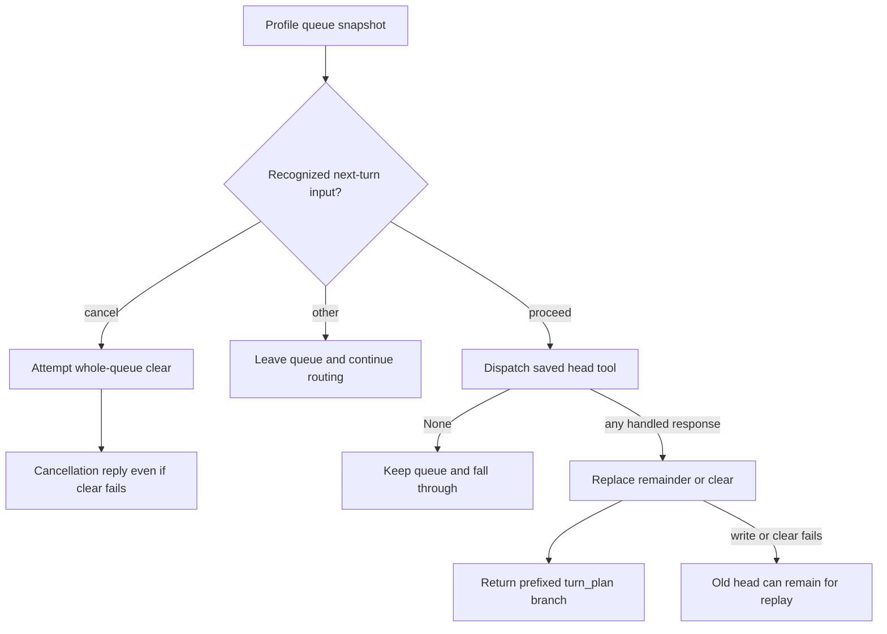

# Companion multi-intent routing and TurnPlan

Product technical reference · source review dated 2026-10-11. This guide describes deterministic branch selection, two implemented compound file forms, deferred lyrics/music and the profile-backed TurnPlan queue. It does not establish arbitrary mixed-domain planning, exactly-once effects, successful generation or universal workflow pause/resume.

## Execution boundaries

[Task orchestrator](../../../shared/api/ewa_platform/companion/orchestration/task_orchestrator.py) returns the first handled response, a `continue_main_llm` response, or `None` for later ordinary chat processing. A handled response can be a failure or missing prerequisite; it is not necessarily a successful effect. There is no general loop that executes every intent joined with “and”. Dedicated compound handling and workflow starters are exceptions with their own narrow contracts.

[Tool dispatch](../../../shared/api/ewa_platform/companion/orchestration/task_orchestrator.py) stops on `ok`, `error`, `needs_confirm`, `unavailable`, `needs_open_editor` and `accepted`. `None`, skipped and other nonterminal statuses fall through. `memory_append` defers only when its memory text is nonempty. A client `open_app` action is a proposal for desktop dispatch, not proof that an editor mounted. A durable task, a confirmation gate, a deferred tool queue and a visible chat answer are different state objects.

The common HTTP, serialization, cache, transcript and main-model phases are owned by [chat-turn phases](EWA-COMPANION-CHAT-TURN-PHASES.md). Preparation can perform storage and grounding before orchestration; only later main-model HCM recall is skipped by a deterministic terminal result. The earlier statement that all grounding happens after orchestration was too broad.

## Actual runtime order

[routing_policy.py](../../../shared/api/ewa_platform/companion/orchestration/routing_policy.py) defines reusable runners and branch lists. The orchestrator calls its pre-tool runner twice, with different no-op hooks, and puts quick-intent bypasses between those calls. Read both source files to determine runtime precedence:

1. First pre-tool pass: pending confirmation; agentic session; completed music resume; completed presentation resume; output-surface request; single-task status; operation cancel/status. TurnPlan/action/chat-workflow hooks are no-ops in this pass.
2. Matched quick-intent workflow route, then registered quick-intent bypass with `_tool_router_bypass_line_match=true`. These can handle a turn before the queued plan is considered.
3. Second pre-tool pass: TurnPlan resume/cancel, action-workflow starter, then chat workflow. The earlier hooks are no-ops; the dedicated reflect-week hook is also a no-op here, while the chat-workflow runner can select reflect-week.
4. Defer-memory pass: compound file chain, file-study/lyrics, file-focus opinion. First non-`None` result returns before ordinary early tool probes.
5. Gated early tool loop, in the sequence shown below.
6. Tool-router dispatch, then a non-chat intent plan at its configured confidence threshold. A plan-like request blocks a planner-selected doc_create here.
7. Plan-like fallback: try plan_v1 when enabled; otherwise return plan_v1_unavailable. Then memory-question lookup, gated late file tools and the missing-open-editor response. Fallthrough returns `None` for chat.

```text
early: check_task_status → plan_v1 → plan_task_complete_v1 → calendar_v1
       → catalog_discuss → social_post_compose → catalog_list → file_rewrite
       → theme_set → music_xl_base_interactive → music_generation_xl_base
       → music_generation → image_generation → presentation_generation
       → music_studio_open → file_open → app_open
late:  file_create → file_rename → file_delete → doc_insert
```

Each early branch also needs its line/feature/tool predicate; an attached image bypasses the ordinary image line predicate. Late probes share one file-operation gate. `file_rewrite` maps to the policy label server_first_v2, and `file_create` to doc_create. The legacy server_first_v2_enabled argument is informational: handler gates decide whether that tool is active.

The exported ORCHESTRATION_PIPELINE_ORDER currently places catalog tools before compound/file-study/file-focus, while the actual defer-memory call runs first. DEFER_MEMORY_BRANCHES is empty metadata. Existing policy tests compare constants or runner fragments and therefore pass despite this full-order discrepancy (DOC-CODE-056). Do not use the exported tuple as a complete runtime trace. Pre-tool hooks accept synchronous or awaitable values; defer-memory hooks are awaited directly. Both stop on a non-`None` result, including an empty mapping.

## Compound file chains

[compound_file_chain.py](../../../shared/api/ewa_platform/companion/orchestration/compound_file_chain.py) accepts a line of at least 12 characters with a recognized separator (`и`, `and`, `потом`, `then`) and an editor-open tail. It splits once. The head must be a recognized discuss/read/summarize or file-list request. This is a heuristic for `discuss_then_open` and `list_then_open`, not a general expression grammar or multi-file DAG.

- `прочитай notes.md и открой в редакторе`: catalog-discuss resolution must return nonempty memory. The resolved content id/label is passed to file-open; its actions become orchestration sidecar actions for main-model continuation.
- `show me the files and open in doc editor`: catalog-list output provides appendix/actions; the open step resolves separately. A list result does not select an arbitrary file by itself.
- `прочитай notes.md, потом открой в редакторе`: a `потом`/`then` cue queues one file_open step instead of executing the open tail now. The queue uses the companion pool; unavailable/exception paths add an explicit not-queued hint and report when enabled.

The deferred branch carries memory/catalog appendix and sidecar actions, with reply initially empty and task_run null. A successful enqueue adds turn_plan_hint, turn_plan_next_tool and turn_plan_source; a detected failure omits next_tool and uses a source ending `_not_queued`. Enqueue currently ignores a `False` persistence return (DOC-CODE-052), so metadata alone is not proof of a stored queue. File-focus recording is best effort. An immediate chain can fail/fall through if read/open resolution returns `None`; no provider/editor/browser acceptance was executed.

The source also returns compound_ack, but [defer parsing](../../../shared/api/ewa_platform/companion/turn/phases/orchestration_defer.py) does not use that field. Visible wording comes from later model/finalization, not that acknowledgement string. Catalog access, file-body selection and ACL details require the separate [catalog discuss](EWA-COMPANION-CATALOG-DISCUSS.md) and [file catalog](EWA-COMPANION-FILE-CATALOG.md) reviews.

## File study, lyrics and deferred music

[file_study_compose.py](../../../shared/api/ewa_platform/companion/orchestration/file_study_compose.py) recognizes document study plus lyrics/text requested in chat. It needs a named file extension, file/document wording or a valid focus stack. An explicit audio-generation phrase without a recognized follow-up split makes this predicate false. For example, `прочитай notes.md и сгенерируй песню` is not this lyrics-first branch.

The implemented mixed form is analysis/lyrics followed by a recognized music clause. It queues music_generation; an autonomous/mood/“сама” cue selects music_generation_xl_base. It does not copy newly generated lyrics into the queued args: the saved music clause is the step's user_line, and later handlers own lyric/context selection. Do not infer identical lyrics or a completed audio artifact from queue creation.

Handling requires a catalog user and the catalog-discuss gate. Named/deictic resolution or focused-file refresh may load memory. Read failures are caught; the branch can still return a compose directive, and can enqueue a follow-up, without loaded document text. Routing recognition is therefore not proof that the file was read. The directive requests analysis and in-chat lyrics while forbidding an immediate audio promise. Queue failure emits a notice and a separate-command instruction.

[turn_context_guards.py](../../../shared/api/ewa_platform/companion/orchestration/turn_context_guards.py) recognizes file-focus opinion/analysis only with an existing focus stack. Explicit open/delete/rename/create/insert/rewrite/generation/list cues reject that opinion predicate. Its suppression helper combines opinion and lyrics-first predicates; media handlers and the tool router call it. Preceding pending/agentic/quick/queue/workflow branches still have their own precedence. An active file focus does not universally prohibit every tool, and regex predicates do not establish semantic intent for every language.

## TurnPlan state and persistence

[turn_plan_v1.py](../../../shared/api/ewa_platform/companion/orchestration/turn_plan_v1.py) stores `learned_preferences.companion_turn_plan_v1` with steps (`tool`, `args`), source capped at 120 characters and created_at as UTC ISO. Enqueue replaces the plan with at most four steps; it does not append to an existing queue. Empty enqueue returns false. Parsing examines only the first four raw rows before skipping invalid/empty-tool rows; it does not validate ids against the tool registry. It reads the supplied profile snapshot, not a freshly claimed queue.

[Profile persistence](../../../shared/api/ewa_platform/persistence_pg/companion_asyncpg.py) locks the profile row in a transaction and replaces/removes this namespace, updating updated_at without bumping companion_revision. A missing profile returns false. These row transactions do not claim a tool step before execution or atomically include its external effect. There is no queue-level expected revision, task id or exactly-once drain guarantee. Profile retrieval later refreshes the client independently.

Proceed/cancel recognition is deliberately narrow but currently not tool-specific:

- Cancel matches anchored RU/EN prefixes such as отмена, отмени, стоп, cancel, stop, не надо, skip step and clear plan. It removes the entire queue, including for “skip step”; it does not cancel an already running task.
- Proceed matches anchored да/ok/continue/продолжай/запускай/дальше/next step/go on forms, or an open/editor cue within 30 characters. The editor cue can resume a queued music step with the saved music line and bypass enabled (DOC-CODE-055); it is not matched against the next tool.
- One next step is dispatched per proceed turn. Stored args preserve their user_line and an explicit false bypass because defaults use setdefault. The current turn line is passed separately to the dispatcher.
- A `None` tool result keeps the queue and falls through. Any non-`None` response consumes the head, including unavailable/error/missing-editor responses and accepted/pending-confirmation responses (DOC-CODE-057). “Consumed” means a response was selected, not successful work.
- Remaining steps replace the queue; a last step clears it. A failed remaining write leaves the old head available for another proceed, permitting repeated selection/effects (DOC-CODE-054). Clear exceptions are swallowed, and Cancel still claims cancellation (DOC-CODE-053).



Failure helpers can create execution reports when the protocol gate is on. The orchestrator's queue wrapper currently omits the outer turn_reports list; queue-specific failure reports can be logged and then lost from the response collection (DOC-CODE-058). Tool reports, persistence logs, queue notices and delivered protocol fields must be checked separately.

## Visible reply and Next step UI

[Truth guards](../../../shared/api/ewa_platform/companion/context/truth_guard_registry.py) remove selected false started/ready/action claims and add a not-started/deferred instruction when appropriate. These are pattern-based text corrections, not proof that every model claim is factual. Deferred music metadata drives the queued-language guard; false-success queue persistence can consequently mislead it. [Main persistence](../../../shared/api/ewa_platform/companion/turn/phases/main_llm_persist.py) carries hint/tool/source in the constructed payload; sync/SSE/replay fidelity has the independent limits recorded in the chat guide.

[Client extraction](../../../shared/web/frontend/src/services/ewa/ewaCompanionChatCoerce.ts) reads all valid step rows from learned preferences (without the backend's four-raw-row cap). [Left-rail controller](../../../shared/web/frontend/src/features/ewa/companionUx/useCompanionLeftRailController.ts) chooses the profile queue head before response hint metadata. A queued badge/button requires actual extracted steps; hint-only responses produce a notice. Raw hints are sanitized by [UI helpers](../../../shared/web/frontend/src/features/ewa/companionTurnPlanUi.ts), and tool labels come from localized operation labels rather than raw ids.

[CompanionTurnPlanStrip](../../../shared/web/frontend/src/features/ewa/companionUx/CompanionTurnPlanStrip.tsx) disables its action while chat is pending. Continue submits a new chat line through the parent callback: music tools send запускай/go on; other tools send продолжай/continue. It does not merely insert a draft or call a dedicated queue-drain endpoint. The latest hint state is retained when later responses contain no queue fields, so a notice is not a fresh persistence acknowledgement.

TurnPlan is separate from server plans/calendar and from `ewa_companion_task_runs`/steps. Durable task Confirm/Cancel/revisions and stream delivery belong to [operations](EWA-COMPANION-OPERATIONS-PANEL.md). V1 action/chat, personal declarative workflow and DAG v2 schemas have different supported execution paths: [registry](EWA-COMPANION-WORKFLOW-REGISTRY.md), [personal workflows](EWA-COMPANION-USER-WORKFLOWS.md), [DAG engine](EWA-COMPANION-WORKFLOW-ENGINE-V2.md). There is no generic revise-step contract established here. Deployment identities belong to [production topology](../../platform/PRODUCTION-TOPOLOGY-STATE.md); this guide contains no host inventory.

## Verification and remaining checks

Existing backend routing/queue/compound/file-study/focus selection: **42 passed**. Separate visible-reply/truth-guard selection: **10 passed**. The queue/parser tests are mostly pure; executor checks use mocked pools/dispatch. Ephemeral actual-function probes confirmed false enqueue success, false cancellation, repeated head selection after drain-write failure, editor input selecting music, unavailable consuming a step, policy/runtime order drift and the queue-report integration gap. No real database, content write, broker, provider or app lifespan was used.

Three existing frontend helper/strip/controller suites: **11 passed, 1 failed**. The strip's immediate assertion ran before lazy marketing namespace resolution; an isolated repeat failed the same way. Running the unchanged two strip tests through ephemeral setup awaiting i18nReady and marketing load gave **2 passed** (DOC-CODE-059). This isolates a test-readiness defect; it is not evidence that product strip mounting failed. That temporary config emitted a Vite native-loader path-extension warning. No repository config/test/source was changed.

From the repository root, the bounded backend selection used the existing environment and redirected pytest cache:

```bash
PYTHONPATH=shared .venv/bin/python -m pytest -q -o cache_dir=/tmp/eliteew-documentation-pytest shared/api/tests/test_companion_turn_plan_v1.py shared/api/tests/test_companion_compound_file_chain.py shared/api/tests/test_companion_file_study_compose.py shared/api/tests/test_companion_turn_context_guards.py shared/api/tests/test_routing_policy_pipeline.py shared/api/tests/test_routing_policy_orchestrator.py shared/api/tests/test_ewa_companion_routing_policy.py
```

End-to-end compound file ACL/body selection, competing queued/confirmation/quick/workflow requests, concurrent drain/cancel, actual editor actions, final queue/transcript delivery and generated music remain unverified. Re-run success and failed persistence cases through authorized integration environments before claiming durable or exactly-once chains. Open defects are in the [append-only code log](../../../docs/CODE_ISSUES.md); this documentation change does not fix them.
