# Assistant · visible reply formatting

**Статус:** Канон  
**Обновлено:** 2026-07-26

Как сырой вывод LLM превращается в **user-visible prose** в чате спутника: JSON envelope, memory/actions tails, guards от утечек.

---

## Контракты модели

Модель может отвечать тремя способами (приоритет сверху вниз):

### 1. JSON envelope (structured)

```json
{"visible_reply":"<prose>","memory":[...],"actions":[...]}
```

Парсер: `extract_visible_reply_memory_actions` → `json.loads` или loose extract при битом JSON.

### 2. Канонические tails (legacy)

```text
Visible prose here.
<<MEMORY>>[{"type":"fact","content":"…","importance":0.5}]<<END>>
<<ACTIONS>>[{"type":"focus_app","app_component":"DocEditor"}]<<END>>
```

### 3. Битые tails (malformed)

Модель иногда сокращает delimiters:

```text
Prose. <>[{"type":"fact","content":"…","importance":0.5}]<
```

**Fix 2026-05-25:** `control_tails.py` + расширенные `parse_memory_tail` / `parse_actions_tail`.

---

## Pipeline (sync + SSE)

```mermaid
flowchart LR
  LLM[HTTP LLM response]
  Extract[extract_visible_reply_memory_actions]
  Mem[parse_memory_tail]
  Act[parse_actions_tail]
  Guards[apply_companion_visible_reply_guards]
  Strip[strip_internal_companion_markup]
  Coerce[_coerce_visible_reply_for_turn]
  UI[EwaCompanionChatPanel]

  LLM --> Extract --> Mem --> Act --> Guards --> Strip --> Coerce --> UI
```



| Шаг | Модуль |
|-----|--------|
| Extract envelope + tails | `companion/ux/reply_extract.py` |
| Memory tails | `companion/memory/hcm_store.py` — `parse_memory_tail` |
| Action tails | `companion/actions/allowlist.py` — `parse_actions_tail` |
| Malformed `<>[…]<` | `companion/ux/control_tails.py` |
| Anti-meta, strip markup + Gemma channel tokens | `companion/context/noise.py` (`strip_llm_channel_markup`) |
| Blank reply fallback | `companion/turn/chat_turn.py` — `_coerce_visible_reply_for_turn` |
| SSE token scrub (accumulated) | `companion/turn/phases/main_llm_stream_llm.py` |
| FE defensive scrub | `features/ewa/companionVisibleReplySanitize.ts` |

---

## Invariants

- Парсеры **никогда не raise** на битом LLM output — WARN log + drop.
- Memory rows persist server-side (`companion_memory_v1`) даже когда tail срезан из visible text.
- Action-only payloads в malformed блоках не попадают в memory (`_body_is_action_only`).
- `strip_internal_companion_markup` — последняя линия обороны в guards.

---

## Симптомы и диагностика

| Симптом в UI | Вероятная причина | Fix layer |
|--------------|-------------------|-----------|
| `<>[{"type":"fact"` в bubble | Malformed memory tail | `control_tails` (fixed) |
| Целый JSON `{visible_reply:…}` | Envelope не распарсился | `reply_extract` loose extract |
| `[identity]` строки | Internal markup | `noise.strip_internal_companion_markup` |
| `<\|channel>thought` / `<channel\|>` в bubble | Gemma 4 Canonical prefill при `enable_thinking=false` | `strip_llm_channel_markup` в `noise` + SSE accum scrub + FE sanitize (2026-07-26) |
| Пустой bubble при actions | Blankish coerce | `_coerce_visible_reply_for_turn` |

Логи: `companion_chat_memory_parse_failed`, `companion_reply_json_probe_failedchars`.

---

## Тесты

| Файл | Сценарий |
|------|----------|
| `tests/test_ewa_companion_reply_extract.py` | JSON envelope, legacy tails, malformed `<>` |
| `tests/test_companion_visible_reply_guards.py` | strip markup + malformed tail |
| `tests/test_ewa_companion_channel_markup_scrub.py` | Gemma channel prefill leak |
| `tests/test_ewa_companion_character_memory.py` | `parse_memory_tail` unit |
| FE `companionVisibleReplySanitize.test.ts` | envelope + channel scrub |

---

## Связанные документы

- [EWA-COMPANION-PROFILE-ADR.md](EWA-COMPANION-PROFILE-ADR.md) — `companion_memory_v1`
- `documentation/plans/product/ewa/EWA-COMPANION-CONTEXT-ANCHOR-ROLLOUT.md` *[operator-local process plan; gitignored — not living canon]* — guards
- [EWA-COMPANION-CHAT-TURN-PHASES.md](EWA-COMPANION-CHAT-TURN-PHASES.md)
- [EWA-COMPANION-USER-WORKFLOWS.md](EWA-COMPANION-USER-WORKFLOWS.md)
