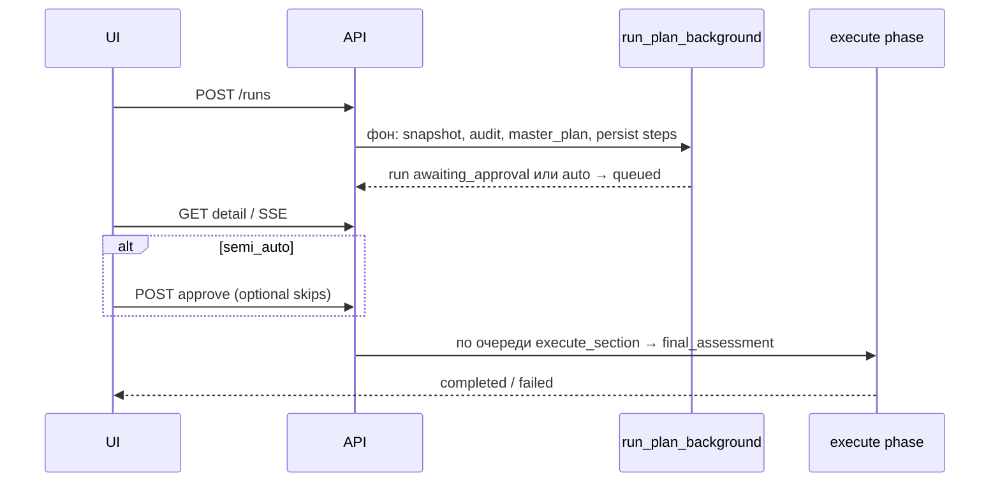

# AMKA — полный справочник (EliteEW · маркетинговый кабинет)

**AMKA** (audited marketing knowledge assistant / staged-аудит проекта) — серверный оркестратор: **аудит разделов кабинета → master plan → [одно согласование оператора] → пошаговое исполнение → финальная оценка**. Он **не** является отдельным типом ИМК (`imc_rag_*`) и **не** заменяет произвольный CRUD кабинета; переиспользует **project context**, **маркетинговый RAG**, **автозаполнение по проекту**, **ImcService** и **mutation-слой кабинета**.

**Граница контуров (обязательно):** этот справочник — только **маркетинговые прогоны** (`/api/v1/marketing-cabinet/amka/*`, таблицы `marketing_amka_*`).  
**EWA-платформа** (`shared/api/ewa_platform/`, UI **`EwaApp`** / `src/features/ewa/`, HTTP **`/api/v1/ewa/*`** включая `desktop-orchestration`) — **другой продукт**. Таксономия: [../ewa/EWA-VS-AMKA-TAXONOMY.md](../ewa/EWA-VS-AMKA-TAXONOMY.md); таблица контуров: [../amka-seed-album/AMKA-CONTOURS.md](../amka-seed-album/AMKA-CONTOURS.md).  
Retired DEWA и прочие soft-retire деревья — не living путь кабинета.

**Связанные документы (углубление по подтемам):**

| Документ | Содержание |
|----------|------------|
| [README.md](README.md) | Хаб каталога marketing/ и живые пути |
| [amka/README.md](amka/README.md) | **Техническая фактура по файлам:** инструменты tool-agent (`agent-tools/`), модули `amka_*.py` (`modules/`), HTTP, схемы |
| [../amka-seed-album/README.md](../amka-seed-album/README.md) | **Seed / видение драйверов** (не runtime кабинета) |
| [../amka-seed-album/RFC-001-amka-driver-contract.md](../amka-seed-album/RFC-001-amka-driver-contract.md) | Черновик контракта AMKA core / driver / trace / pulse |
| [../amka-seed-album/AMKA-STANDALONE-LAYER-MAP.md](../amka-seed-album/AMKA-STANDALONE-LAYER-MAP.md) | Карта слоёв standalone-компонента |
| [../amka-seed-album/AMKA-CONTOURS.md](../amka-seed-album/AMKA-CONTOURS.md) | Маркетинговая AMKA vs EWA (`/api/v1/ewa/*`) |
| [../amka-seed-album/AMKA-ENTRYPOINTS.md](../amka-seed-album/AMKA-ENTRYPOINTS.md) | Карта HTTP-входов |
| [AMKA-AUDIT-WORKFLOW.md](AMKA-AUDIT-WORKFLOW.md) | Workflow, логи, runbook, SSE, права, ИМК-шаги, reconcile графа |
| [amka/modules/module-amka-phase-audit.md](amka/modules/module-amka-phase-audit.md) | Фаза аудита разделов (baseline + LLM + RAG) |
| [MARKETING-CABINET.md](MARKETING-CABINET.md) | Кабинет в целом, навигация |
| [marketer-analysis-review/06-amka.md](marketer-analysis-review/06-amka.md) | Краткий чеклист для маркетолога |
| [MARKETING-CABINET-PROMPTS-REFERENCE.md](MARKETING-CABINET-PROMPTS-REFERENCE.md) | Промпты по смыслу секций |
| [IMC-MISO-ARCHITECTURE.md](IMC-MISO-ARCHITECTURE.md) | ИМК vs UGS vs MISO |
| [MARKETING-PROJECT-RAG.md](MARKETING-PROJECT-RAG.md) | RAG проекта, лимиты чанков |

Кодовый префикс HTTP: **`/api/v1/marketing-cabinet/amka`**. Роутер: `shared/api/routers/marketing_cabinet/amka.py`. Фасад сервиса: `shared/api/services/marketing_cabinet/amka_service.py`.

Пользовательский вход: **Marketing Cabinet → проект → вкладка AMKA** (`MarketingCabinetAmkaView` → `src/features/amka/AmkaView.tsx`).  
Окно **`EwaApp`** на столе — **EWA**, не этот сценарий.

| Слой | Living path (маркетинговый контур) |
|------|-------------------------------------|
| UI вкладки | `shared/web/frontend/src/features/amka/` (`AmkaView` parent ≤800 LOC + `amkaView/*` modules; `MarketingCabinetAmkaView` alias; builder/presets unchanged) |
| Re-export pages | `.../pages/MarketingCabinet/views/AmkaView.tsx` (только re-export) |
| FE bridge типов/API | `.../services/amka/marketingCabinetAmkaBridge.ts` → `marketingCabinetApi` |
| HTTP run lifecycle | `/api/v1/marketing-cabinet/amka/*` |
| Backend phases/store | `shared/api/services/marketing_cabinet/amka_*.py` (glob under `shared/api/services/marketing_cabinet/`) |
| Driver/engine (shared) | `shared/api/services/amka_core/` (`MarketingCabinetAmkaDriver` делегирует в `AmkaService`) |

`src/services/amka/amkaFacadeApi.ts` и префикс **`/api/v1/ewa/ugs/...`** — UGS admin alignment на **контуре EWA**, не вкладка кабинета.

---

## 1. Назначение и инварианты

1. **Один прогон = одна запись `marketing_amka_runs` + упорядоченный список `marketing_amka_run_steps`.**
2. **Планирование** (фоновая задача) строит шаги **`section_audit`**, затем **`master_plan`**, затем очередь **`execute_section`** и заготовку **`final_assessment`** (см. `amka_phase_plan.py`).
3. **Запись в сущности кабинета** идёт **только** через обозначенные пути: `AmkaMutationService`, **async project generate** (дочерние `marketing_ai_runs`), **IMC** (`imc_research_runs` / UGS), **прямой upsert сводки заказчика**. AMKA не «пишет SQL в таблицы стратегии» в обход этих сервисов.
4. **Граф зависимостей разделов** (`AMKA_SECTION_DEPENDENCIES` и т.п.) зашит в коде; конструктор оператора его **не** переопределяет.
5. Служебные разделы **AI Studio**, **Контекстный чат**, **Источники RAG** в baseline аудита **не входят** (см. workflow-док).

---

## 2. Модель данных

| Таблица | Роль |
|---------|------|
| **`marketing_amka_runs`** | Статус прогона, `master_plan`, `final_assessment`, `metrics_before` / `metrics_after`, `context_payload`, `approved_at`, режимы `run_mode`, auto-cycle, `preset_id`, текст итога |
| **`marketing_amka_run_steps`** | Пошаговые записи: `stage_kind`, `section_key`, `plan_payload`, отчёты, `applied_entities`, трассы операций |
| **`marketing_amka_operator_config`** | Singleton-конфиг конструктора (глобально на контур), merge с env |
| **`marketing_amka_presets`** | Именованные пресеты проекта (`extra_plan_tasks`) |
| **`marketing_amka_preset_templates`** | Системные шаблоны пресетов |

Миграции (эталон): `20260416_marketing_amka.sql`, `20260429_marketing_amka_operator_config.sql`, `20260430_marketing_amka_presets.sql`, шаблоны пресетов — `20260431_*`, `20260414_*` (категории).

**Статусы прогона** (`AmkaRunStatus` в `schemas/marketing_cabinet/amka.py`):  
`planning` → `awaiting_approval` (semi_auto) или сразу исполнение в auto → `queued` / `running` → **`completed` | `failed` | `cancelled`**.  
Промежуточно: **`awaiting_step_approval`** при `per_step_execution=true` (только с `run_mode=semi_auto`).

**Статусы шага:** `pending`, `running`, `completed`, `failed`, `skipped`.

**Виды шагов (`stage_kind`):** `section_audit`, `master_plan`, `execute_section`, `final_assessment`.

---

## 3. HTTP API (краткий каталог)

Все маршруты под **`GET/POST/PUT/DELETE .../api/v1/marketing-cabinet/amka/...`**. Авторизация: JWT + маркетинговый пул; **`PUT /operator-config`** — `users.is_trusted`; CRUD пресетов — владелец проекта **или** trusted (см. полную матрицу в [AMKA-AUDIT-WORKFLOW.md](AMKA-AUDIT-WORKFLOW.md)).

| Метод | Путь | Назначение |
|-------|------|------------|
| GET | `/operator-config` | stored + **effective** конфиг + **env_caps** |
| PUT | `/operator-config` | Обновление JSON (trusted) |
| GET | `/preset-templates` | Системные шаблоны |
| GET | `/presets?project_id=` | Пресеты проекта |
| POST | `/presets?project_id=` | Создать пресет |
| GET/PUT/DELETE | `/presets/{preset_id}` | Чтение / обновление / мягкое удаление |
| GET | `/project/{project_id}/runs` | Список прогонов + **`poll_after_ms`** + дайджест |
| POST | `/runs` | Старт (тело **`AmkaStartRequest`**) |
| GET | `/runs/{run_id}` | Деталь + шаги + **`overview_health_preview`** + **`pulse`** + **`standalone_projection`** |
| GET | `/runs/{run_id}/core-alignment` | **AmkaCoreEngine** (read-only, `execute=false`): persisted **`master_plan`** → policy + pulse + projection + **`traces`** (лента событий ядра); тяжелее детали — отдельный запрос / без poll |
| GET | `/runs/{run_id}/export.md` | **Серверный** markdown-экспорт; query **`include_core_alignment=true`** — приложить JSON выравнивания ядра и **читаемую секцию трассы** после блока JSON |
| GET | `/runs/{run_id}/events` | **SSE** прогресса (~2 с, `: ping`) |
| POST | `/runs/{run_id}/approve` | Подтверждение плана (`skip_section_keys`, `skip_operation_keys`, `skip_step_ids`) |
| POST | `/runs/{run_id}/resume` | Возобновление / те же skip-поля в `awaiting_approval` |
| POST | `/runs/{run_id}/continue-step` | Следующий шаг при `awaiting_step_approval` |
| POST | `/runs/{run_id}/cancel` | Отмена |

**`GET /runs/{run_id}/core-alignment` — условные запросы:** ответ с **`ETag`** (weak, от `run_id` + `updated_at` + `status` строки прогона) и **`Cache-Control: private, max-age=60`**. Заголовок **`If-None-Match`** с тем же значением даёт **304 Not Modified** без повторной сборки alignment. Клиент Marketing Cabinet (`getAmkaCoreAlignment` / `useAmkaCoreAlignment`) передаёт **`If-None-Match`** при повторном запросе, чтобы снизить нагрузку при обновлении панели. Поле **`traces`** дублирует по смыслу `projection.trace_events`, но вынесено на верхний уровень для UI и экспорта.

**`MarketingCabinetAmkaDriver.act()` (ядро):** по умолчанию не мутирует БД (`executed: false`, `delegated`, текстовый `hint`). Явные мутации — только при **`AmkaPolicyDecision.allowed`** и **`subject.metadata["amka_core_act_operation"]`** ∈ `approve` | `resume` | `continue_step` (делегирование в **`AmkaService`**). Опционально skip-поля в metadata: **`amka_core_act_skip_section_keys`**, **`amka_core_act_skip_operation_keys`**, **`amka_core_act_skip_step_ids`** — строка с запятыми или список строк.

- **`project_id`**, **`company_id`** — обязательны.
- **`scope_key`** — сейчас по сути **`all_visible`**.
- **`user_instruction`** — фокус оператора для аудита/промптов (до 4000 символов).
- **`section_keys`** — узкий поднабор секций; сервер расширяет транзитивными зависимостями.
- **`imc_type_key`**, **`imc_focus`**, **`imc_max_wait_seconds`** — дефолты для ИМК (детали в workflow: semi_auto vs auto).
- **`run_mode`**: `semi_auto` — пауза на approve; `auto` — исполнение после планирования без ручного approve.
- **`per_step_execution`** — пауза после **каждого** `execute_section` (`continue-step`); только с `semi_auto`.
- **`auto_cycle_count`** — несколько полных прогонов подряд в **auto** (1–5).
- **`preset_id`** — пресет **того же** `project_id`.

---

## 4. Жизненный цикл прогона

1. **`create_run`** создаёт строку run и ставит фон **`run_plan_background`** (`amka_phase_plan.py`).
2. Планирование: **`_build_run_snapshot`** → **`_build_section_audits`** → **`build_master_plan`** → запись шагов (`section_audit` завершены сразу, `master_plan` completed, `execute_section` в `pending`).
3. **Semi_auto:** статус **`awaiting_approval`** до `approve` / `resume` с теми же skip-полями.
4. **Auto:** переход к **`apply_plan_and_start_execute`** без ручного подтверждения (см. `amka_run_lifecycle.py`).
5. **Исполнение:** `amka_phase_execute.py` по очереди обновляет шаги; после всех successful/skipped execute — **`final_assessment`** (компактный health до/после + LLM при не слишком длинном промпте).
6. **Reconcile графа стратегии:** перед финалом вызывается **`reconcile_marketing_strategy_graph_for_project`** — см. workflow-док (связи JTBD↔VP, сегменты, кампании).
7. **Pulse artifact:** detail API и серверный `export.md` добавляют `pulse` — короткий человеческий итог по persisted run/steps: что изменилось, что сохранено, где AMKA сомневается, почему no-op может быть верным исходом.
8. **Standalone projection:** detail API и `export.md` добавляют `standalone_projection` — read-only представление run через границу будущего AMKA-компонента (`driver_key`, `domain_profile`, subject, stage counts, trace events).
9. **Смежный контур EWA (не кабинет):** префикс **`/api/v1/ewa`** (каталог драйверов, UGS read-only alignment, desktop orchestration) — см. [AMKA-ENTRYPOINTS.md](../amka-seed-album/AMKA-ENTRYPOINTS.md) и [EWA-VS-AMKA-TAXONOMY.md](../ewa/EWA-VS-AMKA-TAXONOMY.md). Lifecycle маркетингового прогона остаётся только в **`/api/v1/marketing-cabinet/amka/*`**; `POST .../approve`, `resume`, `continue-step`, `cancel` делегируют в `MarketingCabinetAmkaDriver.act()` → `AmkaService` без смены JSON-ответов кабинета.
10. **Фоновые asyncio-задачи** (plan, execute, цепочка auto-cycle после `completed`) регистрируются через `MarketingCabinetAmkaDriver.schedule_background_*` и `amka_driver_background_schedule.py`; перечень ключей и поведение при **`POST .../cancel`** — [AMKA-BACKGROUND-TASK-KEYS.md](../amka-seed-album/AMKA-BACKGROUND-TASK-KEYS.md) (`amka_background_tasks.py`); регрессия отмены — `shared/api/tests/test_amka_run_cancel_background.py`.
11. **Серверный `export.md`:** блок JSON **core alignment** санитизирует `traces[].payload` через `redact_amka_trace_payload` (`amka_run_export_markdown.py`); см. [AMKA-TRACE-EXPORT-GUIDELINES.md](../amka-seed-album/AMKA-TRACE-EXPORT-GUIDELINES.md). Расширенная операторская матрица (SSE, ручной просмотр выгрузки) остаётся опциональной при наличии автотестов.

## 5. Снимок прогона (`build_run_snapshot`)

Файл: `shared/api/services/marketing_cabinet/amka_run_snapshot.py`.

**Что входит в snapshot (главные ключи):**

| Поле | Источник / смысл |
|------|-------------------|
| `run` | Строка `marketing_amka_runs` |
| `health` | `build_project_health` — метрики обзора, issues, gaps |
| `project_context` / `project_context_formatted_text` | `build_project_context` + `format_project_context_for_prompt` |
| `project_context_text` | Базовый контекст + **`merge_project_context_text_with_rag`** (лимит чанков **16**, `min_score` **0.22**), либо reuse при **`AMKA_EXECUTE_REUSE_MERGED_CONTEXT`** |
| `extras` | `fetch_project_extras`: участники, ИМК-счётчики, сводка заказчика, диагностика, дашборды, счётчики RAG/vault |
| `source_catalog` | `_source_resolver` — каталог источников для плана и мутаций |
| `section_entities` | `AmkaMutationService.list_project_entities` — каркас сущностей для плана |
| `user_instruction`, `allowed_sections`, `imc_defaults`, `run_mode` | Из **`context_payload`** прогона |
| `recent_amka_runs_digest` (+ markdown) | История AMKA по проекту |
| `operator_amka` | Effective JSON конструктора |
| `imc_types_catalog` | Активные типы ИМК из **`generation_types`** для промпта плана |

**Оптимизация:** при цепочке `execute_section` часть полей snapshot **переиспользуется** между шагами (`reuse_static`, опционально reuse merged context) — см. workflow-док.

---

## 6. Фаза аудита разделов

Детально: [amka/modules/module-amka-phase-audit.md](amka/modules/module-amka-phase-audit.md) и [AMKA-AUDIT-WORKFLOW.md](AMKA-AUDIT-WORKFLOW.md). Модуль: `amka_phase_audit.py`.

- **Baseline:** `build_section_audits_baseline` — эвристики + health + integrity issues.
- **LLM по разделу:** `enrich_single_section_audit_llm` — RAG с **отдельным** запросом на секцию; цитаты **`work_needed`**; опция отключения LLM (`section_llm_audit.enabled: false`).
- В промпт секции **не** подмешивается long-term **chat memory** — только project context, RAG, дайджест AMKA, health.

---

## 7. Master plan

- **Кандидаты без LLM:** `amka_plan_candidates.py`.
- **LLM-план:** `amka_llm_plan.py` + нормализация в `build_master_plan` (`amka_phase_plan.py`).
- Промпт получает **сжатый** срез сущностей и аудит; **полный** `project_context_text` в промпт плана **не** кладётся (см. workflow).
- Задачи содержат **`operations`** (см. ниже), **`write_policy`**, **`execution_mode`**, для `imc` — **`imc_type_key`**, **`imc_focus`**, **`rationale`**.
- Валидация: одна задача на `section_key` (кроме **нескольких** `imc` с **уникальными** типами), структура `plan_llm_status`, retry/repair — в workflow-док.
- **Пресет:** `extra_plan_tasks` вставляются после `build_master_plan` с валидацией якорей (`insert_after_section_key`).

---

## 8. Исполнение шага `execute_section`

Файл: `amka_phase_execute_section.py`. Решение зависит от **`section_key`**, **`plan_payload.operations`**, **`write_policy`**, **`execution_mode`**.

### 8.1. Ветка `section_key == imc`

1. **`_run_imc_research_for_section`** — тот же контур ИМК, что UI (`ImcService.run_research`), ожидание терминала **`imc_research_runs`** (таймауты из env / operator execute).
2. Опционально **дополнительные `operations`** из плана → **`execute_operations`**.
3. После успешного ИМК возможен **`rag_upsert`** результата в материалы проекта (логи `execute.imc.rag_*`), если текст проходит порог готовности.

### 8.2. `execution_mode == desktop_ensemble` (и не `client_interaction`)

1. **`run_amka_desktop_ensemble_for_project`** (`amka_ensemble_core.py`) — ephemeral Ассистент «Команда»: blueprint ensemble с RAG vault проекта, 1–3 героев (`ensemble_hero_ids`), **`ensemble_template_hint`** → принудительный blueprint (`amka_forced_blueprint_template_id`).
2. Чат создаётся и удаляется в том же запросе; отчёт — markdown assistant-сообщения или SSE-токены.
3. При ошибке ensemble и **`ensemble_fallback_to_tool_agent=true`** (операторский конфиг, default) — fallback на **`marketing_tool_agent`** без падения всего execute.
4. Если в плане есть **operations** — materialize + **`AmkaMutationService.execute_operations`** после отчёта.
5. Логи: **`execute.ensemble.start`**, **`execute.ensemble.done`**, **`execute.ensemble.fallback_tool_agent`**, **`execute.ensemble.stream_failed`**, **`execute.ensemble.empty_output`**, **`execute.ensemble.disabled_downgrade`** (если `desktop_ensemble_enabled=false`).

**UI (маркетинговый кабинет):** карточка шага AMKA показывает roster/template/fallback; конструктор — флаги execute **`desktop_ensemble_enabled`** / **`ensemble_fallback_to_tool_agent`**; пресеты — режим **`desktop_ensemble`** с полями **`ensemble_hero_ids`** и **`ensemble_template_hint`**; running banner и блок ошибки run подсказывают длительность ensemble и resume после deploy API. Ошибки ensemble читаются из **`report_payload.ensemble_error`**, **`report_payload.error`** и **`error_payload.message`**; серверный и клиентский Markdown-экспорт добавляют режим, blueprint, команду, длительность, fallback и ошибки (до 400 символов, без дубля ensemble/шаг при одинаковом тексте). В шапке run — сводка **`ensembleRunOutcomeSummary`**; pager шагов помечает упавшие (`stepJumpFailedMark`) и running.

### 8.3. `execution_mode == marketing_tool_agent` (и не `client_interaction`)

1. `run_marketing_tool_agent_for_project` (ядро: `marketing_tool_agent_core.py`).
2. Если в плане есть **operations** — materialize + **`AmkaMutationService.execute_operations`**.

### 8.4. Ненулевой список `operations` (без спец-ветки)

Прямой вызов **`execute_operations`** после **`_materialize_operation_sources`** (импорт артефактов и т.д.).

### 8.5. `client_interaction`

`execute_client_interaction_step`: если сводки ещё нет — LLM JSON → **`INSERT/UPDATE marketing_customer_facing_summary`**; иначе report-only.

### 8.6. Секция не в списке автозаполнения / только отчёт

Часто **`_render_report_only_execution`** — **без** записи в сущности раздела.

### 8.7. `write_policy == report_only`

Явный report-only без autofill.

### 8.8. Автозаполнение раздела

**`_run_project_generate_async_for_section`** — очередь как у **`POST .../autofill/generate-from-project/async`**: создаются дочерние **`marketing_ai_runs`**, AMKA ждёт терминала (см. `amka_execute_async_helpers.py`).

### 8.9. Дефолтный `execution_mode` по разделу

`amka_section_mapping.default_execution_mode_for_section`:

| Условие | Режим |
|---------|--------|
| `evidence`, `project_rag` | `mutation_service` |
| `imc` | `imc_research` |
| Разделы с маппингом на Autofill (`jtbd`, `value`, `analysis`, …) | `project_generate_async` |
| Прочее | `mutation_service` |

Эвристика кандидатов плана (`amka_ensemble_mapping.suggest_desktop_ensemble_execution_mode`) может выставить **`desktop_ensemble`** для synthesis-разделов без operations (например `analysis`, `evidence`) при `report_only` или ключевых словах «исследование/анализ/план».

Маппинг **ключей AMKA → target автозаполнения:** `AMKA_SECTION_TO_AUTOFILL_TARGET_VALUES` (для `value` → `value_propositions`; `analysis` → `swot` + `competitors`).

---

## 9. Операции `AmkaMutationService`

Файл: `amka_mutation_service.py`. Метод **`execute_operations`** обходит список нормализованных операций.

**Виды `kind` (ориентир):**

| kind | Назначение |
|------|------------|
| `create`, `update`, `replace`, `delete`, `archive`, `status_transition` | CRUD / статусы сущностей кабинета (job_story, value_proposition, swot, competitor, segment, campaign, funnel, task, alert, research, …) |
| Режим autofill в payload | `project_autofill` **или** непустой **`autofill_target`** → `_execute_autofill_operation` (докрутка JSON, retry — см. workflow) |
| `import_analysis_artifact` | Импорт артефакта (в т.ч. ИМК) в контент проекта; префлайт `amka_plan_import_sanitize` |
| `attach_content_source` | Вкл/выкл **`marketing_rag_included`** у `unified_content` |
| `reindex_marketing_rag_content` | Переиндексация документа в маркетинговый RAG |

У операций — **`operation_key`** (для **`skip_operation_keys`** при approve), **`source_refs`**, **`destructive`**, трасса с **before/after** в `operation_trail` шага.

### 9.1. Нормализация payload перед CRUD (конкуренты и сегменты)

AMKA не передаёт LLM-строки напрямую в Pydantic роутеров, если они могут быть битыми или не из БД проекта.

**Конкуренты (`create` / `update` direct):**

- маршрут в autofill, если в payload есть **`autofill_target`**, даже без `mode: project_autofill`;
- `_normalize_competitor_mutation_payload`: алиасы `title` / `company_name` / … → **`name`**, снятие autofill meta-ключей.

**Сегменты (`create` / `update` direct):**

- `_resolve_segment_mutation_payload`: **`linked_job_story_titles`** / **`linked_competitor_names`** (и алиасы) → lookup по проекту через `_build_lookup_indexes` / `_resolve_linked_ids` (как document autofill);
- **`linked_*_ids`** от модели — только после `_try_parse_uuid` (strip NBSP/пробелов) и **`_filter_ids_for_project`** (`job_stories`, `competitors`, `unified_content`);
- на **update**, если все id битые или не найдены в проекте, поле связей **не включается** в PATCH (существующие связи не обнуляются).

Публичные REST-схемы сегмента не менялись; titles в operation payload — контракт планировщика/LLM, не OpenAPI PATCH.

**Env / миграции:** для §9.1 новых переменных окружения и SQL-миграций нет.

Подробнее: [amka/modules/module-amka-mutation-service.md](amka/modules/module-amka-mutation-service.md).

---

## 10. Точки контакта: «откуда читает / куда пишет»

### 10.1. Чтение (без побочных эффектов на кабинет)

- PostgreSQL: проект, сущности разделов, ИМК, дашборды, диагностика, `marketing_customer_facing_summary`, `generation_types`, предыдущие `marketing_amka_runs`.
- **RAG:** поиск чанков по проекту (`marketing_project_rag_service`).
- **Llama** (маркетинговая модель): аудит, план, tool-agent, сводка заказчика, финальный текст (где включено конструктором).
- **Каталог источников** и **health** для review в UI.

### 10.2. Запись / побочные эффекты

| Цель | Механизм |
|------|----------|
| Состояние AMKA | `marketing_amka_runs`, `marketing_amka_run_steps` |
| Конфиг конструктора | `marketing_amka_operator_config` |
| Пресеты | `marketing_amka_presets` |
| Сводка для заказчика | `marketing_customer_facing_summary` |
| Сущности кабинета | `AmkaMutationService` / autofill / прямые update-* сервисы |
| Генерация «как кнопка Все разделы» | Дочерние **`marketing_ai_runs`** |
| ИМК | **`imc_research_runs`**, UGS при необходимости |
| Индексация RAG | `index_unified_content_marketing_rag`, upsert после ИМК |
| Граф стратегии (связи) | `reconcile_marketing_strategy_graph_for_project` перед финалом |

---

## 11. Разделы: ожидаемое поведение (сводка)

| Раздел | Типичное исполнение |
|--------|----------------------|
| `evidence` | Мутации: импорт, привязка к RAG, reindex |
| `jtbd`, `value`, `analysis`, `segments`, `campaigns`, `funnel`, `tasks`, `alerts` | При не-report_only: **`project_generate_async`** |
| `imc` | **`imc_research`** (+ опционально operations) |
| `client_interaction` | LLM → таблица сводки заказчика (если пусто) |
| `overview`, `companies`, `projects`, `team` | В основном аудит / отчёт |

Полная матрица и осторожность перезаписи: [AMKA-AUDIT-WORKFLOW.md § Матрица «раздел → действие»](AMKA-AUDIT-WORKFLOW.md).

---

## 12. Конструктор оператора и пресеты

- **Схема конфига:** `shared/api/schemas/marketing_cabinet/amka_operator_config.py`.
- **Merge с env:** `amka_operator_config.py` — поля вроде `AMKA_AUDIT_LLM_*`, `AMKA_MASTER_PLAN_*`, потолок финального промпта, лимиты ожидания шагов, флаги отключения LLM на фазах.
- **Пресеты:** только **`extra_plan_tasks`**; базовый граф фаз не переписывается.

---

## 13. Фронтенд (ориентиры)

- Канон UI: `shared/web/frontend/src/features/amka/AmkaView.tsx` (orchestrator; modules under `features/amka/amkaView/` — start/history/toolbar/status/master-plan/steps + compose hooks; contract test `amkaView/__tests__/AmkaView.atomization.contract.test.ts`). Вход кабинета — `MarketingCabinetAmkaView.tsx`; `pages/.../views/AmkaView.tsx` — legacy re-export.
- Конструктор / пресеты: `features/amka/AmkaBuilderView.tsx`, `AmkaPresetsPanel.tsx`.
- Типы и клиент кабинета: `services/amka/marketingCabinetAmkaBridge.ts` → `pages/MarketingCabinet/marketingCabinetApi`.
- Хуки опроса / SSE: **`useAmka.ts`**, **`useAmkaRunDetail`** (деталь в workflow-док).
- Экспорт: сначала **`GET .../export.md`**, при ошибке — клиентская сборка.
- Не путать с EWA: `src/features/ewa/`, `src/services/ewa/ewaDesktopOrchApi.ts`.

---

## 14. Наблюдаемость и эксплуатация

- **Логи:** префикс **`[AMKA]`**, события `event=...`, `run_id`, `step_id` — команды в [AMKA-AUDIT-WORKFLOW.md](AMKA-AUDIT-WORKFLOW.md).
- **Переменные окружения** и **runbook симптомов:** таблицы в том же документе.
- **SSE / nginx:** `X-Accel-Buffering: no`, таймауты прокси — см. workflow.
- **Тесты:** `tests/test_marketing_amka_service.py`, `test_amka_phase_plan_master.py`, `test_amka_quality_plan_audit.py`, `test_amka_llm_plan_parse.py` — команды в workflow.

---

## 15. Поле `context_payload` на прогоне

После **`ops.planning_done`** в **`marketing_amka_runs.context_payload`** сохраняется минимум:

- **`user_instruction`**, **`project_context_text`** (снимок на момент планирования);
- **`section_audits`** — список `report_payload` по шагам `section_audit` (дальше исполнение читает аудит по `section_key`);
- метаданные плана: **`plan_source`**, **`audit_llm_stats`**, **`plan_llm_*`** (статус разбора, retry, repair и т.д.).

При старте run в `context_payload` уже могут быть **`run_mode`**, **`section_keys`**, **`imc_type_key`**, **`imc_focus`**, **`imc_max_wait_seconds`**, **`preset_id`** (часть полей переносится из тела `POST /runs`).

---

## 16. Ключи разделов (`AmkaSectionKey`)

Канон в `shared/api/schemas/marketing_cabinet/amka.py`:

`overview`, `companies`, `projects`, `team`, `jtbd`, `value`, `analysis`, `evidence`, `project_rag`, `segments`, `campaigns`, `funnel`, `tasks`, `alerts`, `dashboard`, `imc`, `client_interaction`.

Не все из них получают исполняемый шаг с записью в данные: часть существует для аудита и обзора (см. §11 и workflow-матрицу).

---

## 17. Фоновые задачи и auto-cycle

- **План:** `_spawn_background("amka-plan:...", run_plan_background(...))` после `create_run`.
- **Исполнение:** `_spawn_background("amka-exec:...", _run_execute_background(...))` после auto-approve или операторского `approve`.
- **Auto-cycle** (`run_mode=auto`, `auto_cycle_count` > 1): после завершения прогона планировщик может породить следующий run той же группы (см. `amka_run_lifecycle.py`, поля `auto_cycle_index` / `auto_cycle_total` / `auto_cycle_group_id` в ответах API).

---

## 18. Версионирование документа

Файл описывает контур по состоянию репозитория; при смене контракта API или фаз правьте этот файл (и хаб [README.md](README.md)). Monthly worklog retired — хронология в `git log` / чате.

*Последнее обновление содержания: 2026-07-18.*
