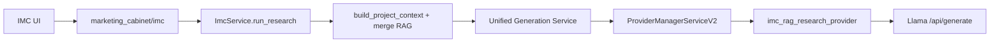

# ИМК, UGS и провайдеры — архитектура

## Статус (актуально)

- **Исследования ИМК** с ключами **`imc_rag_*`** выполняются через отдельный провайдер UGS **`imc_rag_research_provider`**. По умолчанию — **только RAG** (PostgreSQL + семантические фрагменты vault проекта). При **`web_search_quality`** ≠ **`off`** в toolbar кабинета провайдер добавляет quota-aware блок live web через `resolve_marketing_web_search_context` (Yandex Search API, без SearXNG/Crawl4AI). Legacy **`use_web_search: true`** без quality → **`standard`**. Runtime-политика провайдера/квоты/секретов — DB-first через `search_runtime_config` (`surfaces.marketing`, encrypted secrets), с env fallback.
- **MISO** (`miso_provider`) **не используется** для типов ИМК с ключами **`imc_rag_*`** после миграций: маршрутизация в `provider_manager_service_v2` отделяет `imc_rag_research_provider` от ветки `_call_miso` для соответствующих `generation_types`.
- **`imc_cabinet_filler`** по-прежнему **отдельный** провайдер **`imc_cabinet_filler_provider`**: другой JSON-контракт, **не** смешивать с markdown-исследованиями RAG-only.

Данные в БД: строка в **`generation_providers`** для `imc_rag_research_provider` и набор активных типов **`imc_rag_*`** в **`generation_types`**: пять базовых — миграция `*_imc_rag_research_provider_and_types.sql`; два типа клиентской диагностики — `20260427_imc_rag_customer_diagnostic.sql`, `20260428_imc_rag_customer_diagnostic_answers.sql`. Тип **`imc_rag_deep_market_showcase`** **не** входит в активную выдачу кабинета после `pending/20260418_imc_deactivate_deep_market_showcase.sql` (наследник — `imc_rag_cabinet_analysis`, см. `imc_legacy_type_successors.py`; исторический showcase soft-retired → `trash/`). Шесть прежних типов `imc_competitive_landscape`, `imc_audience_deep_dive`, `imc_gtm_channels`, `imc_pricing_packaging`, `imc_content_messaging`, `imc_brand_positioning` переводятся в **`is_active = false`** миграцией RAG-only.

**Решение по `marketing_research_creator`** (остаётся на MISO, скрытие из кабинета и т.д.) — одно на весь контур; зафиксировано **комментарием в SQL** миграции ИМК RAG-only.

---

## RAG-only поток (ИМК)

Логи провайдера: префикс **`[STEP] imc.rag_research.*`** (тип, длина контекста). Live web — при **`web_search_quality`** ≠ **`off`** и user/db; метаданные: **`imc_rag_web_search_used`**, **`web_search_quality`**, число запросов. Research prompt и web-срез включают authoritative server wall-clock (`llm_wall_clock_context.py`) для относительных дат пользователя.

### Глобальный web search quality (маркетинговый кабинет)

Селектор в **toolbar** (`MarketingWebSearchQualitySelect`): одно значение для всех AI-поверхностей кабинета, persist в `localStorage`.

| `web_search_quality` | Поисковых запросов | Hits / запрос | Бюджет текста (срез) |
|----------------------|-------------------|---------------|----------------------|
| `off` | 0 | — | — |
| `light` | 1 | 5 | ~1800 симв. |
| `standard` | 2 | 6 | ~3200 симв. |
| `deep` | 3 | 8 | ~5000 симв. |

Запросы для ИМК строятся из **карточки проекта** (компания, проект, отрасль, описание) + intent типа (`build_imc_web_search_queries`), без boilerplate «опирайся только на фрагменты». Промпт провайдера переопределяет устаревшие «без веба» в `type_metadata` и даёт type-specific hint (`imc_web_search_prompt_hint`).

| Поверхность | API / провайдер |
|-------------|-----------------|
| ИМК исследования | `ImcRunResearchRequest.web_search_quality` → multi-query → `imc_rag_research_provider` |
| AMKA run | `AmkaStartRequest.web_search_quality` → IMC шаги наследуют из `context_payload` |
| Evidence AI synthesis | `ResearchRunRequest.web_search_quality` |
| Чат кабинета | `MarketingChatMessageRequest.web_search_quality` |
| AI Studio assist | `MarketingAiAssistRequest.web_search_quality` |

Общие модули: `api/services/marketing_web_search_context.py`, `api/services/marketing_web_search_quality.py`. Квота — `web_search_quota_service` (shared infra с Ассистент / Assistant; **не** смешивать с маркетинговой AMKA и не с `ewa_platform` orchestration). Глобальный admin runtime endpoint: `/api/v1/desktop/admin/search-config/config`.

---

## Типы анализа (`generation_types.type_key`)

| `type_key` | Смысл (методология) |
|------------|---------------------|
| `imc_rag_swot` | SWOT |
| `imc_rag_jtbd` | JTBD |
| `imc_rag_trends_signals` | Тренды и сигналы (единый отчёт: мир + РФ как подразделы) |
| `imc_rag_cabinet_analysis` | Кабинетный сводный анализ (стейкхолдерский срез по фрагментам) |
| `imc_rag_competitive` | Конкурентный анализ |
| `imc_rag_customer_diagnostic` | Результаты клиентской диагностики + RAG проекта |
| `imc_rag_customer_diagnostic_answers` | Разбор формулировок ответов диагностики (снимок сессии) |
| `imc_rag_cx_journey` | Путь клиента, touchpoints, трения и моменты истины по материалам проекта |
| `imc_rag_voice_of_customer` | Тематический синтез VoC (опросы, отзывы, тексты) по фрагментам vault |
| `imc_rag_rf_operating_context` | PESTLE-образный срез среды РФ **только из внутренних документов** |
| `imc_rag_channel_partner_rf` | Каналы и партнёры (в т.ч. локальная логика), по загруженным материалам |
| `imc_rag_positioning_messaging` | Позиционирование и иерархия сообщений с опорой на бренд-материалы |
| `imc_rag_pricing_packaging_rf` | Тарифы, пакеты, коммерческие условия из прайсов/КП/договоров в проекте |
| `imc_rag_brand_identity_compliance` | Соответствие материалов правилам бренд-системы (гайды, нейминг, ToV), не архитектура месседжей |
| `imc_rag_marketing_gtm_plan` | GTM / план вывода по внутренним брифам и планам |
| `imc_rag_campaign_retrospective` | Ретроспектива кампании или инициативы по отчётам в vault |
| `imc_rag_content_comms_strategy` | Контент и коммуникации: темы, каналы, календарь по документам проекта |
| `imc_rag_stakeholder_decision_raci` | Стейкхолдеры, решения, RACI/эскалации по мемо и протоколам |
| `imc_rag_cx_service_ops_recovery` | Сервисные регламенты, SLA, recovery и компенсации (операционный CX) |
| `imc_rag_deep_market_showcase` | *(неактивен в кабинете)* бывший 12-раздельный прогон (soft-retired doc); наследник API — `imc_rag_cabinet_analysis` |

Операторский playbook по входам и ограничениям RAG-only: [IMC-RESEARCH-TYPES-PLAYBOOK.md](IMC-RESEARCH-TYPES-PLAYBOOK.md).

В **`type_metadata`** у активных типов задаются флаги вроде `imc_rag_project_only`, `imc_use_merged_context`, `imc_vector_only`, лимит чанков (`imc_rag_limit`) и текст методологии в `imc_prompt_instructions` (см. миграции). У оркеструемых типов (в т.ч. **тренды**, **диагностика**, исторически — запись **`imc_rag_deep_market_showcase`** в БД) дополнительно: `imc_rag_orchestrate`, при необходимости `imc_answer_depth: deep`, шаговые / merge `num_predict`. Модель по умолчанию для генерации согласуется с записью провайдера / типа (например **`rscr/vikhr_llama3.1_8b:Q4_K_M`** — как в конфиге миграции).

**Слияние контекста:** для ключей **`imc_rag_*`** в рантайме при отсутствии `imc_use_merged_context` в метаданных типа по умолчанию включается режим «Postgres (карточка проекта) + семантические фрагменты», как в маркетинговом чате (`resolve_imc_use_merged_context` в `shared/api/services/imc/imc_rag_enrichment.py`). Явное `imc_use_merged_context: false` оставляет только векторный поиск. Булевы флаги в JSONB допускают строки (`"true"` / `"false"`) — нормализация через `coerce_meta_bool`.

- **`imc_prompt_version`** (целое): версия методологии; при создании `imc_research_runs` дублируется в `input_payload` вместе с опциональным `imc_response_format` для трассировки прогонов.
- **`imc_response_format`**: `markdown` (по умолчанию) или `json` — провайдер задаёт Llama `format: json` и жёсткую инструкцию по одному JSON-объекту.
- **`imc_streaming`**: при `true` в метаданных провайдер только логирует, что потоковая отдача в этот контур не реализована (клиент по-прежнему опирается на UGS/polling).
- **Длина ответа (токены):** Llama `options.num_predict` — по умолчанию из env **`IMC_RAG_NUM_PREDICT`** (`unified_settings.imc_rag_num_predict`, дефолт 24576). Переопределение на тип: `type_metadata.imc_num_predict` (целое, 512…131072). **Глубина без жёсткого числа токенов:** `imc_answer_depth`: `brief` (≈½ базы), `standard` (база), `deep` (≈1.5× базы). Промпт провайдера просит развёрнутую структуру с опорой на фрагменты.
- **Таймаут HTTP к Llama на `/api/generate`:** env **`IMC_RAG_LLAMA_GENERATE_TIMEOUT_SEC`** (`unified_settings.imc_rag_llama_generate_timeout_seconds`, дефолт **600** с, макс. 3600). Раньше было жёстко 180 с — при большом промпте и `num_predict` провайдер мог получать `ReadTimeout`.
- **Качество цитирования (все `imc_rag_*`):** в `build_rag_research_prompt` заданы правила уникальных меток в таблице «факт — цитата — источник», запрет «водяного» финала, осторожная связка SWOT/JTBD только при явных фрагментах. Для **`imc_rag_trends_signals`** — дополнительный блок (глобус vs РФ, weak signals, impact×uncertainty, шаги с «потому что» + фрагмент); метаданные типа: миграция **`applied/20260331_03_imc_rag_trends_prompt_quality.sql`**. В коде провайдера по строке ключа `deep_market_showcase` остаётся ветка «полный контур» / объём глав для совместимости и исторических прогонов (см. `imc_rag_research_provider.py`, миграции `*_imc_rag_deep_market_showcase.sql`).
- **Анти-паразит промпта:** отчёт должен быть содержательным, без вставки в ответ служебных заголовков («Требуемые разделы», «Качество…») и без замены анализа мета-фразами «необходимо провести…»; списки структуры в промпте помечены как «Служебно», после контекста — напоминание начать с Executive summary.

---

## Матрица: кто вызывает MISO vs ИМК кабинета

| Вход | Исполнитель | Примечание |
|------|-------------|------------|
| `GET/POST .../marketing-cabinet/imc/*` (типы `imc_rag_*`) | `imc_rag_research_provider` | RAG-only, markdown или JSON по `type_metadata`, без веб-поиска |
| `imc_cabinet_filler` из кабинета | `imc_cabinet_filler_provider` | JSON-контракт автозаполнения, не MISO |
| `marketing_research_creator` (вне списка типов кабинета) | MISO (`miso_provider`) | Legacy/прочие вызовы UGS; в UI списка ИМК не показывается |
| Прочие типы UGS вне ИМК | По `generation_types.provider` | В т.ч. MISO там, где провайдер так назначен |

---

## Коротко про связку компонентов

- **ИМК** — оркестратор: `type_key`, проект, источники (для типов с `imc_rag_project_only` API/UI может разрешать запуск без файла/URL — только контекст vault/RAG).
- **UGS** — очередь, `generation_requests`, выбор провайдера по **`generation_types.provider`**.
- **MISO** — по-прежнему существует в коде для **других** типов UGS; **для `imc_rag_*` не является исполнителем** после описанных миграций.

---

## Где смотреть в коде

| Что | Где |
|-----|-----|
| Список типов ИМК из БД | `generation_types`, `imc_service.list_types_for_cabinet` |
| Запуск исследования + контекст | `imc_service.run_research`, `marketing_project_rag_service` |
| RAG-only markdown | `imc_rag_research_provider`, ветка в `provider_manager_service_v2._call_provider` |
| Заполнитель кабинета (JSON) | `imc_cabinet_filler_provider` |
| MISO (не для `imc_rag_*`) | `miso_provider.MISOProvider` |
| Схемы / флаг `rag_project_only` | `api/schemas/imc.py`, ответ `GET .../imc/types` |

Связка RAG: [MARKETING-PROJECT-RAG.md](MARKETING-PROJECT-RAG.md). **Оркестрация** нескольких шагов генерации и склейка отчёта (дизайн): [IMC-RAG-ORCHESTRATION.md](IMC-RAG-ORCHESTRATION.md).

**Примечание по `provider_type` в `generation_providers`:** из-за CHECK в БД у новой строки может стоять тот же **`provider_type`**, что у filler/MISO, как у `imc_cabinet_filler_provider`; фактическая ветка определяется **`provider_name`** в `ProviderManagerServiceV2._call_provider`.

---

## Исторический контекст

Ранее часть типов ИМК шла в **MISO** с шаблоном «маркетинговое исследование» и опциональным веб-блоком через устаревший SearXNG/stack5. Текущий контур — **Yandex SERP snippets** (multi-query при `deep`), без page crawl.
