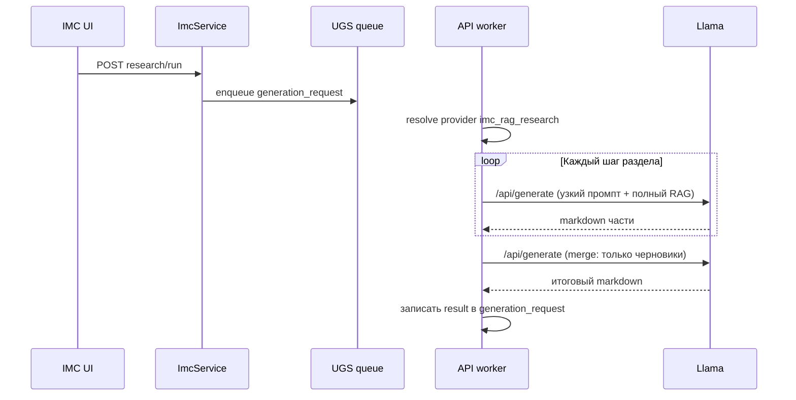

# ИМК RAG: оркестрация нескольких шагов → один отчёт

## Зачем

Один вызов `POST /api/generate` с полным списком разделов и длинным контекстом даёт сдвиг качества: модель **подменяет содержание планом**, **зеркалирует ТЗ** или **сжимает** детали. Разбиение на **узкие подзадачи** (по разделам или по слоям: факты → синтез) с финальной **склейкой** приближает поведение к «оркестратору», который **уже выполнил** работу, а не перечислил, что «надо сделать».

## Текущее состояние (фиксация)

| Факт | Где в коде / схеме |
|------|-------------------|
| Один запуск ИМК → одна очередь UGS | `ImcService.run_research` → `_ugs.generate` |
| Строка `imc_research_runs.ugs_request_id` — один FK на `generation_requests` | `database_models.ImcResearchRun` |
| Поля `workflow_key`, `steps` (JSONB) есть, но составной запуск **запрещён** | `ImcService.run_research`: `if body.workflow_key: raise ValueError(...)` |
| В метаданные UGS уже кладутся заделы | `_attach_imc_metadata_to_ugs_request`: `imc_research_id`, `imc_workflow_key`, `imc_step_key` |

## Варианты архитектуры

### A. Последовательные вызовы в одном воркер-теке (фаза 0, минимум инфраструктуры)

**Идея:** для типов с флагом `type_metadata.imc_rag_orchestrate` провайдер (или тонкая обёртка перед ним) **внутри одного** `process_queued_request`:

1. Тот же `marketing_project_rag_context`, те же чанки.
2. Цикл по шагам (например по `imc_output_sections` или явному списку `imc_rag_orchestrate_steps`): каждый шаг — отдельный `build_rag_research_prompt(...)` с **одним** целевым разделом + жёсткая инструкция «только этот раздел, без введения про остальное».
3. Финальный шаг («merge»): промпт из **только уже сгенерированных кусков** + «собери единый отчёт без новых фактов; сохрани таблицу фактов с метками фрагментов из кусков».

**Плюсы:** не нужна новая очередь; один `generation_requests` с точки зрения биллинга/UX; проще откат.

**Минусы:** суммарный таймаут = сумма шагов (настроить `IMC_RAG_LLAMA_GENERATE_TIMEOUT_SEC` и/или уменьшить `num_predict` на шагах); при падении на шаге k нет «точечного retry» без доработки.

**Точки правок:** `imc_rag_research_provider.py` (метод `generate` или соседний helper), опционально `provider_manager_service_v2._call_imc_rag_research` для ветвления по флагу; `unified_config` — лимит шагов, таймаут на шаг.

### B. Несколько `generation_requests` + поле `steps` (фаза 1)

**Идея:** родительский `imc_research_run` создаёт цепочку: для каждого шага — отдельный `_ugs.generate` (или постановка в очередь), в `steps` пишется `[{ "key", "ugs_request_id", "status", "excerpt" }]`. UI и `/status` агрегируют дочерние статусы. Последний шаг — merge (отдельный `type_key` или тот же с `input_data.imc_rag_merge_only`).

**Плюсы:** видимость прогресса, повтор одного шага, частичный `partial`.

**Минусы:** биллинг/лимиты по нескольким задачам; идемпотентность сложнее; нужны доработки `ImcService`, UI, синхронизация `result_text` с финального шага.

### C. Отдельный workflow-движок (Celery chain / `workflow_key`) — фаза 2

**Идея:** снять запрет на `workflow_key`, описать workflow в БД или конфиге, универсальный исполнитель. Тяжёлей в сопровождении; имеет смысл, если оркестрация понадобится за пределами ИМК.

**Рекомендация:** начать с **A**, при необходимости UX — **B**.

## Контракт `type_metadata` и UGS `input_data` (фаза A, реализовано)

Поля из `generation_types.type_metadata` копирует **`ImcService._build_ugs_input_data`** в payload UGS при `imc_rag_orchestrate: true`:

| Поле | Тип | Назначение |
|------|-----|------------|
| `imc_rag_orchestrate` | bool | Включить оркестрацию (только при `imc_response_format` ≠ `json`, см. ниже). |
| `imc_rag_orchestrate_mode` | string | v1: только **`sections`** — шаг = один элемент `imc_output_sections`. Другое значение → один проход (single-shot). |
| `imc_rag_orchestrate_max_steps` | int | Максимум разделов за запуск; срезается сверху **`IMC_RAG_ORCHESTRATE_MAX_STEPS_CAP`** / `unified_config.imc_rag_orchestrate_max_steps_cap` (дефолт 12, диапазон 2–24). |
| `imc_rag_step_num_predict` | int | `num_predict` **на шаг** (Llama), ≥512, cap 131072. |
| `imc_rag_merge_num_predict` | int | `num_predict` для финального merge (температура 0.15). |

Если флага нет или список `imc_output_sections` короче **двух** непустых строк — выполняется **один** вызов Llama, как раньше (в логе: `imc.rag_research.orchestrate.skipped`).

**JSON v1:** при `imc_response_format: json` оркестрация **не** используется — один запрос с `format: json` (и при необходимости `json_mode` fallback на стороне модели).

**Метаданные ответа** провайдера при оркестрации: `metadata.imc_rag_orchestrated`, `imc_rag_orchestrate_steps`, `imc_rag_orchestrate_step_duration_ms`, `imc_rag_orchestrate_merge_duration_ms`, `imc_rag_step_num_predict`, `imc_rag_merge_num_predict`, `imc_rag_merge_max_prompt_chars`, `imc_rag_merge_prompt_truncated`.

**Лимиты символов:** шаги и single-shot режет `IMC_RAG_MAX_PROMPT_CHARS`; **merge** — отдельно **`IMC_RAG_MERGE_MAX_PROMPT_CHARS`** (выше, иначе черновики не помещаются). В Llama при `IMC_RAG_LLAMA_NUM_CTX` ≥ 512 в `options` передаётся `num_ctx` (контекстное окно модели).

Пример фрагмента `type_metadata`:

```json
{
  "imc_rag_orchestrate": true,
  "imc_rag_orchestrate_mode": "sections",
  "imc_rag_orchestrate_max_steps": 10,
  "imc_rag_step_num_predict": 10240,
  "imc_rag_merge_num_predict": 20480
}
```

Пилот в БД: миграция **`shared/api/migrations/applied/20260331_04_imc_rag_trends_orchestration.sql`** (тип `imc_rag_trends_signals`).

## Схема потока (фаза A)



## Merge-промпт (принципы)

- Вход: только тексты шагов + короткое напоминание меток фрагментов, если они уже были в шагах.
- Инструкция: «**Не добавляй** факты, которых нет в переданных черновиках; **не** восстанавливай контекст vault заново; устрани дубликаты заголовков; единая таблица фактов в конце, если раздел требовался».
- Риск: merge «придумает» мосты — смягчать температурой и коротким `num_predict`, плюс жёсткая фраза «если сомневаешься — оставь формулировку из шага N».

## Чеклист внедрения (фаза A)

1. Добавить флаги в `type_metadata` для пилотного типа (например `imc_rag_trends_signals`).
2. Реализовать в `ImcRagResearchProvider` (или отдельном модуле) `generate_orchestrated`: цикл вызовов существующей логики построения промпта с параметром «только раздел i».
3. Прогнать интеграционный сценарий: логи `[STEP] imc.rag_research.orchestrate step=...`.
4. Подобрать `num_predict` на шаг vs merge; при необходимости увеличить общий таймаут воркера (не только Llama-read).
5. Документация + opt-in в БД для одного типа; затем расширение на остальные `imc_rag_*`.

## Риски и ограничения

| Риск | Митигация |
|------|-----------|
| Суммарное время > таймаута воркера | Меньше шагов, меньше `num_predict` на шаг, отдельный лимит на «длинный» тип только после замеров |
| Дублирование токенов в промптах (RAG × N) | На шагах передавать тот же контекст один раз в памяти воркера — без дублирования в БД; при упоре в RAM — сжатый RAG на шаг (отдельное ТЗ) |
| Биллинг «одна задача — несколько GPU-вызовов» | Зафиксировать политику: один `generation_request` = одна строка биллинга с внутренними шагами или коэффициент по `imc_rag_orchestrate` |
| Частичный провал | Фаза A: весь запрос failed; фаза B: `steps[k].status=failed`, `partial` в `imc_research_runs` |

## Связанные документы

- [IMC-MISO-ARCHITECTURE.md](IMC-MISO-ARCHITECTURE.md) — текущий RAG-only контур.
- [MARKETING-PROJECT-RAG.md](MARKETING-PROJECT-RAG.md) — источники контекста и индекс.
- Наследник deactivated-type `imc_rag_deep_market_showcase` — `imc_rag_cabinet_analysis` (исторический showcase soft-retired → `trash/`).
