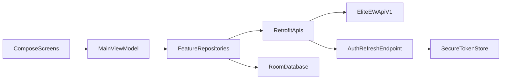

# Android Developer Assistant (`pack-cloud/mobile/`)

Подробный справочник по Android-проекту в монорепозитории.

## 1) Цель и границы

`pack-cloud/mobile/` — отдельный Android-клиент, который использует существующий backend (`/api/v1`) и не копирует desktop/web код.

Ориентир по изменениям API: клиент завязан на **URL и тела ответов**, а не на имена операций в OpenAPI. Любое изменение маршрутов из [`ANDROID-API-CONTRACTS.md`](../../api/ANDROID-API-CONTRACTS.md) — править **оба** документа в одном PR/волне.

Текущий scope v1:

- Desktop Hub (store/install, shell-state snapshot, widget notes/todos, favorites)
- EWDesk feed
- Notification Center
- Profile
- Мессенджер Lite
- Friends Lite
- Global pull-to-refresh for all tabs
- Global snackbar for request errors
- Online/offline status banner
- Chat-first mobile UX: premium-contextual Elite timeline by default (partner avatar + bold name + thread-line, no bubbles), unread boundaries, optimistic send, realtime updates in opened chat

## 2) Структура проекта

```text
pack-cloud/mobile/
  app/
  core/
    auth/
    network/
    storage/
    ui/
  feature/
    desktop/
    feed/
    notifications/
    profile/
    chat/
    friends/
    ugs/
```

### Условные GET (ETag и 304)

Часть маршрутов отдаёт заголовок **`ETag`** (кавычки + SHA-256 от канонического JSON тела). Повторный запрос с заголовком **`If-None-Match`**, равным последнему `ETag`, при неизменных данных даёт **`304 Not Modified`** и **пустое тело** — клиенту нужно хранить последний успешный JSON (ответ **200**) и не ожидать тела при **304**.

Актуальный перечень маршрутов и нюансы: [`api/ANDROID-API-CONTRACTS.md`](../../api/ANDROID-API-CONTRACTS.md) (в т.ч. Friends overview и Desktop Hub: `config`, `shell-state`, `installed`).

**Клиент (`pack-cloud/mobile/`):**

- Общий helper: `core/network/ConditionalGet.kt` (`resolveConditionalGet`) + `HttpEtagSupport.kt` (парсинг `ETag`, проверка **304**).
- **OkHttp allowlist interceptor:** `ConditionalGetEtagInterceptor` + `ETagMemoryStore` в `core/network` — для allowlisted GET (`/api/v1/mobile/profile/me`, friends overview) автоматически ставит `If-None-Match` из памяти; если заголовок уже задан (Retrofit `@Header`), interceptor **no-op** (explicit wins).
- Profile `/me`: `ProfileApiContracts.getMeConditional` + `ProfileRepository.refresh` → Room `ProfileEntity` на **304** (не wipe); in-memory `ProfileMeEtagCache`.
- Friends: `FriendsApiContracts.getOverviewConditional` → core `RetrofitFriendsRemoteDataSource` → `DefaultFriendsRepository`; ETag/304 и Room snapshot принадлежат data layer, presentation получает результат через `RefreshFriendsOverviewUseCase`.
- Desktop Hub: `DesktopApiContracts.getConfigConditional`, `getShellStateConditional`, `getInstalledConditional`; ETag-кэш и инвалидация после мутаций — `DesktopHubRepository` в `feature/desktop/DesktopHubFeature.kt`.
- Notification Center delta: при известном `lastUpdatedAt` — `ProfileApiContracts.getNotificationCenterDelta(since)`; fallback на полный `refresh()` — `NotificationRepository` в `feature/notifications/NotificationFeature.kt`.

### Что за что отвечает

- `app/`
  - Composition root, навигация, `MainViewModel`, WorkManager bootstrap, FCM service.
- `core/network/`
  - Retrofit/OkHttp, Bearer interceptor, auto-refresh authenticator, API interfaces и DTO.
- `core/auth/`
  - Secure token store (EncryptedSharedPreferences), refresh-репозиторий, OIDC manager scaffold.
- `core/storage/`
  - Room БД, DAO и offline entities.
- `core/ui/`
  - Shared Compose primitives for premium/glass mobile surfaces: hero headers, spotlight hero cards, glass cards, icon tiles, state cards, section/loading cards, configurable row/banner surfaces, metric pills, feed media row chrome, shared shell status chrome and generator loading/progress chrome.
  - **Shared avatar:** `MobileAvatarPlaceholder` + `mobileAvatarInitials` (Coil) — friends/chat/profile without `feature:friends` → `feature:profile` coupling. Profile keeps thin `ProfileAvatarPlaceholder` wrapper.
  - **Adaptive layout:** [`MOBILE-ANDROID-ADAPTIVE-LAYOUT.md`](MOBILE-ANDROID-ADAPTIVE-LAYOUT.md) — `LocalMobileWindowLayout`, hybrid rail/bottom nav, multi-column helpers.
- `feature/*`
  - Вертикальные фичи: UI + repository + feature state.
- `feature/friends/`
  - Clean DDD flow: `FriendsRemoteDataSource` ↔ `FriendsLocalDataSource` (Room) ↔ `data/DefaultFriendsRepository` (SSOT) → named + focused `domain/usecase/*` → thin `presentation/FriendsTabViewModel` → `FriendList` / `FriendItem` / `FriendSearchBar` / `CircleSelector` / `FriendDetail` + `FriendsLiteScreen` facade.
  - Canonical named use cases: `GetFriendsListUseCase`, `SearchFriendsUseCase`, `AddFriendUseCase`, `RemoveFriendUseCase`, `UpdateFriendStatusUseCase`, `GetFriendCirclesUseCase` (bundled in `FriendsUseCases`).
  - Feature зависит только от `core:network`, `core:storage`, `core:ui` и AndroidX. App — composition/factory; session, telemetry и shell prefs передаются через узкие presentation boundaries.
  - Profile privacy circles читаются через core `FriendCirclesProvider`; `ProfileTabViewModel` не знает `FriendsRepository`. **No** `implementation(project(":feature:profile"))` / `feature:chat` — avatars via `core:ui`.
- `feature/desktop/`
  - Android-реализация web-parity блока для desktop API: управление установленными приложениями, заметками/todo виджетов, избранным и shell-state/config с мобильного клиента.

## 3) Flavors и окружения

Настроены flavor'ы **`stage` / `prod` / `tunnelBeta`** в `pack-cloud/mobile/app/build.gradle.kts`.
Flavor'ы **`dev` и `tg` удалены** (2026-07-14 Security Lockdown) — не использовать `assembleDev*` / `assembleTg*`.

Для каждого flavor задаются:

- `BuildConfig.BASE_URL` (корень API, обычно с суффиксом `/api/v1/`)
- `BuildConfig.SSO_LOGIN_URL` (выводится из того же хоста: `{base}/auth/sso/login`)
- `BuildConfig.KEYCLOAK_REDIRECT_URI`
- `BuildConfig.KEYCLOAK_CLIENT_ID` (`empery-mobile`)
- `BuildConfig.KEYCLOAK_AUTHORIZATION_ENDPOINT` / `KEYCLOAK_TOKEN_ENDPOINT` / `KEYCLOAK_PUBLIC_URL` (override: `mobile.android.<flavor>.keycloakPublicUrl`)

Переопределение без правки репозитория: свойства `mobile.android.stage.baseUrl`, `mobile.android.prod.baseUrl`, `mobile.android.tunnelBeta.baseUrl` в `pack-cloud/mobile/gradle.properties` или `-P` (полный URL с завершающим `/`).

Значения по умолчанию в Gradle:

- `stage` — `https://app-staging.eliteew.ru/api/v1/`.
- `prod` — `https://app.eliteew.ru/api/v1/`.
- `tunnelBeta` — `https://app.eliteew.ru/api/v1/` (отдельный `applicationId` `.tunnelbeta`).

**HTTPS:** `AppRuntimeConfig` требует `https://` для всех flavor'ов. Локальный `http://127.0.0.1:8000` / `10.0.2.2` не поддерживается как дефолт.

**Резервное копирование:** в манифесте `android:allowBackup="false"` и правила в `res/xml/backup_rules.xml` / `data_extraction_rules.xml` (исключения на случай повторного включения backup).

**JSON refresh токена:** клиент бьёт в `POST /api/auth/refresh` (не `/api/v1/auth/refresh`). См. `api/ANDROID-API-CONTRACTS.md`.

## 4) Установка toolchain (Linux, Fedora)

Минимум:

- Java 17 (как в CI `.github/workflows/mobile-android-ci.yml`) или Java 21 локально — оба совместимы с `jvmTarget = 17` в Gradle.
- Android command-line tools + SDK packages
- Gradle (только чтобы сгенерировать wrapper, если он еще не лежит в проекте)

### 4.1 Пакеты

```bash
sudo dnf install -y java-21-openjdk java-21-openjdk-devel unzip git which curl
```

### 4.1.1 Gradle (через SDKMAN, если `dnf` не даёт пакет `gradle`)

```bash
curl -s "https://get.sdkman.io" | bash
source "$HOME/.sdkman/bin/sdkman-init.sh"
sdk install gradle 8.13
```

### 4.2 Android SDK command-line tools

```bash
mkdir -p "$HOME/Android/Sdk/cmdline-tools"
cd /tmp
curl -L -o commandlinetools-linux.zip \
  "https://dl.google.com/android/repository/commandlinetools-linux-11076708_latest.zip"
unzip -q commandlinetools-linux.zip -d "$HOME/Android/Sdk/cmdline-tools"
mv "$HOME/Android/Sdk/cmdline-tools/cmdline-tools" "$HOME/Android/Sdk/cmdline-tools/latest"
```

### 4.3 Переменные окружения (добавить в `~/.bashrc`)

```bash
export ANDROID_SDK_ROOT="$HOME/Android/Sdk"
export ANDROID_HOME="$ANDROID_SDK_ROOT"
export PATH="$PATH:$ANDROID_SDK_ROOT/platform-tools:$ANDROID_SDK_ROOT/cmdline-tools/latest/bin"
```

Применить:

```bash
source ~/.bashrc
```

### 4.4 Установка SDK пакетов и лицензий

```bash
yes | sdkmanager --licenses
sdkmanager "platform-tools" "platforms;android-35" "build-tools;35.0.0"
```

## 5) Первый запуск и сборка

Из корня репозитория:

```bash
cd ~/powered_by_emperyworld/MobileAndroid
```

Если wrapper отсутствует:

```bash
gradle wrapper --gradle-version 8.13
chmod +x ./gradlew
```

Проверка:

```bash
./gradlew tasks
```

Сборка:

```bash
./gradlew :app:assembleProdDebug
./gradlew :app:assembleStageDebug
./gradlew :app:assembleProdDebug
```

Установка debug APK на реальное устройство (USB):

```bash
# 1) Разрешить USB debugging на телефоне
# 2) Проверить, что устройство видно
adb devices

# 3) Установить сборку
adb install -r app/build/outputs/apk/prod/debug/app-prod-debug.apk
```

Первый запуск на устройстве:

1. Открыть приложение.
2. Нажать **Войти** — откроется in-app SSO WebView (`EmperySsoWebViewActivity`) с формой Keycloak клиента **`empery-mobile`** (PKCE). Не Chrome/Custom Tabs для app SSO.
3. После входа callback уходит на custom-scheme redirect → `POST /api/v1/auth/sso/callback` (SSO registry class `mobile`).
4. Проверить загрузку вкладок Feed / Center / Chat / Friends / Profile.

Линт/тесты:

```bash
./gradlew lint
./gradlew test
```


### Perimeter access (Yandex ID gate)

Карточка **«Доступ к Empery»** в Profile показывает статус сетевого perimeter (probe `GET /api/health`), кнопки «Продлить» / «Проверить» и opt-in **автопродление** через Custom Tabs на `access.eliteew.ru/oauth/yandex/start`.

Канон: [`MOBILE-PERIMETER-ACCESS.md`](MOBILE-PERIMETER-ACCESS.md). Код: `PerimeterAccessProbe`, `PerimeterAccessRepository`, `PerimeterAccessCoordinator`, `PerimeterAccessCard`.

### Фоновая связь (hybrid, v0.2.33+)

- **`EmperyConnectionService`** работает в foreground только когда приложение в foreground **или** есть активный/входящий звонок.
- Socket.IO не держится 24/7: в фоне канал закрывается (таймер background teardown), при возврате в foreground поднимается снова.
- **`MobileSyncScheduler`** — разовый WorkManager sync по FCM (`data.sync=chat|light|all`), восстановлению сети и `onDeletedMessages`; периодический sync — по-прежнему ~15 мин.
- **FCM data `type=video_call_incoming`** — локальное уведомление о звонке + лёгкий sync чата (fallback, если процесс убит OS).
- **HTTP refresh токена** → пересборка Socket.IO auth через `AuthRepository.onAccessTokenRefreshed`; после relogin listener регистрации токена должен быть восстановлен в `MainViewModel`.
- **Истечение / отказ SSO (v0.2.42+):** после terminal 401 (`UnauthorizedRetryInterceptor`) приложение очищает сессию, показывает snackbar и переводит на экран входа. Для realtime auth errors сначала выполняется controlled refresh+reconnect retry; мгновенный logout — только для явного `session_replaced`.
- **Конфликт SSO-сессий при входе (v0.2.172+):** если registry вернул `session_replace_confirmation_required`, показывается диалог «Заменить активную сессию?»; после подтверждения повторный OAuth и `POST /api/v1/auth/sso/callback` с заголовком `X-SSO-Replace-Confirm: 1` (как на SPA). Без подтверждения вход «застревал» до сброса сессии в Keycloak.
- **Push после logout (v0.2.172+):** перед очисткой токенов вызывается `DELETE profile/mobile-push-token`; FCM handler не показывает уведомления, пока `AuthRepository.hasSession()` ложен.
- **API FCM fallback (v0.1.5+):** после `gaf_chat.*` / `video_call.incoming` emit, если у получателя **нет live mobile Socket.IO** (presence), API шлёт data-only FCM на токены из `user_mobile_push_tokens`. Env: `MOBILE_FCM_SERVICE_ACCOUNT_JSON` (path или inline JSON) + опционально `MOBILE_FCM_PROJECT_ID`; legacy `MOBILE_FCM_SERVER_KEY`. Отключить: `MOBILE_FCM_ENABLED=false`.

Smoke: залогиниться → свернуть приложение → отправить сообщение/звонок с веба; вернуться — чат актуален. Профиль → Обновления для OTA sideload (versionCode на сервере > установленного).

### GAF видеозвонки (WebView, v0.2.4+)

Полный канон миграции, OTA и troubleshooting: **[`MOBILE-GAF-VIDEO-CALLS-WEBVIEW.md`](MOBILE-GAF-VIDEO-CALLS-WEBVIEW.md)**.

- API: `POST /video-calls/gaf-chats/{id}`, `POST /video-calls/{call_id}/join` → **`join_url`** (JWT в URL, как desktop).
- Android: `GafMeetWebViewLauncher` → `EmperyMeetWebViewActivity` (**без** `jitsi-meet-sdk`; prod APK ~18 MB).
- Завершение: `GafVideoCallReturnBar` «Завершить» или закрытие WebView → `endGafVideoCall` + API `/end`.
- Desktop аналог: `VideoCallApp.tsx` (iframe на тот же `join_url`).

## In-app updates (Профиль → Обновления)

С sideload-сборкой (не Google Play) приложение может проверять и ставить новую версию **внутри UI**:

1. **Профиль → Обновления** — если версия актуальна, одна кнопка **«Проверить обновления»** (`GET /api/v1/mobile-app/overview`, Bearer). **≥ 0.2.110:** если на сервере код выше — вместо неё только **«Обновить»**: повторная проверка актуальной версии, загрузка APK и автозапуск системного установщика (без отдельных «Скачать» / «Установить»). **≥ 0.2.5:** overview при каждом открытии Профиля; на старых сборках pill «Сервер» мог быть stale до 6 ч.
2. Загрузка — `GET /api/v1/mobile-app/download` через OkHttp с тем же Bearer (WorkManager + foreground notification).
3. Установка — `FileProvider` + системный установщик APK; на Android 8+ при первом разе может понадобиться разрешение «Установка из неизвестных источников» (баннер в разделе до выдачи разрешения).

Операторский invariant: `/api/v1/mobile-app/*` не должен попадать в generic Redis response cache. Иначе приложение может показывать старую «Сервер: 0.2.x» даже после успешного OTA publish/restart nginx.

Оператор публикует prod APK:

```bash
cd pack-cloud/mobile && ./gradlew :app:assembleProdRelease -Pmobile.android.ci=true
bash docker/scripts/mobile-release-stack.sh up    # отдельный Podman nginx (опционально, рекомендуется)
bash docker/scripts/serve-mobile-apk-tunnel.sh publish
bash docker/scripts/mobile-release-stack.sh smoke
```

Скрипт publish пишет `local/binaries/empery-mobile.apk.meta.json` и **`empery-mobile.manifest.json`** (`version_code`, `version_name`, `sha256`, размер). Отдельный стек **`stack-mobile-release`** (nginx на `127.0.0.1:29180`, внутри сети `http://stack-mobile-release`) отдаёт manifest/APK без restart API. API читает manifest (`MOBILE_RELEASE_BASE_URL`, default `http://stack-mobile-release`) и отдаёт поля в overview; fallback — sidecar `.meta.json` на mount `/app/mobile-release`.


**APK archive + web version surface (v0.2.3+):**

- `bash pack-mobile-apk-archive.sh *[absent — mobile APK archive helper not in tree]* — 7z max (`-mx=9`), APK внутри как `app-prod-release.apk`. Вызывается в конце `publish`.
- Sidecar `app-prod-release.apk.meta.json` рядом с архивом — версия в meta.
- Operator TG bot tree `tg_bot_ip_verif/` is **soft-retired** under `trash/` — restore only on explicit request before `--tg` / `push-bot-remote.sh`.
- Web: `/mobile-app/` и Связи «Моё приложение телефона» показывают `version_name (version_code)` из overview API.
- OTA versioning invariant: перед каждым новым prod OTA publish нужно монотонно поднять `defaultConfig.versionCode` в `pack-cloud/mobile/app/build.gradle.kts` и обновить `versionName`; иначе APK перезапишется на edge, но установленный клиент может не увидеть обновление как новую версию.

Канон: [`MOBILE-RELEASE-SERVER.md`](../../platform/docker-re_doc/MOBILE-RELEASE-SERVER.md).

Код: `feature/profile/MobileAppUpdateRepository.kt`, `MobileApkInstaller.kt`, `ProfileTabViewModel.checkForUpdates()`.

**EWDesk (v0.1.6+):** list API отдаёт paginated JSON (`items` + `next_cursor`), не массив; `FeedRepository` обходит cursor, заменяет локальный кэш и подписывается на Room Flow — фоновый sync обновляет UI без ручного pull-to-refresh.

**Mobile UI wave (v0.2.0+):**

- **EWDesk:** карточка заголовка с иконкой, счётчик постов, badge на колокольчике (непрочитанные из Room notifications).
- **Центр уведомлений:** карточка заголовка, счётчик непрочитанных, кнопка «Обновить», точка у непрочитанных строк.
- **Профиль → Обновления:** баннер «Доступно обновление» без дубля размера APK; chip «Актуальная версия» после успешной проверки без апдейта.
- **Профиль → Уведомления (≥ 0.2.111):** одна карточка — главный push, по одному переключателю на категорию (без вложенных «Без звука»), тихие часы с пресетами; техдиагностика FCM/Socket только при блокировке разрешения Android.
- **Профиль → Оформление (≥ 0.2.112):** одна карточка — стиль (горизонтальные чипы), яркость и масштаб (FilterChip), фон, комфорт чтения; OTA `release_notes` — русский пользовательский текст (`RELEASE-NOTES-user.ru.txt`, `.cursor/rules/mobile-android-release-notes.mdc`).
- **Профиль → стиль чата:** `ChatVisualStyle` Elite (структурный timeline, default для unset/unknown) / Standard (явно сохранённый compatibility-mode) через `LocalChatStyle` + `ChatVisualStrategy`. Один `ChatMessageTimeline` обслуживает оба режима без дублирования message logic; prefs `ChatVisualStylePreferences` (`empery_mobile_ui`). В треде рядом с блоками своих сообщений показывается аватар текущего пользователя (как у собеседника слева). **Шрифт сообщений:** пресеты + family/size/color через `ChatTypographyPreferences` / `LocalChatTypography` (Профиль → Оформление).
- **Управление столом → магазин:** иконки приложений из `icon_url` (Coil + `EwDeskLinkedMediaUrls.rewriteMarkdownAssetDestination`), fallback `Apps`.
- **v0.2.7:** shell/offline/snackbar/login states, Friends/Notifications loading, Chat/UGS list cards and Feed cards use calmer premium/glass surfaces while preserving navigation, IME and OTA contracts.
- **v0.2.8:** Desktop Hub refresh, Feed initial loading, Profile OTA download progress and UGS Images/Songs/Presentations empty-loading states use shared premium loading/progress surfaces.
- **v0.2.9:** visible premium redesign pass: Feed, UGS Hub, Profile → Updates and Chat list now use large spotlight cards with metric/action zones; EWDesk feed post titles use stronger hierarchy so the change is visible at first glance while preserving navigation, IME and OTA contracts.
- **v0.2.10:** redesign completion pass: bottom navigation selected tabs use premium icon tiles, UGS AI list/detail screens gained spotlight hero surfaces, and Chat message threads now use a stronger composer dock plus wider premium bubbles.
- **v0.2.11:** remaining-screen premium pass: Friends, Notifications, Desktop Hub and UGS Images/Songs/Presentations now open with large spotlight surfaces, metrics and clearer primary actions before the detailed lists/forms.
- **v0.2.12:** full-deploy premium pass: Profile main loading/identity now uses the shared loading/spotlight surfaces, EWDesk feed cards use stronger elevation/radius/glow separation, and UGS Songs/Presentations spotlight CTAs jump directly to their generation forms.
- **v0.2.13:** quick-launch/list polish pass: UGS Hub tool cards are larger CTA surfaces with descriptions and arrow affordances; Friends and Notifications list rows use stronger premium containers, larger avatars/status badges and denser action layout.
- **v0.2.14:** UI completion pass for leftover old-style surfaces: Profile appearance/scale/wallpaper/push settings now use premium choice tiles, larger wallpaper previews and row chrome; UGS generator screens gained glow separation between generation forms and history.
- **v0.2.15:** compact header correction: shared spotlight cards were reduced from oversized hero blocks to compact section headers, so screens keep premium chrome without consuming half the viewport.
- **v0.2.16:** duplicate header removal: shared spotlight cards no longer render duplicated section title/body/icon/metric blocks; only useful inline actions remain where callers supplied them.
- **v0.2.17:** UGS AI regression fix after spotlight action-only change: removed broken spotlight shells from UGS screens; compact `UgsToolCard` with full-width action slot.
- **v0.2.18:** chat unread badge on avatar only (uniform row styling) + total unread on Chat bottom-nav tab; profile identity block without duplicate header/id; push toggle moved to Notification Center; wallpaper instant apply via `wallpaperRevision`.
- **v0.2.19:** UGS Hub tool cards unified — no `featured` tint; all tools use same `PremiumIconTile` sizing as Songs/Presentations.
- **v0.2.20:** UGS Songs — **XL Base only** (`ugs_workflow=v2_base`); Turbo segmented control removed from mobile.
- **MusicForge SFT (2026-07-18+):** UGS Songs — thin client `/api/v1/music-forge/*` (`MusicForgeApi` + `MusicForgeMobileSupport`); history merge `music_forge`+`music_generator`; pipeline pill «MusicForge · SFT». Ideal TOP: [`MUSIC-FORGE-IDEAL-TOP-SONG-CANON.md`](../MUSIC-FORGE-IDEAL-TOP-SONG-CANON.md).

**UI chrome / scale:** [`MOBILE-ANDROID-SCALE-CHROME-POLICY.md`](MOBILE-ANDROID-SCALE-CHROME-POLICY.md); glass/premium tokens live in `pack-cloud/mobile` `PremiumGlass.kt`.

**Докачка APK (v0.2.1+, тот же `versionCode`):**

- Частичный файл: `files/Download/updates/empery-mobile-v{code}.apk.part`.
- **≥ 0.2.6:** загрузка **чанками по 1 MiB** (`Range: bytes=N-M`) — каждый запрос короткий, переживает обрыв edge/SSH-туннеля; resume с `.part`.
- **≤ 0.2.5:** один длинный HTTP-запрос с `Range: bytes=N-` (при обрыве — **«Продолжить загрузку»**).
- API: Starlette `FileResponse`, заголовок **`Accept-Ranges: bytes`**, ответ **206** на Range.
- До **5** попыток с backoff при `IOException`; при HTTP **416** partial сбрасывается и загрузка с начала.
- UI: кнопка **«Продолжить загрузку»**, progress восстанавливается из `.part`.
- Тесты: `MobileAppUpdateDownloadSupportTest` (Range/progress/retry policy); API `test_mobile_app_download_supports_range`.

**OTA надёжность (v0.2.2+):**

- **`GET /mobile-app/overview`** → поле **`apk_sha256`** (manifest nginx или sidecar `.meta.json` при publish).
- После загрузки APK сверяется SHA-256; mismatch → удаление файла, ошибка «повреждён или подменён».
- Загрузка через **`MobileAppUpdateDownloadWorker`** (WorkManager + foreground notification «Загрузка обновления») — продолжается при сворачивании приложения.
- Автопроверка обновлений раз в **6 ч** (`checkForUpdatesIfStale`); **≥ 0.2.5** — overview при каждом открытии Профиля; badge на табе **Профиль** при `updateAvailable`.
- Тесты: `MobileAppUpdateHashTest`, `test_mobile_app_overview_includes_sha256_from_sidecar`.


**core/auth OIDC i18n (v0.2.3+):**

- `core/auth/src/main/res/values/strings.xml` + `values-en` — OIDC/WebView user-safe errors (`auth_oidc_*`, `auth_sso_webview_*`).
- `OidcAuthManager` принимает `appContext: Context`; `fetchConfigurationFromDiscoveryUrl(context, …)`.

**App shell i18n (v0.2.3+):**

- `app/src/main/res/values*` — auth errors, chat/GAF VM messages, push channels, tab load errors (~45 ключей).
- `MainViewModel`, `MainActivity`, `NotificationHelper`, `MobileFirebaseMessagingService`, `UgsHubTabViewModel`, `DesktopHubTabViewModel` — без hardcoded RU в user-visible путях.
- **AI heroes:** `ugs_hero_*_name/desc` в `feature/ugs/.../values*`; `AiHero.nameRes/descRes`.
- Остаток: `core/auth/OidcAuthManager.kt` (internal auth copy) — отдельная задача.

**UGS Hub + Desktop Hub i18n (v0.2.3+):**

- `feature/ugs/src/main/res/values-en/strings.xml` — полное EN-зеркало (~160 ключей) для AI hub, songs/images/presentations, ошибок download.
- Оставшиеся hardcoded в UGS экранах: `ugs_nav_back`, vocals, submit/chat errors; hero **имена персонажей** пока RU (контент продукта).
- `feature/desktop/.../values/strings.xml` + `values-en` — Desktop Hub (config, widgets, favorites, store).
- `DesktopHubFeature.kt` — все UI/a11y строки через `stringResource`; embedded wallpaper summary локализован.

**Friends + Chat i18n (v0.2.3+):**

- `feature/friends/src/main/res/values-en/strings.xml` — полное EN-зеркало экрана «Друзья» (UI уже на `stringResource`).
- `feature/chat/src/main/res/values/strings.xml` + `values-en` — ~90 ключей: диалоги, фильтры, composer, вложения, meta «изменено/прочитано».
- `ChatModels.kt`: `ChatListFilterTab.labelRes` вместо hardcoded RU labels.
- `ChatFeature.kt` — компактный public shell; list/thread/message/composer разнесены по `Chat*Pane.kt`, `ChatMessage*.kt`, `ChatComposerDock.kt`. Все user-visible строки идут через `stringResource` / `context.getString`; валидация вложений локализована.
- **Compose a11y:** в `Modifier.semantics { }` и `buildString { }` — только `context.getString(...)` (не `stringResource`); в `@Composable` UI — `stringResource`. См. правки Desktop/Chat v0.2.3 prod build.

**EWDesk feed i18n (v0.2.3+):**

- `feature/feed/src/main/res/values/strings.xml` + `values-en` — header, empty/error, pinned, expand/collapse, share, media.
- Даты meta (`Опубликовано` / `Updated`) и формат `d MMMM yyyy • HH:mm` — locale устройства через `ewDeskLineFormatter(context)`.
- `EwDeskFeedHeroMedia.kt` — fallback ошибок видео и подсказки audio player.

**Mobile UI wave (v0.2.3, code-only):**

- OTA status messages через `MobileAppUpdateMessages` + `strings.xml` / `values-en` (без hardcoded RU в `ProfileTabViewModel`).
- Баннер «обновление без APK» (`updateAvailable && !apkAvailable`); pill сервера показывает `—` до первой проверки.
- Отмена WorkManager → сообщение + восстановление partial/resume.
- **Центр уведомлений:** кнопка «Назад», строки в `feature/notifications/src/main/res/values*`.
- **Shell:** offline banner и login screen — `app/src/main/res/values*`; `contentDescription` у иконок bottom nav.

**Prod release lint (манifest, v0.2.2):**

- OAuth redirect в `MainActivity`: custom scheme без host → `tools:ignore="AppLinkUrlError"` на intent-filter (не App Link).
- Foreground download worker: merge `androidx.work.impl.foreground.SystemForegroundService` с `android:foregroundServiceType="dataSync"` в `app/src/main/AndroidManifest.xml`.
- `RedirectUriReceiverActivity` из AppAuth снимается в `core/auth/src/main/AndroidManifest.xml` (`tools:node="remove"`), чтобы `:app:lintProdRelease` не давал `MissingClass`.
- Чистая сборка: `./gradlew :app:lintProdRelease :app:assembleProdRelease` (без `-x lint*`).


## 6) Архитектурный поток данных



Ключевая идея: network-first с fallback в Room cache.

## 7) Auth модель

Текущее:

- In-app SSO login через **`EmperySsoWebViewActivity`** напрямую на Keycloak `/protocol/openid-connect/auth` (`empery-mobile`, PKCE). Обычные телефоны больше не запускают Chrome/Custom Tabs для SSO.
- **Browser choice (DEBT-X-03, legacy):** `MobileSsoLaunchPlanner` больше не возвращает `ChooseBrowser` / `DirectAppAuth` для production login. Старые browser-picker типы и preferences остаются только как compatibility shell wiring; выбранный legacy browser не должен переопределять WebView-only transport.
- Callback-контракт shell: `MobileSsoBrowserChoiceHost` + `MobileSsoBrowserChoiceRequest` (`core/auth/MobileSsoBrowserChoiceContracts.kt`).
- Callback exchange по-прежнему через `POST /api/v1/auth/sso/callback` (backend facade + SSO registry).
- PKCE: `code_verifier` в `AuthRepository`, `code_challenge` в authorization request (`OidcAuthManager` builds the request; launch transport is WebView).
- Legacy URL `GET /api/v1/auth/sso/login` остаётся в конфиге для совместимости и perimeter/DNS, но **не** открывается внешним браузером при входе из приложения.
- Bearer добавляется централизованно (`BearerTokenInterceptor`).
- При 401 используется `UnauthorizedRetryInterceptor` (single retry, terminal marker).
- Refresh идет через `POST /api/auth/refresh` (absolute path, не `/api/v1/auth/refresh`).
- Токены хранятся в EncryptedSharedPreferences (`SecureTokenStore`). **Fail-closed (2026-07-14 Lockdown):** при недоступности encrypted prefs после recovery — `SecurityStorageException` (без RAM phantom session); `AuthRepository` делает force logout. JVM unit tests (Robolectric) используют MODE_PRIVATE prefs только под fingerprint `robolectric`.
- **Biometric unlock (2026-07-15 Stealth Premium, 1C; hardened 2026-07-16):** после SSO-сессии опциональный privacy gate. Разблокировка — **системный** `BiometricPrompt` (`BIOMETRIC_STRONG | DEVICE_CREDENTIAL`), автозапуск при показе gate; кастомного PIN UI нет. Grace **60 с** в фоне. Токены Keycloak не трогает. Toggle — Profile → Security.
- **SafeAuthFlow:** `BiometricAuthCoordinator` + `AppBiometricUnlockGate`. Terminal non-success (cancel / error / unavailable) → `StayLocked`; временный non-match не терминалит (Honor bio UI). Open→exit без системного листа часто был **restart loop**: `clearEphemeralBindingMaterial().apply()` + `exitProcess` терял clear → снова CLEAR+restart; нужен `commit()` до restart.
- Cold start: `Theme.EmperyMobile.Splash` + `installSplashScreen()` (чёрный фон). **Не** использовать `setKeepOnScreenCondition` на `SecureTokenStore` — токены создаются в `AppContainer` внутри `MobileApp.onCreate` **до** Activity.
- **PremiumSplashScreen:** Compose overlay после system splash. Priority: `res/raw/start_app_mobile.mp4` (~5s VideoView + fade-out ~700ms) → optional `assets/premium_splash.json` (Lottie) → static «Empery». HandEmbed skips overlay.
- Socket connect path делает best-effort pre-refresh (`ensureFreshAccessToken`) перед установкой realtime bridge.

Важно: `pack-cloud/mobile` использует **нативный in-app SSO WebView + Keycloak** с клиентом `empery-mobile`. Это не web SPA auth-flow (`empery-web`) и не embedded desktop SPA WebView; backend callback остаётся `/api/v1/auth/sso/callback`. `AuthRepository` / `MobileAccessTokenClientGuard` отказывают persist/`hasSession`, если access JWT `azp` ≠ `empery-mobile` (телефон не должен жить в browser-слоте SSO registry). Канон registry: `platform/SSO-SESSION-REGISTRY-AND-ADMIN-PRESENCE.md`.

## 8) Offline и синхронизация

Кэшируем:

- feed posts
- notification center items
- profile snapshot
- chat list (Room `lastMessageAt`, sort: pinned → last activity DESC → unread tiebreaker; relative time in list UI)
- friends list

Фоновый sync:

- `BackgroundSyncWorker` запускается периодически (15 min).
- Периодический sync выполняется только при наличии сети и нормальном уровне батареи.
- Для повторов используется exponential backoff (старт с 30 секунд).
- При сбое — `Result.retry()`.

Рекомендации:

- добавить backoff policy и network constraints;
- разделить sync по доменам (feed/notifications/chat/friends) для изоляции ошибок.

## 9) Push, telemetry, crash

Реализовано:

- `MobileFirebaseMessagingService` (token/message hooks).
- `MobileTelemetry` (Analytics + Crashlytics baseline).
- Screen telemetry отправляется по смене маршрута (без дублирования событий на каждом recomposition).
- Регистрация FCM token на backend: `PUT /api/v1/profile/mobile-push-token` после логина, при выдаче нового token, и после ответа на runtime permission уведомлений (Android 13+). См. `MobileApp.scheduleFcmTokenSyncWithBackend`. Токен пишется в `user_mobile_push_tokens` с `device_id` (= stable device id).
- **Orphan prune (cause):** после clear-data / reinstall появляется новый `device_id`, а старый FCM-ряд остаётся. `PUT` supersede удаляет (1) тот же token под другим `device_id`, (2) android-ряды, чей `device_id` не среди active `mobile_trusted_devices.stable_device_id` (если у пользователя есть хотя бы одна active привязка). Revoke trusted device также удаляет matching push row. Send path дополнительно prune’ит FCM `UNREGISTERED` / `NOT_FOUND`.
- Маршрутизация из push: data key `tab` ∈ `desktop|feed|notifications|chat|friends|profile` кладётся в `Intent` (`MobileDeepLinks.EXTRA_NAV_ROUTE`); диплинк того же набора: `<redirect_scheme>:/nav/<tab>` (схема как у OAuth redirect).
- События аналитики чата: `chat_opened`, `chat_send_started`, `chat_send_succeeded`, `chat_send_failed` (без сырых ID в параметрах).

Нужно завершить:

- event schema для прочих доменов (единый naming).

## 10) Realtime для chat

В `feature/chat` есть `RealtimeChatBridge` (Socket.IO) для событий:

- `gaf_chat.message_new`
- `gaf_chat.message_read`

Сейчас:

- сокет подключается из `MainViewModel` после авторизации;
- lifecycle сокета привязан к foreground/background процесса (в фоне соединение закрывается, при возврате в foreground поднимается снова);
- подписки на Socket.IO события не дублируются при reconnect;
- reconnect стратегия включает backoff + jitter;
- входящие `message_new` для открытого чата сразу добавляются в ленту сообщений;
- после realtime-событий список чатов обновляется с debounce, без лишних каскадных refresh.

Текущее правило auth fallback:

- connect reject от backend должен нести machine-readable `reason/action`;
- mobile realtime layer парсит reason и делает controlled retry перед terminal logout (кроме `session_replaced`).

## 11) CI и тесты

Workflow: `.github/workflows/mobile-android-ci.yml`

Шаги (2026-07-15, identity/social re-engineering + all-flavor gate):

- setup Java 17 + Android SDK + Gradle 8.13
- JVM gates: `:core:{network,auth,storage,ui}:testDebugUnitTest`
- feature gates: `:feature:{feed,notifications,profile,chat,friends,desktop,ugs}:testDebugUnitTest`
- app gates (all active debug flavors): `:app:test{Stage,Prod,TunnelBeta}DebugUnitTest`, `:app:lint{Stage,Prod,TunnelBeta}Debug`, `:app:lintProdRelease`, `:app:assemble{Stage,Prod,TunnelBeta}Debug`
- optional CI: `bash pack-cloud/mobile/scripts/validate-version-bump.sh` when `local/binaries/empery-mobile.manifest.json` exists
- upload prod-debug APK and lint/test reports

Локально (узкий smoke после mobile-волны):

```bash
cd pack-cloud/mobile
./gradlew :feature:chat:testDebugUnitTest :feature:friends:testDebugUnitTest :feature:profile:testDebugUnitTest
./gradlew :app:testProdDebugUnitTest :app:lintProdDebug :app:assembleProdDebug
```

Полный CI-parity прогон:

```bash
cd pack-cloud/mobile
./gradlew :app:testStageDebugUnitTest :app:testProdDebugUnitTest :app:testTunnelBetaDebugUnitTest \
  :app:lintStageDebug :app:lintProdDebug :app:lintTunnelBetaDebug :app:lintProdRelease \
  :app:assembleStageDebug :app:assembleProdDebug :app:assembleTunnelBetaDebug --no-daemon
```

Flaky policy: [pack-cloud/mobile/docs/FLAKY-TEST-POLICY.md](../../../pack-cloud/mobile/docs/FLAKY-TEST-POLICY.md). Device smoke: [MOBILE-ANDROID-DEVICE-SMOKE-TEMPLATE.md](MOBILE-ANDROID-DEVICE-SMOKE-TEMPLATE.md). Maestro (operator): `pack-cloud/mobile/maestro/smoke.yaml`. API contract canon: [`api/ANDROID-API-CONTRACTS.md`](../../api/ANDROID-API-CONTRACTS.md).

### ANDROID-API-CONTRACTS sync (docs-002)

Любое изменение маршрута или JSON-поля в `shared/api` для mobile:

1. Обновить [`api/ANDROID-API-CONTRACTS.md`](../../api/ANDROID-API-CONTRACTS.md).
2. Обновить Retrofit DTO в `pack-cloud/mobile/core/network/src/main/java/world/empery/mobile/core/network/api/`.
3. Добавить/обновить `*ApiContractsTest` или MockWebServer test в `:core:network:test`.
4. Один PR/волна — оба документа + Kotlin контракт.

### Pre-OTA operator smoke

Перед prod OTA прогонять [MOBILE-ANDROID-DEVICE-SMOKE-TEMPLATE.md](MOBILE-ANDROID-DEVICE-SMOKE-TEMPLATE.md) (SSO `empery-mobile`, Secure Connection, core tabs).

### Release scripts

- `bash pack-cloud/mobile/scripts/validate-version-bump.sh` — перед publish
- `bash pack-cloud/mobile/scripts/generate-release-notes.sh` — черновик + шаблон `RELEASE-NOTES-user.ru.txt`
- Перед OTA: заполнить **`pack-cloud/mobile/docs/RELEASE-NOTES-user.ru.txt`** (русский, пользовательский язык) — см. `.cursor/rules/mobile-android-release-notes.mdc`
- Каналы и rollback: [pack-cloud/mobile/docs/RELEASE-CHANNELS.md](../../../pack-cloud/mobile/docs/RELEASE-CHANNELS.md)

## 12) Траблшутинг

### `gradle: command not found`

Использовать `./gradlew` (предпочтительно) или поставить Gradle через SDKMAN:

```bash
curl -s "https://get.sdkman.io" | bash
source "$HOME/.sdkman/bin/sdkman-init.sh"
sdk install gradle 8.13
```

### `sdkmanager: command not found`

Проверьте `PATH` и что `cmdline-tools/latest/bin` существует.

### `adb: command not found`

Проверьте, что установлен `platform-tools` и в `PATH` есть:

```bash
export PATH="$PATH:$ANDROID_SDK_ROOT/platform-tools"
```

### `No matching variant ...`

Проверьте `compileSdk`, `minSdk`, версии AGP/Kotlin во всех модулях.

### 401 на все запросы

- проверьте наличие токена в `SecureTokenStore`;
- проверьте refresh endpoint и корректность `BASE_URL`.

### Push не приходит

- проверить runtime-permission `POST_NOTIFICATIONS` на Android 13+;
- проверить token registration: контракт **`PUT /api/v1/profile/mobile-push-token`** (см. `api/ANDROID-API-CONTRACTS.md`); токен сохраняется в БД (`user_mobile_push_tokens`); опциональное поле **`device_id`** в теле запроса — для нескольких устройств на одну платформу; при 204 запрос считается принятым.

### `Default FirebaseApp is not initialized ...` при старте

В текущем bootstrap telemetry работает в safe-режиме: если Firebase не инициализировался (например, нет `google-services.json`), приложение не падает и просто пропускает analytics/crashlytics events.

### Краш или «пустой» shell через 5–10 с после запуска

1. **Версия APK:** для известных регрессий нужны **≥ 0.2.36** (UGS energy badge) и **≥ 0.2.39** (post-OTA session gate). Текущий prod OTA baseline: **0.2.196 (206)** — см. `pack-cloud/mobile/app/build.gradle.kts` и [MOBILE-ANDROID-RELEASE-RUNBOOK.md](MOBILE-ANDROID-RELEASE-RUNBOOK.md).
2. **Цепочка старта:** `MobileApp.onCreate` → `AppContainer` → `MobileAppUpgradeCoordinator.runOnColdStart` (только локальная очистка при смене `versionCode`) → `MainActivity` → при сессии `MobileUpgradeSessionGate.awaitIfScheduled()` → `refreshAllTabs` + Socket.IO.
3. **Краш на вкладке AI (UGS):** после `GET ugs/billing/stats` — `adb logcat -d | rg -e 'IllegalFormat|FATAL|AndroidRuntime'`.
4. **Зависание после OTA (не краш):** force-stop + сеть; при необходимости «Очистить данные»; проверить Secure Connection gate если private mode.
5. **Keycloak:** короткие SSO TTL дают logout/401, а не типичный краш при старте; канон — `platform/docker-re_doc/KEYCLOAK-ELITEEW.md` + `platform/SSO-SESSION-REGISTRY-AND-ADMIN-PRESENCE.md` (клиент **`empery-mobile`**, harden через `docker/scripts/keycloak-harden-empery-realm.sh`).

## 13) Связанные документы

- [ANDROID-BOOTSTRAP.md](ANDROID-BOOTSTRAP.md) — bootstrap; archived Quest shell at soft-retired EliteEWWebViewAndroid under `trash/`
- [api/ANDROID-API-CONTRACTS.md](../../api/ANDROID-API-CONTRACTS.md)
- [MOBILE-ANDROID-DEVICE-SMOKE-TEMPLATE.md](MOBILE-ANDROID-DEVICE-SMOKE-TEMPLATE.md)
- [MOBILE-ANDROID-RELEASE-RUNBOOK.md](MOBILE-ANDROID-RELEASE-RUNBOOK.md)
- [MOBILE-SECURE-CONNECTION-OPERATIONS.md](MOBILE-SECURE-CONNECTION-OPERATIONS.md)
- [MOBILE-ANDROID-USER-GUIDE.md](MOBILE-ANDROID-USER-GUIDE.md)
- [pack-cloud/mobile/docs/RELEASE-CHANNELS.md](../../../pack-cloud/mobile/docs/RELEASE-CHANNELS.md)
- `platform/docker-re_doc/KEYCLOAK-ELITEEW.md` — `empery-mobile`
- `platform/SSO-SESSION-REGISTRY-AND-ADMIN-PRESENCE.md` — mobile SSO registry
- `.github/workflows/mobile-android-ci.yml`

## 13.1 Desktop Hub (parity layer)

> **2026-05-27:** вкладка bottom nav — **UGS** (`route=ugs`). Legacy push/deeplink `tab=desktop` и `scheme:/nav/desktop` открывают UGS и вложенный маршрут **`ugs/desktop`** (`DesktopHubScreen`). Фоновый `refreshDesktopHub()` на login убран — snapshot грузится при входе на экран.


В мобильном приложении добавлена отдельная вкладка `Desktop`:

- показывает `desktop/config` и `desktop/shell-state` (включая `now_playing`);
- позволяет ставить/удалять приложения из desktop store (`desktop/installed`);
- управляет `widget notes`, `widget todos` и `dashboard favorites`;
- даёт быстрый цикл темы desktop-конфига прямо с телефона.

Целевые файлы:

- `pack-cloud/mobile/feature/desktop/src/main/java/feature/desktop/DesktopHubFeature.kt`
- `pack-cloud/mobile/core/network/src/main/java/world/empery/mobile/core/network/api/AuthApiContracts.kt`
- `pack-cloud/mobile/app/src/main/java/world/empery/mobile/MainViewModel.kt`
- `pack-cloud/mobile/app/src/main/java/world/empery/mobile/MainActivity.kt`

## 14) Волны запуска (chat-first)

### Волна 1 (готово)

- визуальный редизайн Мессенджер под мобильный сценарий;
- структура “список чатов → диалог”, Elite timeline-рендер по умолчанию (Standard bubbles — явный compatibility choice), статус отправки;
- optimistic send (сообщение мгновенно видно до ответа API);
- быстрый поиск по чатам и сортировка списка по непрочитанным;
- realtime-подхват новых сообщений в открытом чате;
- Material 3 theme c системной светлой/тёмной палитрой (динамические цвета на Android 12+).

### Волна 2 (готово)

- быстрые действия по чатам (mute/pin/archive на UI-уровне);
- read-state/read-marker внутри диалога;
- подготовка к вложениям (медиа/файлы) и предпросмотрам.

Статус: **реализовано** в текущей итерации.

- В списке чатов добавлены быстрые действия `Pin`, `Mute`, `Archive` с локальным сохранением состояния на устройстве (`SharedPreferences`), чтобы персональные настройки диалогов не сбрасывались между перезапусками.
- Добавлены tab-фильтры `All / Unread / Pinned / Muted / Archived` с комбинированием с текстовым поиском.
- При открытии диалога добавляется маркер `New messages` на границе ранее непрочитанных сообщений.
- В composer добавлен блок подготовки вложений через системные пикеры (`Image`/`File`) с предпросмотром выбранных элементов и удалением до отправки.
- Добавлена валидация вложений (лимит по количеству, проверка MIME-типа, ограничение размера, понятные ошибки пользователю).
- Вложения отправляются как реальные файлы: Android загружает файл в `POST /api/v1/content` (multipart), получает `content_id` и отправляет его в Мессенджер через `attachment_content_id`.
- Для сообщений с вложениями включён рендер карточки вложения в пузыре (имя + размер), включая realtime-входящие события.

### Волна 3 (релизный полиш)

- производительность длинных диалогов (paging/виртуализация/кэш beyond current in-memory cache);
- полноценный QA-набор для реального устройства + аналитика chat funnel.

Что уже закрыто в рамках волны 3:

- in-memory cache сообщений по `chatId` для быстрого повторного открытия диалога;
- снижение лишних refresh через debounce в realtime-потоке;
- дополнительное снижение jank: обновление списка чатов по realtime теперь не триггерится для уже открытого диалога;
- `MainActivity` зафиксирована в portrait, чтобы убрать relaunch-циклы и резкие просадки FPS при поворотах на проблемных устройствах;
- операции с вложениями перенесены с главного потока на `Dispatchers.IO`, чтобы уменьшить input-lag при отправке/получении файлов;
- загрузка файлов из системного picker теперь потоковая (без полного чтения в память), чтобы меньше просаживать UI на крупных вложениях;
- для входящих вложений добавлено открытие через системные приложения Android (`FileProvider` + `GET /gaf-chat/.../attachment`);
- для входящих изображений добавлен on-demand preview прямо в message row;
- добавлена кнопка «Скачать» для входящих вложений (сохранение файла в `Downloads/Empery` на Android 10+);
- визуальный слой чата упрощён под мобильный экран: компактные ID диалогов, короткий формат времени и более стабильная нижняя навигация;
- в длинных диалогах рендер ограничен последними сообщениями, чтобы снизить jank и input latency на слабых устройствах;
- добавлен дополнительный визуальный полиш Мессенджер: информативный top bar, улучшенный поиск по диалогам, подсказки в поле ввода и адаптивное ограничение ширины message row для стабильной читаемости на узких экранах;
- вкладка Desktop Hub переработана под единый стиль: добавлены статусные плашки (тема, число приложений, активные задачи), выровнены карточки секций и действия редактирования/удаления;
- в Мессенджер исключены ложные запросы на загрузку вложений по локальным `pending/socket` ID сообщений, что убирает частые `400 Bad Request` при работе с вложениями сразу после отправки;
- при скачивании вложений добавлен fallback `accept + retry`: если сервер требует предварительное подтверждение вложения, Android-клиент пытается подтвердить его и повторяет загрузку автоматически;
- realtime-обработчик `message_new` теперь учитывает альтернативные поля ID (`id`, `message_id`, `messageId`) и в случае временного ID автоматически планирует канонизирующий refresh, чтобы входящие вложения быстрее становились полностью интерактивными;
- Android-клиент Мессенджер расширен до cursor-пагинации истории (`before`) с кнопкой «Загрузить ранее» и локальным кешем сообщений в Room (`chat_messages`) для восстановления после перезапуска;
- в realtime добавлена обработка `message_edited`, `message_deleted`, `chat_created`; клиент применяет изменения в открытом диалоге и синхронизирует локальный кеш;
- реализованы reply/edit/delete сообщений на мобильном UI: можно ответить на сообщение, отредактировать свой текст и удалить сообщение без перехода в web;
- добавлены действия над чатом через API: очистка истории, архивирование и полное удаление диалога;
- добавлен поиск пользователей и создание/открытие чата по username прямо из Android-клиента;
- реализованы персистентные черновики по чатам (`SharedPreferences`) и retry-путь для неотправленных сообщений с отображением статуса ошибки в пузыре;
- ярлык Android-приложения переведён на брендовый `pack-organization/connection-agent/src-tauri/app-icon-src/logo.png`, чтобы иконка на домашнем экране совпадала с текущим логотипом продукта;
- экраны `EWDesk`, `Центр уведомлений`, `Профиль` и `Друзья` получили единый визуальный стиль: заголовки, аккуратные карточки, понятные empty/error состояния и одинаковые паттерны кнопок обновления;
- lint-правка манифеста WorkManager (`InitializationProvider`) для чистой сборки `:app:lintProdDebug`.

## 15) QA итерации (2026-04-10)

Фактически прогнано (обновить при каждой волне):

- `./gradlew :core:network:testDebugUnitTest :core:storage:testDebugUnitTest`
- `./gradlew :app:lintProdDebug :app:testProdDebugUnitTest :app:assembleProdDebug`

Результат Super Roadmap wave (2026-06-02):

- JVM contract tests для всех `core/network/api/*` модулей;
- MockWebServer: ETag 304, notification delta, OTA overview в `:core:network:test`;
- Room migration registry test в `:core:storage:test`;
- Compose UI stubs: `app/src/androidTest/.../MobileShellComposeUiStubTest.kt`;
- Maestro smoke: `pack-cloud/mobile/maestro/smoke.yaml`.

Known limitations:

- chat сейчас поддерживает только один бинарный attachment на одно сообщение;
- Maestro / full instrumentation не в PR CI gate — см. FLAKY-TEST-POLICY;
- ручная device smoke: [MOBILE-ANDROID-DEVICE-SMOKE-TEMPLATE.md](MOBILE-ANDROID-DEVICE-SMOKE-TEMPLATE.md).

## 16) UGS AI-чат: клавиатура и нижняя навигация (вложенный Scaffold)

Экраны **UGS → AI-чат** используют **два** уровня `Scaffold` (корневой с вкладками + вложенный с полем ввода). При открытой клавиатуре и `adjustResize` панель вкладок оказывается **между** полем ввода и IME, что выглядит как лишний зазор. Решение: на маршрутах `ugs/chat*` при ненулевом `WindowInsets.ime` временно **не показывать** корневой `bottomBar`, на composer оставить только `WindowInsets.ime`. Подробности, таблица среды с **adb** (модель, API, плотность, версия ADB на ПК): **[ANDROID-UGS-AI-CHAT-IME-AND-NAV.md](ANDROID-UGS-AI-CHAT-IME-AND-NAV.md)**.


## AI → «Управление столом» (не полный рабочий стол)

Карточка в разделе **AI** — удалённая панель веб-стола (`/api/v1/desktop/*`): тема, заметки/задачи виджета, избранное, магазин приложений. Это **не** canvas с окнами как в браузере; изменения синхронизируются с `app.eliteew.ru`.

**Обновления:** prod APK на `app.eliteew.ru` обновляется отдельно от локального `publish`; в Профиле показывается хост API («Проверка через: …»). Локальный stack0 после publish отдаёт актуальную версию сразу.
