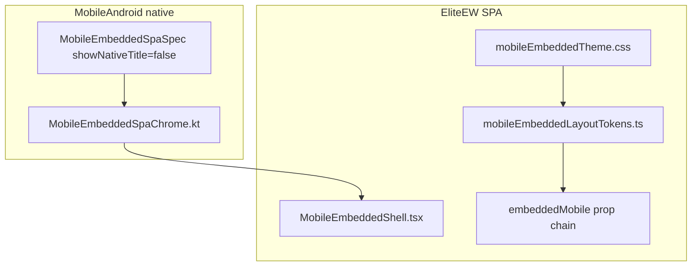

# Mobile Android · Embedded SPA UI Style (канон)

**Статус:** канон визуального и layout-стиля для **всех** `#/mobile-*` hash-маршрутов в MobileAndroid WebView.  
**Версия стиля:** OTA **≥ 0.2.160** (SPA + native chrome parity).  
**Связанные документы:** [MOBILE-ANDROID-EMBEDDED-SPA-WEBVIEW-TEMPLATE.md](MOBILE-ANDROID-EMBEDDED-SPA-WEBVIEW-TEMPLATE.md) (bootstrap/host), [MOBILE-ANDROID-SCALE-CHROME-POLICY.md](MOBILE-ANDROID-SCALE-CHROME-POLICY.md) / `PremiumGlass.kt` (native glass tokens).

---

## 1. Scope

Единый стиль применяется к embedded SPA внутри `EmperyMobileEmbeddedSpaWebViewActivity`:

| Маршрут | Hash | Feature root |
|---------|------|--------------|
| **Связи** | `#/mobile-social-hub` | `SocialHubApp embeddedMobile` |
| **EWA · спутник** | `#/mobile-ewa-companion` | `EwaDesktopApp embeddedMobile` |
| **Справочная Навигация** | `#/mobile-handbook` | `AssistantApp embeddedMobile` |
| **Обращения** | `#/mobile-feedback-hub` | `FeedbackHubApp embeddedMobile` |
| **Центр уведомлений** | `#/mobile-notifications` | `NotificationsDesktopApp embeddedMobile` |
| **Файловый менеджер** | `#/mobile-content-manager` | `ContentManagerPro embedded embeddedMobile` |
| **EWDesk** | `#/mobile-ewdesk` | `EWDeskApp embeddedMobile` |
| **Professional Worlds** | `#/mobile-professional-worlds` | `ProfessionalWorldsApp embeddedMobile` |
| **Магазин приложений** | `#/mobile-app-store` | `AppStoreWindowContent embeddedMobile` |
| **Настройки рабочего стола** | `#/mobile-desktop-settings` | `DesktopSettingsPanel embeddedMobile` |

**Инвариант:** новый embedded-маршрут **обязан** монтироваться через `MobileEmbeddedShell`, подключать `mobileEmbeddedTheme.css` и переиспользовать токены из `mobileEmbeddedLayoutTokens.ts`. Отдельные page-level CSS для palette/layout **не добавлять**.

**Инвариант WebView viewport:** в `EmperyMobileEmbeddedSpaWebViewActivity` включены `useWideViewPort = true` и `loadWithOverviewMode = true` — CSS-ширина часто **≈1200px** даже на телефоне. Решения layout для embedded **не привязывать** к Tailwind `md:` / `lg:` / `max-md:`; использовать prop **`embeddedMobile`** + атрибуты `[data-embedded-mobile='1']` / `[data-mobile-embedded-shell='1']` и правила в `mobileEmbeddedTheme.css`.

---

## 2. Слои (source of truth)



| Слой | Путь | Роль |
|------|------|------|
| Native toolbar | `MobileEmbeddedSpaChrome.kt` | Фон `#0B0F17`, accent lime `#C4E830`, только close; **без** дублирующего SPA title на EWA/Assistant/Связи |
| Shell wrapper | `MobileEmbeddedShell.tsx` | `data-mobile-embedded-shell="1"`, `h-dvh max-h-dvh`, safe-area, импорт theme CSS |
| Palette + bridges | `mobileEmbeddedTheme.css` | CSS vars `--me-*` → `--desktop-*`; **viewport lock** `html/body/#root/#app-main` → `100dvh` для flex-цепочки |
| Layout tokens | `mobileEmbeddedLayoutTokens.ts` | Tailwind class bundles: glass panels, segment nav, EWA composer/bubbles |
| Route loading | `MobileEmbeddedRouteLoading.tsx` | Компактный boot (не full-screen `EliteBootLoadingScreen`) |
| Fallback header | `MobileEmbeddedSpaChrome.tsx` | SPA-only fallback; на каноне native toolbar заменяет title strip |

---

## 3. Palette и glass

Согласовано с native `MobileDesignTokens` / `PremiumGlass.kt`:

| Token | CSS var | Значение |
|-------|---------|----------|
| Background | `--me-bg` | `#0B0F17` |
| Surface | `--me-surface` | `#121820` |
| Surface soft | `--me-surface-soft` | `#16202C` |
| Panel | `--me-surface-panel` | `#1E2A38` |
| Accent (lime) | `--me-accent` | `#C4E830` |
| Text primary | `--me-text-primary` | `#E8ECF2` |
| Text muted | `--me-text-muted` | `#96A0B4` |

**Glass panel:** radius **22px**, padding **16px** (`MOBILE_EMBEDDED_GLASS_PANEL_CLASS`).  
**Horizontal rhythm:** **12px** (`p-3`) на app root.  
**Segment nav:** pill rail **18px** radius, items **14px** active radius, min touch **44px**.

### 3.1 Viewport и высота (все `#/mobile-*`)

| Слой | Файл / класс | Поведение |
|------|----------------|-----------|
| Android WebView | `EmperyMobileEmbeddedSpaWebViewActivity.kt` | `useWideViewPort = true` — **не** полагаться на «узкий» CSS breakpoint на телефоне |
| SPA root lock | `mobileEmbeddedTheme.css` | `html:has([data-mobile-embedded-shell])` → `body`, `#root`, `#app-main`, `[data-app-router-outlet]` — `height: 100%`, `max-height: 100dvh`, `overflow: hidden` |
| Shell | `MOBILE_EMBEDDED_SHELL_CLASS` | `h-dvh max-h-dvh`; body — `h-full flex-1` |
| Feature flex | `[data-embedded-mobile='1']` на корне feature | `flex` column, `min-height: 0`, дочерние scroll — `flex-1 overflow-y-auto`, **не** `absolute inset-0` без bounded parent |

При добавлении embedded-маршрута проверять **ADB screenshot**: composer внизу, scroll-area заполняет середину, без наложений FAQ/composer.

---

## 4. Layout по маршрутам

### 4.1 Связи (`#/mobile-social-hub`)

- `MobileSocialHubPage` → `MobileEmbeddedShell` → `SocialHubApp embeddedMobile`.
- Segment navigation: `SocialHubMobileSegmentNav` + `MOBILE_EMBEDDED_SEGMENT_RAIL_CLASS`.
- Workspace: glass panel + scroll main (`MOBILE_EMBEDDED_MAIN_CLASS`).
- **Layout по `embeddedMobile`:** KPI grid **2 cols max**; overview columns **1 col**; inbox/privacy grids без `md:`/`lg:`/`xl:`; guided tour off; `data-social-hub-root`.
- **Код:** `SocialHubShell.tsx`, `SocialHubHomeSection.tsx`, `socialHubLayoutTokens.ts` (`shHome*GridClass`), `mobileEmbeddedTheme.css`.
- Native entry: `SocialHubLaunch.kt` / `SocialHubWebViewLauncher.kt`, EW hub + Friends.
- **Smoke (ADB):** EW hub → Связи — segment rail, scroll workspace, KPI 2-col max.

### 4.2 EWA · спутник (`#/mobile-ewa-companion`)

- `MobileEwaCompanionPage` → `EwaDesktopApp embeddedMobile` → `EwaCompanionChatPanel embeddedMobile`.
- **Meta rail скрыт** на embedded mobile (desktop-only hints/panels).
- **Presence header:** горизонтальная строка — sigil **48px**, имя, chip, role line `line-clamp-1` (`MOBILE_EMBEDDED_EWA_PRESENCE_*`).
- **Composer (сверху вниз):**
  1. **Horizontal toolbar** над textarea — photo, operations, restore, voice, speaker, mic, send (`MOBILE_EMBEDDED_EWA_COMPOSER_TOOLBAR_CLASS`, кнопки **40×40**).
  2. Textarea.
  3. **Quick presets** под textarea — горизонтальный scroll, **icon-only** pills (`MOBILE_EMBEDDED_EWA_QUICK_ACTION_ICON_CLASS`: скрыт visible label, `sr-only` сохранён).
- **Assistant bubbles:** full transcript width, min height для коротких ответов — `w-full min-h-14 py-3` (`MOBILE_EMBEDDED_EWA_ASSISTANT_BUBBLE_CLASS`); theme CSS enforces `max-width: 100%` on embedded transcript rows.
- **FirstMeet (gate `pick`):** legend choice tiles — **single column** when `embeddedMobile` (`MOBILE_EMBEDDED_EWA_FIRST_MEET_CHOICE_GRID_CLASS`), not `md:grid-cols-3` (wide WebView breaks Tailwind `md:`). Root `[data-ewa-first-meet='1']`; narrow tier `[data-me-width-tier='narrow']` tightens padding/type via `mobileEmbeddedTheme.css`.
- **Empty transcript gateway:** `CompanionMasterDashboard` with `embeddedMobile` — single-column; shows **Agentic + Media** cards only (workflows/documents via tools CTA); examples stay one column.
- **Physical width tier:** `useMobileEmbeddedHostViewport` sets `[data-me-width-tier]` on `EwaDesktopApp` (`narrow` &lt; 400px · `standard` &lt; 720px · `wide`) from `visualViewport.width` — independent of CSS viewport ~1200px in WebView.
- **Deeplink (native):** `tab=ewa` / `tab=companion`, `/nav/ewa`, FCM `tab=ewa` → `EwaCompanionLaunch` WebView; optional hash suffix `operation`/`run`/`tools`/`open`/`phrases`/`workflows` (`MobileEmbeddedSpaDeepLinkSupport.kt`). Distinct from Desktop Hub scroll `section=ewa`.

> **Не канон:** vertical composer rail справа от textarea (legacy desktop-only).


### 4.3 Ассистент (`#/mobile-handbook`)

- `MobileAssistantPage` → `MobileEmbeddedShell` → `AssistantApp embeddedMobile`.
- Native toolbar: только **Close** (`showNativeTitle = false`); заголовок «Ассистент» — compact SPA header (`MOBILE_EMBEDDED_COMPACT_HEADER_CLASS`).
- **Layout только по `embeddedMobileLayout`**, не по Tailwind `md`/`lg` (см. §1, §3.1).
- **FAQ** свёрнут по умолчанию (`faqMobileOpen = false`); panel скрыт классом `mobile-handbook-faq-collapsed` + `display: none` в theme CSS; открытый panel — `mobile-handbook-faq-open` + `max-height: min(42dvh, clamp(14rem, 38dvh, 22rem))`.
- Chip **«Развернуть FAQ · N вопросов»** в chat-panel (`data-assistant-guide="faq-collapsed-chip"`, `MOBILE_EMBEDDED_HANDBOOK_FAQ_CHIP_CLASS`) — **без** `md:hidden`, виден в wide WebView.
- Кнопка сворачивания FAQ в panel header (`data-assistant-guide="faq-panel-toggle"`) — `md:inline-flex` override на embedded.
- **Скрыто на embedded:** subheader «Переписка», panel «Горячие клавиши», подсказки `Ctrl+.` / «все клавиши» в composer; desktop `lg:` toolbar (всегда mobile refresh + ⋮); empty-chat **Обращения** footer (`requestOpenDesktopApp`) и Alt/Shift FAQ chip hints.
- **Chat:** column split (не `md:flex-row`); scroll messages — `flex-1 min-h-0 overflow-y-auto` (не `absolute inset-0`); composer — `mt-auto`, icon-only send (**2.75rem**, `MOBILE_EMBEDDED_HANDBOOK_COMPOSER_SEND_CLASS`).
- **Scale/width:** COMPACT/STANDARD/COMFORT и wide WebView (~1200 CSS px) — flex-цепочка `MOBILE_EMBEDDED_HANDBOOK_ROOT_CLASS` + `MOBILE_EMBEDDED_HANDBOOK_CHAT_COLUMN_CLASS`; FAQ/composer padding через `clamp()` в theme CSS.
- **Код:** `AssistantApp.tsx` (`embeddedMobileLayout`), `AssistantChatMessageList.tsx`, `mobileEmbeddedLayoutTokens.ts` (handbook tokens), `mobileEmbeddedTheme.css` (`[data-assistant-guide-root='1']`), `MobileAssistantPage.tsx`.
- **Smoke (ADB):** EW hub → Ассистент — header + FAQ chip + scrollable chat + composer внизу; empty chat без desktop Feedback CTA; развернуть/свернуть FAQ на foldable/wide; frontend deploy после rebake.

### 4.4 Обращения (`#/mobile-feedback-hub`)

- `MobileFeedbackHubPage` → `FeedbackHubApp embeddedMobile`.
- Native toolbar owns title; desktop product header скрыт (`data-feedback-hub-guide='header'`).
- **Layout по `embeddedMobileLayout`:** single-column stack (stats → ticket list → compose form); без `xl:grid-cols-2`; stats **1 колонка**; без Esc/filter desktop hints и guided tour.
- **Код:** `FeedbackHubApp.tsx`, `feedbackHub/FeedbackHubStatsSection.tsx`, `feedbackHub/FeedbackHubComposeForm.tsx`, `mobileEmbeddedTheme.css` (`[data-feedback-hub-root='1']`).
- Native entry: `FeedbackHubLaunch.kt` / `FeedbackHubWebViewLauncher.kt`, EW hub + Desktop Hub + Profile → Support.
- **Smoke (ADB):** EW hub → Обращения — stats column, scrollable list, form внизу.

### 4.5 Центр уведомлений (`#/mobile-notifications`)

- `MobileNotificationsPage` → `NotificationsDesktopApp embeddedMobile` → `NotificationHubBody density="window"`.
- Native toolbar owns title; guided tour disabled on embedded; `sr-only` h1 для a11y.
- **Layout по `embeddedMobileLayout`:** quick settings **1 колонка** (без `xl:grid-cols-2` / `sm:grid-cols-3` / `md:grid-cols-*`); filters block сверху с `max-h ~42dvh`, feed снизу с отдельным scroll.
- **Код:** `NotificationsDesktopApp.tsx`, `NotificationHubBody.tsx`, `NotificationHubQuickSettings.tsx`, `mobileEmbeddedTheme.css` (`[data-notifications-hub-root='1']`).
- Native entry: `NotificationsLaunch.kt` / `NotificationsWebViewLauncher.kt`, EW hub + Desktop Hub + Profile → Notifications.
- **Примечание:** compact native list остаётся в Feed → колокольчик; embedded — desktop parity (поиск, группировка, экспорт).
- **Smoke (ADB):** EW hub / Profile → Уведомления — settings rail сверху, прокручиваемый feed, footer actions.

### 4.6 Файловый менеджер (`#/mobile-content-manager`)

- `MobileContentManagerPage` → `ContentManagerPro embedded embeddedMobile` (desktop window density).
- Native toolbar owns title; guided tour disabled on embedded; duplicate product header скрыт (`embeddedMobileLayout`).
- **Layout только по `embeddedMobileLayout`**, не по Tailwind `md:flex-row` (§1, §3.1): split rail (вкладки, upload, поиск) **сверху**, список файлов **снизу** с `flex-1 min-h-0 overflow-y-auto`; grid columns — как на телефоне (`isMobile || embeddedMobileLayout`).
- **Код:** `ContentManagerPro.tsx`, `ContentManagerFilesTab.tsx` (`forceColumnFilesSplit`, `data-cm-files-split`), `mobileEmbeddedTheme.css` (`[data-content-manager-root='1']`).
- Native entry: `ContentManagerLaunch.kt` / `ContentManagerWebViewLauncher.kt`, EW hub → «Файловый менеджер», Desktop Hub.
- **Примечание:** compact native library (`MobileContentLibraryScreen`) остаётся в UGS hub; EW hub Files открывает embedded SPA.
- **Smoke (ADB):** EW hub → Файловый менеджер — rail сверху (сворачиваемый), прокручиваемый список, без бокового desktop-split на всю высоту.

### 4.7 EWDesk (`#/mobile-ewdesk`)

- `MobileEwDeskPage` → `EWDeskApp embeddedMobile` (phone-style list/detail navigation even in wide WebView).
- Native toolbar owns title; product header and guided tour disabled on embedded.
- Native entry: `EwDeskLaunch.kt` / `EwDeskWebViewLauncher.kt`, Feed tab + Desktop Hub.
- **Примечание:** compact native feed остаётся на вкладке EWDesk; embedded — desktop parity (поиск, фильтры, starred, reading pane).

### 4.8 Professional Worlds (`#/mobile-professional-worlds`)

- `MobileProfessionalWorldsPage` → `ProfessionalWorldsApp embeddedMobile` → `ProfessionalWorldsRuntimeShell`.
- Native toolbar owns title; product header hidden; guided tour disabled on embedded; `sr-only` h1.
- **Layout по `embeddedMobileLayout`:** nav rail **сверху** (horizontal scroll), workspace **снизу**; shared grids без `md:`/`xl:` (Overview, Clients, Profile, Brand); `embeddedMobileLayout` в workspace context.
- **Код:** `ProfessionalWorldsRuntimeShell.tsx`, `ProfessionalWorldsSidebarNav.tsx`, `professionalWorldsLayoutTokens.ts` (`pwShellBodyClass`, `pw*GridClass`), `mobileEmbeddedTheme.css` (`[data-professional-worlds-root='1']`).
- Native entry: `ProfessionalWorldsLaunch.kt` / `ProfessionalWorldsWebViewLauncher.kt`, Desktop Hub.
- **Smoke (ADB):** Desktop Hub → Professional Worlds — horizontal nav, scrollable workspace, overview metrics в 2 колонки max.

### 4.9 Магазин приложений (`#/mobile-app-store`)

- `MobileAppStorePage` → `AppStoreWindowContent embeddedMobile` → `AppStoreViewStack` / `AppStore variant="page"`.
- Native toolbar owns title; desktop page header and guided tour disabled on embedded; install **success** toast без «Открыть приложение»; install **errors** — inline на карточке (toast отключён на embedded).
- **Layout только по `embeddedMobileLayout`**, не по Tailwind `lg:` (§1, §3.1): sidebar rail **сверху** (поиск, фильтры, горизонтальные категории), каталог **снизу** с scroll; grid **1 колонка**; mobile catalog bar; без desktop keyboard hints (`/` shortcut) / lg sidebar summary.
- **Embedded density:** premium hero — только строка метрик (без marketing copy и CTA); секции «Новинки» / «Недавно просмотренные» скрыты; wait-hint при install — sidebar `busyHint` (без дубля tooltip на карточках).
- **`aria-busy`** на `<main>` каталога во время загрузки и install/uninstall.
- **Код:** `AppStore.tsx` (`catalogGridClass`, `storeNavAsideClass`, `storeCategoryNavClass`), `appStore/AppStoreCatalogSections.tsx`, `appStore/AppStoreHeroSearchCluster.tsx`, `utils/appStoreInstallError.ts`, `mobileEmbeddedTheme.css` (`[data-app-store-root='1']`).
- Native entry: `AppStoreLaunch.kt` / `AppStoreWebViewLauncher.kt`, Desktop Hub (отдельная карточка над lite-каталогом).
- **Примечание:** compact native store list остаётся в Desktop Hub → «Приложения»; embedded — полный desktop catalog UX.
- **Smoke (ADB):** Desktop Hub → «Открыть магазин» — rail сверху, компактные метрики, прокручиваемый каталог, карточки в одну колонку; install error на карточке без toast.

### 4.10 Настройки рабочего стола (`#/mobile-desktop-settings`)

- `MobileDesktopSettingsPage` → `MobileEmbeddedDesktopSettingsWorkspace` → `DesktopWorkspaceContent embeddedMobileSettingsOnly` → `DesktopSettingsPanel embeddedMobile`.
- Native toolbar owns title/close; desktop header title row hidden; guided tour disabled on embedded; `sr-only` h1.
- **Layout по `embeddedMobileLayout`:** horizontal tab strip (не sidebar `md:flex` на wide WebView); content column scroll.
- **Код:** `DesktopSettingsPanel.tsx` (`settingsTabsDesktopLayout`), `mobileEmbeddedTheme.css` (`[data-desktop-settings-root='1']`).
- Native entry: `DesktopSettingsLaunch.kt` / `DesktopSettingsWebViewLauncher.kt`, Desktop Hub.
- **Примечание:** lite theme/config readout остаётся в Desktop Hub → «Конфигурация»; embedded — полный Settings Center (все вкладки + expansion). `WallpaperPicker` и `DesktopWindowLayoutPresetApplyDialog` монтируются в `embeddedMobileSettingsOnly`.
- **Smoke (ADB):** Desktop Hub → Настройки — horizontal tabs, scrollable tab content.

---

## 5. Prop chain `embeddedMobile`

```
Mobile*Page.tsx
  └─ MobileEmbeddedShell
       └─ FeatureApp embeddedMobile={true}
            └─ … nested panels (EwaCompanionChatPanel, SocialHubShell, …)
```

**Правила:**

- На `embeddedMobile` скрывать desktop window chrome, meta rails, full-screen boot.
- Ветки layout (**column vs row**, visibility панелей, toolbar mobile vs desktop) — по **`embeddedMobile` / `embeddedMobileLayout`**, не только по `md:`/`lg:`.
- Не форсить interactive login gate (`App.tsx`, `sessionSlice`, `pageNavigation`).
- UA / client detection: `eliteewEmbeddedClient.ts`, `mobileEmbeddedSpaRoute.ts`, `mobileEmbeddedNativeBridge.ts`.

---

## 6. Native ↔ SPA checklist (новый маршрут)

**Frontend**

- [ ] Hash в `mobileEmbeddedSpaRoute.ts`, router, `desktopOnlyLegacyRoutes`.
- [ ] `Mobile{Feature}Page.tsx` только shell + loading; **без** локального palette CSS.
- [ ] `embeddedMobile` в корневом feature component + layout hooks (**не** только responsive breakpoints).
- [ ] Scroll regions: `flex-1 min-h-0 overflow-y-auto`; viewport chain §3.1; ADB smoke на устройстве.
- [ ] Токены из `mobileEmbeddedLayoutTokens.ts` или новые константы **в том же файле** (не разрозненные magic classes).

**Android**

- [ ] Запись в `MobileEmbeddedSpaSpec.kt`, `showNativeTitle = false` если native toolbar достаточен.
- [ ] Launcher + EW hub entry; `MobileEmbeddedSpaChrome` host.
- [ ] UA marker в `eliteewEmbeddedClient` parity test при необходимости.

**Docs**

- [ ] Строка в этой таблице §1 и §4.
- [ ] Changelog в [MOBILE-ANDROID-EMBEDDED-SPA-WEBVIEW-TEMPLATE.md](MOBILE-ANDROID-EMBEDDED-SPA-WEBVIEW-TEMPLATE.md).

---

## 7. Changelog

| Дата | Изменение |
|------|-----------|
| 2026-06-21 | Первый канон unified embedded UI: shared shell/theme/tokens; Связи route; EWA horizontal composer + icon presets + assistant bubble min-width; Assistant compact; native `MobileEmbeddedSpaChrome`; OTA 0.2.160 |
| 2026-06-21 | **Ассистент layout fix:** wide WebView + height chain (`100dvh`, flex scroll); §3.1 viewport invariant; §4.3 детализация; SPA `prod-baked-20260621-0715` |
| 2026-06-21 | **Файловый менеджер embedded layout:** column split rail/list + viewport flex chain; §4.6 |
| 2026-06-21 | **App Store embedded layout:** column split + 1-col grid + mobile nav; §4.9 |
| 2026-06-30 | **App Store embedded UX (audit 9/20):** compact hero metrics, hide discovery rows, install error mapper + inline-only errors on embedded, `aria-busy` during install; §4.9 |
| 2026-06-21 | **Обращения embedded layout:** single-column polish + flex viewport; §4.4 |
| 2026-06-21 | **Notifications embedded layout:** single-column quick settings + split scroll; §4.5 |
| 2026-06-21 | **Professional Worlds embedded layout:** column shell + horizontal nav + grid helpers; §4.8 |
| 2026-06-30 | **Ассистент polish (T04):** wide WebView FAQ chip/toggle без `md:hidden`; handbook layout tokens; scale-aware FAQ/composer CSS; contract test `AssistantApp.mobile-embedded.contract.test.ts`; §4.3 |
| 2026-06-21 | **Связи + Desktop Settings embedded layout polish; §4.1, §4.10** |
| 2026-06-30 | **Assistant T03 residual close:** FirstMeet single-column + width tier; assistant bubble CSS lock; `tab=ewa` deeplink → WebView; §4.2 |
| 2026-07-16 | **W4 U4 polish:** Assistant empty chat hides desktop Обращения CTA on embedded; EWA Master Dashboard compact (agentic+media) when `embeddedMobile`; §4.2 / §4.3 |
