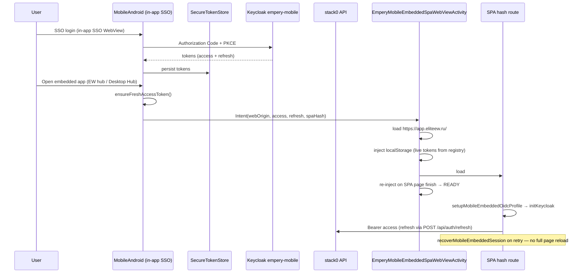

# Mobile Android · Embedded SPA WebView — шаблон и канон

**Статус:** канон для переноса **desktop/web SPA-модулей** в MobileAndroid через in-app WebView с **native-first OAuth** (`empery-mobile`, PKCE, backend callback).

**Reference implementations (OTA ≥ 0.2.160):**

| Приложение | Hash route | Точки входа в MobileAndroid |
|------------|------------|----------------------------|
| **Связи** | `#/mobile-social-hub` | EW hub, Friends |
| **EWA · спутник** | `#/mobile-ewa-companion` | EW hub, Desktop Hub |
| **Ассистент** | `#/mobile-handbook` | EW hub, Desktop Hub |
| **Обращения** | `#/mobile-feedback-hub` | EW hub, Desktop Hub, Profile |
| **Центр уведомлений** | `#/mobile-notifications` | EW hub, Desktop Hub, Profile |
| **Файловый менеджер** | `#/mobile-content-manager` | EW hub, Desktop Hub |
| **EWDesk** | `#/mobile-ewdesk` | Feed tab, EW hub, Desktop Hub |
| **Professional Worlds** | `#/mobile-professional-worlds` | EW hub, Desktop Hub |
| **Магазин приложений** | `#/mobile-app-store` | EW hub, Desktop Hub |
| **Настройки рабочего стола** | `#/mobile-desktop-settings` | EW hub, Desktop Hub |

**UI style canon:** [MOBILE-ANDROID-EMBEDDED-SPA-UI-STYLE.md](MOBILE-ANDROID-EMBEDDED-SPA-UI-STYLE.md) — palette, glass, layout per route, EWA composer order.

**Связанные документы:** [KEYCLOAK-ELITEEW.md](../../platform/docker-re_doc/KEYCLOAK-ELITEEW.md), [MOBILE-ANDROID-GUIDELINES.md](MOBILE-ANDROID-GUIDELINES.md), [FRONTEND-AUTH.md](../FRONTEND-AUTH.md), [ANDROID-API-CONTRACTS.md](../../api/ANDROID-API-CONTRACTS.md), [MOBILE-SECURE-CONNECTION-OPERATIONS.md](MOBILE-SECURE-CONNECTION-OPERATIONS.md).

---

## 1. Когда использовать этот паттерн

| Подходит | Не подходит |
|----------|-------------|
| Богатый UI уже есть в SPA (desktop route / feature module) | Простой CRUD — нативный Compose дешевле |
| Нужен **тот же** UX, что на `app.eliteew.ru` | OAuth/login **внутри** WebView (запрещено RFC 8252) |
| Пользователь уже залогинен в MobileAndroid (in-app SSO WebView + `empery-mobile`) | Standalone APK без native shell |
| Модуль живёт на hash-route (`#/…`) без desktop window manager | Требуется полный desktop chrome / multi-window |

**Инвариант:** login только **нативно** (MobileAndroid in-app SSO WebView + backend callback). Embedded SPA WebView получает access/refresh tokens из native SecureTokenStore, не запускает собственный `empery-web` login.

---

## 2. Архитектура (канон)



### Слои

| Слой | Ответственность |
|------|-----------------|
| **Native SSO** | In-app SSO WebView, `empery-mobile`, custom scheme redirect, refresh через API |
| **Shared WebView host** | `EmperyMobileEmbeddedSpaWebViewActivity` — один activity для всех embedded SPA; маршрут через `MobileEmbeddedSpaSpec` |
| **Token registry** | `MobileEmbeddedOidcBridgeRegistry` — **живые** токены из `AuthRepository.readSpaOidcBootstrapTokens()` (alias `EwaCompanionOidcBridgeRegistry` сохранён для совместимости) |
| **Launchers** | `EwaCompanionWebViewLauncher`, `AssistantWebViewLauncher` → `MobileEmbeddedSpaWebViewLauncher` |
| **SPA profile** | `mobileEmbedded` OIDC profile, shared storage keys, no Keycloak redirect in WebView |
| **Session UX** | `recoverMobileEmbeddedSession()`, silent AuthContext sync, grace before error screen |
| **API (optional)** | `GET /api/v1/auth/mobile-embedded/webview-shell?spa=…` — audit/validation; **не единственный** bootstrap на Huawei |
| **Keycloak** | Client `empery-mobile`, mappers `sub`/`sid`/`audience`; **`KEYCLOAK_BIND_BROWSER_SESSION_LIMIT_FLOW=false` по умолчанию** |

**Миграций БД нет.** Новых env для stack0 API нет (используются существующие `KEYCLOAK_MOBILE_CLIENT_ID` / unified_settings).

---

## 3. Shared Android paths (`pack-cloud/mobile/`)

| Файл | Роль |
|------|------|
| `feature/desktop/EmperyMobileEmbeddedSpaWebViewActivity.kt` | Единый WebView host: 3-phase bootstrap, per-route UA marker, live inject |
| `feature/desktop/MobileEmbeddedSpaSpec.kt` | Реестр маршрутов (`socialHub`, `ewaCompanion`, `handbook`) |
| `feature/desktop/MobileEmbeddedSpaChrome.kt` | Native Compose toolbar (palette parity с SPA) |
| `feature/desktop/SocialHubWebViewLauncher.kt` / `SocialHubLaunch.kt` | Связи embedded entry |
| `feature/desktop/MobileEmbeddedSpaWebViewLauncher.kt` | Intent extras, trusted origin, `spaUrl()` |
| `feature/desktop/MobileEmbeddedSpaLaunch.kt` | Общий gate: tunnel + session + origin |
| `feature/desktop/MobileEmbeddedOidcBridgeRegistry.kt` | Live token source для JS bridge + inject |
| `feature/desktop/EwaCompanionWebViewLauncher.kt` | Thin wrapper → EWA spec |
| `feature/desktop/AssistantWebViewLauncher.kt` | Thin wrapper → Assistant spec |
| `feature/desktop/EwaCompanionLaunch.kt` / `AssistantLaunch.kt` | Entry + toasts (tunnel/session) |
| `app/.../MobileApp.kt` | `MobileEmbeddedOidcBridgeRegistry.install { … }` |
| `app/.../MainActivity.kt` | `openEwHubEwaCompanion`, `openEwHubAssistant`, `ensureFreshAccessToken()` |
| `app/.../shell/MobileShellEwHub.kt` | EW hub sheet: все embedded SPA + AI + Music |
| `feature/desktop/DesktopHubFeature.kt` | Карточки «Открыть спутника» / «Открыть справочник» |
| `core/auth/AuthRepository.kt` | `readSpaOidcBootstrapTokens()`, `ensureFreshAccessToken()` |
| `app/proguard-rules.pro` | Keep `@JavascriptInterface` `NativeOidcBootstrapBridge` |

**Удалено (0.2.154):** `EmperyEwaCompanionWebViewActivity.kt`, `EwaCompanionOidcBridgeRegistry.kt` — заменены shared host + registry.

---

## 4. Frontend paths (`shared/web/frontend/`)

| Файл | Роль |
|------|------|
| `src/entries/setupMobileEmbeddedOidcProfile.ts` | **До** `initKeycloak()` — profile для любого `#/mobile-*` embedded hash |
| `src/utils/mobileEmbeddedSpaRoute.ts` | `resolveMobileEmbeddedHashRoute()`, `isMobileAssistantEmbeddedRoute()` |
| `src/services/keycloakProfile.ts` | `mobileEmbedded` keys + `empery-mobile` client id |
| `src/services/keycloak.ts` | Embedded refresh `/api/auth/refresh`, `recoverMobileEmbeddedSession()` |
| `src/contexts/AuthContext.tsx` | Silent sync on refresh; embedded recovery on error/expiry |
| `src/utils/eliteewEmbeddedClient.ts` | UA markers (EWA + Assistant) / flag detection |
| `src/appState/slices/sessionSlice.ts` | Не форсить `login` на embedded hashes |
| `src/App.tsx` | Skip interactive login gate для embedded SPA routes |
| `src/pages/MobileSocialHub/*` | Связи shell → `MobileEmbeddedShell` + `SocialHubApp embeddedMobile` |
| `src/pages/MobileEwaCompanion/*` | EWA shell → `MobileEmbeddedShell` + `EwaDesktopApp embeddedMobile` |
| `src/pages/MobileAssistant/*` | Assistant shell → `AssistantApp embeddedMobile`; FAQ collapsed; flex viewport layout (§ UI-STYLE 4.3) |
| `src/components/mobileEmbedded/*` | Shared `#/mobile-*` shell, theme CSS, route loading, layout tokens |
| `src/features/ewa/EwaCompanionChatPanel.tsx` | `embeddedMobile`: meta rail hidden, horizontal presence, toolbar above textarea, icon-only presets below |

---

## 5. Backend (`shared/api/`)

| Файл | Роль |
|------|------|
| `routers/auth_mobile_embedded.py` | `GET /api/v1/auth/mobile-embedded/webview-shell?spa=<hash>` |
| `domains/auth.py` | Router registration |
| `middleware/oauth2_protection.py` | Public paths для shell |
| `tests/test_auth_mobile_embedded.py` | Contract tests (EWA + handbook + reject unknown `spa`) |

---

## 6. Контракт констант по приложениям

| Константа | EWA · спутник | Ассистент |
|-----------|---------------|------------|
| Hash route | `mobile-ewa-companion` | `mobile-handbook` |
| SPA component | `EwaDesktopApp` | `AssistantApp` |
| UA marker | `EmperyMobileEwaWebView` | `EmperyMobileAssistantWebView` |
| Launcher | `EwaCompanionWebViewLauncher` | `AssistantWebViewLauncher` |
| Launch gate | `EwaCompanionLaunch` | `AssistantLaunch` |

**Общее для всех embedded SPA:**

| Константа | Значение |
|-----------|----------|
| WebView activity | `EmperyMobileEmbeddedSpaWebViewActivity` |
| Flag LS key | `eliteew.mobileEmbeddedClient.v1` |
| Token LS key | `eliteew.keycloak.mobileEmbedded.oidcTokens.v1` |
| OIDC profile | `mobileEmbedded` |
| Keycloak client | `empery-mobile` |
| Bridge name | `EmperyMobileNativeOidc` |
| Bridge read | `getBootstrapJson()` |
| Bridge refresh | `refreshSessionJson()` — **sole** refresh owner (native AuthRepository mutex); SPA must not call `/api/auth/refresh` |
| WebView headers (optional shell) | `X-EliteEW-Mobile-WebView: 1`, `X-EliteEW-Mobile-Refresh` |

Для **нового** embedded-приложения: добавьте строку в `MobileEmbeddedSpaSpecs`, hash в `mobileEmbeddedSpaRoute.ts`, `PageType`, `AppRouter`, mobile page + CSS.

---

## 7. Bootstrap localStorage — матрица подходов

### ❌ Не работает (Huawei WebView 114.x, prod evidence)

| Подход | Симптом | Причина |
|--------|---------|---------|
| Прямой `loadUrl(#/route)` + inject после load | «Сессия не подключилась» | Race: `initKeycloak()` раньше inject |
| `about:blank` + inject + reload | Blank / lost session | Storage partition / reload timing |
| Server shell **как единственный** путь | **Белый экран** (API 200) | localStorage с path `/api/…` не переносится на `/` |
| OAuth redirect в WebView на `auth.eliteew.ru` | Loop / blocked | RFC 8252 + `shouldOverrideUrlLoading` |
| SPA `location.reload()` как единственный retry | Частые ошибки сессии | Не re-inject native tokens |

### ✅ Рабочий канон (0.2.154+)

**Трёхфазный bootstrap в `EmperyMobileEmbeddedSpaWebViewActivity`:**

1. **`LOADING_ORIGIN`** — `webView.loadUrl("$webOrigin/")`.
2. **`onPageFinished` (origin)** — `injectOidcBootstrap()` из **`MobileEmbeddedOidcBridgeRegistry.readTokens()`** (fallback — Intent extras).
3. **`LOADING_SPA`** — `loadUrl("$origin/#/{spaHash}?spaBoot=${timestamp}")`.
4. **`onPageFinished` (target hash)** — повторный inject → **`READY`**.

**Defence in depth:** `@JavascriptInterface` `EmperyMobileNativeOidc.getBootstrapJson()` читает registry на каждый вызов; SPA `recoverMobileEmbeddedSession()` на «Повторить». Token refresh в embedded — только `refreshSessionJson()` → native `AuthRepository` (не backend `/api/auth/refresh`).

---

## 8. Mobile layout (embedded WebView)

### WebView viewport (обязательно)

`EmperyMobileEmbeddedSpaWebViewActivity` задаёт `useWideViewPort = true` — SPA видит **широкий** CSS viewport. Embedded layout **не строить** только на Tailwind `md`/`lg`. Канон: [MOBILE-ANDROID-EMBEDDED-SPA-UI-STYLE.md](MOBILE-ANDROID-EMBEDDED-SPA-UI-STYLE.md) §1, §3.1.

### Shared native palette (`mobileEmbeddedTheme.css`)

All `#/mobile-*` routes mount **`MobileEmbeddedShell`**, which applies the same palette as native **`MobileEmbeddedSpaChrome.kt`**:

| Token | Value |
|-------|-------|
| background | `#0B0F17` |
| surface | `#121820` |
| accent | `#C4E830` (lime) |
| text | `#E8ECF2` / muted `#96A0B4` |

Glass panels: **22dp** radius, **16dp** padding. Native toolbar: **`showNativeTitle = false`** on EWA, Assistant, Связи.

Boot loading: **`MobileEmbeddedRouteLoading`** (not full-screen `EliteBootLoadingScreen`).

### Связи (`#/mobile-social-hub`)

- `SocialHubApp embeddedMobile` → segment nav + glass panel workspace.

### EWA · спутник (`#/mobile-ewa-companion`)

- `EwaDesktopApp embeddedMobile` → compact horizontal presence; **horizontal composer toolbar above textarea**; icon-only quick presets below; meta rail hidden; assistant bubbles `w-full min-h-14`. См. [MOBILE-ANDROID-EMBEDDED-SPA-UI-STYLE.md](MOBILE-ANDROID-EMBEDDED-SPA-UI-STYLE.md) §4.2.

### Ассистент (`#/mobile-handbook`)

- `AssistantApp embeddedMobile`; FAQ collapsed by default; layout — prop `embeddedMobileLayout` + `[data-embedded-mobile='1']` в `mobileEmbeddedTheme.css` (viewport `100dvh`, flex chat scroll, composer `mt-auto`).
- Детали UX и smoke: [MOBILE-ANDROID-EMBEDDED-SPA-UI-STYLE.md](MOBILE-ANDROID-EMBEDDED-SPA-UI-STYLE.md) §4.3.

---

## 9. Optional API: `GET /api/v1/auth/mobile-embedded/webview-shell`

Публичный path (Bearer валидируется в handler). **Не заменяет** origin inject на Huawei.

| Query | Значение |
|-------|----------|
| `spa` | `mobile-ewa-companion` (default), `mobile-handbook`, или `mobile-social-hub` |

| Header | Обязательность | Значение |
|--------|----------------|----------|
| `Authorization` | да | `Bearer <access_token>` |
| `X-EliteEW-Mobile-Refresh` | да | refresh token (min 8 chars) |
| `X-EliteEW-Mobile-WebView` | да | `1` |
| `User-Agent` | рекомендуется | `EmperyMobileEwaWebView` или `EmperyMobileAssistantWebView` |

**Ответ:** HTML → set localStorage → `location.replace` на `https://<host>/#/{spa}`.

**Проверки:** `azp === empery-mobile`; unknown `spa` → `400`.

**Тест:** `bash docker/scripts/run-stack0-api-tests.sh api/tests/test_auth_mobile_embedded.py`

---

## 10. Keycloak env (harden script)

| Env | Default | Назначение |
|-----|---------|------------|
| `KEYCLOAK_BIND_BROWSER_SESSION_LIMIT_FLOW` | `false` | Opt-in bind `browserFlow` → `eliteew-browser-session-limit` |
| `KEYCLOAK_MOBILE_EXTRA_REDIRECT_URIS` | — | Доп. redirect для `empery-mobile` |

---

## 11. Deploy и smoke

| Контур | Команда (command-center `.136`) |
|--------|----------------------------------|
| SPA + API | `bash docker/scripts/eliteew-deploy.sh release stack0 --all` (command-center; wraps baked deploy) |
| Mobile OTA | `bash docker/scripts/mobile-apk-release-cycle.sh --yes --all` (`eemobile`) |
| Keycloak (`empery-mobile`) | `./docker/scripts/keycloak-harden-empery-realm.sh docker/env_file/.env.stack6` |

```bash
curl -sf https://app.eliteew.ru/app-build-version.txt
bash docker/scripts/run-stack0-api-tests.sh api/tests/test_auth_mobile_embedded.py
ssh 192.168.1.111 'curl -sf http://127.0.0.1:29000/api/health'
```

На устройстве: OTA **≥ 0.2.154** → **EW → EWA · спутник** или **EW → Ассистент** (не `pm clear` без нужды).

---

## 12. Шаблон: новое embedded-приложение

**Android:**

- [ ] Запись в `MobileEmbeddedSpaSpecs` + strings (error/tunnel/session)
- [ ] `{App}WebViewLauncher` + `{App}Launch` (или прямой вызов `MobileEmbeddedSpaLaunch`)
- [ ] Точка входа в EW hub / Desktop Hub
- [ ] `ensureFreshAccessToken()` перед Intent
- [ ] ProGuard keep bridge

**Frontend:**

- [ ] Hash в `mobileEmbeddedSpaRoute.ts`, `PageType`, `AppRouter`, `desktopOnlyLegacyRoutes`
- [ ] `Mobile{App}Page.tsx` + `.css` (grace, retry, compact layout)
- [ ] Embedded layout hooks в desktop component (hide chrome, collapse panels; **embeddedMobile flag**, не только breakpoints)

**Backend (optional):**

- [ ] Добавить hash в `ALLOWED_MOBILE_EMBEDDED_SPA_HASHES` + тест redirect

---

## 13. Changelog

| Дата | Изменение |
|------|-----------|
| 2026-06-19 | Первый канон: bootstrap matrix, EWA reference |
| 2026-06-19 | 0.2.153: live registry, session recover, EWA compact layout, server shell API |
| 2026-06-19 | 0.2.154: shared `EmperyMobileEmbeddedSpaWebViewActivity`, Ассистент `#/mobile-handbook`, `?spa=` на webview-shell |
| 2026-06-21 | 0.2.161: Обращения `#/mobile-feedback-hub`, EW hub + Desktop Hub + Profile entry |
| 2026-06-21 | 0.2.162: Notification Center `#/mobile-notifications`, EW hub + Desktop Hub + Profile entry |
| 2026-06-21 | 0.2.163: Файловый менеджер `#/mobile-content-manager`, EW hub Files + Desktop Hub entry |
| 2026-06-21 | Файловый менеджер embedded layout polish: column split + flex viewport (UI-STYLE §4.6) |
| 2026-06-21 | App Store embedded layout polish: column split + mobile catalog grid (UI-STYLE §4.9) |
| 2026-06-21 | Обращения embedded layout polish: single-column + flex viewport (UI-STYLE §4.4) |
| 2026-06-21 | Notifications embedded layout polish: single-column settings + split scroll (UI-STYLE §4.5) |
| 2026-06-21 | Professional Worlds embedded layout polish: column shell + horizontal nav (UI-STYLE §4.8) |
| 2026-06-21 | Связи + Desktop Settings embedded layout polish (UI-STYLE §4.1, §4.10) |
| 2026-06-21 | 0.2.164: EWDesk `#/mobile-ewdesk`, Feed tab + Desktop Hub entry |
| 2026-06-21 | 0.2.165: Professional Worlds `#/mobile-professional-worlds`, Desktop Hub entry |
| 2026-06-21 | 0.2.166: App Store `#/mobile-app-store`, Desktop Hub entry |
| 2026-06-21 | 0.2.167: Desktop Settings `#/mobile-desktop-settings`, Desktop Hub entry |
| 2026-06-21 | SPA fix: `ContentManagerPro` missing `cn` import broke mobile file manager (`cn is not defined`); frontend `prod-baked-20260621-0655` |
| 2026-06-21 | **Ассистент embedded layout:** wide WebView viewport invariant + flex height chain; UI-STYLE §3.1/§4.3; SPA `prod-baked-20260621-0715` |
| 2026-06-30 | **Ассистент polish (T04):** FAQ chip/toggle wide WebView fix; `MOBILE_EMBEDDED_HANDBOOK_*` tokens; contract test |
