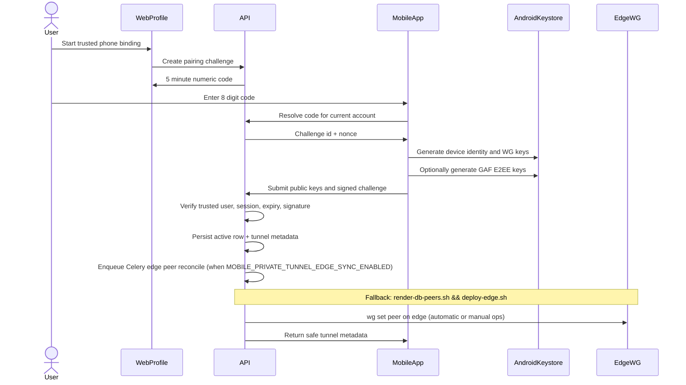
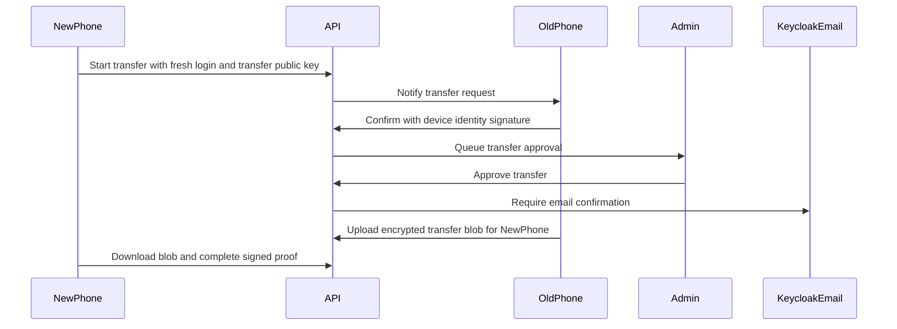

# Mobile Trusted Device Binding

**Status:** Living — trusted-device registry, web pairing, Android bind UI, Celery/manual edge peer sync, transfer backend, and GAF E2EE eligibility gates (from 2026-06-17+).
**Scope:** MobileAndroid trusted device binding, `EliteEW Secure Connection` peer provisioning via `mobile-private-tunnel`, GAF E2EE device keys, transfer without server-side key recovery. App SSO prerequisite: Keycloak **`empery-mobile`**.

## Goal

Trusted Device Binding adds a device-bound security layer above Keycloak SSO:

- Keycloak proves the user session.
- Trusted device keys prove that the approved phone is present.
- WireGuard keys grant private tunnel access only to approved devices.
- GAF E2EE keys enable encrypted chats only on devices that opted in and still hold their private material.

This is not phone-number or SIM binding. The stable device identity is an app/device cryptographic identity generated on the phone.

## Non-Negotiable Rules

- The phone generates private keys locally.
- The server never receives device private keys, WireGuard private keys, or GAF private keys.
- The server stores public keys, opaque encrypted transfer blobs, device metadata, status, and audit records.
- Device identity, WireGuard, and GAF E2EE keys are separate key families.
- Lost GAF private keys cannot be recovered from the server.
- Transfer is allowed only from an active old device to a new device, with old-device confirmation, admin approval, and user verification.
- Trusted device binding requires `users.is_trusted`.
- Binding, transfer, revoke, and key rotation require fresh authentication.
- If Android screen lock is not configured, trusted binding and GAF E2EE must not be enabled.

## Key Families

| Key family | Required | Generated by | Private key stored | Server stores | Purpose |
|------------|----------|--------------|--------------------|---------------|---------|
| Device identity | yes | Mobile app | Android Keystore, user-auth protected | Public key + fingerprint | Signs server challenges, proves exact trusted device. |
| WireGuard | yes for private tunnel | Mobile app | Android Keystore or encrypted local config wrapped by Keystore | Public key, assigned tunnel metadata | Edge peer identity for `EliteEW Secure Connection`. |
| GAF E2EE | optional at binding | Mobile app | Android Keystore-wrapped material, user-auth protected | Public identity/prekeys only | Client-side chat encryption and secure device transfer. |
| Transfer key | only during transfer | New device | Temporary local key | Public transfer key + encrypted relay blob metadata | Old device encrypts key material for the new device. |

WireGuard keys must not be reused as GAF chat keys. Device identity keys must not encrypt messages. Each key family has one job.

## Android Storage Policy

MobileAndroid must use Android system protection:

- Device identity private key: Android Keystore with `userAuthenticationRequired`.
- GAF private material: encrypted by a Keystore wrapping key requiring device credential / biometric.
- WireGuard private key: encrypted locally; high-value actions such as export/rotate/transfer require biometric or device credential.
- Binding is blocked if no screen lock is configured.
- After reboot, Android may require PIN/password before biometric keys are usable; the app should show a recoverable state.
- If screen lock is removed or keys are invalidated, the app shows re-bind required. E2EE history remains unavailable unless transferred earlier.

Recommended user-auth windows:

- Device proof for routine API trust: short window, for example 5-15 minutes.
- Transfer, revoke, GAF E2EE enable, and key rotation: authenticate per operation.
- Background sync must not unlock GAF private keys silently.

Phase 4/5 Android implementation:

- `pack-cloud/mobile/app/src/main/java/world/empery/mobile/trusteddevice/MobileTrustedDeviceKeyStore.kt`
- Device identity uses Android Keystore P-256 signing (`p256-es256`) with user authentication required.
- Backend accepts `p256-es256` for Android and keeps `ed25519` support for future clients.
- WireGuard keypair is generated on the phone via the WireGuard tunnel library; private key is stored in encrypted app prefs and never sent to API.
- Optional GAF preparation generates a local software P-256 ECDH keypair and stores the private material encrypted in app prefs. This is only a foundation for Phase 7; final GAF E2EE may still move to X25519/prekey bundles before public rollout.
- `MobileTrustedDeviceKeyStore.buildWireGuardConfig(...)` assembles client config from local WG private key and server metadata.
- Mobile Profile → Security now has a Trusted Device card. The user enters the 8 digit web pairing code; the phone resolves the hidden challenge metadata, generates/signs local key material, calls `/api/v1/mobile-devices/bind`, and stores the returned WireGuard config in the existing Secure Connection manager.
- **Client sync (0.2.105+):** `ProfileTabViewModel.syncTrustedDeviceBinding()` calls `GET /api/v1/mobile-devices` and sets `serverBound` only when an **`status=active`** row matches this phone's `stable_device_id`. Private-tunnel defer clears stale bound UI (`serverBound=false`, syncing) instead of preserving ghost state; `onAuthenticatedNetworkReady()` always re-syncs; pull-to-refresh while defer pending calls sync; opening Profile → Security re-syncs. API `GET /api/v1/mobile-devices` returns `Cache-Control: private, no-store`; the mobile client sends `Cache-Control: no-cache` on the list request.
- Backend binding is fail-closed for WireGuard metadata: if `MOBILE_TRUSTED_DEVICE_WG_ENDPOINT` or `MOBILE_TRUSTED_DEVICE_WG_SERVER_PUBLIC_KEY` is missing, `/bind` returns `503` without consuming the challenge or creating an active trusted-device row.
- Web `Связи` → `Телефон` refreshes the trusted-device list every 30s while the tab is open, polls every 5s while a pairing code is active, and shows a dedicated warning banner if `/api/v1/mobile-devices` fails (overview/APK data still loads). Bound devices show badges for `Телефон привязан`, `Secure Connection ready`, and `GAF E2EE key ready`.
- `GAF E2EE key ready` means the account/device has prerequisite key material for GAF E2EE eligibility. It does not mean a specific chat is already in E2EE mode.
- The first Android UI uses a short device-unlock validity window for signing. A dedicated biometric/device-credential prompt is still required before public rollout.

## Binding Flow



Server response to the phone may include:

- Assigned tunnel address.
- Edge endpoint.
- Server WireGuard public key.
- DNS server.
- Allowed routes.
- Optional preshared-key material only if product policy chooses PSK. A PSK is a shared tunnel secret, not the phone private key.

Current operator/user binding steps:

1. In web, open `Связи` → `Телефон`.
2. Press `Создать код привязки`.
3. If the web returns `403`, the web UI now redirects to Keycloak with `prompt=login&max_age=0`; complete the fresh login and press `Создать код привязки` again.
4. Press `Скопировать код`; this copies only the numeric code.
5. In MobileAndroid, open `Профиль` → `Безопасность` → `Доверенное устройство`.
6. Enter the 8 digit code into `Код привязки`.
7. Keep `Подготовить ключ GAF E2EE` enabled if the device should be eligible for encrypted GAF chats.
8. Press `Привязать телефон`. On success, the app stores the server-provisioned Secure Connection config.

The old JSON payload path is retained only as a diagnostics fallback. It is not the normal user path.

## GAF Chat E2EE Eligibility vs Active E2EE vs Active E2EE

Trusted-device GAF key readiness is only one gate. A GAF chat switches to E2EE only when:

- both participants have active trusted-device GAF keys;
- one participant explicitly proposes E2EE for that chat;
- the other participant explicitly accepts;
- backend `gaf_chats.e2ee_status` becomes `active`.

Ordinary GAF chat remains the default. Either participant may disable E2EE for future messages; old E2EE messages stay ciphertext-only.

**Revoke / lost trusted device:** when `e2ee_status='active'` but one or both participants no longer have active trusted devices with GAF public keys, the API auto-disables E2EE for that chat (`e2ee_status='off'`), emits `gaf_chat.e2ee_consent_changed` with `suspend_reason=trusted_device_lost`, and allows plain messages again. Clients show a user-visible notice; no manual «Отключить E2EE» is required.

**Mobile sync after web revoke:** `GET /mobile-devices?include_inactive=true` returns revoked rows for sync; if the active list is empty but the phone still has local WG keys and a saved `bound_active_device_id`, sync clears local binding and returns to the pairing UI (web «Телефон» stays empty — that is the source of truth).

**Revoke (web SPA):** requires fresh Keycloak auth (same window as pairing). `POST /{id}/revoke` is **idempotent** for already-revoked rows (200 + device). GAF E2EE suspend after revoke is best-effort — a socket emit failure must not turn a successful revoke into HTTP 500 (that previously left the hub in a broken refresh loop).

### Mobile wire identity (2026-06-19)

Trusted-device bind publishes `p256-ecdh` for device eligibility. **Chat wire crypto** uses a separate RSA-OAEP SHA-256 identity (`rsa_oaep_sha256`) stored in encrypted app prefs and uploaded to `gaf_user_public_keys`. This matches desktop `GAFChatCrypto.ts`.

- Mobile decrypts REST + Socket.IO payloads (`body_ciphertext`, `nonce`, session-key envelope).
- Mobile sends E2EE when `e2ee_status='active'` for the chat.
- First mobile wire-key upload may replace an existing desktop RSA public key on the server; partners need a new outbound message so the session key is re-wrapped for the new public key. Desktop private keys on another device cannot be synced to the phone automatically.

## Transfer Without Recovery

There is no server-side recovery of GAF private keys.

Transfer is a controlled device-to-device operation:



Required gates:

- New device logged in via `empery-mobile`.
- Old device active and bound.
- Old device confirms with local biometric/device credential.
- Admin approves transfer.
- Email confirmation is completed now; SMS can be added later as a second channel.
- Server cannot decrypt the transfer blob.

If the old device is lost or wiped, transfer is impossible. The user can bind a new device for future VPN and future GAF E2EE messages, but old encrypted GAF messages remain unreadable.

Phase 6 implementation:

- Backend state machine:
  - `pending_old_device`
  - `pending_admin`
  - `pending_user_email`
  - `ready_for_new_device`
  - `completed`
  - final states: `rejected`, `expired`, `cancelled`
- Transfer request stores:
  - transfer public key and fingerprint;
  - server nonce;
  - old-device signature;
  - opaque encrypted transfer blob and metadata;
  - email confirmation token hash and expiry;
  - admin approval/reject metadata.
- API never stores raw email confirmation token after sending; it stores only a hash.
- SMTP sender defaults to `secrets@eliteew.ru`; API requires `MOBILE_TRUSTED_DEVICE_SMTP_*` env settings.
- If SMTP is missing or send fails, admin approval fails closed and the transfer does not advance as email-sent.
- Android contract foundation exists in `MobileAppApiContracts.kt`; full Compose UX for transfer start/confirm/complete remains a public-readiness task.

## Threat Model

| Threat | Expected behavior |
|--------|-------------------|
| Stolen Keycloak access/refresh token | Cannot provision VPN or trusted device without device key proof and fresh binding flow. |
| Attacker logs in on another phone | Login alone is not trusted-device binding; private tunnel provisioning is denied. |
| Stolen phone while locked | Android Keystore and screen lock protect private keys; revoke device from web/admin. |
| Stolen phone while unlocked | Residual risk. Per-operation biometric/device credential reduces transfer/revoke/GAF key exposure. |
| Backend database leak | Public keys and ciphertext/opaque blobs leak, not private keys. Audit metadata may leak and must be minimized. |
| Admin mistake | Audit trail and explicit approval states must show who approved/revoked/transferred. |
| App reinstall / data clear | Local keys are gone; device must be re-bound. |
| App update | Keys remain in app data and must continue working. |
| Removed screen lock | Android may invalidate keys; app must stop trusted/E2EE use and require re-bind. |

## Server Data Model

Living tables (stack1 Postgres):

- `mobile_trusted_devices`: one row per bound device.
- `mobile_device_pairing_challenges`: short-lived single-use binding challenges.
- `mobile_device_transfer_requests`: transfer state machine and encrypted blob metadata.
- `mobile_device_audit_events`: append-only audit.

Phase 2 migration:

- `shared/api/migrations/20260617_mobile_trusted_devices.sql`

Prod note 2026-06-17:

- After the first stack0 deploy, `/api/v1/mobile-devices` returned `500` because the SQL migration had not been applied on prod-core stack1 Postgres.
- The migration was applied manually to `.111` and recorded in `schema_migrations` as `20260617_02/mobile_trusted_devices`.
- `docker/scripts/apply-eliteew-migrations.sh` now includes this migration so future migration runs do not skip the trusted-device tables.

Phase 2 backend foundation:

- `POST /api/v1/mobile-devices/pairing-challenges` creates a 5 minute single-use challenge, only for `users.is_trusted = true`, and requires fresh Keycloak `auth_time`.
- `POST /api/v1/mobile-devices/pairing-challenges/resolve` lets MobileAndroid exchange a user-entered numeric code for the hidden `challenge_id` and `challenge_nonce` inside the current authenticated account.
- `POST /api/v1/mobile-devices/bind` verifies pairing code hash, device signature over server nonce, 32-byte WireGuard public key, and complete server WireGuard metadata before creating an active row.
- `GET /api/v1/mobile-devices` lists current user's active device rows. Revoked rows remain in admin/audit history.
- `POST /api/v1/mobile-devices/{device_id}/revoke` revokes the registry row and reports pending edge peer removal.
- `POST /api/v1/mobile-devices/{device_id}/rotate-wg` rotates only the WireGuard public key.
  MobileAndroid client path: `MobileTrustedDeviceApi.rotateWgKey` +
  `ProfileTabViewModel.rotateTrustedDeviceWireGuard` (new keypair → API → rebuild config with
  `MTU` → import → commit keys → restart tunnel; old config/keys kept until import succeeds).
  Bind/tunnel metadata includes `mtu` (default **1280**) written into the local WG `[Interface]` block.

Phase 6 transfer endpoints are implemented. **Edge peer application is mandatory after bind/revoke/rotate:** production prefers Celery auto-sync (`MOBILE_PRIVATE_TUNNEL_EDGE_SYNC_ENABLED`); manual render+deploy remains bootstrap/fallback — see [`MOBILE-SECURE-CONNECTION-OPERATIONS.md`](MOBILE-SECURE-CONNECTION-OPERATIONS.md). API `tunnel.status=ready` means phone-safe metadata only; traffic-ready needs `edge_sync_status=synced` (or parity PASS) and phone `CONNECTED`.

### Post-bind operator checklist (mandatory)

After every successful `POST /bind`, `rotate-wg`, or before closing a bind incident:

1. Prefer Celery `mobile_wg_edge_sync_ok` / `tunnel.edge_sync_status=synced`.
2. If automation off or parity fails, from command-center:

```bash
export MOBILE_PRIVATE_TUNNEL_RENDER_SOURCE=db
export MOBILE_PRIVATE_TUNNEL_PSQL="$PWD/docker/scripts/mobile-private-tunnel/psql-via-prod-core.sh"
export MOBILE_PRIVATE_TUNNEL_DATABASE_URL='postgresql://ai_user@localhost/ai_services'
bash docker/scripts/mobile-private-tunnel/render-db-peers.sh
bash docker/scripts/mobile-private-tunnel/deploy-edge.sh
bash docker/scripts/mobile-private-tunnel/verify-db-edge-peer-parity.sh
```

Do not treat `verify-edge.sh` PASS alone as proof: stale pilot peers may still handshake while DB assigned a new `wg_assigned_ip`. Incident: 2026-06-18 (`10.88.88.102` on edge vs `10.88.88.108` in DB).


Initial statuses:

- `pending_binding`
- `active`
- `pending_admin_approval`
- `transfer_pending_old_device`
- `transfer_pending_admin`
- `transfer_pending_user_email`
- `revoked`
- `expired`

Device trust is separate from account trust:

- `users.is_trusted` controls whether a user may start binding.
- `mobile_trusted_devices.status='active'` controls whether a device is trusted.
- Keycloak mobile SSO controls whether a session is authenticated.

## API Contract Draft

All routes are additive under `/api/v1/mobile-devices`.

| Method | Path | Purpose |
|--------|------|---------|
| POST | `/pairing-challenges` | Web starts a 5 minute challenge. |
| POST | `/bind` | Mobile submits code, public keys, device metadata, signed challenge. |
| GET | `/` | List current user's trusted devices. |
| POST | `/{device_id}/revoke` | Revoke device and queue peer removal. |
| POST | `/{device_id}/rotate-wg` | Rotate WireGuard key without touching GAF keys. |
| POST | `/transfer/start` | New device starts transfer. |
| POST | `/transfer/{transfer_id}/confirm-old` | Old device confirms. |
| POST | `/transfer/{transfer_id}/confirm-email` | User confirms emailed transfer code. |
| POST | `/transfer/{transfer_id}/complete` | New device downloads opaque blob and completes transfer. |
| GET | `/admin/transfers` | Admin lists transfer queue. |
| POST | `/admin/transfers/{transfer_id}/approve` | Admin approves and sends email token. |
| POST | `/admin/transfers/{transfer_id}/reject` | Admin rejects transfer. |

Fresh-auth and 2FA policy:

- Phase 1 implementation may check fresh Keycloak auth time where available and require user to re-login when stale.
- Admin approval is mandatory for transfer.
- SMS is future extension; email confirmation is current channel.

## WireGuard Relationship

The current `tunnelBeta` manual/bundled config flow remains a pilot fallback only.

Target state:

- Mobile generates WG private/public key locally.
- Server registers only the WG public key.
- Server assigns tunnel address and peer metadata.
- Edge `wg-mobile` config is rendered from active trusted devices.
- Revoking a trusted device removes its peer.

## GAF E2EE Relationship

GAF E2EE is a later phase and depends on trusted devices.

Rules for E2EE chats:

- User may opt in to GAF E2EE key generation during binding.
- E2EE chat can be created only when all participants have active trusted devices with GAF public keys.
- Server stores ciphertext and generic previews only.
- Socket.IO and push must not include plaintext for E2EE messages.
- Attachments are out of initial E2EE scope unless explicitly client-encrypted later.

Phase 7 backend gate:

- GAF E2EE send checks active trusted-device GAF keys for both chat participants.
- A request containing both plaintext `body` and E2EE ciphertext is rejected.
- Socket.IO `message_new` may carry ciphertext/nonce for capable clients; plaintext field remains generic.
- GAF public-key discovery prefers active trusted-device `gaf_public_key`; legacy `gaf_user_public_keys` remains only a fallback.

## Audit Requirements

Audit every state transition:

- challenge created, expired, consumed, failed attempt
- bind submitted, approved, rejected
- device active, revoked
- WG key rotated
- transfer started, old-device confirmed, admin approved/rejected, email confirmed, completed, expired
- GAF E2EE keys created/rotated/disabled

Audit records must avoid raw keys, tokens, pairing codes, encrypted blob contents, and message plaintext.

## Web And Admin UX

Phase 5 implementation:

- User surface: `shared/web/frontend/src/features/friends/components/MobileAppHubPanel.tsx`
  - shows trusted mobile devices;
  - starts a pairing challenge;
  - copies only the numeric pairing code;
  - lets the user request GAF E2EE key preparation;
  - lets the user revoke their own device;
  - owns **call target** preference UI (`MobileHubCallTargetPanel` → `users.preferences.video_calls.call_target`); Android Profile only mirrors it — see [`INTERNAL-VIDEO-CALLS.md`](../INTERNAL-VIDEO-CALLS.md) §«Куда принимать звонки».
- Android profile (`pack-cloud/mobile/feature/profile`, `ProfileTabViewModel`):
  - `GET /api/v1/mobile-devices` on profile refresh / cold start with session;
  - if the server has no active row for this `stable_device_id`, clears local WireGuard config and ephemeral WG/GAF prefs (revoke from desktop propagates after sign-in);
  - without SSO session, shows a warning when local VPN material remains and offers **Clear local data** (no server call);
  - `POST /api/v1/mobile-devices/{device_id}/revoke` from the phone clears server row and local material.
- API client: `shared/web/frontend/src/services/mobileAppApi.ts`
- Admin surface: `shared/web/frontend/src/pages/Admin/AdminUserDetailPanel.tsx` (facade) → `adminUserDetail/AdminUserDetailOverviewTab.tsx` (trusted devices / transfers / audit)
  - shows selected user's trusted-device registry rows;
  - shows latest trusted-device audit events.
- Admin read-only backend:
  - `GET /api/v1/mobile-devices/admin/users/{user_id}/devices`
  - `GET /api/v1/mobile-devices/admin/users/{user_id}/audit`

Phase 6 adds transfer approval controls:

- Admin surface lists latest transfer requests for the selected user.
- `pending_admin` requests can be approved/rejected.
- Approval sends an email confirmation token through API SMTP configuration.
- Audit view records transfer state transitions without raw token/blob contents.

## Rollout Order

1. Backend registry, challenges, audit, and trusted-user gate.
2. Android key generation and local storage.
3. Server-provisioned WireGuard peer metadata.
4. Web/admin device management.
5. No-recovery transfer.
6. GAF E2EE on top of active trusted devices.

Do not ship GAF E2EE before device revoke, key invalidation handling, and audit are proven.
