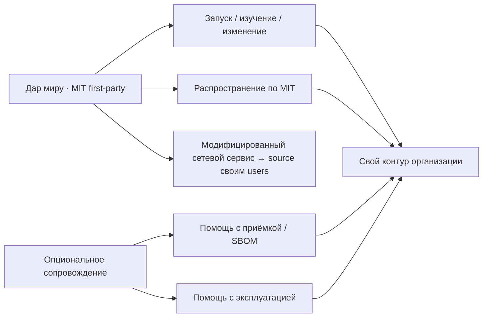

# D11 — Дар миру: MIT и опциональное сопровождение (P3e)

**Смысл:** центр — свободный код как дар. Сопровождение (если есть) помогает
принять и крутить контур, но **не** подменяет и не закрывает исходники.
