# EliteEW — схемы D01–D12 (Markdown / Mermaid)

Исходники также в [`assets/diagrams/`](assets/diagrams/).

# D01 — Hybrid formula (P1)

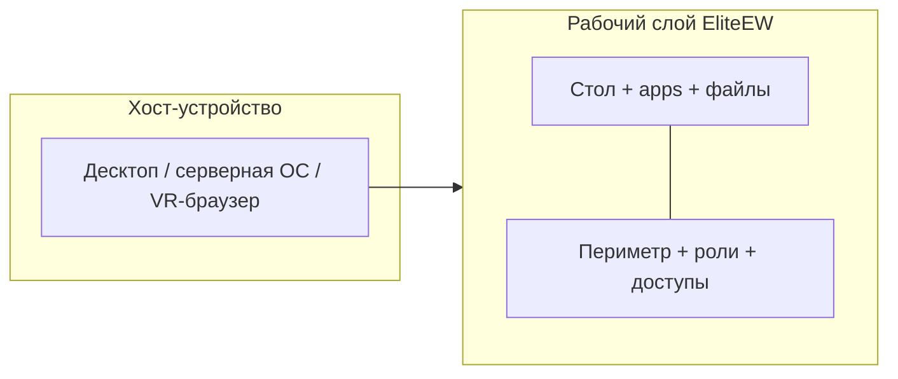

**Смысл:** EliteEW — управляемый слой поверх устройства, не «выбросили ядро ОС».

---

# D02 — Классы угроз → ответы (P2)

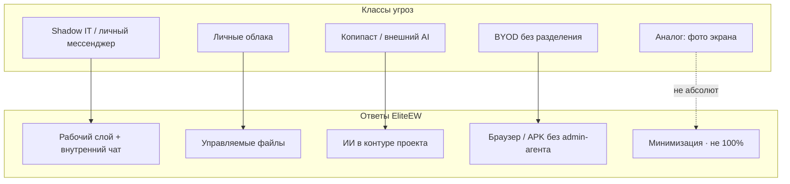

**Alt:** Поток «угроза → ответ продукта»; пунктир — граница абсолюта.

---

# D03 — Нормы: даёт EliteEW / остаётся организации (P3)

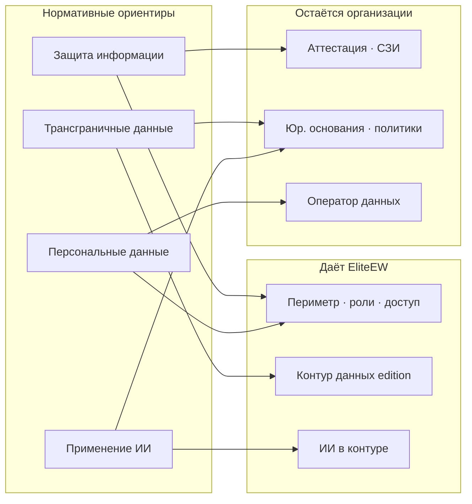

**Alt:** Карта «помогает / не заменяет» — не аттестат.

---

# D04 — День сотрудника (P3a)

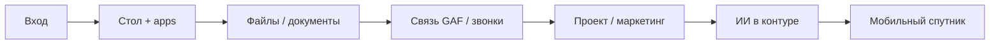

**Alt:** Один swimlane внутреннего внедрения; детали глав — по ссылкам в P3a.

---

# D05 — Файлы: две плоскости (P4a)

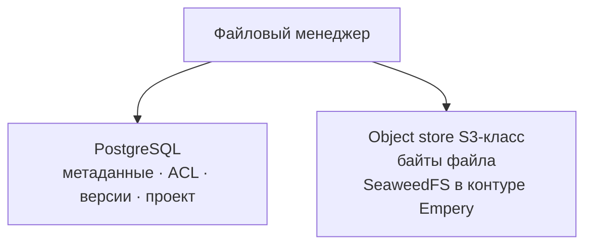

**Смысл:** права и каталог в БД; содержимое — в объектном хранилище; пользователь не ходит в PG/Seaweed руками.

---

# D06 — Edge: стена и 1 клик (P7d)

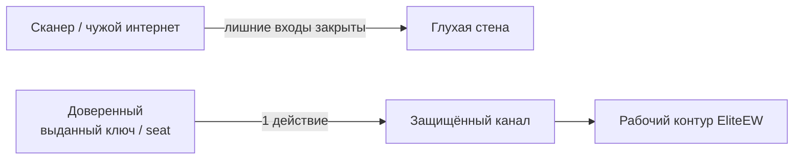

**Смысл:** default-deny снаружи; allow только по выданному доверию. Без IP/портов на схеме.

---

# D07 — Atomic access (P8a)

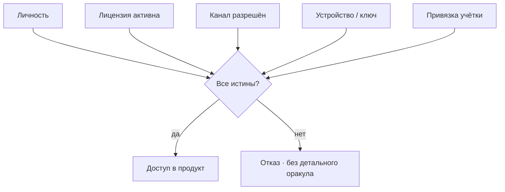

**Смысл:** native Connected / FoFline — связка факторов; не универсально для любого браузерного входа.
**Alt:** Условный доступ как логическое И, не один пароль.

---

# D08 — Editions (P10)

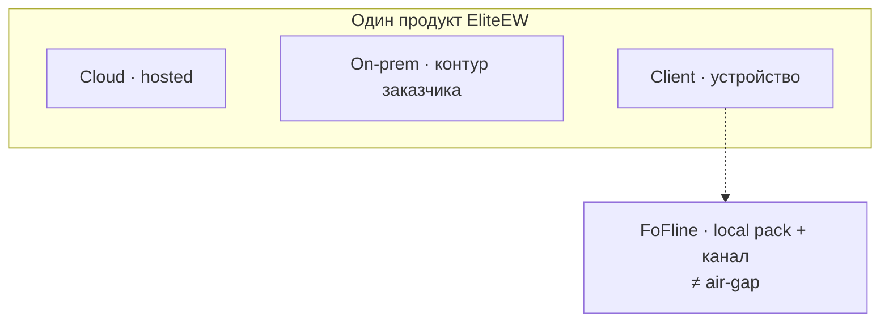

**Alt:** Три edition + FoFline как client-adjacent; не три разных продукта и не air-gap.

---

# D09 — Структура затрат: три колонки (P3d)

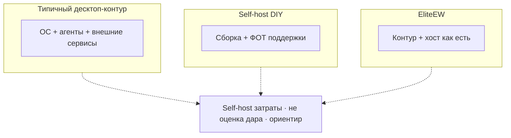

**Alt:** Структура сравнения затрат без ложной точности цифр.

---

# D10 — Reading paths (P0)

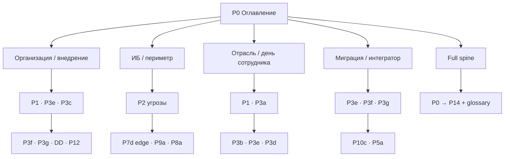

**Смысл:** входы для организации, ИБ, отрасли и внедрения — без рекламного захода.

---

# D11 — Дар миру: MIT и опциональное сопровождение (P3e)

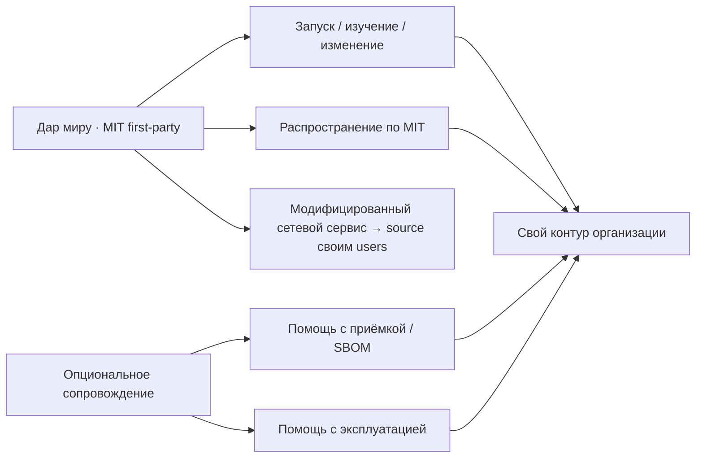

**Смысл:** центр — свободный код как дар. Сопровождение (если есть) помогает
принять и крутить контур, но **не** подменяет и не закрывает исходники.

---

# D12 — Принять дар у себя (P3f)

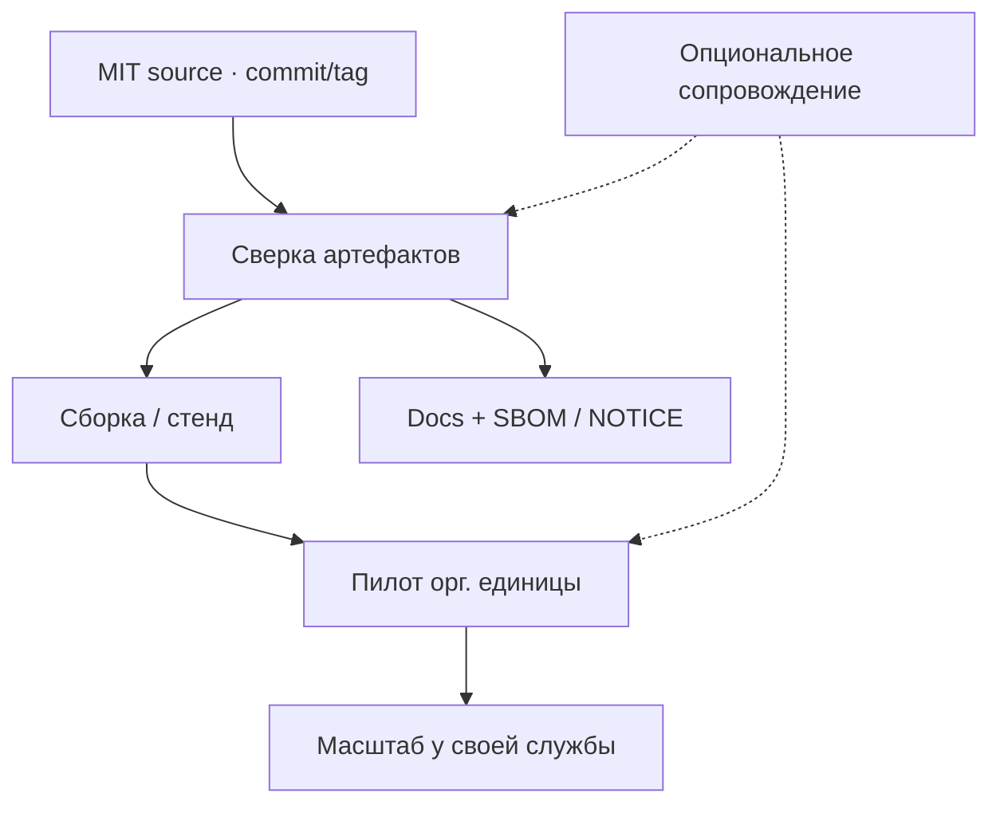

**Смысл:** исходники открыты по MIT; приёмка у себя сверяет версию, сборку,
документацию и границы. Чужие prod-секреты в «дар» не входят.

---

