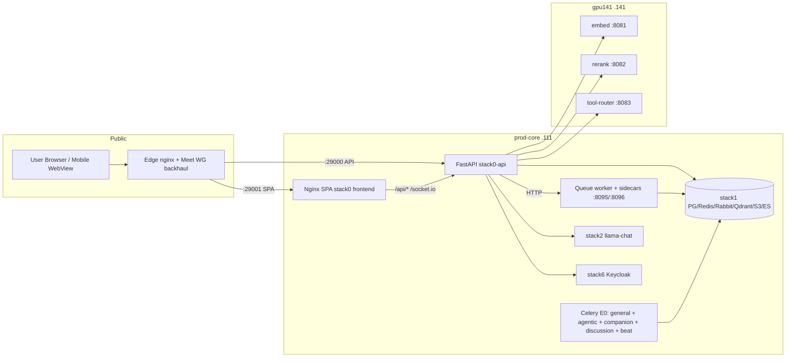
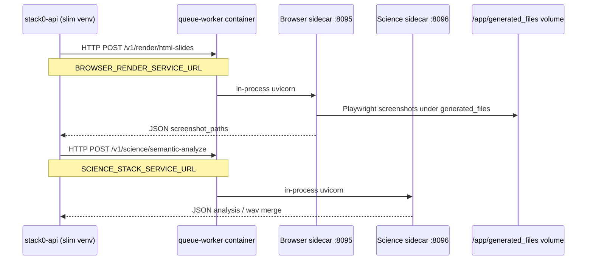
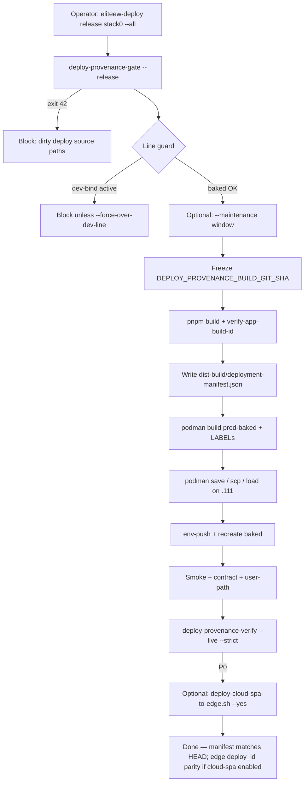
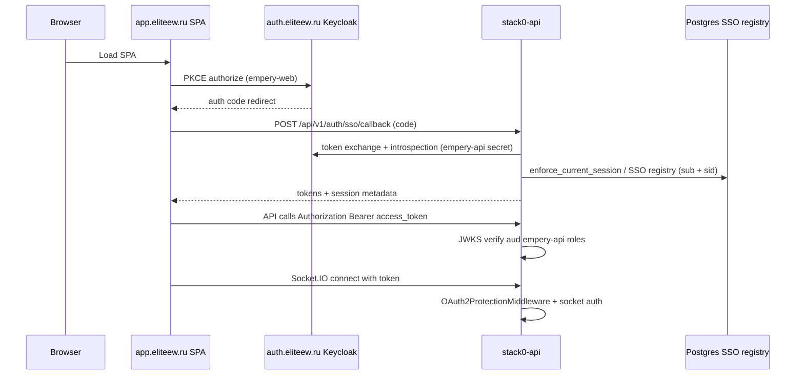

# EliteEW Master Project Card (System Blueprint)

**Status:** канон — dense technical reference for senior engineers (Python/Podman) onboarding to EliteEW **post Wave 2 & 3** (monolith API venv → distributed **queue-worker sidecars** + baked prod-core topology).
**Updated:** 2026-09-10
**Audience:** backend, platform, release engineering — not end-user copy.

**Authoritative topology (SoT for live host/runtime):** [platform/PRODUCTION-TOPOLOGY-STATE.md](platform/PRODUCTION-TOPOLOGY-STATE.md) §Current — this card summarizes architecture; if inventory drifts, **topology wins**.
**Stack overview:** [platform/DOCKER-STACKS-PROD-OVERVIEW.md](platform/DOCKER-STACKS-PROD-OVERVIEW.md).
**Wave 3 sidecar canon:** [platform/docker-re_doc/STACK0-BACKEND-IMAGES.md](platform/docker-re_doc/STACK0-BACKEND-IMAGES.md) §Browser render / Science stack sidecar.

> Runtime default: **Podman** on prod-core (`.111`) and command-center (`.136`). Historical `docker/` paths are repo layout, not a Docker daemon requirement.

---

## Document map

| § | Content |
|---|---------|
| [1](#1-system-topology--architecture) | Host roles, request flow, full service inventory, sidecar map, networks |
| [2](#2-deployment--orchestration) | Baked vs dev-bind, stack0 release lifecycle, contract gate, env/volumes |
| [3](#3-data--protocol-contracts) | REST/WS/Socket.IO, auth trace, persistence |
| [4](#4-operational-knowledge-base) | Accepted debt, failure modes, maintenance windows |

---

## 1. System Topology & Architecture

### 1.1 Host roles (production)

| Host | LAN IP | Role |
|------|--------|------|
| **prod-core** | LAN `192.168.1.111` | Public runtime: stack0 (API/SPA/queue-worker + **Celery E0 split + Discussion**), stack1, EWA PG, stack2 llama-chat, stack4, stack6, stack11, stack12, landing/mobile OTA, **stack-kbsew** `:28030`. **No builds.** Deploy SSH from `.136` = **LAN only** (`192.168.1.111`); former 2.5G `10.255.136.0/24` retired — [platform/PRODUCTION-TOPOLOGY-STATE.md](platform/PRODUCTION-TOPOLOGY-STATE.md) §Current. |
| **command-center** | LAN `192.168.1.136` | Git, docs, env staging/SOPS, **all builds**, Phase 4 `llama-deep` `:8080`. Living ComfyUI is on **gpu141** (historical `.136:31003` retired for product path). Legacy hostname «punisher» = historical alias only. Soft-retired operator trees (DEWA/EWGen/EWPower/EWC/EWCO/…) live under repo `trash/` unless operator restores. |
| **gpu141** | `192.168.1.141` | Remote inference (Debian 13, overlayroot RO, host-net Podman): embed `:8081` (**Qwen3-Embedding-0.6B**, dim **1024**), rerank `:8082` (**0.6B**), tool-router `:8083` (Qwen3-4B), **living ComfyUI** `:31003`. nftables allowlist `.111`+`.136`. |
| **edge VM** | `93.77.165.185` (public) | TLS nginx; HTTP backhaul via Meet WG `10.77.77.2` (**primary**); SSH reverse = **manual reserve**. Portal Private Tunnel `wg-portal` `10.88.89.1` UDP **51823** (desktop/Fedora trusted; not mobile WG). |

**Forbidden on command-center after cutover:** duplicate stack0 prod containers, stack-mobile-release, stack12, stack1/stack6/stack11 — see [platform/PRODUCTION-TOPOLOGY-STATE.md](platform/PRODUCTION-TOPOLOGY-STATE.md) §Current.

### 1.2 High-level request flow



**Path summary (happy path):**

1. User opens `https://app.eliteew.ru` → edge VM nginx → hashed `/assets/*` and shell from **edge disk** `/srv/eliteew/cloud-spa/current` (cloud-spa mode); `/api/*` and `/socket.io/` proxy via **Meet WG** backhaul (`10.77.77.2`, SSH reverse = reserve) → prod-core `:29000`.
2. SPA static on prod-core `:29001` remains authoritative for deploy_id/manifest; edge publish is a **separate** step after Line A release — [platform/CLOUD-SPA-EDGE-STATIC.md](platform/CLOUD-SPA-EDGE-STATIC.md). Dev-bind line B still serves NFS export on `:29001` only (edge static unchanged until republish).
3. Browser calls relative `/api/*` → **frontend nginx** proxies to compose service DNS **`eliteew-api-prod:8000`** (not host port 29000 inside the docker network).
4. API validates JWT (Keycloak JWKS/introspection), uses `DatabaseManager` for PG/Redis/Rabbit/S3/Qdrant.
5. Heavy browser/science work: API → **HTTP sidecars** on queue-worker (`8095`, `8096`).
6. LLM/embed/rerank: HTTP to stack2 on prod-core and/or gpu141 per env (`LLAMA_URL`, `LLAMA_EMBEDDING_URL`, tool-router URL chain — see [platform/docker-re_doc/STACK0-LLM-OVERVIEW.md](platform/docker-re_doc/STACK0-LLM-OVERVIEW.md)).
7. Realtime: Socket.IO on same API process (`/socket.io/`), proxied by frontend nginx with WebSocket upgrade.

### 1.3 Public edge port map (prod-core localhost binds)

From [platform/PRODUCTION-TOPOLOGY-STATE.md](platform/PRODUCTION-TOPOLOGY-STATE.md) §Current (verify on host if drift):

| Public hostname / path | Edge → prod-core local | Backend service |
|------------------------|------------------------|-----------------|
| `app.eliteew.ru` (SPA static) | edge disk `/srv/eliteew/cloud-spa/current` | cloud-spa nginx (hashed assets); prod-core `:29001` = SoT for deploy_id |
| `app.eliteew.ru` (API) | WG → `:29000` | stack0 API (also reachable via SPA proxy on `:29001`) |
| `auth.eliteew.ru` | `:36000` | stack6 Keycloak |
| `eliteew.ru` (landing) | `:29002` | `stack0-eliteew-landing` — image `local/eliteew-site-prod:secure` (**cutover 2026-08-05**; prior clear 2026-07-20 was legacy landing) |
| `meet.eliteew.ru` | tunnel `:13402` → `.111:34002` | stack11 Jitsi web |
| Mobile OTA (internal) | `:29180` | stack-mobile-release (**cleared healthy 2026-07-20**; Keep OTA on `.111` only) |
| KBSEW (internal) | `:28030` | `stack-kbsew` → container `:8030`; API gateway `/api/v1/kbsew/*` via `KBSEW_SERVICE_URL` |

**Portal Private Tunnel** (edge, not Meet/mobile WG): `wg-portal` `10.88.89.1` UDP **51823** — desktop/Fedora trusted access; canon [platform/docker-re_doc/PORTAL-PRIVATE-TUNNEL-EDGE.md](platform/docker-re_doc/PORTAL-PRIVATE-TUNNEL-EDGE.md).

Historical note: former DEWA/EWPower public edge remotes (e.g. `dewa.eliteew.ru` / `power.eliteew.ru`) are **wontfix** after soft-retire — not acceptance gates. Mobile OTA on prod-core `:29180` is distinct from retired `.136:4180`.

### 1.4 Stack0 service inventory (application tier)

Compose base: `docker/stack/stack0_b.yml` (backend), `docker/stack/stack0_f.yml` (frontend).
Prod-core prod: `stack0_b.prod-baked.override.yml` + `stack0_f.prod-baked.override.yml`.
Dev hotfix line: `stack0_*.dev-bind.override.yml` — [platform/PROD-CORE-DEV-BIND-LINE.md](platform/PROD-CORE-DEV-BIND-LINE.md).

| Service (compose name) | Prod baked container_name | Primary responsibility | Host bind (typical) | In-container port | DNS identity on `ew_net_*` |
|------------------------|---------------------------|------------------------|---------------------|-------------------|----------------------------|
| `eliteew-api-prod` | `stack0-eliteew-api-prod-baked` | FastAPI HTTP + Socket.IO + startup gates | `${API_BIND_ADDRESS}:${API_HOST_PORT}` → **29000** → 8000; WS **28999** | 8000, 28999 | **`eliteew-api-prod`** (compose service name; nginx upstream) |
| `eliteew-frontend-prod` | `stack0-eliteew-frontend-prod-baked` | Nginx static SPA + reverse proxy to API | `${FRONTEND_HTTP_BIND}:${FRONTEND_HTTP_PORT}` → **127.0.0.1:29001** → 8080 | 8080 | `eliteew-frontend-prod` (service name) |
| `eliteew-api-worker-prod` | `stack0-eliteew-api-worker-prod-baked` | RabbitMQ consumer + **browser render sidecar** + **science sidecar** | none (internal) | 8095, 8096, AMQP consumer | **`stack0-eliteew-api-worker-prod`** (explicit network **aliases** on all worker networks) |
| `eliteew-celery-worker-prod` | `stack0-eliteew-celery-worker-prod-baked` | **E0 general** Celery: queues `short,maintenance,broadcast,ewa_reembed` (concurrency `STACK0_CELERY_GENERAL_CONCURRENCY`, default 4) | none | worker process | container_name / service name |
| `eliteew-celery-agentic-worker-prod` | `stack0-eliteew-celery-agentic-worker-prod-baked` | **E0 agentic** Celery: `ewa_agentic,ewa_agentic_step,ewa_factory` (concurrency default 2; soft/hard **900/960s**; factory ticks 120/180s) | none | worker process | container_name / service name |
| `eliteew-celery-companion-worker-prod` | `stack0-eliteew-celery-companion-worker-prod-baked` | **E0 companion** Celery: `ewa_companion` (concurrency default 2; soft/hard 540/600s) | none | worker process | container_name / service name |
| `eliteew-celery-discussion-worker-prod` | `stack0-eliteew-celery-discussion-worker-prod-baked` | **E0 discussion** Celery: `desktop_discussion` (concurrency `STACK0_CELERY_DISCUSSION_CONCURRENCY`, default 2; soft/hard 540/600s) | none | worker process | container_name / service name |
| `eliteew-celery-beat-prod` | `stack0-eliteew-celery-beat-prod-baked` | **Single** Celery beat scheduler | none | beat process | container_name |
| `eliteew-site-studio-worker-prod` | `stack0-eliteew-site-studio-worker-prod-baked` | Site Studio queue `site_studio` only | none | worker + podman socket | profile **`site-studio-worker`** (paused by default) |

**Celery E0 split + Discussion (2026-08-07):** four baked workers share image `STACK0_CELERY_WORKER_BAKED_IMAGE`; override `stack0_b.prod-baked.override.yml` (mirrored in `stack0_b.dev-bind.override.yml`). Product: [product/desktop/DESKTOP-AI-CHAT-DISCUSSION-MODE.md](product/desktop/DESKTOP-AI-CHAT-DISCUSSION-MODE.md). SoT: [platform/PRODUCTION-TOPOLOGY-STATE.md](platform/PRODUCTION-TOPOLOGY-STATE.md) §Current.

**Legacy dev bind-mount names** (command-center fallback, not prod-core baseline): `stack0-eliteew-api-prod`, `stack0-eliteew-frontend-prod`, etc. without `-baked` suffix.

**Image targets** (single Dockerfile `docker/builders/stack0-api/Dockerfile`):

| Dockerfile target | Role |
|---------------------|------|
| `api` | Slim HTTP tier — **no Playwright**, no scipy/sklearn stack |
| `queue-worker` | Rabbit consumer + Chromium/Playwright + science venv + sidecar HTTP servers |
| `celery-worker` / `celery-beat` | Celery from `runtime-base` |
| `site-studio-worker` | Isolated Site Studio queue consumer |

### 1.5 Stack1 — data plane (prod-core)

Compose: `docker/stack/stack1.yml`, env: `docker/env_file/.env.stack1`.

| Container | Responsibility | Typical host port (env-driven) | Internal DNS |
|-----------|----------------|--------------------------------|--------------|
| `stack1-postgres` | App DB `ai_services` (+ optional dbs) | `POSTGRES_HOST_PORT` (stack0 docs use **30000** as external reference) | `stack1-postgres` / `POSTGRES_HOST` |
| `stack1-redis` | Cache, Celery broker db, maintenance window | **30001** | `stack1-redis` / `REDIS_HOST` |
| `stack1-chroma` | Legacy vector (Chroma) | **30002** | `stack1-chroma` |
| ~~`stack1-chroma-code`~~ | Soft-retired 2026-08-09 (code index → KBSEW) | — | do not recreate |
| `stack1-qdrant` | Primary vector backend (canon) + KBSEW | HTTP **30003** / gRPC | `stack1-qdrant` |
| `stack1-seaweedfs` | S3-compatible object storage | **30006** API, **30005** console | `stack1-seaweedfs` / `MINIO_HOST` |
| `stack1-elasticsearch` | Search index | **30007** | `stack1-elasticsearch` |
| `stack1-rabbitmq` | Task queues | **30008** AMQP, **30009** management | `stack1-rabbitmq` |

All stack1 ports bind `${STACK1_CLIENT_BIND:-127.0.0.1}` unless LAN worker runbook opens `.141` — see [platform/docker-re_doc/LAN-WORKERS-141.md](platform/docker-re_doc/LAN-WORKERS-141.md).

### 1.6 Stack2 — LLM (prod-core + gpu141)

| Location | Container | Role | Internal port | Host bind |
|----------|-----------|------|---------------|-----------|
| `.111` | `stack2-llama-chat` | Main chat LLM (live Phase 1: `gemma-4-26B.gguf`, −c 81920 / parallel 2 ≈40k/slot) | 8080 | `LLAMA_CHAT_HOST_PORT` (prod-core override exposes 8080; probe `192.168.1.111:8080`, not always `127.0.0.1`) |
| `.136` | `eliteew-llama-deep` | Deep job class (Phase 4: Gemma 31B Q4, −c 81920 / parallel 1) | 8080 | `LLAMA_DEEP_URL`; mutex with Comfy on same 3090; `eliteew-llama-deep.sh` |
| `.111` (profile) | `stack2-llama-tool-router` | Local companion tool-router CPU | 8080 | profile `companion-tool-router` |
| `.141` | `llama-remote-embed` | Embeddings | 8080 | **`8081`** host (smoke canon) |
| `.141` | `llama-remote-rerank` | Reranking | 8080 | **`8082`** host |
| `.141` | `llama-remote-tool-router` | Tool router | 8080 | **`8083`** host |

**gpu141 live path (2026-07-14):** Debian 13 + overlayroot RO + rootful Podman **host-net** (`stack2-llama-remote-embed-rerank.host-net.yml`); systemd `gpu141-llama-remote.service`. Bridge compose = legacy/Fedora path. Contract: [platform/STACK2-LLM-CONTRACT.md](platform/STACK2-LLM-CONTRACT.md).

API resolution for companion tool-router sidecar: `shared/api/utils/tool_router_sidecar_runtime.py` — env chain domain-specific → `EWA_COMPANION_*` → `DESKTOP_*` → docker sidecar hostname.

### 1.7 Stack4 — document/media microservices (prod-core)

Compose: `docker/stack/stack4.yml` (+ `stack4.prod-baked.override.yml` for prod images).

| Container | Role | Docker DNS | Notes |
|-----------|------|------------|-------|
| `stack4-tika` | Apache Tika `/tika` | `stack4-tika:9998` | Baseline required; historical 2026-06-30 partial runtime mitigated 2026-07-20 (`eeprodruntime --stack4-only` + smoke) |
| `stack4-ocrmypdf-api` | OCRmyPDF API | `stack4-ocrmypdf-api` | |
| `stack4-gotenberg` | PDF rendering | `stack4-gotenberg` | |
| `stack4-tesseract` | OCR | `stack4-tesseract` | |
| `stack4-paperless` | Paperless NGX | `stack4-paperless` | |

Smoke: `prod_core_deploy_smoke_stack4` in `docker/scripts/prod-core-deploy-lib.sh`. Verify after runtime deploy.

### 1.8 Stack6 — Keycloak (prod-core)

| Container | Role | Host bind (typical) | Internal |
|-----------|------|---------------------|----------|
| `stack6-keycloak` | OIDC issuer realm `empery` | `KEYCLOAK_HOST_PORT` → edge **36000** | `:8080` |
| `stack6-keycloak-postgres` | Keycloak DB | `KEYCLOAK_POSTGRES_HOST_PORT` localhost | `:5432` |

Canon: [platform/docker-re_doc/KEYCLOAK-ELITEEW.md](platform/docker-re_doc/KEYCLOAK-ELITEEW.md).

Image pin: **`quay.io/keycloak/keycloak:26.7.1`** (`STACK6_KEYCLOAK_IMAGE`). Living prod-core (2026-09-08): baked `localhost/eliteew-keycloak:prod-stack6-20260908-0936` (SPI JAR `eliteew-binding.jar`), `command: ["start","--optimized"]`, `kc.transaction-xa-enabled=false` persisted in the image. Atomic desktop flow uses binding SPI when `ELITEEW_KC_ATOMIC_AUTH_ENFORCE=1` (living prod).

Clients: `empery-web` (SPA PKCE), `empery-mobile` (AppAuth), `empery-desktop` (Tauri desktop-client PKCE), `empery-fofline` (FoFline PKCE; XOR vs web), `empery-api` (confidential introspection), `eliteew-binding-spi` (confidential, future service JWT; Wave 3 Java uses `DESKTOP_CLIENT_BINDING_SPI_TOKEN`). Optional public: `empery-apk-distro` (login theme / distro).

### 1.9 Stack11 / stack12 / ancillary

| Stack | Container(s) | Role |
|-------|--------------|------|
| **stack11** | `stack11-jitsi-*` | Jitsi Meet — JWT from API, no guests |
| **stack12** | `${STACK12_DNS_CONTAINER_NAME}` | CoreDNS internal `*.sites.eliteew.ru` |
| **stack-ewa-postgres** | `stack-ewa-postgres` | EWA platform DB — separate from `DATABASE_URL` |
| **stack-mobile-release** | `stack-mobile-release` | OTA APK/manifest nginx — `:29180`, DNS `stack-mobile-release` on `ew_net_6211` |
| **stack0 landing** | `stack0-eliteew-landing` | Public `eliteew.ru` — `:29002`, not stack0_f compose |
| **stack-kbsew** | `stack-kbsew` | Knowledge barrels service — host `:28030` → `:8030`; nets `ew_net_2847` / `ew_net_7198` / `ew_net_9O11`; deploy `kbsew-deploy-prod-core.sh` (default does **not** recreate stack0). Canon: [product/KBSEW.md](product/KBSEW.md) |

**Off baseline:** stack3 VictoriaLogs, stack5 SearXNG/Crawl4AI, stack666 LAN HTTPS retired. **stack9:** Cosy/F5/Qwen3-TTS not autostart (VRAM vs llama on the same 3090). Prod voice on `.111` = whisper+silero via `docker/scripts/prod-core/start-stack9-voice.sh` (`legacy-whisper` large-v3 + `legacy-silero` MIT v5 CIS); kill-switch .disable-stack9-voice *[operator kill-switch marker under docker/env_file/; may be absent]* or `ELITEEW_STACK9_VOICE_DISABLED=1`. See [platform/PRODUCTION-TOPOLOGY-STATE.md](platform/PRODUCTION-TOPOLOGY-STATE.md) §Off / [platform/DOCKER-STACKS-PROD-OVERVIEW.md](platform/DOCKER-STACKS-PROD-OVERVIEW.md).

### 1.10 GPU/operator planes (not prod-core runtime)

| Service | Typical bind | Notes |
|---------|--------------|-------|
| **ComfyUI** | gpu141 `.141:31003` | **Living** music/image workflows; API on prod-core uses `COMFYUI_URL` → `.141`; independent from `.136` deep GPU |
| **llama-deep** | `:8080` | Phase 4 deep LLM; stack0 `LLAMA_DEEP_URL`; ops `eliteew-llama-deep.sh` |
| Deploy / Config Plane helpers | CLI on `.136` | `eliteew-deploy.sh`, `eeprodline`, `eeprodruntime`, `eliteew-prod-core-*` / `eliteew-stack0-baked-deploy.sh` (renamed from `dewa-ops-*`) |
| Soft-retired trees | — | DEWA / EWGen / EWPower / EWC / EWCO / logwatch / … under repo `trash/` — do not scope work unless operator restores |

### 1.11 Docker/Podman network segmentation

Created by `docker/scripts/networks-create.sh`:

| Network | Typical attachers |
|---------|-------------------|
| `ew_net_6211` | stack0 API, frontend, mobile-release |
| `ew_net_2847` | stack0 workers, stack1, stack2, EWA postgres, **kbsew** |
| `ew_net_9O11` | Keycloak, stack0 API (OIDC path), **kbsew** |
| `ew_net_4532` | stack2 LLM, stack0 API |
| `ew_net_7198` | stack0 API/workers (extended routing), **kbsew** |
| `ew_net_3365` | stack0 API/workers |
| `ew_net_5402` | Jitsi / meet-related |

Mapping detail: `docker/SEGMENTATION.md` (if present). **verify on host:** `podman inspect <container> --format '{{json .NetworkSettings.Networks}}'`.

### 1.12 Sidecar map (Wave 3 — queue-worker HTTP services)

Sidecars are **not separate containers**. They are **uvicorn processes** started by `docker/builders/stack0-api/scripts/start_queue_worker.sh` inside the queue-worker container.



#### Browser render sidecar

| Item | Value | Source |
|------|-------|--------|
| Process | `uvicorn api.services.rendering.render_sidecar_app:app` | `start_queue_worker.sh` |
| Port | **8095** (`BROWSER_RENDER_SIDECAR_PORT`) | compose env |
| Enable | `BROWSER_RENDER_SIDECAR_ENABLED=1` | compose env |
| Health | `GET /health` → `{"status":"ok","service":"browser-render-sidecar"}` | `render_sidecar_app.py` |
| Render | `POST /v1/render/html-slides` | paths must be under `/app/generated_files` |
| API client | `api/services/rendering/browser_render_client.py` | async httpx |
| Primary consumer | EWRP PDF slide screenshots | `api/routers/ewrp.py` → `sidecar_http_exception` on failure |

#### Science stack sidecar

| Item | Value | Source |
|------|-------|--------|
| Process | `uvicorn api.services.science_stack.science_sidecar_app:app` | `start_queue_worker.sh` |
| Port | **8096** (`SCIENCE_STACK_SIDECAR_PORT`) | compose env |
| Enable | `SCIENCE_STACK_SIDECAR_ENABLED=1` | compose env |
| Health | `GET /health` | `science_sidecar_app.py` |
| Endpoints | `POST /v1/science/semantic-analyze`, `POST /v1/science/merge-wav-chunks` | sklearn/scipy/numpy on worker only |
| API client | `api/services/science_stack/science_client.py` | |
| Degrade | `document_processor.py` logs `[STEP] document_processor_semantic_sidecar_skip` → local Counter fallback | best-effort |

#### API → sidecar configuration (unified_config)

| Env var | Purpose | Default when empty |
|---------|---------|-------------------|
| `BROWSER_RENDER_SERVICE_URL` | Full base URL | Built from `BROWSER_RENDER_WORKER_HOST` + port **8095** |
| `BROWSER_RENDER_WORKER_HOST` | Fallback host | `stack0-eliteew-api-worker-prod` |
| `BROWSER_RENDER_SERVICE_PORT` | Fallback port | 8095 |
| `SCIENCE_STACK_SERVICE_URL` | Full base URL | Built from `SCIENCE_STACK_WORKER_HOST` + **8096** |
| `SCIENCE_STACK_WORKER_HOST` | Fallback host | `stack0-eliteew-api-worker-prod` |
| `SCIENCE_STACK_SERVICE_PORT` | Fallback port | 8096 |

**Prod-baked override** (`stack0_b.prod-baked.override.yml`) points URLs at **`stack0-eliteew-api-worker-prod-baked`** hostname while **network aliases** remain `stack0-eliteew-api-worker-prod` — both names must resolve from API pod (contract gate checks DNS + HTTP).

**Dev compose defaults** (`stack0_b.yml`):

```yaml
BROWSER_RENDER_SERVICE_URL=${BROWSER_RENDER_SERVICE_URL:-http://stack0-eliteew-api-worker-prod:8095}
SCIENCE_STACK_SERVICE_URL=${SCIENCE_STACK_SERVICE_URL:-http://stack0-eliteew-api-worker-prod:8096}
```

#### Assistant "sidecar" (different concept)

Modules under `shared/api/ewa_platform/companion/sidecar/` are **HTTP LLM helper clients** to stack2/tool-router — not the Wave 3 Playwright/science processes. Do not conflate naming.

#### Other sidecar-adjacent HTTP dependencies from API

| Dependency | Typical target | Env / module |
|------------|----------------|--------------|
| LLM chat | `stack2-llama-chat:8080` | `LLAMA_URL` |
| Deep LLM | `.136` `eliteew-llama-deep:8080` | `LLAMA_DEEP_URL` (never steal interactive) |
| Embeddings / rerank | gpu141 `:8081` / `:8082` or local stack2 profile | `LLAMA_EMBEDDING_URL`, rerank URL vars |
| Tool router | gpu141 `:8083` or stack2 profile | `tool_router_sidecar_runtime.py` |
| ComfyUI | gpu141 `.141:31003` | `COMFYUI_URL` |
| Tika / stack4 | `http://stack4-tika:9998/tika` | `TIKA_URL` |
| Voice TTS (stack9 Silero) | `stack9-silero:8000` | `SILERO_SERVICE_URL` fallback; SSOT `generation_providers.silero`. CosyVoice **not** prod baseline |

## 2. Deployment & Orchestration

### 2.0 Immutable Provenance (audit-grade deploy) — 2026-07-05

**Principle:** Every byte on prod-core stack0 `:29000/:29001` must trace to a **specific git commit** via `deployment-manifest.json` and image labels. Build artifacts no longer pollute the git tree.

| Rule | Enforcement |
|------|-------------|
| **No-dirty-source** | `deploy-provenance-gate.sh --release` — exit **42** if deploy source paths have uncommitted changes |
| **Manifest-first** | `:29001/deployment-manifest.json` is authoritative for baked Line A verification (**Host** `127.0.0.1`/`localhost` only; public `app.eliteew.ru` → **404**) |
| **Traceability chain** | Git commit → build → manifest → image LABEL → remote curl → `verify --live --strict` |

| Tool | Role |
|------|------|
| `bash docker/scripts/eliteew-deploy.sh release stack0 --all` | **Canonical Line A** — gate → bake → export → recreate → smoke → **verify** (optional `--yes`; optional `--refresh-openapi-pilots` for same-release FE OpenAPI pilots before SPA build) |
| `deploy-provenance-gate.sh --release` | Pre-build: clean deploy source paths (not full tree) |
| `deploy-provenance-gate.sh --hotfix [--acknowledge-dirty]` | Line B sync gate |
| `deploy-provenance-verify.sh --live --strict` | Post-deploy P0: runtime git_sha + live manifest vs local HEAD |
| `deploy-provenance-audit.sh --live` | JSON chaos scorecard |

Canon: [platform/docker-re_doc/DEPLOY-CLI-PROVENANCE.md](platform/docker-re_doc/DEPLOY-CLI-PROVENANCE.md) · [platform/PROD-CORE-DEV-BIND-LINE.md](platform/PROD-CORE-DEV-BIND-LINE.md) · [platform/ZERO-TRUST-GIT-HOOKS.md](platform/ZERO-TRUST-GIT-HOOKS.md).

| Service | Deploy line | Provenance source | Status |
|---------|-------------|-------------------|--------|
| stack0 API/SPA/workers | A (baked) | `deployment-manifest.json`, `org.eliteew.deploy.*` labels, `BUILD_GIT_SHA` | **Live** (2026-07-05) |
| stack0 hotfix | B (dev-bind) | NFS export `deployment-manifest.json` + legacy `manifest.json` | Gate + manifest on sync |
| stack2/4 runtime | baked | image tag in env | no git SHA in image (separate contour) |
| Mobile OTA | `:29180` | `empery-mobile.manifest.json` | separate from stack0 |

### 2.1 Build vs run invariant

| Action | command-center `.136` | prod-core `.111` |
|--------|----------------------|------------------|
| `pnpm build`, `podman build`, compose build | **Yes** | **Forbidden** (normal release) |
| `eeprodbaked` export/load/recreate | **Yes** | Receives images + env only |
| `eeprodline sync` (dev-bind) | **Yes** | NFS mount + recreate |
| Plaintext env editing | Staging `docker/env_file/` + SOPS bundle | Runtime tmpfs `$ELITEEW_ENV_RUNTIME_DIR` only |

Canon: `.cursor/rules/project-and-deploy.mdc`, [platform/PROD-CORE-CONFIG-PLANE.md](platform/PROD-CORE-CONFIG-PLANE.md).

### 2.2 Dual line: baked (A) vs dev-bind (B)

| | **Line A — baked** | **Line B — dev-bind** |
|---|-------------------|----------------------|
| CLI | `bash docker/scripts/eliteew-deploy.sh release stack0 --all` (implements via `eeprodbaked` / historical `eliteew-stack0-baked-deploy.sh`) | `eliteew-deploy.sh hotfix stack0 sync` → `hotfix stack0 up-dev-bind` (implementer `eeprodline`) |
| Provenance | `dist-build/deployment-manifest.json` baked into image; `:29001/deployment-manifest.json` | `deployment-manifest.json` on NFS export (same schema v1) |
| Gate | `--release` (exit 42 on dirty source paths) | `--hotfix` (+ `--acknowledge-dirty` if dirty) |
| Code location | Inside `prod-baked-*` images | NFS ro `/mnt/eliteew-prod-line-export/{api,apps,frontend-dist,documentation}` |
| Typical use | Release, migrations, image changes | Minutes-level hotfix |
| Mutual exclusion | Same `container_name` + `:29000/:29001` — **one active line** | Guard blocks `eeprodbaked` when `active_line=dev-bind` |

Check: `bash docker/scripts/eliteew-deploy.sh hotfix stack0 status` — [platform/PROD-CORE-DEV-BIND-LINE.md](platform/PROD-CORE-DEV-BIND-LINE.md).

**Historical note (2026-09-10):** stack0 temporarily on **Line B (`active_line=dev-bind`)** so Connected SPA shipped EBrowser Wave U chrome without full rebake (`deploy_id=1789004248070-tf0vu37o89`; baked tag still `prod-baked-20260910-0923`). Desktop agent then TREE **0.5.30** (OTA RPM). Living desktop Current → [product/desktop/DESKTOP-CLIENT-VERSION-SOT.md](product/desktop/DESKTOP-CLIENT-VERSION-SOT.md) (TREE **0.5.37** / public **0.5.36**). Return to Line A when needed: `bash docker/scripts/eliteew-deploy.sh release stack0 --all`.

### 2.3 Stack0 baked release lifecycle (Line A)

**Agent/operator entry:** `bash docker/scripts/eliteew-deploy.sh release stack0 --all` (optional `--yes`; optional `--refresh-openapi-pilots`).
Internal implementer: `eeprodbaked` / historical `eliteew-stack0-baked-deploy.sh` — agents must not call partial `--frontend-only` / `--backend-only` for release. Bake image names always follow this release `BAKED_TAG` (do not trust leftover `STACK0_*_BAKED_IMAGE` in the shell).
Library: `docker/scripts/prod-core-deploy-lib.sh`.



**Modes:**

| Flag | Effect |
|------|--------|
| `--all` | Frontend + backend baked; deploy_id sync |
| `--refresh-openapi-pilots` | Opt-in: tree OpenAPI → pilots → then SPA build (before bake); incompatible with `--skip-build` / `--skip-frontend-build` |
| `--frontend-only` | SPA/nginx image only |
| `--backend-only` | API + workers; optional `--with-frontend-build` |
| `--maintenance` | Writes `maintenance-state.json` + user-visible window |
| `--rebuild-base` | Rebuild venv base images (lock-sync + import probe gates) |
| `--skip-env-push` | Skip Config Plane push |
| `--no-rollback` | Disable env rollback on smoke failure |

**Build integrity gates** (backend): lock-sync, import probe (API: bcrypt present, playwright absent; worker: playwright present), traceability labels — [STACK0-BACKEND-IMAGES.md](platform/docker-re_doc/STACK0-BACKEND-IMAGES.md) §Build integrity gates.

### 2.4 Contract gate (mandatory post-deploy checks)

Function: `prod_core_deploy_smoke_stack0_contract()` in `docker/scripts/prod-core-deploy-lib.sh`.

| # | Check | Failure symptom |
|---|-------|-----------------|
| 1 | API venv: `import bcrypt`; `playwright` **absent** | Wave 3 regression — fat API image |
| 2 | Queue-worker container running (`stack0-eliteew-api-worker-prod-baked`) | EWRP/science/document jobs stall |
| 3 | API pod `getent hosts <sidecar_host>` | **DNS alias loss** — HTTP sidecar unreachable |
| 4a | API pod `curl http://<host>:8095/health` | Browser render down — EWRP PDF fails |
| 4b | API pod `curl http://<host>:8096/health` | Semantic analysis degrades to Counter fallback |

Sidecar host resolution: `BROWSER_RENDER_SERVICE_URL` hostname → else `BROWSER_RENDER_WORKER_HOST` → default `stack0-eliteew-api-worker-prod`.

**Replay scripts:**

```bash
bash docker/scripts/verify-stack0-deploy-contract-gate.sh --live
bash docker/scripts/verify-stack0-deploy-contract-gate.sh --negative-dns   # must fail (regression lock)
bash docker/scripts/verify-stack0-user-path-gate.sh --all
```

### 2.5 User-path gate (external — command-center + prod-core)

| Check | What it catches |
|-------|-----------------|
| `https://app.eliteew.ru/api/health` | Edge/tunnel/API down |
| Engine.IO polling `sid` | Socket.IO broken after recreate |
| Frontend `getent hosts eliteew-api-prod` ⊆ live API container IPs | **Ghost DNS** / stale records → nginx 502 |
| `deploy-cloud-spa-to-edge.sh --verify-only` (post-release) | **deploy_id drift** — edge static stale-chunk vs prod-core `:29001` |

Host constant: `STACK0_USER_PATH_API_HOST=eliteew-api-prod` — nginx template uses this alias; `fix-prod-core-baked-frontend-nginx.sh` patches resolver + alias after reboot.

### 2.6 Infrastructure dependencies (critical env & volumes)

#### Sidecar / worker (must be consistent)

| Variable | Required | Notes |
|----------|----------|-------|
| `BROWSER_RENDER_SERVICE_URL` | Strongly recommended prod-baked | Include scheme + host + port |
| `SCIENCE_STACK_SERVICE_URL` | Strongly recommended prod-baked | Same |
| `BROWSER_RENDER_WORKER_HOST` / `SCIENCE_STACK_WORKER_HOST` | Fallback | Must match network aliases on prod-baked |
| `BROWSER_RENDER_SIDECAR_*` / `SCIENCE_STACK_SIDECAR_*` | On worker | Ports 8095/8096 |
| Shared volume | **`host/generated_files`** mounted on **both** API and worker | Render paths validated under `/app/generated_files` |

#### Core stack0 connectivity (representative — full list in env_file)

| Variable | Points to |
|----------|-----------|
| `DATABASE_URL` / `POSTGRES_*` | `stack1-postgres` |
| `EWA_DATABASE_URL` | `stack-ewa-postgres` (env_file only — not duplicated in compose `environment` block) |
| `REDIS_*` | `stack1-redis` |
| `RABBITMQ_*` | `stack1-rabbitmq` |
| `AWS_S3_ENDPOINT` / `MINIO_*` | `stack1-seaweedfs` |
| `QDRANT_HOST` | `stack1-qdrant` |
| `LLAMA_URL` | `stack2-llama-chat` |
| `KEYCLOAK_URL` / `KEYCLOAK_PUBLIC_URL` | `stack6-keycloak` / public issuer |
| `COMFYUI_URL` | gpu141 Comfy `.141:31003` (not historical `.136` or dead `.111:31004`) |

**Config Plane:** prod-core reads **`$ELITEEW_ENV_RUNTIME_DIR/.env.stack0.backend`** (tmpfs). Push from `.136`: `eliteew-prod-core-env-push.sh` (historical `dewa-ops` prefix; EliteEW config-plane helper) — [platform/PROD-CORE-CONFIG-PLANE.md](platform/PROD-CORE-CONFIG-PLANE.md).

#### Volumes (baked vs dev)

| Mount | Baked API | Dev-bind add-on |
|-------|-----------|-----------------|
| `/app/api` | In image | NFS ro export |
| `/usr/share/nginx/html` | In frontend image | NFS ro `frontend-dist` |
| `/app/generated_files` | host bind rw | same |
| `/app/mobile-release` | ro APK store | same |
| `/logs` | host log dir per container | same |

### 2.7 Deploy helper map (stack0-related)

Living CLI surface (command-center). Ops scripts use `eliteew-*.sh` (renamed from `dewa-ops-*`, 2026-08-15) — **not** a live DEWA product tree (soft-retired under `trash/`).

| Action | Script / alias | Role |
|--------|----------------|------|
| Line A release | `eliteew-deploy.sh release stack0 --all` | Canonical baked release |
| Edge cloud SPA | `yandex-tunnel/deploy-cloud-spa-to-edge.sh --yes` | After Line A when `dist-build` changed; not in release script |
| Line B hotfix | `eliteew-deploy.sh hotfix stack0 …` (implementer `eeprodline.sh`) | status / sync / up-dev-bind / up-baked |
| Switch to baked (no rebake) | `eliteew-deploy.sh hotfix stack0 up-baked --yes` | Ops recreate baked line (not a substitute for release) |
| Env push | `eliteew-prod-core-env-push.sh` | Config Plane |
| Landing | `eliteew-landing-deploy.sh` / start helpers | Separate `:29002` artifact |

Runtime stacks (stack2/4): `eliteew-deploy.sh release runtime` / `eeprodruntime` / `eliteew-prod-core-runtime-deploy.sh` — build on `.136`, run on `.111`.

### 2.8 Smoke command cheat sheet

```bash
# prod-core localhost
ssh 192.168.1.111 'curl -sf http://127.0.0.1:29000/api/health'
ssh 192.168.1.111 'curl -sf http://127.0.0.1:29001/ >/dev/null'
ssh 192.168.1.111 'podman ps --format "{{.Names}}|{{.PodName}}" | awk "/stack0-eliteew-(api|frontend|api-worker|celery-worker|celery-agentic-worker|celery-companion-worker|celery-discussion-worker|celery-beat)-prod-baked/ {print}"'
ssh 192.168.1.111 'curl -sf http://127.0.0.1:29002/health'
ssh 192.168.1.111 'curl -sf http://127.0.0.1:29180/health'
ssh 192.168.1.111 'curl -sf http://127.0.0.1:28030/health && curl -sf http://127.0.0.1:28030/ready >/dev/null'

# In-container API
ssh 192.168.1.111 'podman exec stack0-eliteew-api-prod-baked curl -sf http://127.0.0.1:8000/api/health'

# Sidecars from API pod
ssh 192.168.1.111 'podman exec stack0-eliteew-api-prod-baked curl -sf http://stack0-eliteew-api-worker-prod-baked:8095/health'
ssh 192.168.1.111 'podman exec stack0-eliteew-api-prod-baked curl -sf http://stack0-eliteew-api-worker-prod-baked:8096/health'

# gpu141
ssh gpu141 'curl -sf http://127.0.0.1:8081/health && curl -sf http://127.0.0.1:8082/health && curl -sf http://127.0.0.1:8083/health'

# command-center
bash docker/scripts/eliteew-command-center.sh smoke
```

---

## 3. Data & Protocol Contracts

### 3.1 Communication protocols

| Layer | Protocol | Path / port | Notes |
|-------|----------|-------------|-------|
| Browser → edge | HTTPS | `app.eliteew.ru` | TLS at edge VM |
| Edge → prod-core | Meet WG HTTP backhaul (**primary**); SSH reverse = reserve | `:29001`, `:29000`, … | See [WG-HTTP-BACKHAUL-PRIMARY.md](platform/docker-re_doc/WG-HTTP-BACKHAUL-PRIMARY.md) |
| SPA → API (same origin) | HTTPS → nginx → HTTP | `/api/*` → `eliteew-api-prod:8000` | Bearer JWT in `Authorization` |
| Realtime | **Socket.IO** (Engine.IO v4) over HTTP long-polling + WS | `/socket.io/` proxied same as API | Deploy gate checks polling `sid` |
| Dedicated WS routes | WebSocket | `/api/v1/live-voice/ws/`, legacy `:28999` host map | nginx upgrade headers |
| Long jobs / generation | **SSE** `StreamingResponse` | Various `/api/v1/*` stream endpoints | Keep-alive ~2s; terminal `done`/`error` (Wave A-06) |
| API → sidecars | **REST JSON** | `:8095`, `:8096` on worker | httpx async; 300s render timeout default |
| API → stack2 / gpu141 | **REST** OpenAI-compatible / llama.cpp server | HTTP internal/LAN | See STACK2-LLM-CONTRACT |
| API → Keycloak | HTTPS / HTTP | JWKS, token, introspection | `KEYCLOAK_URL` internal |
| Mobile OTA | HTTP | `stack-mobile-release` / public tunnel | manifest + APK |
| Celery | Redis broker + task protocol | `CELERY_REDIS_DB` | Single beat; E0 queues incl. `ewa_factory` on agentic — [platform/CELERY-BEAT-AND-QUEUES.md](platform/CELERY-BEAT-AND-QUEUES.md) |
| RabbitMQ workers | AMQP | queue keys: `ai_generation`, `document_processing`, `notifications`, optional `site_studio` | Separate site-studio worker profile |

**Not used in prod baseline:** stack5 web search crawl; stack3 centralized logs (use `podman logs`, `docker/logs/stack0/`).

### 3.2 Authentication flow (JWT / Keycloak / session)



**Clients:** [KEYCLOAK-ELITEEW.md](platform/docker-re_doc/KEYCLOAK-ELITEEW.md).

| Stage | Component | Detail |
|-------|-----------|--------|
| Browser OIDC | `shared/web/frontend/src/services/keycloak.ts` | oauth4webapi + PKCE; tokens in sessionStorage default |
| Code exchange | `POST /api/v1/auth/sso/callback` | Backend exchange — enables SSO registry sid replacement |
| API validation | `keycloak_service.py`, `token_roles.py` | Audience `empery-api`; roles from `resource_access` |
| Admin role | `msi` / `admin` / `emperyworld_admin` in token | Not Keycloak realm-admin |
| Mobile | `empery-mobile` client + `/api/v1/auth/sso/*` | Separate redirect URIs |
| Desktop native | `empery-desktop` PKCE | Tauri WebviewWindow; SSO `client_class=desktop` |
| FoFline | `empery-fofline` PKCE | SSO `client_class=fofline`; XOR vs `empery-web` (`SSO_FOFLINE_BROWSER_XOR_POLICY`); L3 local origin redirects `fofline-spa://localhost/*` (+ `http(s)://fofline-spa.localhost/*`) — not on `empery-web` / `empery-desktop` |
| Socket.IO vs SSO tab count | Socket.IO sids ≠ SSO sessions | See [SSO-SESSION-REGISTRY-AND-ADMIN-PRESENCE.md](platform/SSO-SESSION-REGISTRY-AND-ADMIN-PRESENCE.md) |
| Logout | Six-step cache cascade | [product/FRONTEND_BROWSER_CACHE_MODEL.md](product/FRONTEND_BROWSER_CACHE_MODEL.md) |

**Legacy JWT:** `JWT_SECRET_KEY` still in unified_config for non-OIDC paths — verify usage per route; OIDC is primary for prod SPA.

### 3.3 Data persistence

| Store | Technology | Host | Primary schemas / usage |
|-------|------------|------|-------------------------|
| Application OLTP | PostgreSQL 18 | `stack1-postgres` | Users, desktop, billing, content, marketing tables — migrations `shared/api/migrations/` |
| EWA platform | PostgreSQL 18 | `stack-ewa-postgres` | Companion orchestration, EWA settings — `ewa_platform/persistence_pg/` |
| Keycloak | PostgreSQL | `stack6-keycloak-postgres` | Realms, clients, users (SSO source of truth for credentials) |
| Cache / Celery | Redis 7.2 | `stack1-redis` | Sessions cache, maintenance window, rate limits |
| Vector (canon) | Qdrant | `stack1-qdrant` | RAG, KBSEW — prefer over new Chroma |
| Vector (legacy) | Chroma | `stack1-chroma` only (`stack1-chroma-code` soft-retired 2026-08-09) | Legacy paths only |
| Object storage | SeaweedFS S3 API | `stack1-seaweedfs` | Media, exports, APK artifacts path on host `local/binaries` |
| Search | Elasticsearch | `stack1-elasticsearch` | Full-text where indexed |
| Queues | RabbitMQ | `stack1-rabbitmq` | Async document/UGS/EWRP/voice/site_studio |
| Generated artifacts | Filesystem | `host/generated_files` | EWRP HTML, sidecar screenshots — **shared volume API↔worker** |
| SPA static | dist-build / baked image | frontend container | `app-build-version.txt` deploy gate |
| Runtime env secrets | tmpfs | prod-core `$ELITEEW_ENV_RUNTIME_DIR` | No persistent plaintext `.env` on `.111` |

**Access pattern rule:** all pools via `shared/api/core/database_manager.py` — no ad-hoc `asyncpg.create_pool` in routers (`.cursor/rules/api-infrastructure.mdc`).

### 3.4 Sidecar API schemas (reference)

**Browser — request** (`HtmlSlidesRenderRequest`):

| Field | Type | Notes |
|-------|------|-------|
| `html_path` | string | Under `/app/generated_files` |
| `screenshot_dir` | string | Under `/app/generated_files` |
| `viewport_width` / `viewport_height` | int | default 1600×1131 |
| `slide_selector` | string | default `.ewrp-slide` |
| `filename_prefix` | string | default `page` |

**Browser — response:** `{ screenshot_count, screenshot_paths[] }`

**Science — semantic:** `{ text, max_features? }` → analysis dict
**Science — wav merge:** `{ chunks_base64[], pause_seconds? }` → `{ wav_base64 }`

Regression locks: `shared/api/tests/test_wave3_playwright_extraction.py`, `test_wave3_science_stack_extraction.py`.

---

## 4. Operational Knowledge Base

### 4.1 Accepted complexity / debt (post Wave 3)

| Item | Layer | Status | Reference |
|------|-------|--------|-----------|
| **`numpy` in `api.lock`** transitively (qdrant-client / soundfile) | API venv | Accepted; not same as science stack direct pins | STACK0-BACKEND-IMAGES.md note |
| Playwright **only** on queue-worker | Sidecar split | Closed Wave 3 — enforced by contract gate | `prod_core_deploy_smoke_stack0_contract` |
| PII field encryption gaps | App DB | **verify backlog** — `ENCRYPTION_ENABLED` / `ENCRYPTION_MASTER_KEY` on worker; not all columns encrypted | Living follow-up: [platform/PRODUCT-AUDIT-STABILITY-BACKLOG.md](platform/PRODUCT-AUDIT-STABILITY-BACKLOG.md); historical Wave-4 note soft-retired under `trash/` (`MASTER_RE_MEDIATION_BACKLOG`) |
| `desktop.py` / god-service files | API structure | Open Wave 4 | [platform/GOD-FILE-LOC-BASELINES.md](platform/GOD-FILE-LOC-BASELINES.md) · [platform/ENGINEERING-GOVERNANCE-MANIFESTO.md](platform/ENGINEERING-GOVERNANCE-MANIFESTO.md) (historical `FINAL-REMEDIATION-CLOSURE` → `trash/`) |
| stack4 partial runtime | Ops | **Mitigated 2026-07-20** (retire-before-recreate + smoke assert); re-check after `eeprodruntime --stack4-only` | PRODUCTION-TOPOLOGY-STATE.md §Live drift |
| Landing `eliteew.ru` / Mobile OTA / Comfy `COMFYUI_URL` | Ops | Landing **cutover 2026-08-05** (`site_prod`); OTA/Comfy **cleared 2026-07-20** — not living acceptance debt | PRODUCTION-TOPOLOGY-STATE.md §Live drift |
| `power.eliteew.ru` / `dewa.eliteew.ru` | Edge residual | **wontfix** after soft-retire | PRODUCTION-TOPOLOGY-STATE.md |
| Full pytest suite segfault | Test infra | Pre-existing Python 3.14 ~5% in full run; isolated passes | [platform/TESTING-STRATEGY.md](platform/TESTING-STRATEGY.md) (historical closure note → `trash/`) |
| Site Studio worker | Feature pause | Profile off by default | SITE-STUDIO.md |
| Chroma new features | Product | Forbidden — Qdrant canon | project-and-deploy.mdc |
| stack5 / stack3 resurrection | Ops | Forbidden without explicit task | project-and-deploy.mdc |

### 4.2 Critical failure modes

#### Sidecar failure

| Symptom | Likely cause | Detection | Mitigation |
|---------|--------------|-----------|------------|
| EWRP PDF export fails | Browser sidecar down / Playwright crash / missing staged fonts | Contract check 4a; API logs `[STEP] browser_render_http_fail` or `ewrp_fonts_*`; HTML must be offline (no Google Fonts CDN) | Restart queue-worker; vendor fonts via `api/static/ewrp/vendor_ewrp_fonts.py`; check Chromium in worker image |
| Semantic analysis weak | Science sidecar down | check 4b; `document_processor_semantic_sidecar_skip` | Restart worker; verify scipy/sklearn in queue-worker image |
| Timeouts on render | Large HTML / slow disk | 300s httpx timeout | Reduce slide count; check `generated_files` IO |

#### DNS alias loss (recent incident class)

| Symptom | Likely cause | Detection | Mitigation |
|---------|--------------|-----------|------------|
| API 502 from SPA but direct `:29000/health` OK | Frontend resolves **ghost** `eliteew-api-prod` IP | `verify-stack0-user-path-gate.sh --upstream`; deploy check 3 | Run `fix-prod-core-baked-frontend-nginx.sh`; recreate API+frontend together |
| Sidecar URL host mismatch baked vs alias | `BROWSER_RENDER_SERVICE_URL` uses `-prod-baked` hostname but aliases are `-prod` | Contract check 3–4 | Align env with STACK0-BACKEND-IMAGES.md; ensure worker networks include aliases block in `stack0_b.yml` |
| Worker unreachable | Queue-worker not in profile / not recreated | Contract check 2 | prod-baked override clears `profiles: !override []` |

#### Config / deploy failures

| Symptom | Cause | Mitigation |
|---------|-------|------------|
| `eeprodbaked` blocked | dev-bind line active | `eeprodline up-baked --yes` or `--force-over-dev-line` |
| Thin bake tag ≠ release `BAKED_TAG` | stale `STACK0_*_BAKED_IMAGE` in shell | eeprodbaked unsets leftovers; build derives from `BAKED_TAG` |
| SOPS under `/tmp/.config/sops` | `HOME=/tmp` leak | restore host HOME (eeprodbaked auto-fix) |
| Env drift after push | Staging not rebuilt to SOPS | `prod-core-env-bundle-build.sh` on `.136` |
| Stale SPA chunks | deploy_id mismatch | `app-build-version.txt` vs API; user hard reload — FRONTEND-STALE-CHUNK-404.md |
| Comfy/music jobs fail | Wrong `COMFYUI_URL` | Must reach `.141:31003` from API container |

### 4.3 Maintenance windows (user-safe deploy)

Canon: [platform/USER-SAFE-RESTARTS-AND-MAINTENANCE.md](platform/USER-SAFE-RESTARTS-AND-MAINTENANCE.md).

| Mechanism | Purpose |
|-----------|---------|
| `eeprodbaked --maintenance` | Writes `dist-build/maintenance-state.json` + optional Redis via API |
| `GET /api/v1/system/maintenance` | Runtime maintenance window |
| Phases | `warning` → `draining/active` (503 JSON `code=maintenance`) → `recovering` → `completed` |
| Frontend | Overlay on desktop; suppress error toasts; defer stale-bundle reload |
| Safe for sessions | Socket.IO + desktop `shell_state` — soft recovery on `#desktop` after `completed` |

**Operator guidance:**

- Use `--maintenance` for backend/all baked deploys affecting `:29000`.
- Default notice **300s**, duration **600s** (`eliteew-maintenance-window.sh`).
- Frontend-only deploys may skip full maintenance if no API recreate — operator judgment.
- Do not rely on in-container smoke alone after backend recreate — **always run user-path gate**.

### 4.4 Regression commands (Failure/Edge-Case Matrix)

| Axis | Policy |
|------|--------|
| **Offline-mode** | Sidecar unreachable → EWRP hard fail; semantic analysis Counter fallback; companion LLM degrades per `companion_degrade_debug` |
| **Dual-flag / conflict** | `active_line=baked` vs `dev-bind` — mutually exclusive; `eeprodbaked` fails closed on dev-bind |
| **Permission / access boundary** | JWT default deny; sidecar paths restricted to `/app/generated_files`; prod-config API metadata-only |
| **Regression command** | `bash docker/scripts/verify-stack0-deploy-contract-gate.sh --live` + `verify-stack0-user-path-gate.sh --all`; API tests: `bash docker/scripts/run-stack0-api-tests.sh tests/test_wave3_*.py -q` |

### 4.5 Related canonical documents

| Topic | Path |
|-------|------|
| Production topology (**SoT**) | [platform/PRODUCTION-TOPOLOGY-STATE.md](platform/PRODUCTION-TOPOLOGY-STATE.md) |
| Celery E0 queues / beat | [platform/CELERY-BEAT-AND-QUEUES.md](platform/CELERY-BEAT-AND-QUEUES.md) |
| Stack0 backend images & sidecars | [platform/docker-re_doc/STACK0-BACKEND-IMAGES.md](platform/docker-re_doc/STACK0-BACKEND-IMAGES.md) |
| Baked migration | [platform/docker-re_doc/PROD-CORE-MIGRATION-BAKED-IMAGES.md](platform/docker-re_doc/PROD-CORE-MIGRATION-BAKED-IMAGES.md) |
| Dev-bind hotfix line | [platform/PROD-CORE-DEV-BIND-LINE.md](platform/PROD-CORE-DEV-BIND-LINE.md) |
| Config Plane | [platform/PROD-CORE-CONFIG-PLANE.md](platform/PROD-CORE-CONFIG-PLANE.md) |
| Keycloak | [platform/docker-re_doc/KEYCLOAK-ELITEEW.md](platform/docker-re_doc/KEYCLOAK-ELITEEW.md) |
| Edge operations | [platform/docker-re_doc/EMPERY-EDGE-IP-OPERATIONS.md](platform/docker-re_doc/EMPERY-EDGE-IP-OPERATIONS.md) |
| Cloud SPA edge static | [platform/CLOUD-SPA-EDGE-STATIC.md](platform/CLOUD-SPA-EDGE-STATIC.md) |
| Meet WG HTTP backhaul | [platform/docker-re_doc/WG-HTTP-BACKHAUL-PRIMARY.md](platform/docker-re_doc/WG-HTTP-BACKHAUL-PRIMARY.md) |
| Portal Private Tunnel | [platform/docker-re_doc/PORTAL-PRIVATE-TUNNEL-EDGE.md](platform/docker-re_doc/PORTAL-PRIVATE-TUNNEL-EDGE.md) |
| KBSEW | [product/KBSEW.md](product/KBSEW.md) |
| Retired operator apps | repo `trash/` (DEWA/EWGen/EWPower/EWC/EWCO) — not living canon |
| Storage topology | [platform/docker-re_doc/STORAGE-AND-VECTOR-TOPOLOGY.md](platform/docker-re_doc/STORAGE-AND-VECTOR-TOPOLOGY.md) |
| Living technical passport | [platform/ELITEEW-TECHNICAL-PASSPORT-STATE.md](platform/ELITEEW-TECHNICAL-PASSPORT-STATE.md) |
| Product editions / app platform | [platform/ELITEEW-PRODUCT-EDITIONS-AND-APP-PLATFORM.md](platform/ELITEEW-PRODUCT-EDITIONS-AND-APP-PLATFORM.md) |
| Stability / remediation backlog (living) | [platform/PRODUCT-AUDIT-STABILITY-BACKLOG.md](platform/PRODUCT-AUDIT-STABILITY-BACKLOG.md) · [platform/ENGINEERING-GOVERNANCE-MANIFESTO.md](platform/ENGINEERING-GOVERNANCE-MANIFESTO.md) — historical `architecture/MASTER_RE_MEDIATION_BACKLOG.md` soft-retired → `trash/` |

### 4.6 Gaps / verify-on-host

Items not fully pinned in git (env files gitignored):

| Item | Action |
|------|--------|
| Exact `API_HOST_PORT`, `POSTGRES_HOST_PORT`, stack2 host ports on `.111` | Read `$ELITEEW_ENV_RUNTIME_DIR/.env.stack0.backend` on prod-core |
| Live container list | `ssh prod-core 'podman ps --format "{{.Names}}|{{.PodName}}"'` |
| gpu141 model files / VRAM | Operator runbook STACK2-LLM-CONTRACT |
| Edge tunnel port drift | EMPERY-EDGE-IP-OPERATIONS.md + live curl checks |
| `WAVE1-EXHAUSTIVE-DEPENDENCY-AUDIT-2026-07-04.md` | Large audit log — cross-check specific packages on demand |

---

## Revision history

| Date | Change |
|------|--------|
| 2026-07-05 | Initial Master Project Card — Wave 2/3 sidecar architecture, prod-core topology, deploy contract gate |
| 2026-07-05 | §2.0 Immutable Provenance — manifest-first deploy, traceability chain |
| 2026-07-18 | Docs-nav Wave 1 — command-center primary naming; soft-retired operator trees; Line A = `eliteew-deploy.sh release stack0 --all` |
| 2026-07-28 | Sync with PRODUCTION-TOPOLOGY-STATE §Current: Celery E0 three-worker split; stack-kbsew; Portal Private Tunnel; gpu141 host-net; Meet WG primary backhaul; cleared landing/OTA/Comfy drift; topology-wins SoT note |
| 2026-08-10 | Sync §Current: Celery E0 **four** workers (+ `desktop_discussion`); landing cutover 2026-08-05 `site_prod`; Keycloak clients `empery-desktop` / `empery-fofline`; smoke awk includes discussion worker |
| 2026-08-13 | Stack6 pin **Keycloak 26.7.1**; Wave 3 binding SPI bake path `eliteew-deploy.sh release stack6`; atomic flow default-off |
| 2026-08-13 | Living stack6 image `prod-stack6-20260813-2245` with `start --optimized` after XA persist rebake |
| 2026-09-08 | Restored baked `prod-stack6-20260908-0936` after vanilla `quay.io/keycloak/keycloak:26.7.1` drift (missing `eliteew-binding-preauth`) |
| 2026-08-14 | Inventory sync vs compose/Keycloak/§Current: agentic `-Q` includes `ewa_factory`; smoke awk `Names\|PodName`; stack9 Silero (not Cosy) + whisper/silero autostart/kill-switch; FoFline L3 local origins |
| 2026-09-01 | No topology drift — HEAD `e3daec7b1`: OpenAPI pilots `content` (+4 broken-ops paths) + `ewa` (+2 `esp-display` paths); living docs CONTENT-BROKEN / EWA-ESP-DISPLAY / FRONTEND-BACKEND-HTTP §OpenAPI |
| 2026-09-02 | Live stack0 release `prod-baked-20260902-0244` (`d111304cc`): avant-garde Python deps, boto3/Sentry removed, celery-worker `ffmpeg`; edge cloud-spa publish documented as **separate** step after Line A — CLOUD-SPA-EDGE-STATIC / ELITEEW-RELEASE-CHECKLIST §5b / §1.2–2.5 flow |
| 2026-09-02 | Live stack0 release `prod-baked-20260902-0358` (`1ec1674b5`): desktop React #185 + unified content read-probe/broken-files journey; TipTap `linkifyjs` dep; edge deploy_id `1788285493894-a8raf4n3uy` parity verified |
| 2026-09-02 | Live stack0 release `prod-baked-20260902-0550` (`87da7fa06`): TaskbarVolumeControl `useDesktopWindowPortalStackBase` import lock; wheel volume without AudioContext cue; edge CSP `meet.eliteew.ru` defaults + nginx reload on publish; VideoCallApp skips noisy 409 join retries while `awaiting_callee_accept`; edge deploy_id `1788292252104-4agp8m6rim` parity verified |
| 2026-09-03 | No topology / Keycloak / Celery inventory drift — HEAD `83afe8bc8`: mobile content list/player honor `thumbnail_url` (`allowsStoredThumbnailFetch`); living CONTENT-* + passport R12 probe-amplification note |
| 2026-09-10 | Desktop TREE **0.5.30** signed RPM OTA (Connected seq **90** / FoFline seq **92**; EBrowser Waves P/U/O). Temporary stack0 **`active_line=dev-bind`** for Connected SPA Wave U chrome — `deploy_id=1789004248070-tf0vu37o89`; base bake tag still `prod-baked-20260910-0923`. Return via `bash docker/scripts/eliteew-deploy.sh release stack0 --all`. HEAD `939079648` (docs lockstep). Canon: [product/desktop/DESKTOP-EBROWSER.md](product/desktop/DESKTOP-EBROWSER.md), [DESKTOP-CLIENT-VERSION-SOT.md](product/desktop/DESKTOP-CLIENT-VERSION-SOT.md) |
